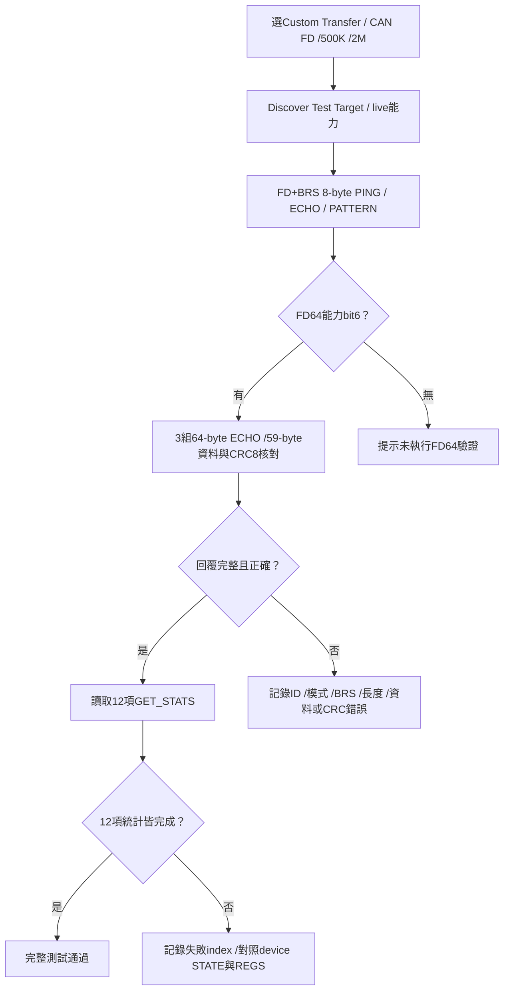
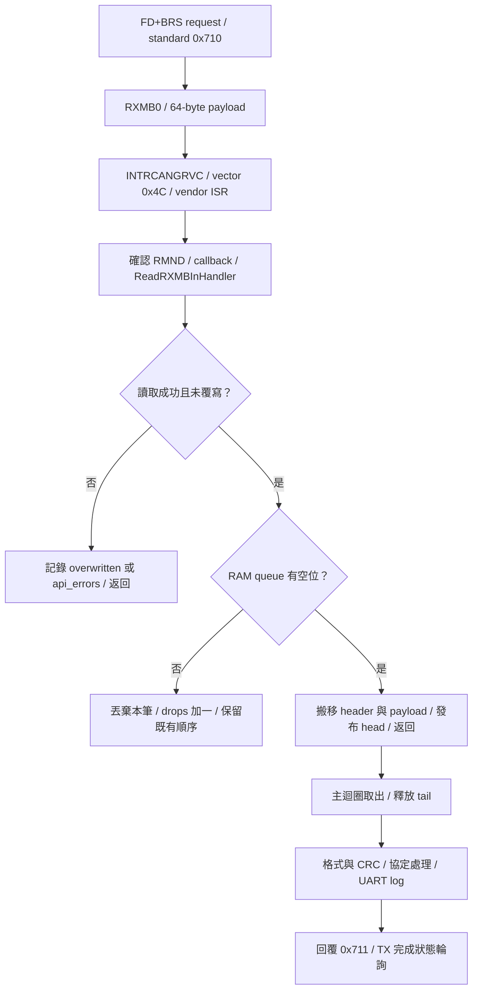
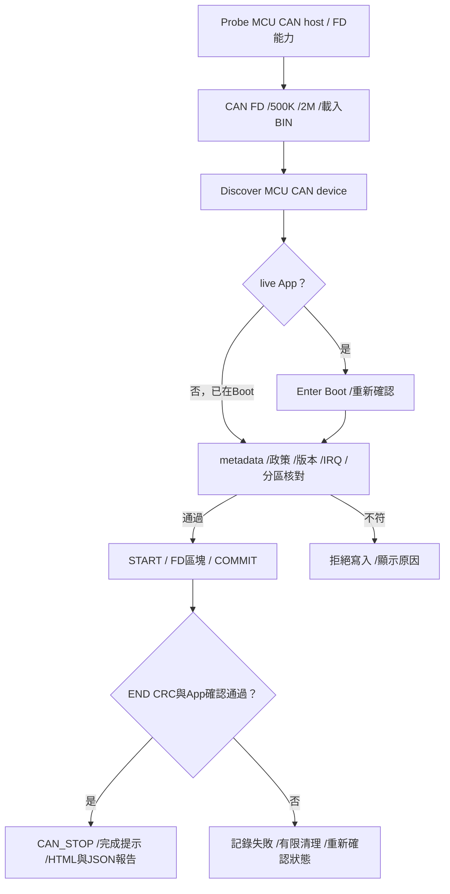
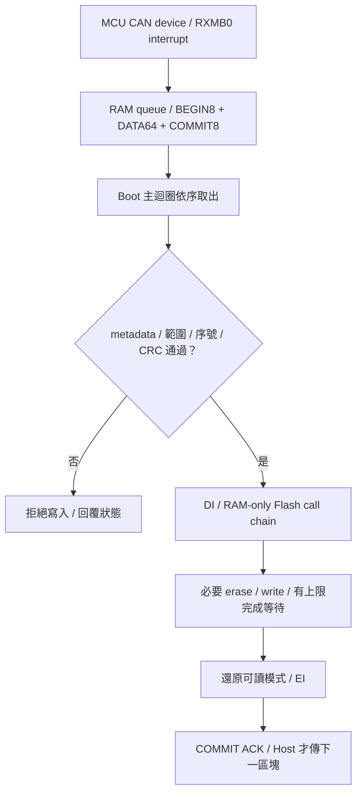

# CAN FD：操作與 Device 工程

<!-- FD_TRANSFER_BEGIN -->
<a id="can-fd-custom-transfer"></a>

## CAN FD Custom Transfer 通訊測試

Custom Transfer 驗證 MCU CAN host 與 MCU CAN device 的收發，不使用更新 BIN，也不擦寫 Flash。
FD 範例使用 `RL78_F24_CAN_FD_Transfer` 獨立整機映像，由燒錄器安裝。
此映像使用自己的 SC 工程與相鄰 FD Boot 工程的 common 後端；它不經 Boot/App 更新流程啟動。

接收使用 RX Message Buffer 0（64-byte 容量）與中斷，資料經 8 筆 RAM queue 交給主迴圈。
Standard 0x710／mask 0x7FF 的規則只儲存到 RXMB0；接收 FIFO 不啟用，TX 完成狀態仍由主迴圈輪詢。
啟動訊息為 `CAN RX backend: RXMB0 interrupt -> RAM queue=8 -> main; payload=64 TX=polling`。
ISR、queue 與主迴圈的分工見[中斷接收路徑](#can-fd-transfer-rx-interrupt)。

### 操作與核對

| 步驟 | 設定／操作 | 核對結果 |
| --- | --- | --- |
| 1 | 燒錄 `DefaultBuild/RL78_F24_CAN_FD_Transfer.hex` | UART115200 顯示 `FD 500K/2M BRS payload=8/64` 與 CAN init OK |
| 2 | Tool Open + Probe Host | Host 支援 CAN FD、standard ID及通用 TX_WAIT_RX；F24 Host App1.7.0可使用 |
| 3 | CAN TAB → Custom Transfer | BIN與metadata不參與此測試；上方保留的OFFLINE檔案不代表live target |
| 4 | CAN FD、Nominal500K、Data2M、RX Filter Metadata/default | standard request0x710／response0x711、mask0x7FF |
| 5 | Discover Test Target | 讀取7頁DEVICE_INFO，顯示live target與capabilities |
| 6 | Transfer Test | PING／ECHO／PATTERN、3組FD64 ECHO及12項統計通過 |
| 7 | Disconnect | 結束CAN session後可選其他設定 |

既有 Classical device 使用 Classical CAN 與其已編譯速率。
FD mode不會讓Classical firmware自動支援FD；測試時匯流排上的節點需適用於所選幀格式與速率。
Bridge Self Test是另一項Classical功能，與 `Transfer Test` 的FD64驗證分開。



### 幀格式與能力

Discovery、PING、ECHO、PATTERN與統計維持8-byte payload，在FD mode使用FDF=1、BRS=1。
Classical命令與格式維持原有行為。
FD64能力由device的DEVICE_INFO page6 bit6（0x0040）宣告；完整範例capabilities為0x007F。
沒有此能力時，Tool不會將僅完成8-byte測試當作64-byte測試通過。

| 64-byte FD payload位置 | Request | Response |
| --- | --- | --- |
| byte0 | A5 | 5A |
| byte1 | 協定major1 | 同request |
| byte2 | 非零sequence | 同request |
| byte3 | ECHO_FD64 command07 | 同request |
| byte4..62 | 59個測試資料bytes | 完整回傳相同資料 |
| byte63 | CRC8-ATM，涵蓋byte0..62 | CRC8-ATM，涵蓋response byte0..62 |
| CAN frame | standard0x710、FDF/BRS、wire DLC15 | standard0x711、FDF/BRS、wire DLC15 |

CRC8-ATM使用poly0x07、init0、無reflection／xorout。
Tool測試遞增、反向與AA/55交錯三種資料；每幀實際payload為64bytes，包含5bytes協定欄位與59bytes測試資料。
Device對相同request重送保留完整回覆；相同sequence卻不同資料、CRC錯誤或無效64-byte格式會計數並丟棄。
Tool對模式／BRS／ID／DLC／sequence／資料／CRC不符回報失敗；等待與重試維持有限上限。
UART trace區分 `wire_dlc=15 bytes=64`，並列出完整資料。
測吞吐量時可關閉device UART trace與Tool detailed trace，正常測試則保留以利對照。

<a id="can-fd-transfer-rx-interrupt"></a>

### 中斷接收路徑

| 執行位置 | 工作 | 對應程式／設定 |
| --- | --- | --- |
| 硬體接收 | standard 0x710 寫入 RXMB0，產生 INTRCANGRVC | `add_rule()`；RMNB=0x0701、RMIEC=0x0001；實體 vector 0x4C |
| Renesas ISR | 擷取來源並確認／清除 RMND，再呼叫 callback | `r_can_glb_rxmb_isr()`；`CAN_CFG_INTRCANGRVC_USE=1` |
| Callback | 呼叫 InHandler，搬移完整 header／payload，最後發布 queue head | `my_can_glb_rxmb_callback()`、`R_CAN_ReadRXMBInHandler()` |
| 主迴圈 | 取出 queue，核對幀格式、協定、CRC，處理 request／reply 與 UART log | `Device_CanRead()`、`CAN_TransferProtocol_Process()` |

ISR 已先處理 RMND，因此 callback 使用 `R_CAN_ReadRXMBInHandler()`。
此 API 負責 RAM window 保存／還原及讀取期間的覆寫檢查；ISR 不解析協定、不輸出 UART，也不等待 TX。
主迴圈只消費 RAM queue，不以 polling 直接讀取 RXMB0。



RAM queue 可保存 8 筆完整訊息；實作用 9 個槽位區分空與滿。
ISR 是唯一 producer，主迴圈是唯一 consumer，完整複製後才交接槽位。
queue 滿時丟棄新到訊息，累計 `drops`；不覆寫尚未處理的資料。
RXMB0 本身仍只有一個硬體訊息位置；讀取期間的硬體覆寫與 RAM queue 滿載分別計數。
此配置屬於獨立 Transfer 映像；更新工程的接收設定見[FD device 工程](https://released.github.io/slide_boot_loader_for_RL78/#can-fd-device-engineering)。

此 Custom Transfer 中斷接收配置已完成一般一問一答實板驗證。
此結果的範圍是通訊測試；Flash 更新、queue 滿載、持續流量與供電中斷分別驗證。

<a id="can-fd-transfer-diagnostics"></a>

### 逾時與 RXMB／TX 診斷

`Host returned TIMEOUT for command 0x21.` 代表 Host 已透過 UART 回覆 CAN 交易逾時。
它與 PC 沒有收到 Host UART 回覆的 `Host Link response timeout after retries.` 分開判讀。
Tool 保留原始錯誤，另顯示 `attempts`、`last_tx_result` 與失敗的 `GET_STATS index`。

| Tool 診斷 | 意義／核對方式 |
| --- | --- |
| `attempts=2` | Host 的 CAN 交易共嘗試兩次，包含第一次發送 |
| `last_tx_result=2 (TX_END)` | 最後一次 CAN TX 完成；不代表 device 軟體已取出或處理 request |
| `TRANSMITTING`／`ABORT_OVER`／`END_WITH_ABORT` | 發送未正常完成或包含 abort；與最後 CAN controller 狀態一起核對 |
| `invalid diagnostic payload` | 回覆長度或保留欄位不符，Tool 不將其解讀為有效 TX 結果 |
| `GET_STATS index=3` | 停在讀取 device 的 TX failure counter；不代表 counter 本身就是故障原因 |

Device 的 `CAN_TRANSFER_RUNTIME_DIAGNOSTICS_ENABLE` 預設跟隨 `CAN_TRANSFER_UART_TRACE_ENABLE`。
啟用時，初始化、每 16 筆接收、TX 異常會輸出 `TRACE CT STATE`、`TRACE CT IRQ` 與兩行 `TRACE CT REGS`。
沒有新接收時，每秒最多一組空閒快照，連續最多三組；有接收後重新計數。
空閒快照也會在正常等待操作時出現，不單獨代表錯誤。

| Device UART 欄位 | 意義 |
| --- | --- |
| `reason` | `INIT`、`RX_CHECKPOINT`、`IDLE_WAIT` 或具體 TX timeout／abort 原因 |
| `tick`／`seq`／`cmd` | device tick、最近收到的協定 sequence／command；不是 PC 時間 |
| `sw_tx` | 軟體狀態：0 idle、1 sending、2 aborting、3 fault；sending 快照可能只是尚未輪詢完成 |
| `rx`／`tx`／`last_driver`／`errors` | 軟體收發計數、最近 HAL 結果及已擷取的 CAN error flags |
| `RMNB` | RXMB 配置；本範例為 0x0701：1 個 RXMB、64-byte 容量 |
| `RMND` | 接收完成旗標；bit0=1 表示 RXMB0 有新訊息，由 vendor ISR 確認／清除 |
| `reads`／`overwritten` | 接收 API 成功次數／讀取期間偵測到的覆寫次數，皆為 16-bit 飽和的軟體觀察計數 |
| `before`／`after` | callback 內 InHandler 呼叫前後的 RMND；ISR 已先確認旗標，因此 `before=0` 正常 |
| `entries` | RXMB callback 次數；來源為零或尚未 ready 時不搬資料，不必與協定 RX 筆數相等 |
| `queued`／`dequeued` | 成功入列／主迴圈取出數；無待處理資料時兩者應相等，計數飽和後不再用差值判讀 |
| `depth`／`peak` | 當下待處理筆數／初始化以來最高筆數，範圍 0..8 |
| `drops`／`api_errors` | RAM queue 滿時丟棄的新訊息數／接收 API 其他錯誤或無效長度數 |
| `RMIEC`／`mask`／`pending` | RXMB 中斷允許位元、快照前 CPU mask、CPU request flag；正常啟動為 RMIEC=1、mask=0 |
| `window` | CAN RAM window 的原始讀值；RXMB0 資料經 page2 讀取，再還原原先視窗 |
| `TMC0`／`TMSTS0`／`last_tmsts` | 當下 TX 控制／狀態，以及 TX polling 在正常清除完成旗標前保留的原始值 |
| `GSTS`／`C0STSL`／`C0ERFLL`／`STB` | Global／channel 狀態、當下 error flags 與 transceiver standby 電位 |

快照在主迴圈暫時遮罩 RXMB 中斷，取得一致的 ISR 軟體計數後，還原原先 mask。
它不清接收旗標、不消費 queue、不 reset，也不自動重試。
硬體仍可在此期間接收，寄存器依序讀取；`before`／`after` 不單獨作為通訊完整性的證明。
ISR／InHandler 使用方式見 [Renesas RS-CANFD Lite 驅動說明](https://www.renesas.com/en/document/apn/rl78f24-rs-canfd-lite-module-software-integration-system)，接收寄存器見[接收緩衝區說明](https://www.renesas.com/en/document/apn/rl78f24-rs-canfd-lite-configuration-reception-and-transmission-rev100)。

遇到逾時時，保留 Tool detailed trace 與 device UART 的最後一筆 RX／TX、`STATE`／`IRQ`／`REGS`。
先對照 request 是否到達、RMND／reads／overwritten 是否改變、TX 是否完成，再決定處理方向。
UART 輸出會增加主迴圈延遲；吞吐量量測時可將兩個 trace 開關設為 `0U` 後重建。

連續測試可在同一連線重複執行 `Transfer Test`，核對每輪的 12 項統計均完成，並由 UART `rx` 觀察累計接收跨過 16、32、64 筆。
同一個 session 可持續接收；不依累計筆數重新初始化 RXMB0。
一般一問一答測試的 `drops`、`overwritten`、`api_errors` 應保持 0，取出後 `depth=0`，`queued=dequeued`。
若 `entries` 不增加，先核對 RMIEC／mask／pending 與實際向量；若 `entries` 增加但 `dequeued` 停住，則對照 queue 與主迴圈狀態。
重新上電時，先確認 device UART 已重新連線並開始記錄，再核對 `INIT`、`CAN init` 與 `STB`；LED 心跳本身不代表 CAN 已就緒。

### 工程與產物

FD Transfer與 `RL78_F24_Boot_loader_CAN_FD` 放在同一父目錄。
在FD Transfer目錄使用Windows PowerShell5.1：

```powershell
powershell.exe -NoProfile -ExecutionPolicy Bypass -File .\build.ps1
```

此入口只clean build FD Transfer，不重建Boot或App，不需要Python。
MTPJ的pre/post hooks引用FD helper；SC重新產生後使用同一入口重新prepare與建置。
正式產物為 `DefaultBuild/RL78_F24_CAN_FD_Transfer.hex`，供燒錄器安裝，不能載入CAN Upgrade。
安裝獨立Transfer會取代板端原有程式；燒錄前核對實際MCU、映像與erase範圍。
CRC／診斷欄位見 [Custom Transfer診斷](https://released.github.io/slide_isp_tool_for_RL78/#transfer-diagnostics)。
一般中斷接收與 Transfer Test 已完成實板驗證；queue 壓力、波形及故障測試另行記錄。
<!-- FD_TRANSFER_END -->

<!-- FD_UPDATE_BEGIN -->
<a id="can-fd-update"></a>

## CAN FD App 更新操作

此設定使用 nominal 500 kbit/s、data 2 Mbit/s、BRS，以及 64-byte FD 資料幀。
Tool 與 MCU CAN host 負責傳輸，MCU CAN device Boot 負責映像驗證與 Flash 寫入。
F24 CAN FD device 的一般 App 寫入、END CRC、APP_READY 與 UART counter 已有實板紀錄。
驗證包含初次 Boot 更新，以及 App → Enter Boot → 更新 → App 確認；
重啟等待後的更新紀錄中，七項 Host 錯誤計數差值均為零。
長時間連續更新、queue 壓力與故障／斷電恢復仍各自保留驗證範圍。

### 準備與設定

| 項目 | 核對內容 |
| --- | --- |
| PC Tool | 使用支援 FD burst 的 FirmwareUpgradeTool |
| MCU CAN host | F24 Bridge App 宣告 CAN FD bit1 與 FD burst bit13；Host Boot 維持原有版本 |
| MCU CAN device | 配對的 CAN FD Boot／App；初裝 Boot 使用燒錄器 |
| Bus | 實際 transceiver、分析儀、供電、共地及終端適用於此 FD 設定 |
| Tool CAN TAB | CAN FD、Nominal 500K、Data 2M；Standard request0x700／response0x701 |
| 更新 BIN | `RL78_F24_Boot_loader_CAN_FD_app_update.bin`，metadata mode2、nominal mask4、data mask2 |
| PC 到 Host Link | 可先用115200；此速度與 CAN nominal／data phase 分開設定 |

若 host 缺少 bit13，Tool 在寫入前拒絕更新。
使用 [Misc Host App 更新](https://released.github.io/slide_isp_tool_for_RL78/#host-bridge-firmware)
載入 `RL78_F24_Bridge_app_bridge_update.bin`，完成後明確 RUN、重新 Probe 核對能力。
此流程更新 Host App，不改 Host Boot。

### 操作順序與結果

| 順序 | 操作 | 核對結果／未符合時 |
| --- | --- | --- |
| 1 | Open + Probe Host | Host 身分及能力有效；失敗時先檢查 COM／Host Link |
| 2 | CAN FD／500K／2M，載入 FD update BIN | Metadata／CRC 有效，介面與 live device 設定一致 |
| 3 | Discover Target | 顯示 live Boot 或 App；無回覆時檢查兩端 FD timing／接線 |
| 4 | live App 時按 Enter Boot | 重新確認 Boot；已在 Boot 時不需 ENTER |
| 5 | Start Device Update | metadata／政策／版本／IRQ／分區通過才進行區塊寫入 |
| 6 | 等待 END 與 App 確認 | 全映像 CRC、APP_READY 與 live 身分比對通過 |
| 7 | 閱讀完成提示及 Firmware update report | CAN_STOP ACK 後清除 target session，保留 Host COM |

接收使用 RXMB0 中斷與 8 筆 RAM queue；Boot／App 向量與 Flash 交接詳見
[FD device 接收與中斷](https://released.github.io/slide_boot_loader_for_RL78/#can-fd-device-rx)。
實板核對時保留 Tool Log、Firmware update report 與 device UART Log，分別確認：

| 階段 | 可觀察結果 |
| --- | --- |
| Boot 安裝／Discover | 使用 programmer 安裝 Boot HEX；Tool 顯示 live Boot、FD 模式與相符的 MCU／分區 |
| App 更新 | 載入 FD App update BIN；metadata／CRC／路由核對通過後才開始更新 |
| END 與 App 啟動 | Tool 確認 APP_READY 與 live 版本／build／size；UART 顯示 `CAN update: completed` |
| App 接收路徑 | UART 顯示 `CAN RX: RXMB0 interrupt -> RAM queue=8 -> main; vector=0x4C`，並持續輸出 V1／V2 counter |
| 再次更新 | 再次 Discover App → Enter Boot → 更新；若 ENTER 已逾時回 App，重新 Discover／Enter Boot |

有效 App 的 ENTER session 在 START 前使用30秒 inactivity。
若已返回 App，重新 Discover → Enter Boot，再開始更新；開始寫入後逾時不會直接跳入未完成映像。
START 本身不擦除 Flash，區塊 COMMIT 驗證通過後才由 Flash driver 寫入。


報告及成功／失敗欄位沿用 [更新確認與驗證紀錄](https://released.github.io/slide_isp_tool_for_RL78/#update-confirmation)。
END 後的等待與查詢時序見 [重啟等待與 App 確認](https://released.github.io/slide_isp_tool_for_RL78/#app-restart-confirmation)；
完成提示與報告同時保留映像驗證結果及 Host 計數警告。
Metadata 的逐欄內容見 [共用欄位指南](https://released.github.io/slide_isp_tool_for_RL78/#tool-ui-fields)，
不以離線 BIN 資訊代替 live device 身分。

### 三幀區塊與 Host Link

每個區塊最多64個有效映像 bytes。
控制與 ACK 也使用 FD+BRS；控制 payload 保留各命令原有長度。
下列 LE 值皆為 little-endian，offset 以 App BIN 開頭為0。

| CAN ID／payload | Byte位置 | 意義 |
| --- | --- | --- |
| 0x700 BEGIN，8 bytes | 0 | 0x0B |
| 同上 | 1..3 | 區塊 offset，LE24、64-byte對齊 |
| 同上 | 4..7 | 實際有效區塊資料的 CRC32 |
| 0x720 DATA，64 bytes、wire DLC15 | 0..N-1 | N=min(64,image_size-offset) 個映像 bytes |
| 同上 | N..63 | 尾塊不足64時固定補FF；Boot逐byte檢查，不計入區塊 CRC |
| 0x700 COMMIT，8 bytes | 0／1..3／4..7 | 0x0C／相同offset／相同CRC |
| 0x701 ACK，8 bytes | 0／1／2..3／4..7 | 0x0C／status／LE16區塊序號／LE32下個絕對寫入address |

完整區塊使用 BEGIN8 + DATA64 + COMMIT8，共3幀。
Host Link command22 的 version2 將它們放入101-byte payload，仍低於128-byte上限。
Header12 bytes之後，每筆為 LE16 standard ID、wire DLC、decoded-length data；
version2 的所有幀及預期回覆均為 FD+BRS，header byte9固定0x0C。
此擴充僅接受 DLC0..8 或15（64bytes）；Classical version1／bit12保持原有格式。
Host 只解碼與傳輸幀，不解讀 BEGIN、Flash address 或 device metadata。

同一區塊可因明確逾時／CRC／sequence結果有限重送。
Boot接受相同資料的重複幀，拒絕衝突幀，最近已提交區塊的重送不會再次寫入。
線路中斷後不自動續寫；重新連線並確認 device 狀態後再操作。
### 更新流程總覽


<!-- FD_UPDATE_END -->

<!-- FD_DEVICE_BEGIN -->
<a id="can-fd-device-engineering"></a>

## MCU CAN FD device 工程設定

F24 device 使用獨立 `RL78_F24_Boot_loader_CAN_FD` 與
`RL78_F24_Boot_loader_CAN_FD_app` 工程，放在同一父目錄。
App 引用相鄰 FD Boot 的 common／metadata 來源。
App 發行與 IRQ 編輯沿用 [C header 工作流程](https://released.github.io/slide_boot_loader_for_RL78/#device-metadata-vector-workshop)。

### 設定來源

| 可編輯來源 | 作用／此範例值 |
| --- | --- |
| App `app_image_config.h` | 版本、build、target、role、允許更新介面、版本政策 |
| App `app_irq_handlers.h` | App-local IRQ mapping；無 vect ISR |
| Boot `image_metadata_config.h` | Flash／metadata格式／IRQ ABI／最低Boot相容契約 |
| Boot `can_boot_config.h` | mode2、nominal mask4、data mask2及ID |
| Boot `common/f24_device_config.h` | 實際40MHz CAN clock timing、FD模式、64-byte RXMB及中斷來源 |
| Boot `boot_app_handoff.h` | owner Boot=AA／App=55、no-init RAM |
| `image_metadata_profile.c` | 由獨立metadata parser比對的工程契約 |
| `tools/device_common.ps1` | 讀取上述C headers、產生metadata |

mode mask 的 bit1 表示 CAN FD；nominal mask 的 bit2 表示500K；data mask 的 bit1表示2M。
這些值描述已編譯的設定，不會重新設定周邊。
變更速率時，Boot／App 的實際 timing、metadata及Tool選項需一起對應。

| Timing輸入 | Nominal | Data |
| --- | --- | --- |
| fCAN | 40MHz | 40MHz |
| BRP register | 3 | 1 |
| 實際divider | 4 | 2 |
| TSEG1／TSEG2／SJW（時間單位數） | 15／4／1 | 7／2／1 |
| 計算 | 40M/(4×(1+15+4))=500K | 40M/(2×(1+7+2))=2M |
| Sample point | 80% | 80% |

preinclude 在SC header之後覆寫CLOE=0、FDOE=1與RXMB RMPLS=7（64bytes）。
SC重新產生後仍需執行工程prepare及clean build，核對實際linked產物。
硬體來源見 [Renesas F24 Target Board](https://www.renesas.com/en/design-resources/boards-kits/rtk7f124fpc01000bj)；
4MHz resonator與周邊接線依實際板本確認。

<a id="can-fd-device-rx"></a>

### 接收與中斷

Boot 與 App 各自連結 `common/device_can.c`，使用精簡 RXMB0 ISR 與 8 筆 RAM queue。
主迴圈負責命令、metadata、CRC 及 Flash 流程；ISR 只核對幀的型態／長度並搬移資料，不解析更新命令、不輸出 UART，也不等待 TX。
主迴圈不直接輪詢 RXMB0；TX 完成狀態仍使用有上限的輪詢。

| 項目 | 設定與來源 |
| --- | --- |
| RXMB0 | `CAN_CFG_NRXMB=1`、`CAN_CFG_RMPLS=7`；RMNB=0x0701，保存完整 64-byte payload |
| 接收規則 | Boot 接收 standard 0x700 與 0x720；App 接收 0x700；exact mask 0x7FF，只存 RXMB0 |
| 硬體中斷 | RMIEC bit0=1；初始化完成後 RCANGRVCMK=0 |
| Driver ISR 設定 | `CAN_CFG_INTRCANGRVC_USE=0` 只停用 driver 自帶的 vect ISR；硬體 RXMB 中斷由 `Device_CanRxIsr` 處理 |
| 接收 FIFO | RF0／RF1 關閉，不與 RXMB0 重複存放 |
| 向量來源 | App `iodefine.h` 的 `INTRCANGRVC=0x004C`，對應此 MCU 的硬體手冊中斷表 |
| Boot owner=AA | Boot 的實體 vector 0x4C → 完整 dispatcher → Boot `Device_CanRxIsr` |
| App owner=55 | 同一實體 vector → App table 的 0x2098 槽位 → App `Device_CanRxIsr` |
| App 編輯來源 | `app_irq_handlers.h` 的 `X(0x4C, Device_CanRxIsr)`；函式使用 global、無 `vect=` 的 interrupt pragma，以 RETI 返回 |

槽位換算、Boot／App ISR 名稱及一般 IRQ 轉送規則見
[中斷所有權與向量轉送](https://released.github.io/slide_boot_loader_for_RL78/#device-irq-ownership)。
建置會檢查完整向量、實際 CAN ISR 槽位、RETI 及實體 vector 所有權。

queue 使用 9 個儲存槽提供 8 筆容量；producer 發布 head、consumer 釋放 tail 都在完成複製後進行。
queue 滿時丟棄新到訊息，保留原有順序。
ISR 確認 RMND 後讀取 RXMB0，保存／還原 CAN RAM window；讀取期間若再次收到訊息，該次副本不入列。

| 診斷 | 意義與取得方式 |
| --- | --- |
| `Device_CanRxFaults()` bit0 | queue 滿載或 CAN 尚未 ready 時的丟棄 |
| bit1 | 讀取 RXMB0 期間發生覆寫 |
| bit2 | 不符合 standard data／FD+BRS／支援長度的幀 |
| `Device_CanRxDrops()` | 丟棄觀察計數，累計到 255 後飽和；不是線上所有遺失幀的精確數量 |
| 觀察位置 | App 在 UART counter 旁顯示非零 faults／drops；Boot 可由 debugger 查看 `g_rx_faults`／`g_device_rx_drops`，位址由當次 map 查詢 |
| 重設範圍 | 上述值只在 CAN 初始化時歸零；正常一問一答應保持 0 |

### 更新區塊與 Flash 交接

一個區塊的 BEGIN8、DATA64、COMMIT8 可先入 queue，再由 Boot 主迴圈依序處理。
metadata、分區、版本政策、重送序號與區塊 CRC 檢查完成後，才允許 Flash 寫入。
Boot 的回覆由 HAL 固定為 standard response ID、FD+BRS、8-byte payload；不從收到的幀複製回覆路由或長度。



Flash 忙碌期間，RFD 呼叫鏈及必要資料位於 RAM，全域中斷關閉；恢復可讀模式後才重新開啟中斷。
8 筆 RAM queue 不代表 DI 期間硬體可額外保存 8 幀；RXMB0 仍只有一筆硬體容量。
Host 在 COMMIT ACK 前等待，不連續送下一個區塊；逾時與斷線結果保持有限重送與明確失敗，不以自動重置掩蓋。


### Flash與建置

`RL78_F24_Boot_loader_CAN_FD`、`RL78_F24_Boot_loader_CAN_FD_app` 與 `RL78_F24_CAN_FD_Transfer`
保持同層及既有名稱；App／Transfer 都需要 Boot checkout 的共用來源與 PowerShell helpers。
詳細相依與生成路徑檢查見 [工程發佈說明](https://github.com/released/simple_renesas_isp_tool/blob/main/docs/GITHUB_PUBLISH_zh-TW.md#fd-publication-layout)。
SC 重新生成後使用同一建置入口；`-CheckOnly` 檢查相對路徑及生成檔狀態。

| 絕對address | 用途 |
| --- | --- |
| 0x0000..0x1FFF | 8KiB Boot與實體vectors |
| 0x2000..0x20FF | 完整64-slot App跳轉表 |
| 0x2100..0x217F |128-byte metadata core |
| 0x2180..0x21FF |128-byte reservedFF |
| 0x2200起 | App startup／code |
| App start + image_size -4 | 全映像 CRC32 tail |
| 0x3FC00..0x3FFFF | 保護區 |

在 FD Boot 目錄執行：

```powershell
# Clean rebuild only the FD Boot/App pair.
powershell.exe -NoProfile -ExecutionPolicy Bypass -File .\build.ps1 -Kind all
# App-only release changes.
powershell.exe -NoProfile -ExecutionPolicy Bypass -File .\build.ps1 -Kind app
# Artifact, metadata, IRQ, ROM/RAM and CRC guards.
powershell.exe -NoProfile -ExecutionPolicy Bypass -File .\test.ps1
```

MCU建置使用CS+ CC-RL、Windows PowerShell5.1／.NET，不需Python。
封裝維持至少512-byte Boot餘裕、完整IRQ表、RAM-only RFD與分區界線；
App-only建置不改Boot；操作見 [CAN FD更新](https://released.github.io/slide_isp_tool_for_RL78/#can-fd-update)。

| 產物 | 使用方式 |
| --- | --- |
| Boot `DefaultBuild/boot0000_1FFF.hex` | 燒錄器安裝 FD Boot |
| App `DefaultBuild/flash_app_variable_CRC.hex` | 燒錄器安裝含metadata／CRC的App |
| App `boot_app.hex` | 合併Boot/App初裝 |
| App `DefaultBuild/RL78_F24_Boot_loader_CAN_FD_app_update.bin` | Tool CAN FD更新 |
| App `DefaultBuild/app_build_report.html` | 實際BIN metadata／CRC／hash／IRQ報告 |

<!-- FD_DEVICE_END -->
