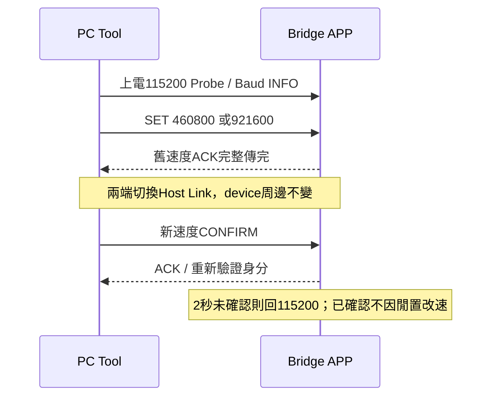
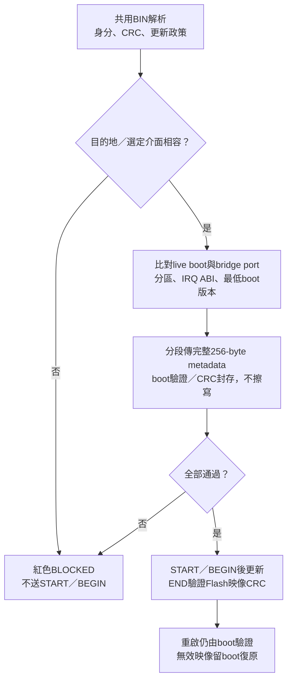

# Common image policy and pre-erase validation

Current contract: tool0082, CAN image format6/protocol5, BUR1 contract3.
Old format5/core96 and BUR1contract2 are rejected, not migrated implicitly.
Base device-CAN and bridge-UART manifests retain separate destination contracts;
the shared32-byte UPD1 policy uses identical offsets and semantics in both.

## Wire policy (all offsets relative to metadata, little-endian)

| Offset | Size | Meaning |
| --- | --- | --- |
| 60h | 4 | UPD1 magic31445055h |
| 64h | 1 | policy version1 CAN/HOST; version2 future DEVICE UART |
| 65h | 1 | policy size32 |
| 66h | 1 | image role:1 DEVICE_APP,2 HOST_BRIDGE_APP |
| 67h | 1 | allowed update transports:bit0 CAN,bit1 I2C,bit2 UART |
| 68h | 4 | fixed IRQ ABI:F1V1=31563146h,F2V1=31563246h |
| 6Ch | 4 | minimum compatible boot version00MMmmpp |
| 70h | 4 | version1 zero; version2 compile-time DEVICE UART baud, nonzero/nonFFFFFFFF |
| 74h..7Fh | 12 | reserved zero; unknown fields rejected |
| 80h..FFh | 128 | reserved erasedFF |

The complete metadata region stays256 at app offset100h; defined core128.
Code remains at app offset200h. Policy is image update permission, not the
app's runtime peripheral inventory, authentication, a pin route or a COM ID.
CAN fields and live descriptors still establish transport parameters/layout.
Current F13 producer declares DEVICE_APP/CAN/F1V1/minboot1.5.0. F24 producer
declares HOST_BRIDGE_APP/UART/F2V1/minboot1.2.0. BUR1 duplicates minimum boot
at50h and6Ch and requires equality. BUI1 remains96 bytes; descriptor3Ch now
reports IRQ ABI rather than reserved zero. Its contract3 fixes host/UART role.
F13 INFO18h packs version/size/role/live boot transport mask; INFO19h IRQ ABI.

## CAN protocol5 staging

- METADATA_RESET0A DLC1 resets stale RAM staging before a new upload, no flash
  access. ACK0A/status/0LE16/256LE32. An active update rejects reset; PC performs
  one bounded ABORT and retries reset once before sending any new metadata.
- METADATA08 DLC8:[08,offsetLE16,00,data4]. Exactly64 ordered chunks assemble
  region256 in RAM, without erase/write. ACK08/status/nextOffsetLE16/totalLE32.
- Identical earlier chunks replay the current next offset; conflicting chunks,
  gaps, unaligned/out-of-range offsets or active-update staging are rejected.
  The PC sends one chunk at a time, so a retried current chunk keeps its ACK.
- SEAL09 DLC8:[09,00,00,00,regionCRC32LE]. Complete RAM metadata must pass
  full identity/layout/policy/IRQ/minboot/reserved checks and region CRC32.
  ACK09/status/256LE16/256LE32. Seal alone cannot erase.
- START02 keeps its8-byte layout, now version5. It requires sealed metadata
  and matching target/exact image size/FSL-ready. A repeated matching START
  does not reset active block offset. Flash is first touched by a fully validated COMMIT.
- COMMIT validates a complete64-byte RAM block/CRC and all overlapping metadata
  against the sealed region before writing any word. See CAN_BLOCK_TRANSFER_V5_zh-TW.md.
  END still validates Flash manifest/declared size and full image CRC32.
  Boot checks manifest and CRC before every app launch. No new F13 persistent
  commit marker is claimed; F24 retains its existing commit-last magic.
- Reset, completed/failed/aborted session clears staging on re-entry. No
  continuation across disconnect/reset: restart complete staging at offset0.
  Existing valid-app ENTER30s inactivity and invalid-app recovery semantics
  remain unchanged. A staging failure/cancel invokes best-effort ABORT/CAN_STOP.

Host Link remains128 payload/142 frame; bridges transport generic frames only.
No target flash semantics are added to F24 CAN/I2C transport. F24 self-update
continues four64-byte STAGE pages before BEGIN, now with UPD1 policy checking.
F13 ROM guard stays8KiB plus>=512 spare; compiler symbol-delete removes unused
C driver functions while assembly vectors remain explicit. CRC32 is table-free
and tested against PC CRC; physical maximum-image CRC latency remains MANUAL.
Compiler option reference: [Renesas CC-RL link optimization](https://tool-support.renesas.com/autoupdate/support/onlinehelp/csp/V4.01.00/CS%2B.chm/Compiler-CCRL.chm/Output/bd_option_link29.html).

<!-- COMMON_IMAGE_POLICY_BEGIN -->
## 共用 Metadata 與跨介面防呆

Metadata固定256 bytes：前128 bytes為已定義內容（含32-byte UPD1政策），
後128 bytes必須為0xFF；app code仍從offset0x200開始。舊core96格式不相容。

| UI資訊 | 意義 |
| --- | --- |
| Update Policy | DEVICE APP或HOST APP，以及允許CAN／I2C／UART更新的清單 |
| Boot / IRQ ABI | 映像要求的最低boot版本，以及固定向量介面識別 |
| MCU、版本、分區、CRC | 仍來自載入BIN；不以目前TAB或在線device補造 |

允許更新介面不是app執行時使用的周邊。CAN-only BIN切到I2C仍顯示原本
MCU／版本／CRC32與政策，卡片及政策欄變紅並封鎖更新；不改解讀為G16 raw BIN。
Misc的目的地是HOST BRIDGE APP，不能拿DEVICE APP更新host。
PC到bridge的Host Link UART不算device更新介面；未實作UART device adapter。

上方Baud只管PC到bridge：上電115200，驗證APP支援後可協商460800／921600。
CAN／I2C／未來第二組UART不跟著換速。UART device映像的UPD1 policy version2
在metadata112..115宣告編譯時固定的device_uart_baud，Tool顯示UART @固定值，
不能由Host Link選單覆寫。boot/app須共用target編譯設定；version1 CAN／HOST
BIN保持原值與相容性。BUR1的uart_baud另指bridge自身BOOT固定更新速度。
目前僅準備UART policy解析、build helper與防呆；未提供UART device燒錄流程。

正常Close會盡力回115200；異常斷線後只對選定COM有限探測三組速度。
Misc ENTER改以BOOT描述器的固定baud重連，現行115200，不沿用APP高速。
F24分頻計算值115200→114942、460800→454545、921600→909090；Tool log
會列名義／計算值。高速度的FTDI、時鐘誤差及負載可靠性仍待實板驗證。

更新路徑必須同時受BIN政策、live boot能力、bridge選定port支援；並通過
MCU／target／分區／protocol／IRQ ABI／最低boot版本／CRC檢查。
UI與worker皆檢查，device boot在首次擦寫前再驗證完整metadata，不能只靠按鈕。
切換介面不能沿用另一介面的探索結果；port／address／rate改動後必須重新確認。

F13使用CAN protocol5、image format6，DEVICE_APP／CAN／F1V1。
F24使用BUR1 contract3，HOST_APP／UART／F2V1。
平台首次安裝須有matching Boot/App；不同更新協定或IRQ契約不能任意混用。
已有matching Boot時，可用Misc更新相容的Host App；Misc不更新boot本身。
精確配套版本與映像雜湊以交付說明、live INFO及BIN metadata為準。
已固定的完整一般向量轉送架構不變，未來相容app新增中斷仍只更新app。

G16新版I2C boot/app依使用者要求延後開發；舊範例保留參考及read-only探索，
不提供erase／write／app jump，也不因tool新增metadata就視為可安全更新。

正常更新／END CRC成功，不代表reset後App已執行，也不代表完整故障驗收。
自動測試包含錯映像、介面／目的地不符、
metadata重送／缺段／CRC錯、重設與768個模擬中斷寫入點。這不是實板斷電驗證；
實體CAN／FSL故障、UART斷線、
最大映像CRC耗時、debug／IRQ、斷電復原及1366×768／DPI視覺驗證仍需板測／目視。
CRC提供完整性，不是簽章、身分認證或防降版。

<!-- COMMON_IMAGE_POLICY_END -->
