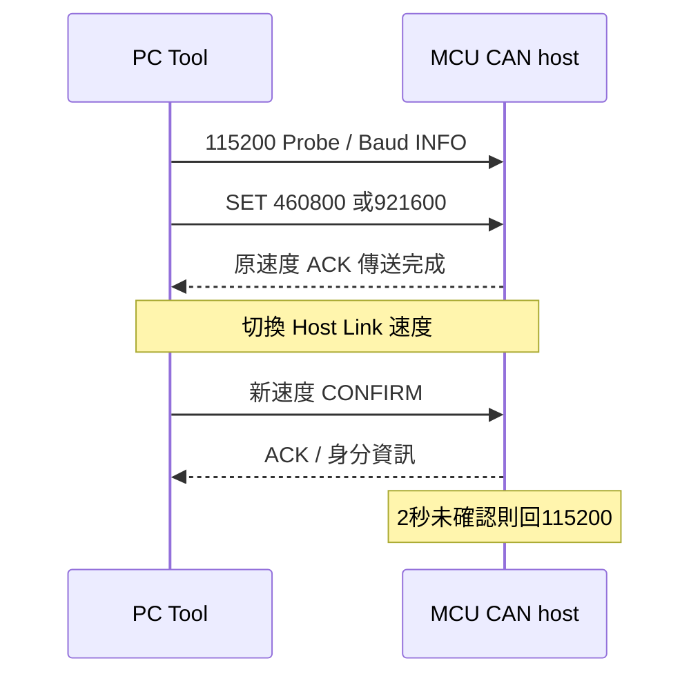
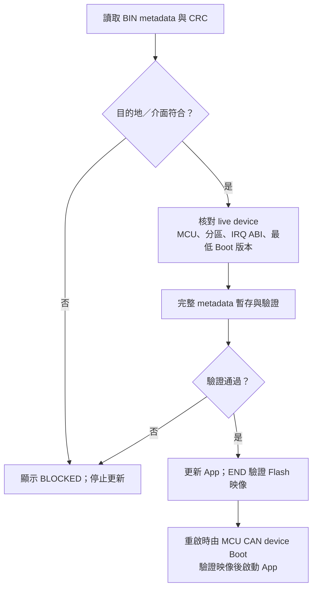

# Common image policy and pre-erase validation

The defined device-CAN and bridge-UART manifests have distinct destinations.
Their shared32-byte UPD1 policy uses the same offsets and field meanings.

## Wire policy (all offsets relative to metadata, little-endian)

| Offset | Size | Meaning |
| --- | --- | --- |
| 60h | 4 | UPD1 magic31445055h |
| 64h | 1 | policy version1 CAN/HOST; version2 future DEVICE UART |
| 65h | 1 | policy size32 |
| 66h | 1 | image role:1 DEVICE_APP,2 HOST_BRIDGE_APP |
| 67h | 1 | allowed update transports:bit0 CAN,bit1 I2C,bit2 UART |
| 68h | 4 | fixed IRQ ABI:F1V1=31563146h,F2V1=31563246h |
| 6Ch | 4 | minimum compatible boot version00MMmmpp |
| 70h | 4 | version1 zero; version2 compile-time DEVICE UART baud, nonzero/nonFFFFFFFF |
| 74h..7Fh | 12 | reserved zero; unknown fields rejected |
| 80h..FFh | 128 | reserved erasedFF |

The complete metadata region stays256 at app offset100h; defined core128.
Code remains at app offset200h. Policy is image update permission, not the
app's runtime peripheral inventory, authentication, a pin route or a COM ID.
CAN fields and live descriptors still establish transport parameters/layout.
Current F13 producer declares DEVICE_APP/CAN/F1V1/minboot1.5.0. F24 producer
declares HOST_BRIDGE_APP/UART/F2V1/minboot1.2.0. BUR1 duplicates minimum boot
at50h and6Ch and requires equality. BUI1 remains96 bytes; descriptor3Ch now
reports IRQ ABI rather than reserved zero. Its contract3 fixes host/UART role.
F13 INFO18h packs version/size/role/live boot transport mask; INFO19h IRQ ABI.

## CAN protocol5 staging

- METADATA_RESET0A DLC1 resets stale RAM staging before a new upload, no flash
  access. ACK0A/status/0LE16/256LE32. An active update rejects reset; PC performs
  one bounded ABORT and retries reset once before sending any new metadata.
- METADATA08 DLC8:[08,offsetLE16,00,data4]. Exactly64 ordered chunks assemble
  region256 in RAM, without erase/write. ACK08/status/nextOffsetLE16/totalLE32.
- Identical earlier chunks replay the current next offset; conflicting chunks,
  gaps, unaligned/out-of-range offsets or active-update staging are rejected.
  The PC sends one chunk at a time, so a retried current chunk keeps its ACK.
- SEAL09 DLC8:[09,00,00,00,regionCRC32LE]. Complete RAM metadata must pass
  full identity/layout/policy/IRQ/minboot/reserved checks and region CRC32.
  ACK09/status/256LE16/256LE32. Seal alone cannot erase.
- START02 keeps its8-byte layout, now version5. It requires sealed metadata
  and matching target/exact image size/FSL-ready. A repeated matching START
  does not reset active block offset. Flash is first touched by a fully validated COMMIT.
- COMMIT validates a complete64-byte RAM block/CRC and all overlapping metadata
  against the sealed region before writing any word. See CAN_BLOCK_TRANSFER_V5_zh-TW.md.
  END still validates Flash manifest/declared size and full image CRC32.
  Boot checks manifest and CRC before every app launch. No new F13 persistent
  commit marker is claimed; F24 retains its existing commit-last magic.
- Reset, completed/failed/aborted session clears staging on re-entry. No
  continuation across disconnect/reset: restart complete staging at offset0.
  Existing valid-app ENTER30s inactivity and invalid-app recovery semantics
  remain unchanged. A staging failure/cancel invokes best-effort ABORT/CAN_STOP.

Host Link remains128 payload/142 frame; bridges transport generic frames only.
No target flash semantics are added to F24 CAN/I2C transport. F24 self-update
continues four64-byte STAGE pages before BEGIN, now with UPD1 policy checking.
F13 ROM guard stays8KiB plus>=512 spare; compiler symbol-delete removes unused
C driver functions while assembly vectors remain explicit. CRC32 is table-free
and tested against PC CRC; physical maximum-image CRC latency remains MANUAL.
Compiler option reference: [Renesas CC-RL link optimization](https://tool-support.renesas.com/autoupdate/support/onlinehelp/csp/V4.01.00/CS%2B.chm/Compiler-CCRL.chm/Output/bd_option_link29.html).

<!-- COMMON_IMAGE_POLICY_BEGIN -->

## 更新政策與通訊速度

BIN metadata 提供更新目的地、允許介面、MCU 身分與 Boot 契約。
Tool 將這些欄位與目前選定的 port、live device 資訊一併核對。

| UI 資訊 | 來源與作用 |
| --- | --- |
| Update Policy | App 目的地及允許 CAN／I2C／UART 更新的清單 |
| Boot / IRQ ABI | 映像所需的最低 Boot 版本、固定向量介面 |
| MCU、版本、分區、CRC | 載入 BIN 的離線資訊 |
| LIVE INFO | 目前連線裝置回報的資訊 |

選定介面與映像政策不同時，Tool 保留 BIN 原有資訊並顯示 BLOCKED。
UI、worker 與 device Boot 分別執行對應驗證；改變 port／address／rate 後會重新探索。

Metadata 位址與欄位格式見 [Device 映像對照](https://released.github.io/slide_boot_loader_for_RL78/#flash-metadata-can-reference)。

### 三條通訊路徑的速度

| 路徑 | 設定來源 | 目前設定 |
| --- | --- | --- |
| PC ↔ MCU CAN host 的 Host Link | Tool Host Baud 與 host live 能力 | 上電115200，可協商460800／921600 |
| MCU CAN host ↔ MCU CAN device | device Boot／App 編譯設定與 metadata | Classical CAN 500K |
| PC ↔ host Boot 的自身 App 更新 | host Boot 描述器 | Misc／UART115200 |

Host Link 換速完成後會重新確認 host 身分。
尚未確認時，host 在2秒內回到115200；已確認後維持該次連線速度。

### 更新前的核對路徑

CRC提供完整性檢查。映像驗證與實板功能測試分別記錄。
Device UART metadata 的 `device_uart_baud` 由 Boot／App 編譯設定決定，獨立於 Host Baud。
<!-- COMMON_IMAGE_POLICY_END -->
