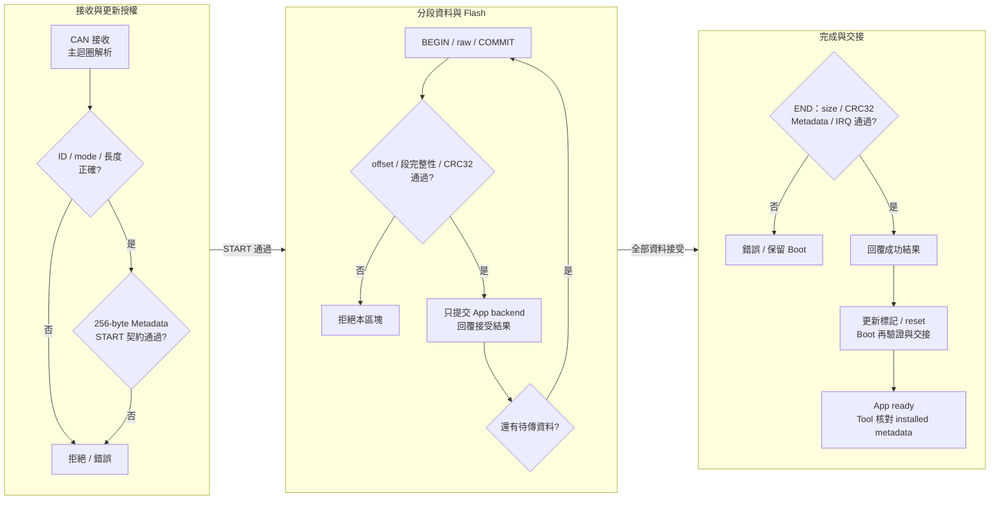
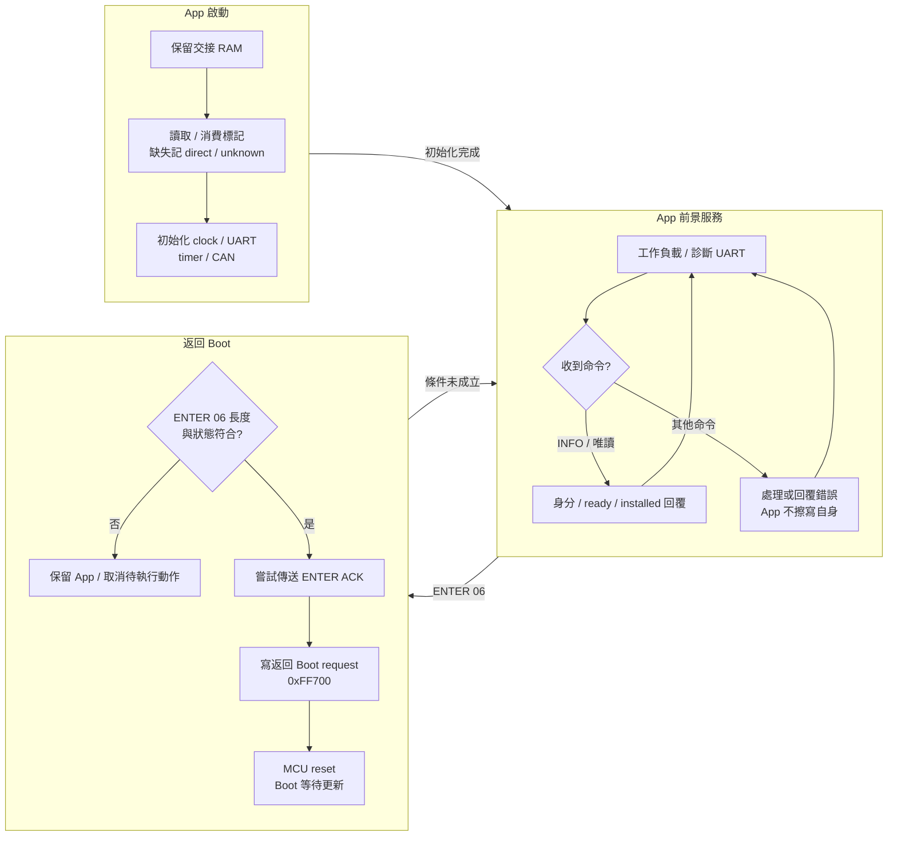
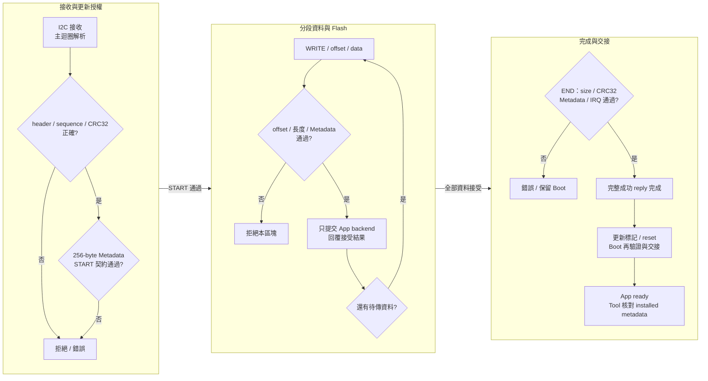
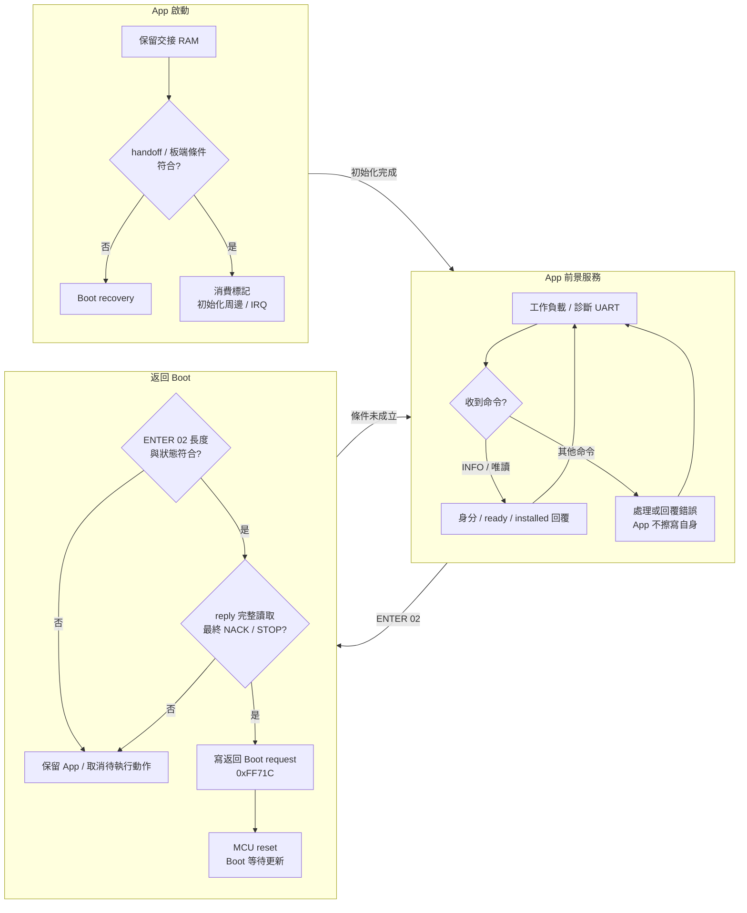
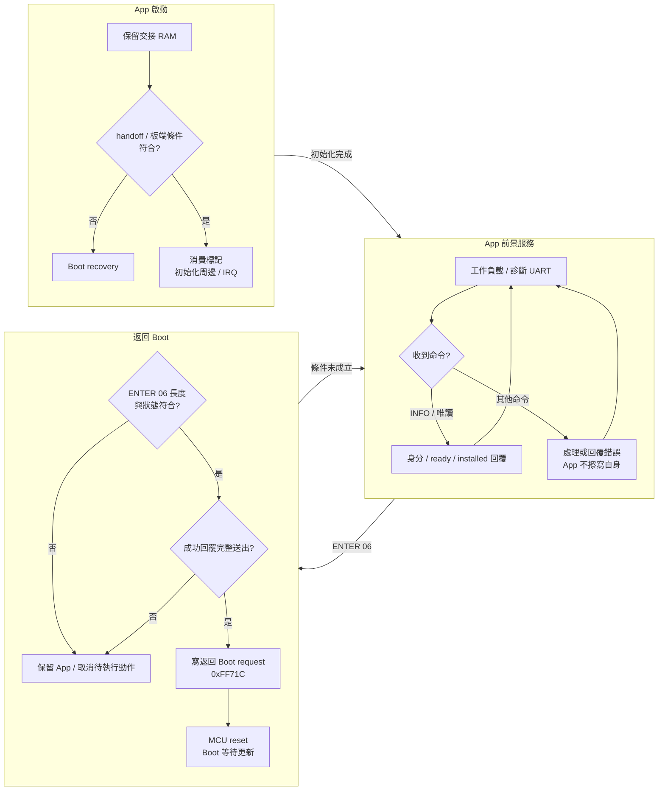
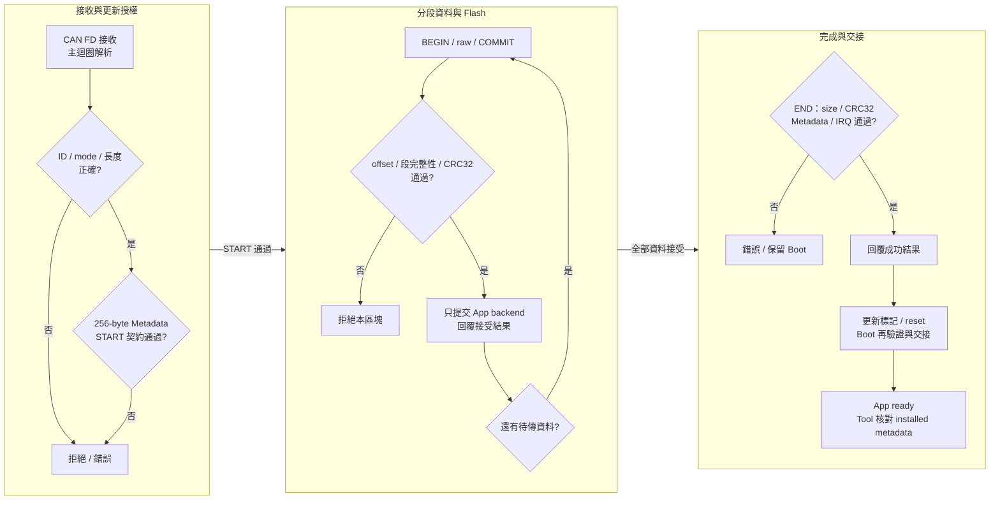
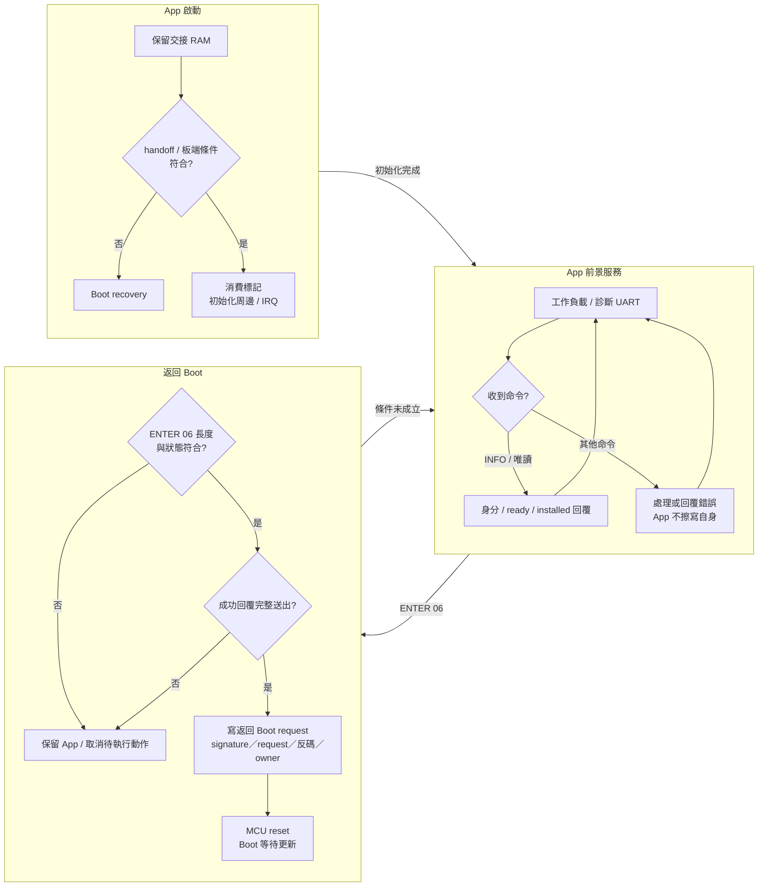

# 依型號與周邊的 App 更新操作與機制

各組合各自包含接線與配對映像、Tool 操作、Boot 接收／驗證流程、App 命令與 RAM 交接，以及完成與錯誤判讀。
依型號與周邊選擇章節，操作不需要先讀完其他 MCU。
工程行為與硬體驗證範圍分開描述；正常更新成功不代表冷啟動、斷電恢復或所有故障條件均通過。

| 型號與周邊 | 章節 |
| --- | --- |
| F13 / CAN | [操作、Boot 與 App](#upgrade-f13-can) |
| F13 / I2C | [操作、Boot 與 App](#upgrade-f13-i2c) |
| F24 / CAN | [操作、Boot 與 App](#upgrade-f24-can) |
| F24 / CAN FD | [操作、Boot 與 App](#upgrade-f24-can-fd) |
| F24 / I2C | [操作、Boot 與 App](#upgrade-f24-i2c) |
| RH850 / CAN | [操作、Boot 與 App](#upgrade-rh850-can) |
| RH850 / CAN FD | [操作、Boot 與 App](#upgrade-rh850-can-fd) |

<!-- DEVICE_UPGRADE_F13_CAN_BEGIN -->

### F13 × CAN：App 更新與兩端機制

#### 配對工程、接線與映像

| 項目 | 此組合的設定 |
| --- | --- |
| Device／target | R5F10BMG／`0xF13B` |
| Boot 工程 | `RL78_F13_Boot_loader_CAN` |
| App 工程 | `RL78_F13_Boot_loader_CAN_app` |
| 初次安裝 | Boot 工程的 `DefaultBuild/boot0000_1FFF.hex`，由 programmer 安裝；確認 MCU 與擦除範圍 |
| Tool 更新檔 | App 工程的 `DefaultBuild/RL78_F13_Boot_loader_CAN_app_update.bin`；HEX、boot_app 合併檔與 Transfer HEX 不放入 App 更新欄 |
| Flash 配置 | App 起點 `0x02000`，容量 `119 KiB`；8 KiB Boot、App 最大 119 KiB；最後 1 KiB 為保留區，App 容量包含 vectors、Metadata、padding 與 CRC。 |
| 資料介面 | Classical 500K；standard control 0x700／reply 0x701，raw 0x720..0x727（各 8 bytes） |
| RAM 交接 | `0xFF710..0xFF71F`；返回 Boot request：`0xFF700` |

- Host 與 device 的 CANH 對 CANH、CANL 對 CANL；共地，bus 兩端依實際接線配置終端電阻。 F13 target board 為 P10 TX／P11 RX，P12 STB LOW，CAN transceiver 的 EVDD 為 5V；MCU 腳位經 transceiver 接 bus。
- 獨立診斷 UART TX P15／RX P16，115200、8-N-1；terminal 與 binary data link 分開。
- PC 連接 F24 bridge 的 Host Link UART0，預設 115200；F24 Host App 需宣告 Classical burst bit12。
- 編輯配對工程的 image／IRQ／transport 設定後重新建置 App，Tool 必須重新 Load Update Image 才會取代已快取的舊 bytes。Bridge 只轉送資料，Device Boot 負責 target、Flash 與映像驗證。

#### Simple Renesas ISP Tool 操作步驟

1. 安裝本組合的 Boot HEX；一般換 App 時保留配對 Boot。若需先檢查接線，使用獨立 Transfer 工程並選 Custom Transfer；Transfer 不等於本組合的 Boot／App。
2. 開啟 Tool，選實接 bridge COM，按 **Open + Probe Host**。核對 Host LIVE 身分與所需能力，不能從 USB-UART 名稱推定 Host 型號。
3. 設定 **CAN TAB：CAN，Nominal 500K**，選實接 Bridge port，Workflow 選 **CAN Upgrade**；速率與安裝的 Boot／App 及 BIN 一致。
4. **Load Update Image** 載入 `RL78_F13_Boot_loader_CAN_app_update.bin`。核對 CRC、Device target、介面、App 起點／容量、版本政策與 IRQ ABI；讀取 **BIN Details／Preflight** 排除 blocker。
5. 按 **Discover Target**。應得到此型號的 Boot 或 App；若為 App，按 **Enter Boot** 後重新確認 Boot。若已在 Boot，直接進入下一步；有效 App 的 Boot 等待窗口會到期，開始前仍核對 live mode。
6. 按 **Start Device Update**。Tool staging Metadata，再開始傳輸與驗證；傳輸進度 100% 並非 App 已啟動。
7. 等待 END 成功與重啟後確認。**APP_READY 與全部 256-byte installed metadata 相符**才代表 App 身分與啟動確認完成。
8. 核對完成提示、JSON／HTML report、UART App 啟動與持續 counter。CAN_STOP ACK 後會釋放 device bus，保留 Host COM；STOP 失敗保留 cleanup warning。

#### Boot 如何接收與驗證 Host raw data

- CAN 接收後由主迴圈解析；Flash 邏輯與 ISR 分離。
- Metadata 以 `RESET 0x0A → 64 筆 METADATA 0x08 → SEAL 0x09` 分段暫存；完整 256 bytes 的 CRC、identity、介面、分區與 IRQ 契約先通過，`START 0x02` 才接受更新 session。
- `BLOCK_BEGIN 0x0B` 帶 offset 與 block CRC32，接著接收以 raw ID 低三位作段索引，收齊最多八段；尾塊依有效長度收齊，最末段可為 4 bytes，`BLOCK_COMMIT 0x0C` 核對 offset、完整性、CRC 與已封存 Metadata 後才提交 backend。
- 每個有效區塊經 RAM Flash driver 擦寫 App；按 1-KiB erase／4-byte program 執行，不觸及 Boot 與尾端保留區。
- 即時前一個已提交區塊的合法重播只回覆確認，不再次擦寫；其他 offset、衝突資料與超界寫入回覆錯誤。Tool 的既有有界重試與人工重新開始是不同操作。
- `END 0x04` 確認完整 size、CRC32、Metadata 與 App 入口／IRQ；通過後才走更新完成與重啟。

#### App 的命令與返回 Boot

- App 回覆 INFO／installed 狀態，Flash 命令由 Boot 執行。
- **ENTER `0x06`** 是 Tool 的返回 Boot 命令；F13 CAN App 在嘗試送出 ENTER ACK 後要求 Boot；Tool 是否收到 ACK 與板端是否已 reset 分別判斷，下一步仍須重新 Discover。
- RAM marker 是一次性交接資料；linker 必須保留此區，startup 的 stack／BSS／data／ECC 初始化避開此區。冷上電不可假設 RAM 值有效，仍由 Boot 驗證 Flash 後重建交接。
- 前景 UART0 **z/Z 是正常 MCU reset**，需要 bus idle／沒有更新；不等同 ENTER 的強制停留 Boot。有效 App 可在 Boot 檢查後重新啟動。

#### 完成條件、錯誤與程式對照

| 現象／階段 | 判讀與處理 |
| --- | --- |
| Discover 無回覆 | 核對所選 MCU／周邊、Boot 或 Transfer 身分、供電、共地、pin／port、速率；先保留原始錯誤 |
| START／Metadata 被拒絕 | 尚未通過該 session 的映像契約；核對 exact BIN、live mode、版本政策與相容 Boot |
| 傳輸中失敗／取消 | 保留最後確認 stage／offset 與 Flash status；不從百分比猜測續傳，不手動重送 erase／START／END |
| END／EOT 通過但 App 未確認 | Flash 驗證與 App 啟動分開；保留報告並唯讀 Discover，核對 UART、startup、RAM 交接、clock 與 IRQ，不盲目 RUN／重寫 |
| App confirmed | installed identity／Metadata 與 BIN 相符，UART 啟動及持續工作另作觀察；不延伸成冷啟動、斷電恢復或全部故障情境的保證 |
| 程式入口 | Boot／App 各自的 `custom_func.c`：`hardware_init()`／`loop()`；`boot_app_handoff.h`、`image_metadata_config.h` 與各自 `hal/isp/` |

進一步欄位定義：[CAN 協定與映像](https://released.github.io/slide_boot_loader_for_RL78/reference.html#guide-reference-10)；[RAM／startup 與 Flash](https://released.github.io/slide_boot_loader_for_RL78/porting.html#guide-porting-5)。

<!-- DEVICE_UPGRADE_F13_CAN_END -->

<!-- DEVICE_UPGRADE_F13_I2C_BEGIN -->

### F13 × I2C：App 更新與兩端機制

#### 配對工程、接線與映像

| 項目 | 此組合的設定 |
| --- | --- |
| Device／target | R5F10BMG／`0xF13B` |
| Boot 工程 | `RL78_F13_ISP_Boot_loader_I2C` |
| App 工程 | `RL78_F13_ISP_Boot_loader_I2C_app` |
| 初次安裝 | Boot 工程的 `DefaultBuild/boot0000_1FFF.hex`，由 programmer 安裝；確認 MCU 與擦除範圍 |
| Tool 更新檔 | App 工程的 `DefaultBuild/RL78_F13_ISP_Boot_loader_I2C_app_update.bin`；HEX、boot_app 合併檔與 Transfer HEX 不放入 App 更新欄 |
| Flash 配置 | App 起點 `0x02000`，容量 `119 KiB`；8 KiB Boot、App 最大 119 KiB；最後 1 KiB 為保留區，App 容量包含 vectors、Metadata、padding 與 CRC。 |
| 資料介面 | I2C framed ISP；0x20／100 kHz 為範例值，Boot／App／BIN／Tool 必須一致 |
| RAM 交接 | `0xFF710..0xFF71F`；返回 Boot request：`0xFF71C` |

- Bridge SCL P62 接 device SCL P62；SDA P63 接 P63。共地並使用電壓相容的上拉；Tool 填未左移的 7-bit 0x20。
- 獨立診斷 UART TX P15／RX P16，115200、8-N-1；terminal 與 binary data link 分開。
- PC 連接 F24 bridge 的 Host Link UART0，預設 115200；Host 必須宣告所選 I2C port／rate；使用 I2C ISP，不能選 G16 Reference read-only。
- 編輯配對工程的 image／IRQ／transport 設定後重新建置 App，Tool 必須重新 Load Update Image 才會取代已快取的舊 bytes。Bridge 只轉送資料，Device Boot 負責 target、Flash 與映像驗證。

#### Simple Renesas ISP Tool 操作步驟

1. 安裝本組合的 Boot HEX；一般換 App 時保留配對 Boot。若需先檢查接線，使用獨立 Transfer 工程並選 Custom Transfer；Transfer 不等於本組合的 Boot／App。
2. 開啟 Tool，選實接 bridge COM，按 **Open + Probe Host**。核對 Host LIVE 身分與所需能力，不能從 USB-UART 名稱推定 Host 型號。
3. 設定 **I2C TAB：7-bit address 0x20、100 kHz**，選實接 Bridge port，Workflow 選 **I2C ISP**；速率與安裝的 Boot／App 及 BIN 一致。
4. **Load Update Image** 載入 `RL78_F13_ISP_Boot_loader_I2C_app_update.bin`。核對 CRC、Device target、介面、App 起點／容量、版本政策與 IRQ ABI；讀取 **BIN Details／Preflight** 排除 blocker。
5. 按 **Discover Target**。應得到此型號的 Boot 或 App；若為 App，按 **Enter Boot** 後重新確認 Boot。若已在 Boot，直接進入下一步；有效 App 的 Boot 等待窗口會到期，開始前仍核對 live mode。
6. 按 **Start Device Update**。Tool staging Metadata，再開始傳輸與驗證；傳輸進度 100% 並非 App 已啟動。
7. 等待 END 成功與重啟後確認。**APP_READY 與全部 256-byte installed metadata 相符**才代表 App 身分與啟動確認完成。
8. 核對完成提示、JSON／HTML report、UART App 啟動與持續 counter。更新完成會釋放 device bus，保留 Host COM；Host counter 不可用時仍獨立標示 UNAVAILABLE。

#### Boot 如何接收與驗證 Host raw data

- ISR 只處理接收與周邊狀態，主迴圈才解碼。framed control 為 10-byte header、0..96-byte payload、LE32 CRC32；先檢查 frame extent、CRC、request type、sequence，再交給 `IspDeviceProcess()`。
- `METADATA 0x03` 依 offset 暫存完整 256 bytes；`START 0x04` 核對 target、介面、App 起點／容量、size、IRQ ABI 與 installed App 的版本政策，建立新的更新 session。
- I2C request 以 STOP 分隔；讀取固定 111-byte window，byte0 為 `00 busy`／`A5 ready`，其後為完整 framed reply 與 FF padding。I2C bus ACK 只代表 bus 接收；命令結果由 framed reply status 判斷。完整回覆、最終 NACK 與 STOP 都完成後才執行 pending reset；放棄／逾時的 App 回覆取消待執行動作。
- `WRITE 0x05` 帶 LE32 offset 與最多 64 image bytes；必須等於 next offset、符合區塊與尾塊長度、App 範圍及 Metadata 重疊內容，通過後才交給 Flash backend。成功 reply 表示該次 session 接受；完整映像仍待 END 驗證。
- RL78 由所屬 MCU 的 Flash driver 執行 App 區擦寫；Boot 與尾端 1 KiB 保留區不在可更新範圍。
- `END 0x06` 核對完整 size、CRC32、Metadata、入口與 IRQ table；成功回覆完成後才允許重啟，Tool 再核對 APP_READY 與 installed metadata。

#### App 的命令與返回 Boot

- App 提供 INFO、PING 20、ECHO 21、STATS 22，以及依 capability 開放的診斷；Flash 命令由 Boot 執行。
- **ENTER `0x02`** 是 Tool 的返回 Boot 命令；只有符合命令與回覆完成條件的 ENTER 才執行返回 Boot；UART0 z/Z 為另一個本機操作。
- RAM marker 是一次性交接資料；linker 必須保留此區，startup 的 stack／BSS／data／ECC 初始化避開此區。冷上電不可假設 RAM 值有效，仍由 Boot 驗證 Flash 後重建交接。
- 前景 UART0 **z/Z 是正常 MCU reset**，需要 bus idle／沒有更新；不等同 ENTER 的強制停留 Boot。有效 App 可在 Boot 檢查後重新啟動。

#### 完成條件、錯誤與程式對照

| 現象／階段 | 判讀與處理 |
| --- | --- |
| Discover 無回覆 | 核對所選 MCU／周邊、Boot 或 Transfer 身分、供電、共地、pin／port、速率及 7-bit address／上拉；先保留原始錯誤 |
| START／Metadata 被拒絕 | 尚未通過該 session 的映像契約；核對 exact BIN、live mode、版本政策與相容 Boot |
| 傳輸中失敗／取消 | 保留最後確認 stage／offset 與 Flash status；不從百分比猜測續傳，不手動重送 erase／START／END |
| END／EOT 通過但 App 未確認 | Flash 驗證與 App 啟動分開；保留報告並唯讀 Discover，核對 UART、startup、RAM 交接、clock 與 IRQ，不盲目 RUN／重寫 |
| App confirmed | installed identity／Metadata 與 BIN 相符，UART 啟動及持續工作另作觀察；不延伸成冷啟動、斷電恢復或全部故障情境的保證 |
| 程式入口 | Boot／App 各自的 `custom_func.c`：`hardware_init()`／`loop()`；`boot_app_handoff.h`、`image_metadata_config.h` 與各自 `hal/isp/` |

進一步欄位定義：[串列共用封包／INFO／Status](https://released.github.io/slide_boot_loader_for_RL78/serial-device.html#guide-serial-device-5)；[RAM／startup 與 Flash](https://released.github.io/slide_boot_loader_for_RL78/porting.html#guide-porting-5)。

#### F13 I2C 更新量測與範圍

條件為 R5F10BMG、F24 bridge、I2C 100 kHz／7-bit 0x20、Host Link 115200；Tool 0.1.0.138、Host FW 1.8.1／build 20261023。時間單位為秒。

| App BIN | bytes | WRITE | END CRC | App 確認 | 總耗時 | 結果與資料 |
| --- | --- | --- | --- | --- | --- | --- |
| 原始 App | 12316 | 21.071 | 0.188 | 1.990 | 24.127 | [PASS／摘要](https://released.github.io/slide_boot_loader_for_RL78/data/f13_i2c_12316b.html) |
| 24 KiB | 24576 | 42.026 | 0.324 | 2.007 | 45.238 | [PASS／摘要](https://released.github.io/slide_boot_loader_for_RL78/data/f13_i2c_24576b.html) |
| 56 KiB | 57344 | 98.240 | 0.650 | 2.150 | 101.918 | [PASS／摘要](https://released.github.io/slide_boot_loader_for_RL78/data/f13_i2c_57344b.html) |
| 119 KiB | 121856 | 208.912 | 1.183 | 3.385 | 214.357 | [PASS／摘要](https://released.github.io/slide_boot_loader_for_RL78/data/f13_i2c_121856b.html) |

- 四份映像均取得 START／END 成功回覆、APP_READY，並核對全部 256-byte installed metadata；UART0 有對應的 boot-validated 啟動與後續 counter。
- 119 KiB 在重啟後唯讀 App 確認期間有四次 I2C_NACK，之後確認成功；Host Link retries=0 不能解讀成每次 I2C 查詢都一次成功。
- Host counter assessment 為 UNAVAILABLE，與更新 PASS 分開判斷；總耗時來自本次 report elapsed_ms，不採載入下一個 BIN 時仍顯示的前次 Result／Elapsed。
- 結果限上述四份映像的一般更新與重啟後確認；冷啟動、斷電／故障恢復、其他速率或 MCU 另行確認。

<!-- DEVICE_UPGRADE_F13_I2C_END -->

<!-- DEVICE_UPGRADE_F24_CAN_BEGIN -->

### F24 × CAN：App 更新與兩端機制

#### 配對工程、接線與映像

| 項目 | 此組合的設定 |
| --- | --- |
| Device／target | R7F124FPJ5xFB／`0xF24B` |
| Boot 工程 | `RL78_F24_Boot_loader_CAN` |
| App 工程 | `RL78_F24_Boot_loader_CAN_app` |
| 初次安裝 | Boot 工程的 `DefaultBuild/boot0000_1FFF.hex`，由 programmer 安裝；確認 MCU 與擦除範圍 |
| Tool 更新檔 | App 工程的 `DefaultBuild/RL78_F24_Boot_loader_CAN_app_update.bin`；HEX、boot_app 合併檔與 Transfer HEX 不放入 App 更新欄 |
| Flash 配置 | App 起點 `0x02000`，容量 `247 KiB`；8 KiB Boot、App 最大 247 KiB；最後 1 KiB 為保留區，App 容量包含 vectors、Metadata、padding 與 CRC。 |
| 資料介面 | Classical 500K；standard control 0x700／reply 0x701，raw 0x720..0x727（各 8 bytes） |
| RAM 交接 | `0xFF710..0xFF71F`；返回 Boot request：`0xFF71C` |

- Host 與 device 的 CANH 對 CANH、CANL 對 CANL；共地，bus 兩端依實際接線配置終端電阻。 Device 為 P10 TX／P11 RX，P12 STB LOW；MCU 腳位經 transceiver 接 bus。
- 獨立診斷 UART TX P15／RX P16，115200、8-N-1；terminal 與 binary data link 分開。
- PC 連接 F24 bridge 的 Host Link UART0，預設 115200；F24 Host App 需宣告 Classical burst bit12。
- 編輯配對工程的 image／IRQ／transport 設定後重新建置 App，Tool 必須重新 Load Update Image 才會取代已快取的舊 bytes。Bridge 只轉送資料，Device Boot 負責 target、Flash 與映像驗證。

#### Simple Renesas ISP Tool 操作步驟

1. 安裝本組合的 Boot HEX；一般換 App 時保留配對 Boot。若需先檢查接線，使用獨立 Transfer 工程並選 Custom Transfer；Transfer 不等於本組合的 Boot／App。
2. 開啟 Tool，選實接 bridge COM，按 **Open + Probe Host**。核對 Host LIVE 身分與所需能力，不能從 USB-UART 名稱推定 Host 型號。
3. 設定 **CAN TAB：CAN，Nominal 500K**，選實接 Bridge port，Workflow 選 **CAN Upgrade**；速率與安裝的 Boot／App 及 BIN 一致。
4. **Load Update Image** 載入 `RL78_F24_Boot_loader_CAN_app_update.bin`。核對 CRC、Device target、介面、App 起點／容量、版本政策與 IRQ ABI；讀取 **BIN Details／Preflight** 排除 blocker。
5. 按 **Discover Target**。應得到此型號的 Boot 或 App；若為 App，按 **Enter Boot** 後重新確認 Boot。若已在 Boot，直接進入下一步；有效 App 的 Boot 等待窗口會到期，開始前仍核對 live mode。
6. 按 **Start Device Update**。Tool staging Metadata，再開始傳輸與驗證；傳輸進度 100% 並非 App 已啟動。
7. 等待 END 成功與重啟後確認。**APP_READY 與全部 256-byte installed metadata 相符**才代表 App 身分與啟動確認完成。
8. 核對完成提示、JSON／HTML report、UART App 啟動與持續 counter。CAN_STOP ACK 後會釋放 device bus，保留 Host COM；STOP 失敗保留 cleanup warning。

#### Boot 如何接收與驗證 Host raw data

- CAN 接收後由主迴圈解析；Flash 邏輯與 ISR 分離。
- Metadata 以 `RESET 0x0A → 64 筆 METADATA 0x08 → SEAL 0x09` 分段暫存；完整 256 bytes 的 CRC、identity、介面、分區與 IRQ 契約先通過，`START 0x02` 才接受更新 session。
- `BLOCK_BEGIN 0x0B` 帶 offset 與 block CRC32，接著接收以 raw ID 低三位作段索引，收齊最多八段；尾塊依有效長度收齊，最末段可為 4 bytes，`BLOCK_COMMIT 0x0C` 核對 offset、完整性、CRC 與已封存 Metadata 後才提交 backend。
- 每個有效區塊經 RAM Flash driver 擦寫 App；按 1-KiB erase／4-byte program 執行，不觸及 Boot 與尾端保留區。
- 即時前一個已提交區塊的合法重播只回覆確認，不再次擦寫；其他 offset、衝突資料與超界寫入回覆錯誤。Tool 的既有有界重試與人工重新開始是不同操作。
- `END 0x04` 確認完整 size、CRC32、Metadata 與 App 入口／IRQ；通過後才走更新完成與重啟。

#### App 的命令與返回 Boot

- App 回覆 INFO／installed 狀態，Flash 命令由 Boot 執行。
- **ENTER `0x06`** 是 Tool 的返回 Boot 命令；只有符合命令與回覆完成條件的 ENTER 才執行返回 Boot；UART0 z/Z 為另一個本機操作。
- RAM marker 是一次性交接資料；linker 必須保留此區，startup 的 stack／BSS／data／ECC 初始化避開此區。冷上電不可假設 RAM 值有效，仍由 Boot 驗證 Flash 後重建交接。
- 前景 UART0 **z/Z 是正常 MCU reset**，需要 bus idle／沒有更新；不等同 ENTER 的強制停留 Boot。有效 App 可在 Boot 檢查後重新啟動。

#### 完成條件、錯誤與程式對照

| 現象／階段 | 判讀與處理 |
| --- | --- |
| Discover 無回覆 | 核對所選 MCU／周邊、Boot 或 Transfer 身分、供電、共地、pin／port、速率；先保留原始錯誤 |
| START／Metadata 被拒絕 | 尚未通過該 session 的映像契約；核對 exact BIN、live mode、版本政策與相容 Boot |
| 傳輸中失敗／取消 | 保留最後確認 stage／offset 與 Flash status；不從百分比猜測續傳，不手動重送 erase／START／END |
| END／EOT 通過但 App 未確認 | Flash 驗證與 App 啟動分開；保留報告並唯讀 Discover，核對 UART、startup、RAM 交接、clock 與 IRQ，不盲目 RUN／重寫 |
| App confirmed | installed identity／Metadata 與 BIN 相符，UART 啟動及持續工作另作觀察；不延伸成冷啟動、斷電恢復或全部故障情境的保證 |
| 程式入口 | Boot／App 各自的 `custom_func.c`：`hardware_init()`／`loop()`；`boot_app_handoff.h`、`image_metadata_config.h` 與各自 `hal/isp/` |

進一步欄位定義：[CAN 協定與映像](https://released.github.io/slide_boot_loader_for_RL78/reference.html#guide-reference-10)；[RAM／startup 與 Flash](https://released.github.io/slide_boot_loader_for_RL78/porting.html#guide-porting-5)。

<!-- DEVICE_UPGRADE_F24_CAN_END -->

<!-- DEVICE_UPGRADE_F24_CAN_FD_BEGIN -->

### F24 × CAN FD：App 更新與兩端機制

#### 配對工程、接線與映像

| 項目 | 此組合的設定 |
| --- | --- |
| Device／target | R7F124FPJ5xFB／`0xF24B` |
| Boot 工程 | `RL78_F24_Boot_loader_CAN_FD` |
| App 工程 | `RL78_F24_Boot_loader_CAN_FD_app` |
| 初次安裝 | Boot 工程的 `DefaultBuild/boot0000_1FFF.hex`，由 programmer 安裝；確認 MCU 與擦除範圍 |
| Tool 更新檔 | App 工程的 `DefaultBuild/RL78_F24_Boot_loader_CAN_FD_app_update.bin`；HEX、boot_app 合併檔與 Transfer HEX 不放入 App 更新欄 |
| Flash 配置 | App 起點 `0x02000`，容量 `247 KiB`；8 KiB Boot、App 最大 247 KiB；最後 1 KiB 為保留區，App 容量包含 vectors、Metadata、padding 與 CRC。 |
| 資料介面 | nominal 500K、data 2M、BRS；standard control 0x700／reply 0x701，raw 0x720（64 bytes） |
| RAM 交接 | `0xFF710..0xFF71F`；返回 Boot request：`0xFF71C` |

- Host 與 device 的 CANH 對 CANH、CANL 對 CANL；共地，bus 兩端依實際接線配置終端電阻。 Device 為 P10 TX／P11 RX，P12 STB LOW；MCU 腳位經 transceiver 接 bus。 收發器與 bus 接線需支援 CAN FD 2 Mbit/s。
- 獨立診斷 UART TX P15／RX P16，115200、8-N-1；terminal 與 binary data link 分開。
- PC 連接 F24 bridge 的 Host Link UART0，預設 115200；F24 Host App 需宣告 FD burst bit13。
- 編輯配對工程的 image／IRQ／transport 設定後重新建置 App，Tool 必須重新 Load Update Image 才會取代已快取的舊 bytes。Bridge 只轉送資料，Device Boot 負責 target、Flash 與映像驗證。

#### Simple Renesas ISP Tool 操作步驟

1. 安裝本組合的 Boot HEX；一般換 App 時保留配對 Boot。若需先檢查接線，使用獨立 Transfer 工程並選 Custom Transfer；Transfer 不等於本組合的 Boot／App。
2. 開啟 Tool，選實接 bridge COM，按 **Open + Probe Host**。核對 Host LIVE 身分與所需能力，不能從 USB-UART 名稱推定 Host 型號。
3. 設定 **CAN TAB：CAN FD，Nominal 500K、Data 2M**，選實接 Bridge port，Workflow 選 **CAN Upgrade**；速率與安裝的 Boot／App 及 BIN 一致。
4. **Load Update Image** 載入 `RL78_F24_Boot_loader_CAN_FD_app_update.bin`。核對 CRC、Device target、介面、App 起點／容量、版本政策與 IRQ ABI；讀取 **BIN Details／Preflight** 排除 blocker。
5. 按 **Discover Target**。應得到此型號的 Boot 或 App；若為 App，按 **Enter Boot** 後重新確認 Boot。若已在 Boot，直接進入下一步；有效 App 的 Boot 等待窗口會到期，開始前仍核對 live mode。
6. 按 **Start Device Update**。Tool staging Metadata，再開始傳輸與驗證；傳輸進度 100% 並非 App 已啟動。
7. 等待 END 成功與重啟後確認。**APP_READY 與全部 256-byte installed metadata 相符**才代表 App 身分與啟動確認完成。
8. 核對完成提示、JSON／HTML report、UART App 啟動與持續 counter。CAN_STOP ACK 後會釋放 device bus，保留 Host COM；STOP 失敗保留 cleanup warning。

#### Boot 如何接收與驗證 Host raw data

- CAN RX IRQ／RAM queue → 主迴圈解析；不在 ISR 內驗證映像或執行 Flash。
- Metadata 以 `RESET 0x0A → 64 筆 METADATA 0x08 → SEAL 0x09` 分段暫存；完整 256 bytes 的 CRC、identity、介面、分區與 IRQ 契約先通過，`START 0x02` 才接受更新 session。
- `BLOCK_BEGIN 0x0B` 帶 offset 與 block CRC32，接著接收一個 FD+BRS、wire DLC15／64-byte raw frame；尾塊傳輸補 FF，但區塊 CRC 與有效寫入長度依實際 image bytes，`BLOCK_COMMIT 0x0C` 核對 offset、完整性、CRC 與已封存 Metadata 後才提交 backend。
- 每個有效區塊經 RAM Flash driver 擦寫 App；按 1-KiB erase／4-byte program 執行，不觸及 Boot 與尾端保留區。
- 即時前一個已提交區塊的合法重播只回覆確認，不再次擦寫；其他 offset、衝突資料與超界寫入回覆錯誤。Tool 的既有有界重試與人工重新開始是不同操作。
- `END 0x04` 確認完整 size、CRC32、Metadata 與 App 入口／IRQ；通過後才走更新完成與重啟。

#### App 的命令與返回 Boot

- App 回覆 INFO／installed 狀態，Flash 命令由 Boot 執行。
- **ENTER `0x06`** 是 Tool 的返回 Boot 命令；只有符合命令與回覆完成條件的 ENTER 才執行返回 Boot；UART0 z/Z 為另一個本機操作。
- RAM marker 是一次性交接資料；linker 必須保留此區，startup 的 stack／BSS／data／ECC 初始化避開此區。冷上電不可假設 RAM 值有效，仍由 Boot 驗證 Flash 後重建交接。
- 前景 UART0 **z/Z 是正常 MCU reset**，需要 bus idle／沒有更新；不等同 ENTER 的強制停留 Boot。有效 App 可在 Boot 檢查後重新啟動。

#### 完成條件、錯誤與程式對照

| 現象／階段 | 判讀與處理 |
| --- | --- |
| Discover 無回覆 | 核對所選 MCU／周邊、Boot 或 Transfer 身分、供電、共地、pin／port、速率；先保留原始錯誤 |
| START／Metadata 被拒絕 | 尚未通過該 session 的映像契約；核對 exact BIN、live mode、版本政策與相容 Boot |
| 傳輸中失敗／取消 | 保留最後確認 stage／offset 與 Flash status；不從百分比猜測續傳，不手動重送 erase／START／END |
| END／EOT 通過但 App 未確認 | Flash 驗證與 App 啟動分開；保留報告並唯讀 Discover，核對 UART、startup、RAM 交接、clock 與 IRQ，不盲目 RUN／重寫 |
| App confirmed | installed identity／Metadata 與 BIN 相符，UART 啟動及持續工作另作觀察；不延伸成冷啟動、斷電恢復或全部故障情境的保證 |
| 程式入口 | Boot／App 各自的 `custom_func.c`：`hardware_init()`／`loop()`；`boot_app_handoff.h`、`image_metadata_config.h` 與各自 `hal/isp/` |

進一步欄位定義：[CAN 協定與映像](https://released.github.io/slide_boot_loader_for_RL78/reference.html#guide-reference-10)；[RAM／startup 與 Flash](https://released.github.io/slide_boot_loader_for_RL78/porting.html#guide-porting-5)。

<!-- DEVICE_UPGRADE_F24_CAN_FD_END -->

<!-- DEVICE_UPGRADE_F24_I2C_BEGIN -->

### F24 × I2C：App 更新與兩端機制

#### 配對工程、接線與映像

| 項目 | 此組合的設定 |
| --- | --- |
| Device／target | R7F124FPJ5xFB／`0xF24B` |
| Boot 工程 | `RL78_F24_ISP_Boot_loader_I2C` |
| App 工程 | `RL78_F24_ISP_Boot_loader_I2C_app` |
| 初次安裝 | Boot 工程的 `DefaultBuild/boot0000_1FFF.hex`，由 programmer 安裝；確認 MCU 與擦除範圍 |
| Tool 更新檔 | App 工程的 `DefaultBuild/RL78_F24_ISP_Boot_loader_I2C_app_update.bin`；HEX、boot_app 合併檔與 Transfer HEX 不放入 App 更新欄 |
| Flash 配置 | App 起點 `0x02000`，容量 `247 KiB`；8 KiB Boot、App 最大 247 KiB；最後 1 KiB 為保留區，App 容量包含 vectors、Metadata、padding 與 CRC。 |
| 資料介面 | I2C framed ISP；0x20／100 kHz 為範例值，Boot／App／BIN／Tool 必須一致 |
| RAM 交接 | `0xFF710..0xFF71F`；返回 Boot request：`0xFF71C` |

- Bridge SCL P62 接 device SCL P62；SDA P63 接 P63。共地並使用電壓相容的上拉；Tool 填未左移的 7-bit 0x20。
- 獨立診斷 UART TX P15／RX P16，115200、8-N-1；terminal 與 binary data link 分開。
- PC 連接 F24 bridge 的 Host Link UART0，預設 115200；Host 必須宣告所選 I2C port／rate；使用 I2C ISP，不能選 G16 Reference read-only。
- 編輯配對工程的 image／IRQ／transport 設定後重新建置 App，Tool 必須重新 Load Update Image 才會取代已快取的舊 bytes。Bridge 只轉送資料，Device Boot 負責 target、Flash 與映像驗證。

#### Simple Renesas ISP Tool 操作步驟

1. 安裝本組合的 Boot HEX；一般換 App 時保留配對 Boot。若需先檢查接線，使用獨立 Transfer 工程並選 Custom Transfer；Transfer 不等於本組合的 Boot／App。
2. 開啟 Tool，選實接 bridge COM，按 **Open + Probe Host**。核對 Host LIVE 身分與所需能力，不能從 USB-UART 名稱推定 Host 型號。
3. 設定 **I2C TAB：7-bit address 0x20、100 kHz**，選實接 Bridge port，Workflow 選 **I2C ISP**；速率與安裝的 Boot／App 及 BIN 一致。
4. **Load Update Image** 載入 `RL78_F24_ISP_Boot_loader_I2C_app_update.bin`。核對 CRC、Device target、介面、App 起點／容量、版本政策與 IRQ ABI；讀取 **BIN Details／Preflight** 排除 blocker。
5. 按 **Discover Target**。應得到此型號的 Boot 或 App；若為 App，按 **Enter Boot** 後重新確認 Boot。若已在 Boot，直接進入下一步；有效 App 的 Boot 等待窗口會到期，開始前仍核對 live mode。
6. 按 **Start Device Update**。Tool staging Metadata，再開始傳輸與驗證；傳輸進度 100% 並非 App 已啟動。
7. 等待 END 成功與重啟後確認。**APP_READY 與全部 256-byte installed metadata 相符**才代表 App 身分與啟動確認完成。
8. 核對完成提示、JSON／HTML report、UART App 啟動與持續 counter。更新完成會釋放 device bus，保留 Host COM；Host counter 不可用時仍獨立標示 UNAVAILABLE。

#### Boot 如何接收與驗證 Host raw data

- ISR 只處理接收與周邊狀態，主迴圈才解碼。framed control 為 10-byte header、0..96-byte payload、LE32 CRC32；先檢查 frame extent、CRC、request type、sequence，再交給 `IspDeviceProcess()`。
- `METADATA 0x03` 依 offset 暫存完整 256 bytes；`START 0x04` 核對 target、介面、App 起點／容量、size、IRQ ABI 與 installed App 的版本政策，建立新的更新 session。
- I2C request 以 STOP 分隔；讀取固定 111-byte window，byte0 為 `00 busy`／`A5 ready`，其後為完整 framed reply 與 FF padding。I2C bus ACK 只代表 bus 接收；命令結果由 framed reply status 判斷。完整回覆、最終 NACK 與 STOP 都完成後才執行 pending reset；放棄／逾時的 App 回覆取消待執行動作。
- `WRITE 0x05` 帶 LE32 offset 與最多 64 image bytes；必須等於 next offset、符合區塊與尾塊長度、App 範圍及 Metadata 重疊內容，通過後才交給 Flash backend。成功 reply 表示該次 session 接受；完整映像仍待 END 驗證。
- RL78 由所屬 MCU 的 Flash driver 執行 App 區擦寫；Boot 與尾端 1 KiB 保留區不在可更新範圍。
- `END 0x06` 核對完整 size、CRC32、Metadata、入口與 IRQ table；成功回覆完成後才允許重啟，Tool 再核對 APP_READY 與 installed metadata。

#### App 的命令與返回 Boot

- App 提供 INFO、PING 20、ECHO 21、STATS 22，以及依 capability 開放的診斷；Flash 命令由 Boot 執行。
- **ENTER `0x02`** 是 Tool 的返回 Boot 命令；只有符合命令與回覆完成條件的 ENTER 才執行返回 Boot；UART0 z/Z 為另一個本機操作。
- RAM marker 是一次性交接資料；linker 必須保留此區，startup 的 stack／BSS／data／ECC 初始化避開此區。冷上電不可假設 RAM 值有效，仍由 Boot 驗證 Flash 後重建交接。
- 前景 UART0 **z/Z 是正常 MCU reset**，需要 bus idle／沒有更新；不等同 ENTER 的強制停留 Boot。有效 App 可在 Boot 檢查後重新啟動。

#### 完成條件、錯誤與程式對照

| 現象／階段 | 判讀與處理 |
| --- | --- |
| Discover 無回覆 | 核對所選 MCU／周邊、Boot 或 Transfer 身分、供電、共地、pin／port、速率及 7-bit address／上拉；先保留原始錯誤 |
| START／Metadata 被拒絕 | 尚未通過該 session 的映像契約；核對 exact BIN、live mode、版本政策與相容 Boot |
| 傳輸中失敗／取消 | 保留最後確認 stage／offset 與 Flash status；不從百分比猜測續傳，不手動重送 erase／START／END |
| END／EOT 通過但 App 未確認 | Flash 驗證與 App 啟動分開；保留報告並唯讀 Discover，核對 UART、startup、RAM 交接、clock 與 IRQ，不盲目 RUN／重寫 |
| App confirmed | installed identity／Metadata 與 BIN 相符，UART 啟動及持續工作另作觀察；不延伸成冷啟動、斷電恢復或全部故障情境的保證 |
| 程式入口 | Boot／App 各自的 `custom_func.c`：`hardware_init()`／`loop()`；`boot_app_handoff.h`、`image_metadata_config.h` 與各自 `hal/isp/` |

進一步欄位定義：[串列共用封包／INFO／Status](https://released.github.io/slide_boot_loader_for_RL78/serial-device.html#guide-serial-device-5)；[RAM／startup 與 Flash](https://released.github.io/slide_boot_loader_for_RL78/porting.html#guide-porting-5)。

<!-- DEVICE_UPGRADE_F24_I2C_END -->

<!-- DEVICE_UPGRADE_RH850_CAN_BEGIN -->

### RH850 × CAN：App 更新與兩端機制

#### 配對工程、接線與映像

| 項目 | 此組合的設定 |
| --- | --- |
| Device／target | R7F701684／`0x8501` |
| Boot 工程 | `Sample_Project_RH850_S1_Boot_loader_CAN` |
| App 工程 | `Sample_Project_RH850_S1_Boot_loader_CAN_app` |
| 初次安裝 | Boot 工程的 `DefaultBuild/boot0000_FFFF.hex`，由 programmer 安裝；確認 MCU 與擦除範圍 |
| Tool 更新檔 | App 工程的 `DefaultBuild/Sample_Project_RH850_S1_Boot_loader_CAN_app_update.bin`；HEX、boot_app 合併檔與 Transfer HEX 不放入 App 更新欄 |
| Flash 配置 | App 起點 `0x10000`，容量 `960 KiB`；64 KiB Boot、App 最大 960 KiB；Flash／debugger 保留配置以配對工程與燒錄器設定核對。 |
| 資料介面 | Classical 500K；standard control 0x700／reply 0x701，raw 0x720..0x727（各 8 bytes） |
| RAM 交接 | `0xFEDFFFF0..0xFEDFFFFF`；返回 Boot request：`signature／request／反碼／owner` |

- Host 與 device 的 CANH 對 CANH、CANL 對 CANL；共地，bus 兩端依實際接線配置終端電阻。 CAN1 TX P10_7／RX P10_6 接板上 CAN0／CN6；CAN4 TX P0_10／RX P0_9 接 CAN1／CN8。Boot／App 的 can_port_config.h 必須啟用同一實接通道；BLDC V2 使用 S7 路由，ASK V3 使用 J20 路由。
- 獨立診斷 UART TX P0_2／RX 依板件 UART0 接線，115200、8-N-1；terminal 與 binary data link 分開。
- PC 連接 F24 bridge 的 Host Link UART0，預設 115200；F24 Host App 需宣告 Classical burst bit12。
- 編輯配對工程的 image／IRQ／transport 設定後重新建置 App，Tool 必須重新 Load Update Image 才會取代已快取的舊 bytes。Bridge 只轉送資料，Device Boot 負責 target、Flash 與映像驗證。

#### Simple Renesas ISP Tool 操作步驟

1. 安裝本組合的 Boot HEX；一般換 App 時保留配對 Boot。若需先檢查接線，使用獨立 Transfer 工程並選 Custom Transfer；Transfer 不等於本組合的 Boot／App。
2. 開啟 Tool，選實接 bridge COM，按 **Open + Probe Host**。核對 Host LIVE 身分與所需能力，不能從 USB-UART 名稱推定 Host 型號。
3. 設定 **CAN TAB：CAN，Nominal 500K**，選實接 Bridge port，Workflow 選 **CAN Upgrade**；速率與安裝的 Boot／App 及 BIN 一致。
4. **Load Update Image** 載入 `Sample_Project_RH850_S1_Boot_loader_CAN_app_update.bin`。核對 CRC、Device target、介面、App 起點／容量、版本政策與 IRQ ABI；讀取 **BIN Details／Preflight** 排除 blocker。
5. 按 **Discover Target**。應得到此型號的 Boot 或 App；若為 App，按 **Enter Boot** 後重新確認 Boot。若已在 Boot，直接進入下一步；有效 App 的 Boot 等待窗口會到期，開始前仍核對 live mode。
6. 按 **Start Device Update**。Tool staging Metadata，再開始傳輸與驗證；傳輸進度 100% 並非 App 已啟動。
7. 等待 END 成功與重啟後確認。**APP_READY 與全部 256-byte installed metadata 相符**才代表 App 身分與啟動確認完成。
8. 核對完成提示、JSON／HTML report、UART App 啟動與持續 counter。CAN_STOP ACK 後會釋放 device bus，保留 Host COM；STOP 失敗保留 cleanup warning。

#### Boot 如何接收與驗證 Host raw data

- CAN RX IRQ／RAM queue → 主迴圈解析；不在 ISR 內驗證映像或執行 Flash。
- Metadata 以 `RESET 0x0A → 64 筆 METADATA 0x08 → SEAL 0x09` 分段暫存；完整 256 bytes 的 CRC、identity、介面、分區與 IRQ 契約先通過，`START 0x02` 才接受更新 session。
- `BLOCK_BEGIN 0x0B` 帶 offset 與 block CRC32，接著接收以 raw ID 低三位作段索引，收齊最多八段；尾塊依有效長度收齊，最末段可為 4 bytes，`BLOCK_COMMIT 0x0C` 核對 offset、完整性、CRC 與已封存 Metadata 後才提交 backend。
- 64-byte 區塊併入 256-byte RAM page；page 滿或映像結尾才送 FCL，尾頁補 FF。COMMIT ACK 是 session 接受，未滿 page 時資料仍可能在 RAM。
- 即時前一個已提交區塊的合法重播只回覆確認，不再次擦寫；其他 offset、衝突資料與超界寫入回覆錯誤。Tool 的既有有界重試與人工重新開始是不同操作。
- `END 0x04` 確認完整 size、CRC32、Metadata 與 App 入口／IRQ；通過後才走更新完成與重啟。

#### App 的命令與返回 Boot

- App 回覆 INFO／installed 狀態，Flash 命令由 Boot 執行。
- **ENTER `0x06`** 是 Tool 的返回 Boot 命令；只有符合命令與回覆完成條件的 ENTER 才執行返回 Boot；UART0 z/Z 為另一個本機操作。
- RAM marker 是一次性交接資料；linker 必須保留此區，startup 的 stack／BSS／data／ECC 初始化避開此區。冷上電不可假設 RAM 值有效，仍由 Boot 驗證 Flash 後重建交接。
- 前景 UART0 **z/Z 是正常 MCU reset**，需要 bus idle／沒有更新；不等同 ENTER 的強制停留 Boot。有效 App 可在 Boot 檢查後重新啟動。

#### 完成條件、錯誤與程式對照

| 現象／階段 | 判讀與處理 |
| --- | --- |
| Discover 無回覆 | 核對所選 MCU／周邊、Boot 或 Transfer 身分、供電、共地、pin／port、速率；先保留原始錯誤 |
| START／Metadata 被拒絕 | 尚未通過該 session 的映像契約；核對 exact BIN、live mode、版本政策與相容 Boot |
| 傳輸中失敗／取消 | 保留最後確認 stage／offset 與 Flash status；不從百分比猜測續傳，不手動重送 erase／START／END |
| END／EOT 通過但 App 未確認 | Flash 驗證與 App 啟動分開；保留報告並唯讀 Discover，核對 UART、startup、RAM 交接、clock 與 IRQ，不盲目 RUN／重寫 |
| App confirmed | installed identity／Metadata 與 BIN 相符，UART 啟動及持續工作另作觀察；不延伸成冷啟動、斷電恢復或全部故障情境的保證 |
| 程式入口 | Boot／App 各自的 `custom_func.c`：`hardware_init()`／`loop()`；`boot_app_handoff.h`、`image_metadata_config.h` 與各自 `hal/isp/` |

進一步欄位定義：[CAN 協定與映像](https://released.github.io/slide_boot_loader_for_RH850/reference.html#guide-reference-10)；[RAM／startup 與 Flash](https://released.github.io/slide_boot_loader_for_RH850/porting.html#rh850-startup-handoff)。

<!-- DEVICE_UPGRADE_RH850_CAN_END -->

<!-- DEVICE_UPGRADE_RH850_CAN_FD_BEGIN -->

### RH850 × CAN FD：App 更新與兩端機制

#### 配對工程、接線與映像

| 項目 | 此組合的設定 |
| --- | --- |
| Device／target | R7F701684／`0x8501` |
| Boot 工程 | `Sample_Project_RH850_S1_Boot_loader_CAN_FD` |
| App 工程 | `Sample_Project_RH850_S1_Boot_loader_CAN_FD_app` |
| 初次安裝 | Boot 工程的 `DefaultBuild/boot0000_FFFF.hex`，由 programmer 安裝；確認 MCU 與擦除範圍 |
| Tool 更新檔 | App 工程的 `DefaultBuild/Sample_Project_RH850_S1_Boot_loader_CAN_FD_app_update.bin`；HEX、boot_app 合併檔與 Transfer HEX 不放入 App 更新欄 |
| Flash 配置 | App 起點 `0x10000`，容量 `960 KiB`；64 KiB Boot、App 最大 960 KiB；Flash／debugger 保留配置以配對工程與燒錄器設定核對。 |
| 資料介面 | nominal 500K、data 2M、BRS；standard control 0x700／reply 0x701，raw 0x720（64 bytes） |
| RAM 交接 | `0xFEDFFFF0..0xFEDFFFFF`；返回 Boot request：`signature／request／反碼／owner` |

- Host 與 device 的 CANH 對 CANH、CANL 對 CANL；共地，bus 兩端依實際接線配置終端電阻。 CAN1 TX P10_7／RX P10_6 接板上 CAN0／CN6；CAN4 TX P0_10／RX P0_9 接 CAN1／CN8。Boot／App 的 can_port_config.h 必須啟用同一實接通道；BLDC V2 使用 S7 路由，ASK V3 使用 J20 路由。 收發器與 bus 接線需支援 CAN FD 2 Mbit/s。
- 獨立診斷 UART TX P0_2／RX 依板件 UART0 接線，115200、8-N-1；terminal 與 binary data link 分開。
- PC 連接 F24 bridge 的 Host Link UART0，預設 115200；F24 Host App 需宣告 FD burst bit13。
- 編輯配對工程的 image／IRQ／transport 設定後重新建置 App，Tool 必須重新 Load Update Image 才會取代已快取的舊 bytes。Bridge 只轉送資料，Device Boot 負責 target、Flash 與映像驗證。

#### Simple Renesas ISP Tool 操作步驟

1. 安裝本組合的 Boot HEX；一般換 App 時保留配對 Boot。若需先檢查接線，使用獨立 Transfer 工程並選 Custom Transfer；Transfer 不等於本組合的 Boot／App。
2. 開啟 Tool，選實接 bridge COM，按 **Open + Probe Host**。核對 Host LIVE 身分與所需能力，不能從 USB-UART 名稱推定 Host 型號。
3. 設定 **CAN TAB：CAN FD，Nominal 500K、Data 2M**，選實接 Bridge port，Workflow 選 **CAN Upgrade**；速率與安裝的 Boot／App 及 BIN 一致。
4. **Load Update Image** 載入 `Sample_Project_RH850_S1_Boot_loader_CAN_FD_app_update.bin`。核對 CRC、Device target、介面、App 起點／容量、版本政策與 IRQ ABI；讀取 **BIN Details／Preflight** 排除 blocker。
5. 按 **Discover Target**。應得到此型號的 Boot 或 App；若為 App，按 **Enter Boot** 後重新確認 Boot。若已在 Boot，直接進入下一步；有效 App 的 Boot 等待窗口會到期，開始前仍核對 live mode。
6. 按 **Start Device Update**。Tool staging Metadata，再開始傳輸與驗證；傳輸進度 100% 並非 App 已啟動。
7. 等待 END 成功與重啟後確認。**APP_READY 與全部 256-byte installed metadata 相符**才代表 App 身分與啟動確認完成。
8. 核對完成提示、JSON／HTML report、UART App 啟動與持續 counter。CAN_STOP ACK 後會釋放 device bus，保留 Host COM；STOP 失敗保留 cleanup warning。

#### Boot 如何接收與驗證 Host raw data

- CAN RX IRQ／RAM queue → 主迴圈解析；不在 ISR 內驗證映像或執行 Flash。
- Metadata 以 `RESET 0x0A → 64 筆 METADATA 0x08 → SEAL 0x09` 分段暫存；完整 256 bytes 的 CRC、identity、介面、分區與 IRQ 契約先通過，`START 0x02` 才接受更新 session。
- `BLOCK_BEGIN 0x0B` 帶 offset 與 block CRC32，接著接收一個 FD+BRS、wire DLC15／64-byte raw frame；尾塊傳輸補 FF，但區塊 CRC 與有效寫入長度依實際 image bytes，`BLOCK_COMMIT 0x0C` 核對 offset、完整性、CRC 與已封存 Metadata 後才提交 backend。
- 64-byte 區塊併入 256-byte RAM page；page 滿或映像結尾才送 FCL，尾頁補 FF。COMMIT ACK 是 session 接受，未滿 page 時資料仍可能在 RAM。
- 即時前一個已提交區塊的合法重播只回覆確認，不再次擦寫；其他 offset、衝突資料與超界寫入回覆錯誤。Tool 的既有有界重試與人工重新開始是不同操作。
- `END 0x04` 確認完整 size、CRC32、Metadata 與 App 入口／IRQ；通過後才走更新完成與重啟。

#### App 的命令與返回 Boot

- App 回覆 INFO／installed 狀態，Flash 命令由 Boot 執行。
- **ENTER `0x06`** 是 Tool 的返回 Boot 命令；只有符合命令與回覆完成條件的 ENTER 才執行返回 Boot；UART0 z/Z 為另一個本機操作。
- RAM marker 是一次性交接資料；linker 必須保留此區，startup 的 stack／BSS／data／ECC 初始化避開此區。冷上電不可假設 RAM 值有效，仍由 Boot 驗證 Flash 後重建交接。
- 前景 UART0 **z/Z 是正常 MCU reset**，需要 bus idle／沒有更新；不等同 ENTER 的強制停留 Boot。有效 App 可在 Boot 檢查後重新啟動。

#### 完成條件、錯誤與程式對照

| 現象／階段 | 判讀與處理 |
| --- | --- |
| Discover 無回覆 | 核對所選 MCU／周邊、Boot 或 Transfer 身分、供電、共地、pin／port、速率；先保留原始錯誤 |
| START／Metadata 被拒絕 | 尚未通過該 session 的映像契約；核對 exact BIN、live mode、版本政策與相容 Boot |
| 傳輸中失敗／取消 | 保留最後確認 stage／offset 與 Flash status；不從百分比猜測續傳，不手動重送 erase／START／END |
| END／EOT 通過但 App 未確認 | Flash 驗證與 App 啟動分開；保留報告並唯讀 Discover，核對 UART、startup、RAM 交接、clock 與 IRQ，不盲目 RUN／重寫 |
| App confirmed | installed identity／Metadata 與 BIN 相符，UART 啟動及持續工作另作觀察；不延伸成冷啟動、斷電恢復或全部故障情境的保證 |
| 程式入口 | Boot／App 各自的 `custom_func.c`：`hardware_init()`／`loop()`；`boot_app_handoff.h`、`image_metadata_config.h` 與各自 `hal/isp/` |

進一步欄位定義：[CAN 協定與映像](https://released.github.io/slide_boot_loader_for_RH850/reference.html#guide-reference-10)；[RAM／startup 與 Flash](https://released.github.io/slide_boot_loader_for_RH850/porting.html#rh850-startup-handoff)。

<!-- DEVICE_UPGRADE_RH850_CAN_FD_END -->
