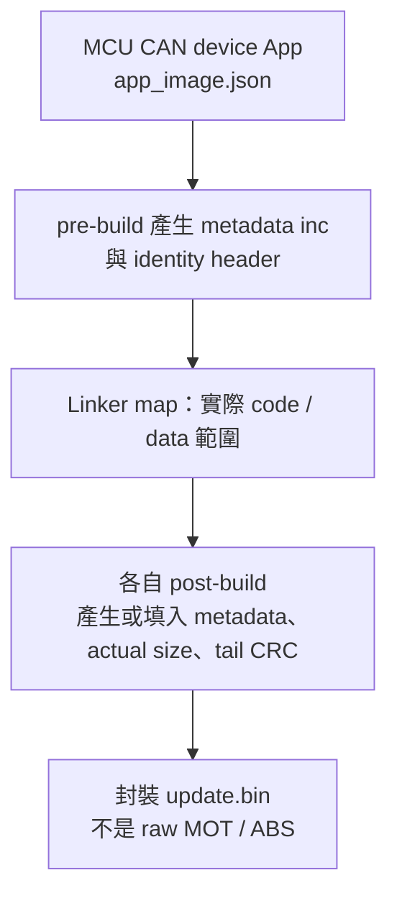
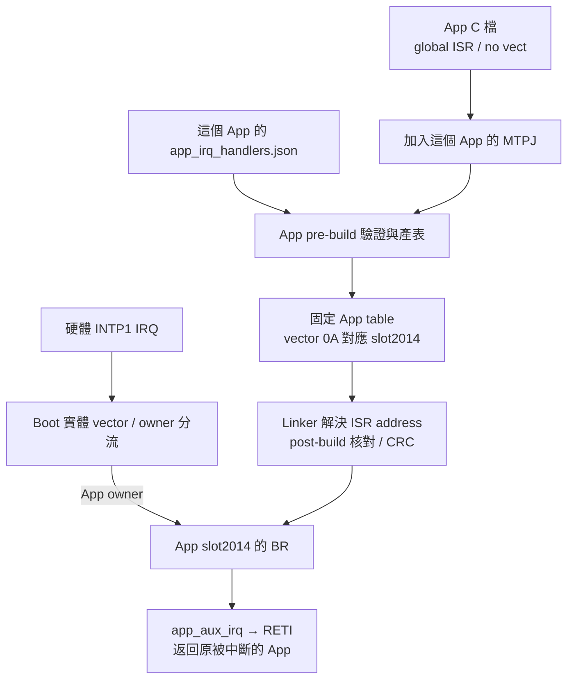

# F13／F24 MCU CAN device：Metadata 與 App Vector Table

<!-- DEVICE_WORKSHOP_BEGIN -->
<a id="device-metadata-vector-workshop"></a>

## Device 開發實作：編輯 Metadata、增加 IRQ、產生並驗證 App

本章整理 **F13 (MCU CAN device)** 與 **F24 (MCU CAN device)** 的 App 設定與建置流程。
兩者皆透過 CAN 更新 App，由 pre-build／post-build 將專案設定轉成映像。

### A. 先辨識專案與共用介面

| 項目 | F13 (MCU CAN device) | F24 (MCU CAN device) |
| --- | --- | --- |
| Boot／App | `RL78_F13_Boot_loader_CAN`／`RL78_F13_Boot_loader_CAN_app` | `RL78_F24_Boot_loader_CAN`／`RL78_F24_Boot_loader_CAN_app` |
| MCU／Flash driver | R5F10BMG／FSL | R7F124FPJ5xFB／RFD，忙碌期間必要程式在 RAM |
| Target／IRQ ABI | `0xF13B`／F1V1 | `0xF24B`／F2V1 |
| Boot／App 起點 | 8 KiB／`0x2000` | 8 KiB／`0x2000` |
| App capacity | `0x1E000`，120 KiB | `0x3DC00`，247 KiB；最後 1 KiB 保護 |
| 更新契約 | App image format 6、CAN protocol 5、Classical 500K | 同樣格式／協定，但身分與 geometry 不同 |
| 版本／build 編輯來源 | App `app_image.json` | App `app_image.json` |
| IRQ 編輯來源 | 各 App 的 `app_irq_handlers.json`＋已註冊 ISR C 檔 | 同左 |

App 與 matching Boot 以原名稱放在同一父目錄；保留相鄰 Boot 提供的腳本／共用來源。
F13 可由 [Boot](https://github.com/released/RL78_F13_Boot_loader_CAN)／[App](https://github.com/released/RL78_F13_Boot_loader_CAN_app) 取得。
F24 device 的 GitHub 來源將於實板驗證後提供，工程配置見 [F24 CAN device](https://released.github.io/slide_boot_loader_for_RL78/#f24-can-device)。
獨立 Transfer 專案是通訊測試整機映像，不是可載入的 App 更新 BIN。

#### A1. 設定檔與產物分工

| 檔案 | 內容 | 編輯方式 |
| --- | --- | --- |
| `app_image.json` | App 版本、build 與映像身分核對值 | 使用者設定 |
| `app_irq_handlers.json` | 實體 vector → ISR 函式名稱 | 使用者設定，搭配 App 的 ISR C 檔 |
| `.inc`、identity header、向量表 | 編譯與封裝所需資料 | 產生器輸出；檔名見 [建置產物](#device-app-build) |

兩個 device 使用相同的 JSON 欄位，產生器依各自的 Boot 契約輸出對應檔案。

<a id="device-app-json"></a>

### B. Metadata 設定與產生來源

| 分類／欄位 | 編輯或產生位置 | 只更新 App？ |
| --- | --- | --- |
| App version／build | 兩者都編輯 `app_image.json` 的 `version`／`build` | 是，仍須符合既有契約 |
| image_size／CRC 地址／CRC32 | 由 linker map 與 post-build 封裝決定 | 自動產生，不填預估大小、不用 hex editor 改 |
| Target、MCU part／family、Flash geometry、CAN IDs／rate | Boot 契約、App producer、linker／backend、封裝與 live INFO 必須一致 | Boot／App 共同契約 |
| Role／transport／IRQ ABI／minimum Boot | matching Boot config／producer 產生；Boot／Tool 均驗證 | 由 Boot／Tool 核對 |
| Metadata reserved `0x80..0xFF` | Producer 固定填 `FF` | 新增欄位時同步 producer 與 validator |
| JSON 的 `target`／`role`／`transport` | 是契約核對值，不是任意可選 MCU／介面 | F13 為 `0xF13B`，F24 為 `0xF24B`；兩者皆 `DEVICE_APP`／`CAN` |

Packed version 採 `(major << 16) | (minor << 8) | patch`；每部分一個 byte。
以下版本／日期用於展示設定差異。
build 使用十進位整數。
App 版本、Boot 版本與 minimum Boot 為不同欄位。

#### B1. F13：編輯 app_image.json

修改前：

```json
{
  "version": "0x00010500",
  "build": 20261015,
  "target": "0xF13B",
  "role": "DEVICE_APP",
  "transport": "CAN"
}
```

修改後（僅示範 App 資訊變更）：

```json
{
  "version": "0x00010501",
  "build": 20261016,
  "target": "0xF13B",
  "role": "DEVICE_APP",
  "transport": "CAN"
}
```

App pre-build 讀 JSON 與 matching Boot 的 `can_boot_config.h`，產生 `ftable.inc`／`app_identity.h`；
`ftable_RL78_F13.asm` 依生成常數排列 App metadata，讓 App INFO 與 BIN 使用同一版本／build。
`IMAGE_SIZE_POST_BUILD = 0xFFFFFFFF` 是封裝前的長度預留值，post-build 會填入實際大小。

#### B2. F24 device：編輯 app_image.json

修改前：

```json
{
  "version": "0x00010000",
  "build": 20261015,
  "target": "0xF24B",
  "role": "DEVICE_APP",
  "transport": "CAN"
}
```

修改後（保留契約欄位）：

```json
{
  "version": "0x00010001",
  "build": 20261016,
  "target": "0xF24B",
  "role": "DEVICE_APP",
  "transport": "CAN"
}
```

`prepare_projects.ps1` 核對 JSON，產生 `app_identity.generated.h`、`app_metadata.generated.inc`
與其組語 wrapper；linker 將該 256-byte metadata 放到 `0x2100`。
`package_images.ps1` 比對已編譯 metadata 與同一 JSON／Boot contract，再填實際長度與尾端 CRC。
geometry、IRQ ABI、CAN routing 等欄位由 Boot 契約提供。
更新目的地與介面的核對規則見 [更新政策](https://released.github.io/slide_isp_tool_for_RL78/#image-update-policy)。

兩邊 JSON 必須剛好有 `version`／`build`／`target`／`role`／`transport` 五個欄位；
version 使用 `0x`＋8 位 hex 的字串，target 使用 `0x`＋4 位 hex 的字串。
build 必須為整數 `0..4294967294`，不能是字串、小數或布林值；version `0xFFFFFFFF` 不接受。
未知或缺少欄位時，產生器會回報錯誤。

#### B3. 用 address 與 byte 核對結果

兩個 device 的 App 起點相同，以下 address 相同；**欄位值與 image capacity 仍不同**。
完整欄位見 [Flash／Metadata byte 對照](https://released.github.io/slide_boot_loader_for_RL78/#flash-metadata-can-reference)；
兩個工程的欄位值由各自的 App 設定及 Boot 契約產生。

| 欄位 | Metadata offset | BIN offset | 絕對 Flash address | 本例預期 |
| --- | --- | --- | --- | --- |
| App version | `0x10..0x13` | `0x110..0x113` | `0x2110..0x2113` | F13：`01 05 01 00`；F24：`01 00 01 00` |
| App build | `0x14..0x17` | `0x114..0x117` | `0x2114..0x2117` | 20261016，LE32 |
| Actual image size | `0x18..0x1B` | `0x118..0x11B` | `0x2118..0x211B` | 必須等於 BIN 檔案長度，不是 capacity |
| Policy／IRQ ABI | `0x60..0x6F` | `0x160..0x16F` | `0x2160..0x216F` | DEVICE_APP、允許 CAN、各自 ABI 與 minimum Boot |
| Reserved FF | `0x80..0xFF` | `0x180..0x1FF` | `0x2180..0x21FF` | 128 bytes 全 `FF` |
| Tail CRC32 | 不在 metadata 裡 | `actual size - 4` | `0x2000 + actual size - 4` | 前面全部 BIN bytes 的 CRC32，LE32 |

#### B4. Metadata 產生路徑



<a id="device-app-irq"></a>

### C. App Vector Table：新增 IRQ 範例

本例使用兩個 device header 都定義的 `INTP1 = 0x0A`。
其他 IRQ 的 vector 位址依各 MCU 的 device header 決定。
JSON key 是 **實體 vector byte address**，不是 IRQ 序號、App slot 或周邊 pin。
兩者的 App slot 計算為 `0x2000 + 0x0A × 2 = 0x2014`，即 BIN offset `0x14`。

#### C1. 加入一般 ISR，並在 App MTPJ 註冊來源

在自己的 App 新增 `app_extra_irq.c`，透過 CS+ 將它加入該 App 的編譯來源。
以下函式只清旗標並記錄事件；**不會初始化或啟用 INTP1**。

```c
#include "r_cg_macrodriver.h"

volatile unsigned char g_app_aux_irq_count;

#pragma interrupt app_aux_irq
void __near app_aux_irq(void)
{
    /* Clear the source flag and capture bounded state only. */
    PIF1 = 0U;
    g_app_aux_irq_count++;
}
```

ISR 必須 global、非 static、無 `vect=`，由編譯器產生 RETI；不要寫成普通 callback，
也不能另設實體 `.VECTOR` 或 `-VECTN` 與 Boot 競爭。
啟用中斷之前，另依實際板子完成 pin／edge／priority／pending flag／mask 初始化；
範例未提供可直接接線使用的 INTP1 pin 設定。未用 IRQ 應保持 mask。
SC／Code Generator 重產後也要核對：原始生成 ISR 若仍帶 `vect=`，不能直接照搬到 split App。

#### C2. F13 mapping：保留原有項目，新增 0x0A

JSON key 的來源是此 App 的 [iodefine.h](https://github.com/released/RL78_F13_Boot_loader_CAN_app/blob/main/iodefine.h) 中的中斷定義。
硬體規格可對照 RL78/F13 硬體手冊「Interrupt functions」章節的中斷來源／向量表。

| JSON key | header 定義 | ISR 名稱 | 函式來源 |
| --- | --- | --- | --- |
| `0x08` | `INTP0 = 0x0008` | `r_intc0_interrupt` | [r_cg_intc_user.c](https://github.com/released/RL78_F13_Boot_loader_CAN_app/blob/main/src/code_gen/r_cg_intc_user.c) |
| `0x0A` | `INTP1 = 0x000A` | `app_aux_irq` | 本章 C1 的 `app_extra_irq.c` |
| `0x16` | `INTST0 = 0x0016` | `r_uart0_interrupt_send` | [r_cg_serial_user.c](https://github.com/released/RL78_F13_Boot_loader_CAN_app/blob/main/src/code_gen/r_cg_serial_user.c) |
| `0x18` | `INTSR0 = 0x0018` | `r_uart0_interrupt_receive` | 同一份 `r_cg_serial_user.c` |
| `0x1E` | `INTTRJ0 = 0x001E` | `r_tmr_rj0_interrupt` | [r_cg_timer_user.c](https://github.com/released/RL78_F13_Boot_loader_CAN_app/blob/main/src/code_gen/r_cg_timer_user.c) |

查找時可先在 header 搜尋周邊中斷名稱，再於 ISR C 檔確認 `#pragma interrupt` 與函式定義。
同一向量可能列有 CSI／IIC／UART 別名，實際來源由本專案啟用的周邊模式決定。
JSON 右側的名稱由 App 定義，左側位址則對應 MCU 的實體向量。

修改前：

```json
{
  "0x08": "r_intc0_interrupt",
  "0x16": "r_uart0_interrupt_send",
  "0x18": "r_uart0_interrupt_receive",
  "0x1E": "r_tmr_rj0_interrupt"
}
```

修改後：

```json
{
  "0x08": "r_intc0_interrupt",
  "0x0A": "app_aux_irq",
  "0x16": "r_uart0_interrupt_send",
  "0x18": "r_uart0_interrupt_receive",
  "0x1E": "r_tmr_rj0_interrupt"
}
```

#### C3. F24 device mapping：保留自己的 timer

F24 App 的 `iodefine.h` 定義 `INTTM01 = 0x002E`。
本工程的 timer ISR 為 `common/device_board.c` 中的 `Device_TimerIsr`，因此使用 `"0x2E": "Device_TimerIsr"`。
`0x0A` 對應此 App header 中的 `INTP1 = 0x000A`，搭配 C1 的 `app_aux_irq` 範例。

修改前：

```json
{
  "0x2E": "Device_TimerIsr"
}
```

修改後：

```json
{
  "0x0A": "app_aux_irq",
  "0x2E": "Device_TimerIsr"
}
```

各 App 的 JSON 保存該專案使用的 IRQ 清單，新增項目時保留既有 mapping。
函式改名會同步反映於 C pragma、函式定義與 JSON。
移除 mapping 時，對應周邊的 IRQ 也一併停用。

#### C4. 生成表中應看到什麼？

| 檢查位置 | 修改前 | 修改後 |
| --- | --- | --- |
| F13 `app_irq_table.inc` 的 vector `0x0A` | `BR !!f13_app_default_isr` | `BR !!_app_aux_irq`，slot `0x2014` |
| F24 device `device_vectors.asm` 的 vector `0x0A` | `BR !!device_default_isr` | `BR !!_app_aux_irq`；table start `0x2000` |
| App map | 沒有新 ISR symbol | `_app_aux_irq` 有有效 code address；應為 interrupt ISR |
| 最終 BIN 的 offset `0x14..0x17` | 指向原 default ISR | `EC`＋新 ISR 的 3-byte little-endian 絕對 address |
| Boot 的實體 vector／來源 | 固定轉送介面 | 不因 App 函式名或使用清單改變 |

Assembler symbol 前綴 `_` 由 generator 加入，JSON 使用 C 函式原名 `app_aux_irq`。
表有固定 64 個 4-byte slot，不是每增加一個 IRQ 就把後面的 entry 往後推。
App reset slot 進 `_start`，不是直接進 `main`；`0x02` 仍是保留位置，不能加入 JSON。
F13 此 slot 填 `FF`，F24 device 產生 default branch；兩者都不代表可啟用 reserved IRQ。
physical BRK `0x7E` 不由 Boot 轉送；App 的保留 BRK slot 使用 RETB，不是一般 IRQ 的 RETI。

#### C5. IRQ 的產生與執行路徑



<a id="device-app-build"></a>

### D. 產生與建置

下列是相鄰工程的相對路徑；在自己的 App 根目錄執行。先備份／記錄 matching Boot image 雜湊。
範例只變動 App 資訊及一般 IRQ，**不應呼叫 Boot 產表或 Boot rebuild**。
兩個 device 都使用 Windows PowerShell 與工程對應的 CS+／CC-RL。
CS+ 開啟自己的 App `.mtpj`，建置組態為 `DefaultBuild`。
下方 PowerShell 腳本以單次 `-ExecutionPolicy Bypass` 執行，不需永久更改系統執行原則。

#### D0. 第一次操作：逐步完成一次 App 變更

1. 選定 F13 或 F24 **device** 的 matching Boot/App，按原名稱放在同一父目錄；確認工程可建置。
2. 保存 Boot HEX、App 更新 BIN 與兩份 JSON，記錄 Boot image 雜湊。
3. 開啟 App 的 `app_image.json`，只修改 `version`／`build`；對照 B1 或 B2，保留原 target、DEVICE_APP 與 CAN。存成 UTF-8 JSON，不加註解。
4. 若只升版本，跳到第6步。若新增 IRQ，依 C1 新增正常 ISR C 檔，並在 CS+ **此 App** 的 MTPJ 加入來源；還不要啟用硬體 IRQ。
5. 編輯這個 App 的 `app_irq_handlers.json`，保留既有清單，再加入 `0x0A` 範例或已核對的合法 vector／handler。
6. 從 App 根目錄執行 D1 或 D2 的產生命令，再執行 CheckOnly。錯誤先修正 JSON／MTPJ／ISR，不手改 `.inc`、identity 或 table。
7. Clean Rebuild **App**，確認 pre-build 與 post-build 都成功。對照下方產物表，確認新 table、version／build、實際 BIN 長度與 CRC；使用此次成功建置的產物。
8. 在 Tool CAN TAB 載入該 App 的 `*_update.bin`，依 E 節核對新版本、Metadata VALID 與 CRC MATCH；這一步不寫 MCU。
9. Open + Probe host、Discover **device**，核對 live target／layout／CAN／IRQ ABI／minimum Boot；相容才 Enter Boot 並開始更新，不以離線 BIN 取代 live 身分。
10. END／reset 後另外確認 App 版本 INFO／UART、既有 IRQ 與新 IRQ；最後比較 Boot 區／映像未變。硬體 IRQ 啟用前的初始化與故障測試仍需另作。

只升 App 版本時不必新增 ISR；只新增 IRQ 時也不必更改 target 或 Boot 版本。

#### D1. F13 device

```powershell
# Generate this App's metadata INC, IRQ table and identity; never Boot.
powershell.exe -NoProfile -ExecutionPolicy Bypass `
  -File "..\RL78_F13_Boot_loader_CAN\generate_irq_contract.ps1" `
  -Mode App -AppProject "."

# Read-only freshness check; run after generating, not instead of generating.
powershell.exe -NoProfile -ExecutionPolicy Bypass `
  -File "..\RL78_F13_Boot_loader_CAN\generate_irq_contract.ps1" `
  -Mode App -AppProject "." -CheckOnly
```

然後在 CS+ **Clean Rebuild 此 App**。原有 pre-build 保留上述 App-mode 命令，
post-build 保留 `generate_update_image.ps1`；該腳本依 map／App HEX 封裝，並非只產表就有新 BIN。
Tool 的 `scripts/verify_f13_artifacts.ps1` 可作後續檢查，需指定正確 Boot／App project。
F13 目前仍保留參考 MTPJ／map／輸出檔名與 sibling Boot 假設；若改專案名／搬目錄，
必須另外對齊 source／include／hook、`-MapFile`、輸出命名、checker 及 Boot HEX 來源。

#### D2. F24 device

```powershell
# Update this App's projections / registered project settings, never Boot.
powershell.exe -NoProfile -ExecutionPolicy Bypass `
  -File "..\RL78_F24_Boot_loader_CAN\tools\prepare_projects.ps1" `
  -Kind app -Project "."

# Read-only freshness / registration check.
powershell.exe -NoProfile -ExecutionPolicy Bypass `
  -File "..\RL78_F24_Boot_loader_CAN\tools\prepare_projects.ps1" `
  -Kind app -Project "." -CheckOnly

# Clean rebuild and mandatory map / image packaging checks.
powershell.exe -NoProfile -ExecutionPolicy Bypass `
  -File "..\RL78_F24_Boot_loader_CAN\build.ps1" `
  -Kind app -AppProject "."
```

CS+ pre-build 使用 `prepare_projects.ps1 -Kind app -Project . -ArtifactsOnly`；
post-build 使用 `package_images.ps1 -Kind app -Project .`。`-ArtifactsOnly` 僅產生編譯所需檔案。
只改一般 App 功能，不用省略 kind 的 all-mode prepare／build；SC 重產後先重新 prepare **app**。
若改名或搬移，仍須修正相對 source／include／hook 路徑；不是任意 standalone App 加 JSON 即可。
F24 device prepare 使用同一磁碟內的相對路徑。

| 產物 | F13 device | F24 device |
| --- | --- | --- |
| Metadata `.inc`（不可手改） | `ftable.inc` | `app_metadata.generated.inc`＋`app_metadata.generated.asm` wrapper |
| App pre-build identity | `app_identity.h` | `app_identity.generated.h` |
| App vector table | `app_irq_table.inc` | `device_vectors.asm` |
| 後續 CAN 更新 | `DefaultBuild/RL78_F13_Boot_loader_CAN_app_update.bin` | `DefaultBuild/<MTPJ stem>_update.bin` |
| 燒錄器初裝 App | `DefaultBuild/flash_app_variable_CRC.hex` | `DefaultBuild/<MTPJ stem>_flash.hex` |
| matching Boot 初裝 | 先核對 `boot_app.hex` 的來源／產生時間；或 matching Boot＋App HEX | matching `boot0000_1FFF.hex`＋封裝 App HEX，依燒錄器設定核對擦除範圍 |

F13 若找不到 sibling Boot HEX，post-build 不會產生新的合併檔；先前的 `boot_app.hex` 可能仍留著。
任何 build／guard 失敗，先前 BIN 仍可能保留，使用前核對此次建置結果。
raw App MOT／ABS 可能包含低位實體記錄，不應代替已封裝的 App HEX 或 update BIN。
post-build 會拒絕 JSON 與已編譯 metadata／IRQ 表不同的編譯輸出；JSON 修改後進行 clean rebuild。
F13 也直接比對 App map、實際 BR 目的地與 mapped ISR 的 RETI，不依賴 Boot map 才能執行這項 App 檢查。
CheckOnly 發現手改／過期生成檔時只報錯、不修復；先重產，再 clean rebuild。

<a id="device-app-validation"></a>

### E. BIN 與向量驗證

| 步驟 | 要檢查的結果 | 未通過時 |
| --- | --- | --- |
| 產表 | 新 JSON entry 對應到正確 slot；source 有且僅有對應的正常 ISR | 不手改生成檔，修 source／MTPJ／JSON |
| map／向量 bytes | table 在 `0x2000`，metadata 不佔 code；BR 指向 App code，ISR 應有 RETI | 不更新 MCU；先查 linker／pragma／註冊 |
| BIN offline | size 等於檔長、metadata reserved FF、CRC match、role／CAN／ABI 正確 | 不用修改 Tool 欄位繞過 |
| Tool Load Update Image | Metadata VALID、CRC MATCH、新 version／build；這仍只是 offline 資訊 | 重查 producer／封裝及實際載入檔案 |
| Discover live device | MCU／target／geometry／CAN／IRQ ABI／minimum Boot 相容 | 不送 START；不能把載入 BIN 身分當 live 身分 |
| 更新與 reset | END 成功後，確認 App 新版 INFO／UART、正常與新增 IRQ，Boot 區未變 | 保留 log／trace，分清 END ACK 與 App 執行證據 |

#### E1. Tool 驗證與更新後 App 證據


INTP1 範例涵蓋來源登錄與產表；實際 IRQ 功能仍需搭配板端初始化與量測。
F13 與 F24 device 的驗證狀態分別記錄於各工程，F24 device 的 CAN／RFD 實板驗證仍在進行規劃。
CRC 用於完整性檢查。
更新中斷後，Boot 於下次啟動重新驗證現有映像，驗證有效才進入 App。

### F. 常見錯誤與只換 App 的邊界

| 變更／錯誤 | 處理原則 |
| --- | --- |
| 只改 App version／build 或相容的一般 IRQ | 產表、重建與封裝 App；不因 ISR 名稱改動重燒 Boot |
| 改 MCU／App start／geometry／IRQ ABI／更新協定 | 不是上述 App-only 教學；同步 Boot、App、producer、Tool／validator 並重新驗證 |
| JSON key 寫 `0x2014`、IRQ index 或保留／奇數 vector | 應寫合法實體 byte address，本例為 `0x0A`；以本工程 header 核對 |
| C 檔只複製進資料夾，沒有加入 MTPJ | generator 或 linker 應拒絕；先修正專案登錄 |
| ISR 帶 `vect=`／static／普通函式，或 symbol 拼錯 | 改成正常 global interrupt ISR，再核對 JSON 與 generated table |
| 覆蓋原有 UART／timer mappings | 先恢復仍在用的清單；新增不是替換整份 JSON |
| 手改 `.inc`、generated table、identity、BIN bytes／CRC | 回到兩份 JSON／ISR 來源修改並重建；CheckOnly 不會替你更新生成檔 |

同一份 Boot 可搭配 App A／B 的不同 ISR 清單，前提是完整共同契約不變。
「Boot 不必因新增普通 IRQ 修改」不等於硬體初始化、stack、pending flag 或 IRQ 行為不需驗證。
<!-- DEVICE_WORKSHOP_END -->
