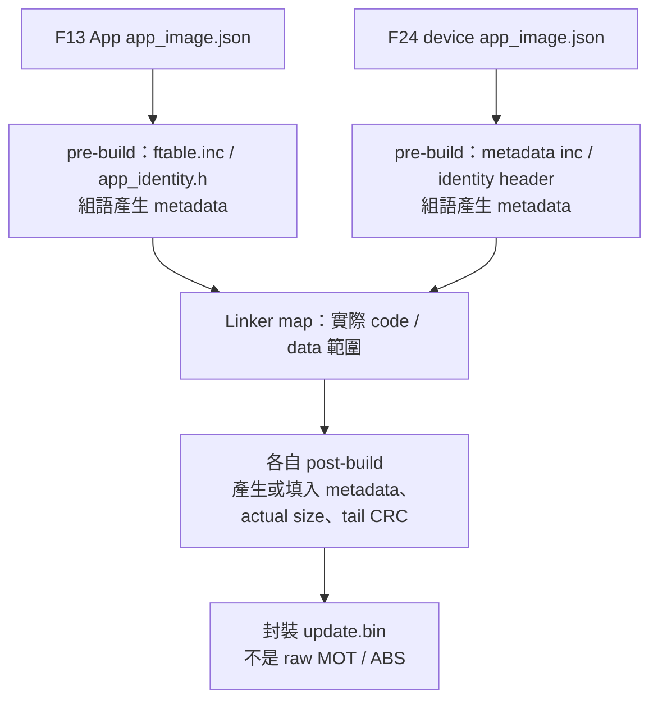
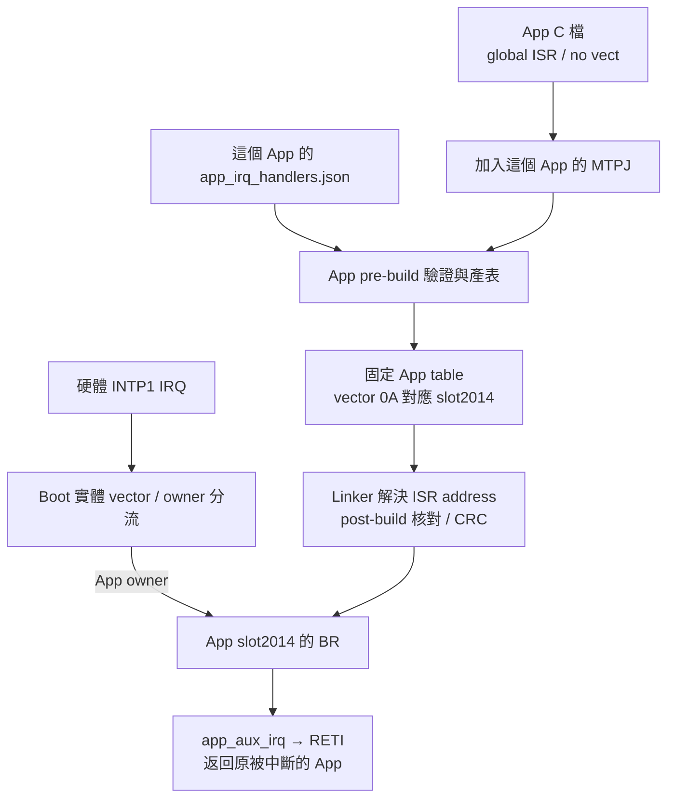
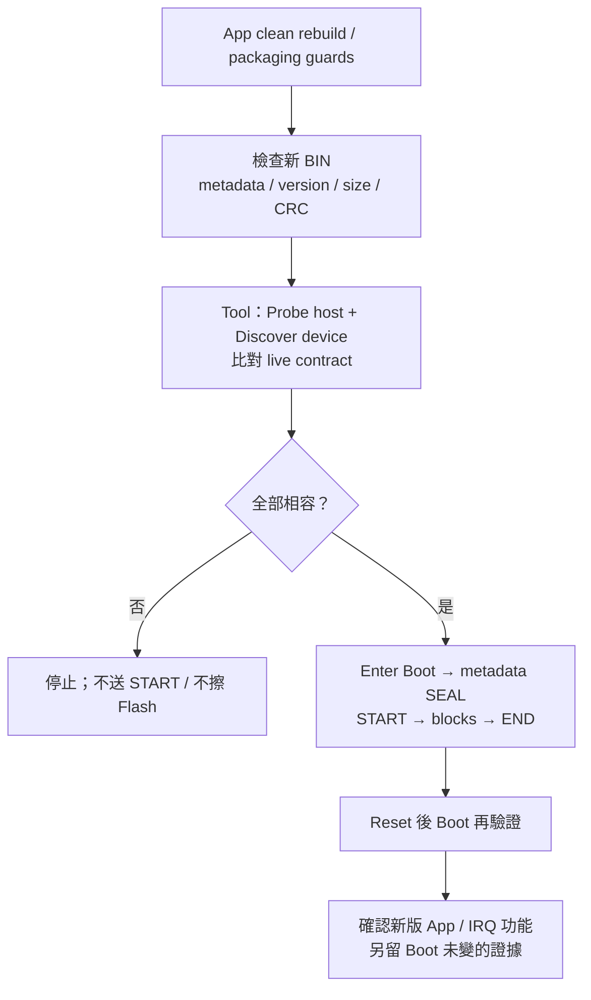

# F13／F24 MCU CAN device：Metadata 與 App Vector Table 實作教學

<!-- DEVICE_WORKSHOP_BEGIN -->
<a id="device-metadata-vector-workshop"></a>

## Device 開發實作：編輯 Metadata、增加 IRQ、產生並驗證 App

本章只處理 **F13 (MCU CAN device)** 與 **F24 (MCU CAN device)**，不調整 F24 host。
兩者都由 CAN 更新 App；不要套用 host 的 BUR1、`0x5000`、Misc 或 host 專用產表腳本。
這裡的「編輯」是修改 firmware 專案來源，再透過 pre-build／post-build 產生映像，
不是在 Tool 手動改 BIN。生成的表、identity header、size 與 CRC 不應手動修補。

### A. 先辨識專案與共用介面

| 項目 | F13 (MCU CAN device) | F24 (MCU CAN device) |
| --- | --- | --- |
| Boot／App | `RL78_F13_Boot_loader_CAN`／`RL78_F13_Boot_loader_CAN_app` | `RL78_F24_Boot_loader_CAN`／`RL78_F24_Boot_loader_CAN_app` |
| MCU／Flash driver | R5F10BMG／FSL | R7F124FPJ5xFB／RFD，忙碌期間必要程式在 RAM |
| Target／IRQ ABI | `0xF13B`／F1V1 | `0xF24B`／F2V1 |
| Boot／App 起點 | 8 KiB／`0x2000` | 8 KiB／`0x2000` |
| App capacity | `0x1E000`，120 KiB | `0x3DC00`，247 KiB；最後 1 KiB 保護 |
| 更新契約 | CAN3、image format 6、CAN protocol 5、Classical 500K | 同樣格式／協定，但身分與 geometry 不同 |
| 版本／build 編輯來源 | App `app_image.json` | App `app_image.json` |
| IRQ 編輯來源 | 各 App 的 `app_irq_handlers.json`＋已註冊 ISR C 檔 | 同左 |

App 與 matching Boot 以原名稱放在同一父目錄；保留相鄰 Boot 提供的腳本／共用來源。
F13 可由 [Boot](https://github.com/released/RL78_F13_Boot_loader_CAN)／[App](https://github.com/released/RL78_F13_Boot_loader_CAN_app) 取得。
F24 device 請使用配套的上述 CAN device 工程；Tool repository 的 `Bridge_app` 是 host，不能替代。
獨立 Transfer 專案是通訊測試整機映像，不是可載入的 App 更新 BIN。

#### A1. ftable.inc 與兩份 JSON，哪個較容易修改？

| 格式 | 一般使用者的閱讀／修改成本 | 現行用途與注意事項 |
| --- | --- | --- |
| `ftable.inc`／metadata `.inc` | 使用者不必理解 `.EQU` 或資料排列才可升版 | **生成檔，不再手改**；F13 為 `ftable.inc`，F24 device 為 `app_metadata.generated.inc` |
| `app_image.json` | 欄位少、可用名稱表達用途，日常版本／build 修改較直覺 | 兩個 device 都用相同五欄 schema；JSON 不接受裸 `0x` 數字，所以 version 使用 hex 字串，build 使用十進位整數；不可加註解 |
| `app_irq_handlers.json` | 直接列出 vector → handler，與 image 設定分開較不易誤動 metadata | 兩個 device 都使用；仍需核對硬體 vector、註冊 ISR 及保留原 mapping |

兩個 device 現在都統一為兩份 JSON 分工；`.inc`、identity header、向量表交給各自產生器。
不保留「沒有 JSON 就讀取手寫 ftable.inc」的 fallback。舊 App 專案須先新增 matching JSON，
保留原 version／build，然後執行 App-mode 產生與 clean rebuild；不能只改副檔名。

### B. Metadata：哪些可改、哪些不能手改？

| 分類／欄位 | 編輯或產生位置 | 只更新 App？ |
| --- | --- | --- |
| App version／build | 兩者都編輯 `app_image.json` 的 `version`／`build` | 是，仍須符合既有契約 |
| image_size／CRC 地址／CRC32 | 由 linker map 與 post-build 封裝決定 | 自動產生，不填預估大小、不用 hex editor 改 |
| Target、MCU part／family、Flash geometry、CAN IDs／rate | Boot 契約、App producer、linker／backend、封裝與 live INFO 必須一致 | 不能只改 App；須評估並安裝 matching Boot/App |
| Role／transport／IRQ ABI／minimum Boot | matching Boot config／producer 產生；Boot／Tool 均驗證 | 契約欄位；不能藉改字串或 JSON 繞過更新路徑 |
| Metadata reserved `0x80..0xFF` | Producer 固定填 `FF` | 不可直接填入新功能；需定義新版契約並同步所有驗證器 |
| JSON 的 `target`／`role`／`transport` | 是契約核對值，不是任意可選 MCU／介面 | F13 為 `0xF13B`，F24 為 `0xF24B`；兩者皆 `DEVICE_APP`／`CAN` |

Packed version 採 `(major << 16) | (minor << 8) | patch`；每部分一個 byte。
以下版本／日期是教學輸入，不是交付配套版本要求；build 是十進位整數，不能寫成 JSON 字串。
App 版本、Boot 版本與 minimum Boot 是不同欄位；App 升版不應順便修改 minimum Boot。

#### B1. F13：編輯 app_image.json

修改前：

```json
{
  "version": "0x00010500",
  "build": 20261015,
  "target": "0xF13B",
  "role": "DEVICE_APP",
  "transport": "CAN"
}
```

修改後（僅示範 App 資訊變更）：

```json
{
  "version": "0x00010501",
  "build": 20261016,
  "target": "0xF13B",
  "role": "DEVICE_APP",
  "transport": "CAN"
}
```

App pre-build 讀 JSON 與 matching Boot 的 `can_boot_config.h`，產生 `ftable.inc`／`app_identity.h`；
`ftable_RL78_F13.asm` 依生成常數排列 CAN3 metadata，讓 App INFO 與 BIN 使用同一版本／build。
`IMAGE_SIZE_POST_BUILD = 0xFFFFFFFF` 由產生器保留，封裝才填實際大小；不要手改 `.inc`。
改 target／分區等固定契約時，仍須另行同步 Boot config、linker、producer 與 validator。
不能只改 metadata 的某一個 byte，就把已 link 的程式搬到不同 address。

#### B2. F24 device：編輯 app_image.json

修改前：

```json
{
  "version": "0x00010000",
  "build": 20261015,
  "target": "0xF24B",
  "role": "DEVICE_APP",
  "transport": "CAN"
}
```

修改後（保留契約欄位）：

```json
{
  "version": "0x00010001",
  "build": 20261016,
  "target": "0xF24B",
  "role": "DEVICE_APP",
  "transport": "CAN"
}
```

`prepare_projects.py` 核對 JSON，產生 `app_identity.generated.h`、`app_metadata.generated.inc`
與其組語 wrapper；linker 將該 256-byte metadata 放到 `0x2100`。
`package_images.py` 比對已編譯 metadata 與同一 JSON／Boot contract，再填實際長度與尾端 CRC。
JSON 不是整份 metadata 編輯器；geometry、IRQ ABI、CAN routing 等由固定契約提供。
把 `transport` 改成 I2C、改 role 或改 target，不會自動變成另一種 bootloader，應被拒絕。

兩邊 JSON 必須剛好有 `version`／`build`／`target`／`role`／`transport` 五個欄位；
version 使用 `0x`＋8 位 hex 的字串，target 使用 `0x`＋4 位 hex 的字串。
build 必須為整數 `0..4294967294`，不能是字串、小數或布林值；version `0xFFFFFFFF` 不接受。
未知或缺少欄位也會拒絕。合法格式仍不代表 target／role／transport 可任意更改。

#### B3. 用 address 與 byte 核對結果

兩個 device 的 App 起點相同，以下 address 相同；**欄位值與 image capacity 仍不同**。
完整欄位見 [Flash／Metadata byte 對照](https://released.github.io/slide_boot_loader_for_RL78/#flash-metadata-can-reference)；
此處兩個 device 使用 CAN3，不可套用該參考頁中 F24 host 的 BUR1 欄位表。

| 欄位 | Metadata offset | BIN offset | 絕對 Flash address | 本例預期 |
| --- | --- | --- | --- | --- |
| App version | `0x10..0x13` | `0x110..0x113` | `0x2110..0x2113` | F13：`01 05 01 00`；F24：`01 00 01 00` |
| App build | `0x14..0x17` | `0x114..0x117` | `0x2114..0x2117` | 20261016，LE32 |
| Actual image size | `0x18..0x1B` | `0x118..0x11B` | `0x2118..0x211B` | 必須等於 BIN 檔案長度，不是 capacity |
| Policy／IRQ ABI | `0x60..0x6F` | `0x160..0x16F` | `0x2160..0x216F` | DEVICE_APP、允許 CAN、各自 ABI 與 minimum Boot |
| Reserved FF | `0x80..0xFF` | `0x180..0x1FF` | `0x2180..0x21FF` | 128 bytes 全 `FF` |
| Tail CRC32 | 不在 metadata 裡 | `actual size - 4` | `0x2000 + actual size - 4` | 前面全部 BIN bytes 的 CRC32，LE32 |

#### B4. Metadata 產生路徑



### C. App Vector Table：新增一個 IRQ 的完整範例

本例使用兩個 device header 都定義的 `INTP1 = 0x0A`；不是因為兩顆 MCU 的所有向量皆相同。
JSON key 是 **實體 vector byte address**，不是 IRQ 序號、App slot 或周邊 pin。
兩者的 App slot 計算為 `0x2000 + 0x0A × 2 = 0x2014`，即 BIN offset `0x14`。

#### C1. 加入一般 ISR，並在 App MTPJ 註冊來源

在自己的 App 新增 `app_extra_irq.c`，透過 CS+ 將它加入該 App 的編譯來源。
以下函式只清旗標並記錄事件；**不會初始化或啟用 INTP1**。

```c
#include "r_cg_macrodriver.h"

volatile unsigned char g_app_aux_irq_count;

#pragma interrupt app_aux_irq
void __near app_aux_irq(void)
{
    /* Clear the source flag and capture bounded state only. */
    PIF1 = 0U;
    g_app_aux_irq_count++;
}
```

ISR 必須 global、非 static、無 `vect=`，由編譯器產生 RETI；不要寫成普通 callback，
也不能另設實體 `.VECTOR` 或 `-VECTN` 與 Boot 競爭。
啟用中斷之前，另依實際板子完成 pin／edge／priority／pending flag／mask 初始化；
範例未提供可直接接線使用的 INTP1 pin 設定。未用 IRQ 應保持 mask。
SC／Code Generator 重產後也要核對：原始生成 ISR 若仍帶 `vect=`，不能直接照搬到 split App。

#### C2. F13 mapping：保留原有項目，新增 0x0A

修改前：

```json
{
  "0x08": "r_intc0_interrupt",
  "0x16": "r_uart0_interrupt_send",
  "0x18": "r_uart0_interrupt_receive",
  "0x1E": "r_tmr_rj0_interrupt"
}
```

修改後：

```json
{
  "0x08": "r_intc0_interrupt",
  "0x0A": "app_aux_irq",
  "0x16": "r_uart0_interrupt_send",
  "0x18": "r_uart0_interrupt_receive",
  "0x1E": "r_tmr_rj0_interrupt"
}
```

#### C3. F24 device mapping：保留自己的 timer

修改前：

```json
{
  "0x2E": "Device_TimerIsr"
}
```

修改後：

```json
{
  "0x0A": "app_aux_irq",
  "0x2E": "Device_TimerIsr"
}
```

不能把 F13 的 UART／timer mapping 整份複製給 F24；也不能用只有新 IRQ 的 JSON 覆蓋舊清單。
改函式名稱要同步 C pragma／定義與 JSON。移除 mapping 前先停用其周邊 IRQ，避免 default RETI 反覆觸發。

#### C4. 生成表中應看到什麼？

| 檢查位置 | 修改前 | 修改後 |
| --- | --- | --- |
| F13 `app_irq_table.inc` 的 vector `0x0A` | `BR !!f13_app_default_isr` | `BR !!_app_aux_irq`，slot `0x2014` |
| F24 device `device_vectors.asm` 的 vector `0x0A` | `BR !!device_default_isr` | `BR !!_app_aux_irq`；table start `0x2000` |
| App map | 沒有新 ISR symbol | `_app_aux_irq` 有有效 code address；應為 interrupt ISR |
| 最終 BIN 的 offset `0x14..0x17` | 指向原 default ISR | `EC`＋新 ISR 的 3-byte little-endian 絕對 address |
| Boot 的實體 vector／來源 | 固定轉送介面 | 不因 App 函式名或使用清單改變 |

Assembler symbol 前綴 `_` 由 generator 加入，JSON 寫 `app_aux_irq`，不要寫 `_app_aux_irq`。
表有固定 64 個 4-byte slot，不是每增加一個 IRQ 就把後面的 entry 往後推。
App reset slot 進 `_start`，不是直接進 `main`；`0x02` 仍是保留位置，不能加入 JSON。
F13 此 slot 填 `FF`，F24 device 產生 default branch；兩者都不代表可啟用 reserved IRQ。
physical BRK `0x7E` 不由 Boot 轉送；App 的保留 BRK slot 使用 RETB，不是一般 IRQ 的 RETI。

#### C5. IRQ 的產生與執行路徑



### D. 產生命令：F13 與 F24 device 分開執行

下列是相鄰工程的相對路徑；在自己的 App 根目錄執行。先備份／記錄 matching Boot image 雜湊。
範例只變動 App 資訊及一般 IRQ，**不應呼叫 Boot 產表或 Boot rebuild**。
使用 Windows PowerShell 執行命令；先安裝工程對應的 CS+／CC-RL。F24 device 另需 Python 3，
以 `python --version` 確認可呼叫。CS+ 開啟的是自己的 App `.mtpj`，建置組態為 `DefaultBuild`。
下方 PowerShell 腳本以單次 `-ExecutionPolicy Bypass` 執行，不需永久更改系統執行原則。

#### D0. 第一次操作：逐步完成一次 App 變更

1. 選定 F13 或 F24 **device** 的 matching Boot/App，按原名稱放在同一父目錄；先確認舊版可建置。
2. 備份現有 Boot HEX、App 更新 BIN 與兩份 JSON，記錄 Boot image 雜湊。舊 F13 若尚無 image JSON，先按 B1 範例新增，保留自己的原版本／build。
3. 開啟 App 的 `app_image.json`，只修改 `version`／`build`；對照 B1 或 B2，保留原 target、DEVICE_APP 與 CAN。存成 UTF-8 JSON，不加註解。
4. 若只升版本，跳到第6步。若新增 IRQ，依 C1 新增正常 ISR C 檔，並在 CS+ **此 App** 的 MTPJ 加入來源；還不要啟用硬體 IRQ。
5. 編輯這個 App 的 `app_irq_handlers.json`，保留舊清單，再加入 `0x0A` 範例或已核對的合法 vector／handler；不要用其他 MCU 的整份清單覆蓋。
6. 從 App 根目錄執行 D1 或 D2 的產生命令，再執行 CheckOnly。錯誤先修正 JSON／MTPJ／ISR，不手改 `.inc`、identity 或 table。
7. Clean Rebuild **App**，確認 pre-build 與 post-build 都成功。對照下方產物表，確認新 table、version／build、實際 BIN 長度與 CRC；不要沿用前次失敗後留下的舊檔。
8. 在 Tool CAN TAB 載入該 App 的 `*_update.bin`，依 E 節核對新版本、Metadata VALID 與 CRC MATCH；這一步不寫 MCU。
9. Open + Probe host、Discover **device**，核對 live target／layout／CAN／IRQ ABI／minimum Boot；相容才 Enter Boot 並開始更新，不以離線 BIN 取代 live 身分。
10. END／reset 後另外確認新版 App INFO／UART、既有 IRQ 與新 IRQ；最後比較 Boot 區／映像未變。硬體 IRQ 啟用前的初始化與故障測試仍需另作。

只升 App 版本時不必新增 ISR；只新增 IRQ 時也不必更改 target 或 Boot 版本。

#### D1. F13 device

```powershell
# Generate this App's metadata INC, IRQ table and identity; never Boot.
powershell.exe -NoProfile -ExecutionPolicy Bypass `
  -File "..\RL78_F13_Boot_loader_CAN\generate_irq_contract.ps1" `
  -Mode App -AppProject "."

# Read-only freshness check; run after generating, not instead of generating.
powershell.exe -NoProfile -ExecutionPolicy Bypass `
  -File "..\RL78_F13_Boot_loader_CAN\generate_irq_contract.ps1" `
  -Mode App -AppProject "." -CheckOnly
```

然後在 CS+ **Clean Rebuild 此 App**。原有 pre-build 保留上述 App-mode 命令，
post-build 保留 `generate_update_image.ps1`；該腳本依 map／App HEX 封裝，並非只產表就有新 BIN。
Tool 的 `scripts/verify_f13_artifacts.ps1` 可作後續檢查，需指定正確 Boot／App project。
F13 目前仍保留參考 MTPJ／map／輸出檔名與 sibling Boot 假設；若改專案名／搬目錄，
必須另外對齊 source／include／hook、`-MapFile`、輸出命名、checker 及 Boot HEX 來源。

#### D2. F24 device

```powershell
# Update this App's projections / registered project settings, never Boot.
python ..\RL78_F24_Boot_loader_CAN\tools\prepare_projects.py --kind app --project .

# Read-only freshness / registration check.
python ..\RL78_F24_Boot_loader_CAN\tools\prepare_projects.py --kind app --project . --check

# Clean rebuild and mandatory map / image packaging checks.
powershell.exe -NoProfile -ExecutionPolicy Bypass `
  -File "..\RL78_F24_Boot_loader_CAN\build.ps1" `
  -Kind app -AppProject "."
```

CS+ pre-build 使用 `prepare_projects.py --kind app --project . --artifacts-only`；
post-build 使用 `package_images.py --kind app --project .`。`--artifacts-only` 不會修正 MTPJ 登錄／選項。
只改一般 App 功能，不用省略 kind 的 all-mode prepare／build；SC 重產後先重新 prepare **app**。
若改名或搬移，仍須修正相對 source／include／hook 路徑；不是任意 standalone App 加 JSON 即可。
目前 F24 device prepare 使用相對路徑；Boot 與 App 必須在同一磁碟，不能跨磁碟直接產生工程。

| 產物 | F13 device | F24 device |
| --- | --- | --- |
| Metadata `.inc`（不可手改） | `ftable.inc` | `app_metadata.generated.inc`＋`app_metadata.generated.asm` wrapper |
| App pre-build identity | `app_identity.h` | `app_identity.generated.h` |
| App vector table | `app_irq_table.inc` | `device_vectors.asm` |
| 後續 CAN 更新 | `DefaultBuild/RL78_F13_Boot_loader_CAN_app_update.bin` | `DefaultBuild/<MTPJ stem>_update.bin` |
| 燒錄器初裝 App | `DefaultBuild/flash_app_variable_CRC.hex` | `DefaultBuild/<MTPJ stem>_flash.hex` |
| matching Boot 初裝 | 先核對 `boot_app.hex` 的來源／產生時間；或 matching Boot＋App HEX | matching `boot0000_1FFF.hex`＋封裝 App HEX，依燒錄器設定核對擦除範圍 |

F13 若找不到 sibling Boot HEX，post-build 不會產生新的合併檔；舊 `boot_app.hex` 可能仍留著。
任何 build／guard 失敗，舊 BIN 也可能仍在，不能以「檔案存在」判定這次成功。
raw App MOT／ABS 可能包含低位實體記錄，不應代替已封裝的 App HEX 或 update BIN。
post-build 會拒絕 JSON 與已編譯 metadata／IRQ 表不同的舊輸出，不能改完 JSON 只重跑封裝。
F13 也直接比對 App map、實際 BR 目的地與 mapped ISR 的 RETI，不依賴 Boot map 才能執行這項 App 檢查。
CheckOnly 發現手改／過期生成檔時只報錯、不修復；先重產，再 clean rebuild。

### E. 驗證新 BIN 與向量，而非只看 build success

| 步驟 | 要檢查的結果 | 未通過時 |
| --- | --- | --- |
| 產表 | 新 JSON entry 對應到正確 slot；source 有且僅有對應的正常 ISR | 不手改生成檔，修 source／MTPJ／JSON |
| map／向量 bytes | table 在 `0x2000`，metadata 不佔 code；BR 指向 App code，ISR 應有 RETI | 不更新 MCU；先查 linker／pragma／註冊 |
| BIN offline | size 等於檔長、metadata reserved FF、CRC match、role／CAN／ABI 正確 | 不用修改 Tool 欄位繞過 |
| Tool Load Update Image | Metadata VALID、CRC MATCH、新 version／build；這仍只是 offline 資訊 | 重查 producer／封裝及實際載入檔案 |
| Discover live device | MCU／target／geometry／CAN／IRQ ABI／minimum Boot 相容 | 不送 START；不能把載入 BIN 身分當 live 身分 |
| 更新與 reset | END 成功後，確認 App 新版 INFO／UART、正常與新增 IRQ，Boot 區未變 | 保留 log／trace，分清 END ACK 與 App 執行證據 |

#### E1. Tool 驗證與更新後 App 證據



本章的 command／JSON／byte 範例以現有來源與暫存產表測試核對；不是已在板上啟用新 INTP1。
F24 device 的 CAN／RFD 實板更新與故障矩陣仍需另驗；F13 已有正常更新紀錄也不代表此新增 IRQ 已驗證。
CRC 是完整性檢查，不是簽章或防回滾；不完整更新也不等於可以 rollback 到舊 App。

### F. 常見錯誤與只換 App 的邊界

| 變更／錯誤 | 處理原則 |
| --- | --- |
| 只改 App version／build 或相容的一般 IRQ | 產表、重建與封裝 App；不因 ISR 名稱改動重燒 Boot |
| 改 MCU／App start／geometry／IRQ ABI／更新協定 | 不是上述 App-only 教學；同步 Boot、App、producer、Tool／validator 並重新驗證 |
| JSON key 寫 `0x2014`、IRQ index 或保留／奇數 vector | 應寫合法實體 byte address，本例為 `0x0A`；不能跨 MCU 照抄 |
| C 檔只複製進資料夾，沒有加入 MTPJ | generator 或 linker 應拒絕；先修正專案登錄 |
| ISR 帶 `vect=`／static／普通函式，或 symbol 拼錯 | 改成正常 global interrupt ISR，再核對 JSON 與 generated table |
| 覆蓋原有 UART／timer mappings | 先恢復仍在用的清單；新增不是替換整份 JSON |
| 手改 `.inc`、generated table、identity、BIN bytes／CRC | 回到兩份 JSON／ISR 來源修改並重建；CheckOnly 不會替你更新生成檔 |
| 拿 host 的 `prepare_f24_app_irq.ps1`／BUR1／Misc 套 device | 使用本章 F24 device 工具鏈；兩個角色不可混用 |

同一份 Boot 可搭配 App A／B 的不同 ISR 清單，前提是完整共同契約不變。
「Boot 不必因新增普通 IRQ 修改」不等於硬體初始化、stack、pending flag 或 IRQ 行為不需驗證。
<!-- DEVICE_WORKSHOP_END -->
