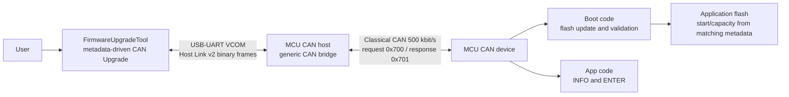
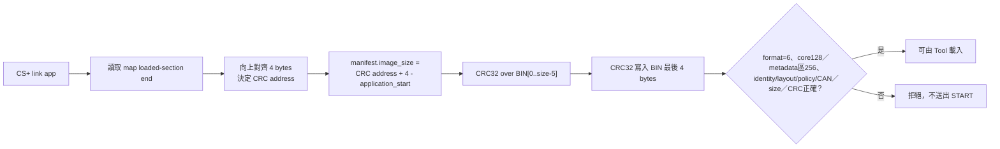
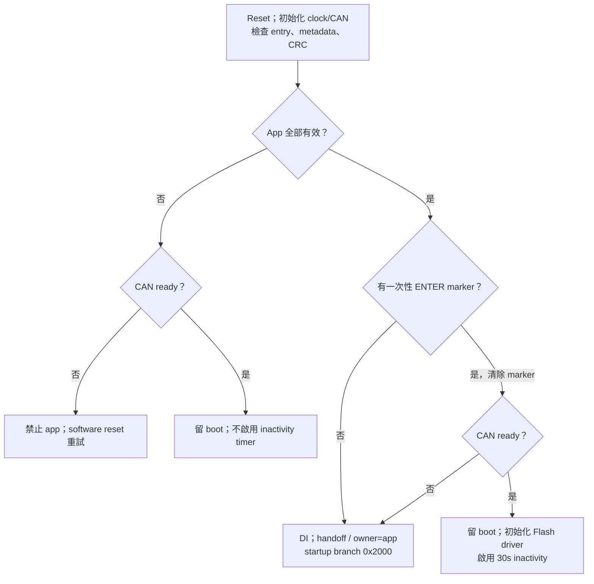
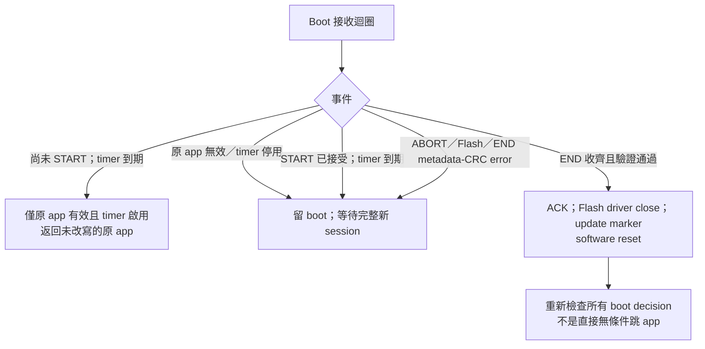
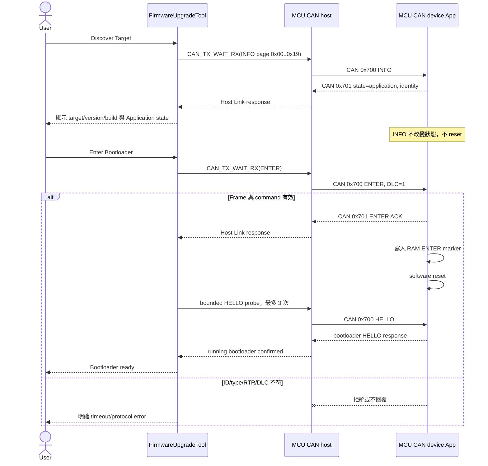
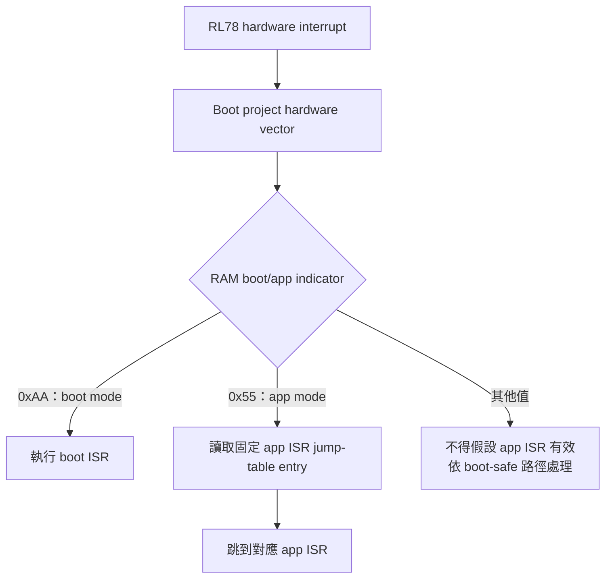
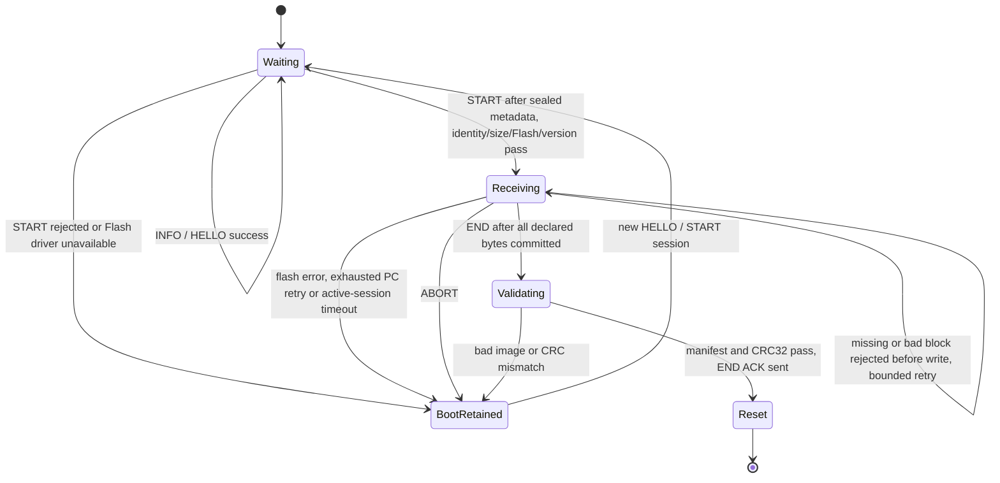
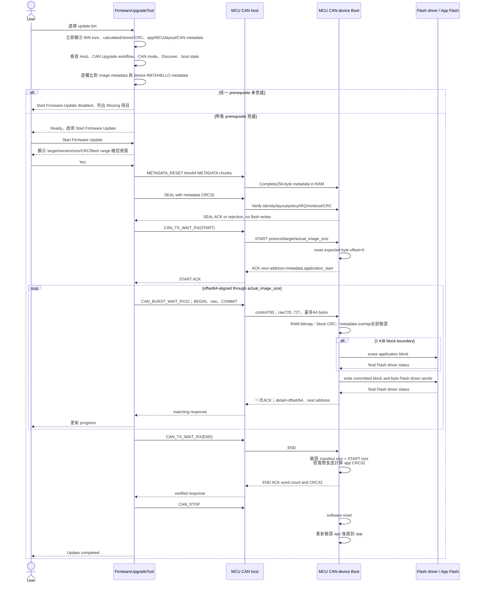
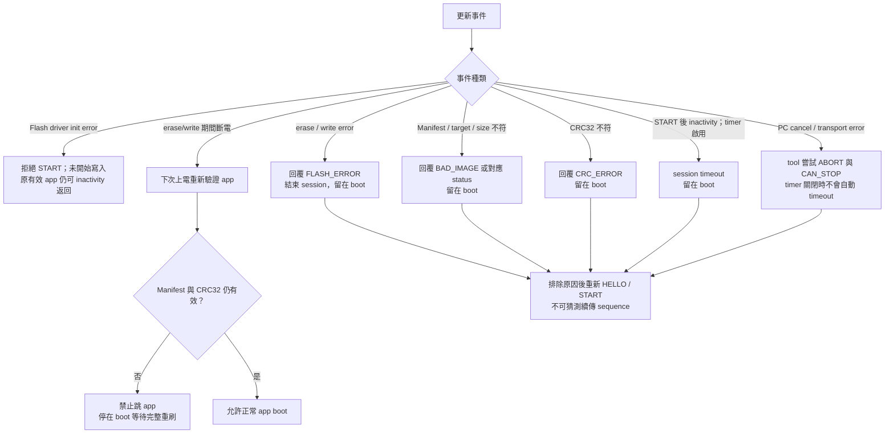

# RL78/F13 (MCU CAN device) Boot Loader 與韌體更新流程

本文件整理 F13 (MCU CAN device) 的啟動驗證、CAN 接收與 App 更新流程。
Tool／host 的操作方式見 [ISP Tool 操作](https://released.github.io/slide_isp_tool_for_RL78/#tool-operation)。
F24 (MCU CAN device) 的工程配置見 [F24 CAN device](https://released.github.io/slide_boot_loader_for_RL78/#f24-can-device)。

映像與傳輸規格採 App image format6、CAN protocol5、256-byte metadata。
版本、雜湊與量測紀錄另收於 [交付紀錄](FIRST_DELIVERY_20261015_zh-TW.md)。

## 1. 系統角色與資料邊界

MCU CAN device 的 Boot 接收更新、驗證映像並交接 App。
Tool 操作與 CAN host 轉送見 [CAN 更新逐層導讀](https://released.github.io/slide_isp_tool_for_RL78/#can-update-walkthrough)。

目前 F13 build 的 metadata 值：

- Classical CAN 500 kbit/s，不使用 CAN FD。
- Request ID `0x700`；response ID `0x701`；兩者皆為 standard data frame。
- Host使用exact response filter701；F13用control700 exact與raw data720..727／mask7F8，無receive-all。
- app 起點為 `0x2000`、容量為 `0x1E000`；兩者都是此 build 的 metadata，
  不是 tool 常數。update image 實際長度為 4-byte aligned，且必須落在
  metadata 的 minimum/capacity 範圍。
- 每區塊最多64 bytes，PC交易數為ceil(actual_image_size/64)；區塊內8筆raw frame
  各攜帶8 bytes，BEGIN／COMMIT帶offset與CRC32；只在COMMIT寫入成功後ACK。
- image manifest 位於 image offset `0x100`（此 build 為 device address
  `0x2100`），區域256 bytes、有效core128 bytes、format6；reserved128必須為0xFF，code仍從0x2200起。
- manifest 的 image-size 欄位必須等於 BIN 實際長度。
- CRC32 永遠位於 update BIN 最後 4 bytes，位址為
  `metadata.application_start + actual_image_size - 4`；CRC 範圍不含這 4 bytes。
- 此工程未啟用 WDT。復原依靠 bounded timeout、明確錯誤回覆、
  software reset、boot-mode retention，以及 manifest/CRC 驗證。

### 1.1 可變長度 F13 image 的產生與接受條件

post-build 以 linker map 的 loaded section end 決定 image 結尾。
合法程式資料也可能以 `0xFF` 結尾，因此 image 長度以 map 為依據。

`APP_REGION_SIZE` 是 boot/app 分區允許的最大容量；實際長度由 linker map 自動決定，
無需另設固定 image-size define。若 build 的實際 image 為 60 KiB，CRC32 會寫在
該 60 KiB 的最後 4 bytes；下次程式成長為 110 KiB，CRC32 就移到該
110 KiB 的最後 4 bytes。只要實際長度不超過 metadata capacity、符合 minimum
與 4-byte alignment，兩者都可由同一個 Tool 更新。

### 1.2 Tool 顯示與映像資訊

BIN 離線資訊與 live device INFO 的來源，見 [Tool 資訊與驗證](https://released.github.io/slide_isp_tool_for_RL78/#can-update-walkthrough)。

### 1.3 App UART log 與 boot/update 來源判讀

Tool 會在 END 後等待 APP_READY 並比對 live App 資訊；另提供 Boot 唯讀 VERIFY。
格式與診斷欄位集中於[更新確認與驗證紀錄](https://released.github.io/slide_isp_tool_for_RL78/#update-confirmation)。
Boot 的診斷 UART 輸出由 `CAN_BOOT_DEBUG_UART` 控制，預設關閉；App UART log 保留。

App 的 `APP_RUNTIME_LOG_TAG` 是 operator 用來快速辨識 image 的短字串。本版
預設為 `V2`，週期 log 為 `log(timer)-V2:...`。製作刻意可區分的測試 image
時可修改此 define，但 tag 本身只證明「現在跑的是哪個 image」，不能單獨
證明 image 是由 E2 Lite、combined HEX 或 bootloader 寫入。

為了判讀本次啟動路徑，boot/app 共用 `0xFF710..0xFF71F` no-init RAM：

- `0xFF710`：shared ISR owner，boot=`0xAA`、app=`0x55`。
- `0xFF714..0xFF717`：boot 驗證 image 後、handoff 前寫入一次性 signature。
- `0xFF718..0xFF71B`：CAN programming 完整成功後、驗證 reset 前寫入一次性
  signature。

App 在開中斷前讀取並清除兩個 signature，啟動時輸出：

- `app launch: boot-validated`：本次確實經 boot 驗證後 handoff。
- `CAN update: completed`：前一個 boot session 確實完成 CAN programming。
- `direct/unknown` 或 `not reported`：沒有對應的一次性證據；不是自動判定
  image 壞掉。

UI 將 BIN size、calculated CRC32、stored CRC32、checksum result、metadata
status、MCU、app version/build、target、protocol/format、flash layout 與 CAN
設定拆成各自的 label/value 欄位。尚未載入 BIN 時，每個 value 都顯示 `N/A`；
BIN metadata 不合法時保留可安全計算的 size/CRC 欄位，metadata 欄位不猜值，
並顯示 `INVALID` 與記錄詳細原因。

`App Start Override = Auto` 表示：載入 BIN 後使用 manifest 的
`application_start`；尚未載入 BIN 但已 Discover Target 時，可暫時顯示／使用
device INFO 的 start。真正開始更新前，Tool 仍要求 image metadata 與 device
metadata 的 start 完全相同。手動輸入只是額外的 safety assertion，不會搬移
BIN，也不能略過 address／identity 驗證。

### 1.4 Metadata 與 MCU CAN device 維護注意事項

- `image_size` 是本次 update BIN 的實際長度，包含最後 4-byte CRC；
  `application_capacity` 是上限，兩者不可混用。
- manifest 固定在 image offset `0x100`，不是固定 device address；device address
  為 `application_start + 0x100`。
- app start、capacity、code flash、boot reserve、erase block、minimum image 必須
  描述同一份實體 flash geometry，且 image range 不可越界或溢位。
- app manifest 與 boot INFO 必須同步 target、MCU family/part、protocol/format、
  CAN mode/bitrate、ID format、request/response ID；任何一欄不符都禁止 START。
- 修改 boot size 或 app start 時，需同步修改 boot config、依 App C header 重產 metadata、
  linker section、CS+ divided-output range，重建 boot/app 後再執行 artifact checker。

- Standard/extended ID、Classical/CAN FD、nominal/data bitrate 都必須以 bitmask
  明確宣告；未支援的組合不可由 Tool 猜測或自動降級。
- CRC32 只能確認資料完整性，不能確認發行者身分；未提供 digital signature 或
  authentication。版本政策與維護確認不是安全簽章或永久最低版本儲存。

## 2. F13 上電與 boot/app 選擇

### 2.1 已驗證的板端通訊基準

Boot/App 共用 `f13_board_support.c/.h`，對齊 Transfer 的 X1 4 MHz／PLL32：

- 4 MHz /2 x16 = PLL／CPU 32 MHz，MDIV=0；CAN 使用 fCLK/2=16 MHz。
- BRP register=1（除 2），SS/TSEG1/TSEG2=1/11/4 TQ，500K、sample point 75%。
- 診斷 UART115200、TMRJ0 1 ms 與 FSL CPU32 依此工程設定。
- reset startup 先寫 CMC 的 X1 模式，仍以 HOCO64/2 進入 main；之後才執行
  bounded X1／PLL 等待。app 繼承正確 PLL 時不停止它，亦不重寫 CMC。
- app `r_systeminit.c` 保留區的 R_CGC_Create→F13_BoardClockPrepare hook 必須
  留存；原本 generated HOCO-only function 不是目前的 active clock path。
- CAN init 先設 S HIGH、mask CAN IRQ、等 RAM 與 global/channel reset，再設定
  timing/filter；成功才設 S LOW。這也處理 boot→app 時 CAN 已啟動的狀態。
- Clock status：0=正常，1=設定不符，2=X1，3=main source，4=PLL lock，
  5=PLL select，6=fallback 失敗。clock 不符會禁止 CAN／FSL。

QB-R5F10BMG-TB 的 IC2 是 TJA1050T，VCC 接 EVDD，必須為 4.75-5.25 V。
P12 控制的是 S/silent mode，LOW 才能正常 TX；不是 standby。這塊板子的
3.3 V 測試失敗，改 5 V 後 Transfer 成功。變更供電前須斷電，確認沒有第二個
3.3 V 電源仍相接，也要確認 USB-UART 的電平相容。log 的 EVDD=5V required
是需求提示，不是 ADC 電壓量測。

初次安裝使用同一工程配套產生的 `boot_app.hex`。
此映像包含 Boot 與 App 的啟動／時鐘設定；後續 CAN 更新使用 `*_update.bin`。

### 2.2 Boot decision、ENTER 與所有 boot→app 條件

<!-- F13_BOOT_DECISION_BEGIN -->

本節整理 F13 (MCU CAN device) 的 Boot 啟動與更新狀態。
對應來源為 `r_main.c` 與 `can_boot_transport.c`。

#### A. 每次 reset 的 app 有效性檢查：全部通過才可啟動

| 檢查 | 目前 F13 build 必須符合 |
| --- | --- |
| Reset entry | `0x2000` 的第一個 DWORD 不為 `0xFFFFFFFF`；只檢查非 erased，沒有完整反組譯／驗證跳轉目的地 |
| Metadata header | `0x2100` magic=`0x004E4143`；format6、core length128、flags=`0x0003`；protocol ID1／version5、checksum type1（CRC32）、target=`0xF13B`、Classical CAN／standard ID 格式全部匹配 |
| Metadata reserved | 整區256 bytes 中後128 bytes（`0x2180..0x21FF`）全部為 `0xFF` |
| Metadata policy | UPD1 version3／size32、DEVICE_APP／CAN、F1V1 IRQ ABI；minimum Boot 不高於目前 Boot；`0x74..0x77` version control 為0或1，UART baud 與其餘保留欄位為0 |
| Image size | manifest size 含尾端 CRC4 bytes，介於516與122880 bytes，且4-byte aligned |
| App version | `0x00MMmmpp`；啟動時驗證欄位有效。更新版本比較在 START 執行，依目前有效 App 的 version control 判斷；build 不參與比較 |
| Flash layout | app start=`0x2000`、capacity=`0x1E000`、code Flash=`0x20000`、boot reserve=`0x2000`、erase=`0x400`、minimum=`0x204`，均等於 boot 編譯設定 |
| CAN contract | nominal mask=`0x04`（500K）、data mask=0、request ID=`0x700`、response ID=`0x701`，均等於 boot 編譯設定 |
| CRC32 | 對 `[app_start, app_start + image_size - 4)` 計算 CRC32，等於該 image 最後4 bytes 的 LE32 stored CRC |

Boot 直接比對 MCU ASCII family／part，要求 build 已初始化，並檢查
UPD1更新政策、IRQ ABI與最低boot版本。PC仍須另作image/live device比對。
CRC是完整性，不是簽章或身分認證；最低boot版本不等於app防回滾。

#### B. ENTER marker 與啟動路徑

1. app 有效且沒有 ENTER marker：正常返回 startup，轉到 `0x2000` 的 app table。
2. app 收到 standard data ID=`0x700`、DLC1、data=`06` 的明確 ENTER request 時，
   先嘗試送 ACK（ID=`0x701`、DLC2、`06 00`），再將 `0xAA55AA55` 寫入
   no-init RAM `0xFF700`，最後 software reset。ACK 不是 reset 的可靠送達保證。
3. boot 看見 marker 後立即清除，表示本次先進入更新模式，不是永久鎖住 boot。
   P13.7／INTP0 不參與 boot decision，也不要求 tool 或 analyzer 必須在線才能正常開 app。
4. app 無效：禁止跳 app；CAN ready 時留 boot 等完整更新，clock／CAN 初始化失敗則
   software reset 重試，不能藉此放行無效 app。
5. app 有效但要求進 boot，而 clock／CAN 初始化失敗：目前實作會返回有效 app，
   不會永久卡 boot；CAN ready／FSL ready 不是所有正常啟動都必須通過的額外 gate。
6. 真正交接前關中斷，寫 `0xFF714` handoff signature、將 `0xFF710` ISR owner
   設為 app（`0x55`），startup 再 branch app table。這些是 boot 的輸出，不是額外外部啟動要求。

#### C. 30 秒 inactivity、START、失敗與更新成功

| 事件 | boot 的實際結果 |
| --- | --- |
| 原 app 有效、ENTER 後尚未接受 START | 連續30秒沒有符合底層接收條件的 CAN request，關閉已初始化的 FSL 後返回原 app |
| 持續 INFO／HELLO／其他符合接收條件的 frame | 都會刷新 inactivity；不是上電後固定30秒，也不是只由 DATA 刷新；未知 command／錯誤 DLC 也可能刷新 |
| 原 app 無效 | 從一開始不啟用 inactivity timer，接受 START 後也不會自動啟用；失聯仍留 boot 等重試 |
| START 被拒絕（protocol／target／size／FSL not ready） | 沒有進入 started state；不能把這個拒絕當成 app 已被擦寫；原 app 有效且 timer 啟用時仍可 inactivity 返回 |
| START 已接受後 inactivity 到期 | 若本次 timer 原本啟用，回 session-timeout error、留 boot、關閉後續自動返回；不跳可能只有部分內容的 app |
| ABORT／erase-write error／END metadata 或 CRC error | error 返回主迴圈，關閉後續自動返回，留 boot 等新 session；ABORT 即使在 START 前也走這條留 boot 路徑 |
| END 長度／state 尚不完整 | 回錯誤但保留 session；不得先宣布成功或跳 app |
| END 收齊、metadata size 等於 START size、Flash metadata 與 CRC 正確 | ACK 成功，關閉 FSL，寫 `0xFF718` update-complete marker，再 software reset；下次 reset 重新通過 A 節與 ENTER 判斷才進 app |
| 擦寫中掉電 | 下次上電重新跑 A 節；若 image 仍有效且無 ENTER 則可啟動，否則留 boot；不是保證有雙映像回復 |

底層接收條件為standard／非RTR、ID700或720..727、DLC>0；通過即刷新timer，之後才
檢查 command。計時由1ms TMRJ0 IRQ 累加，Flash 操作關 IRQ 時不是嚴格的 wall-clock
30秒。timer 已停用或未啟用時，PC 失聯不能期待 target 自動 timeout／reset；tool 的
bounded wait／ABORT 不能取代供電、Flash、IRQ 與掉電的實板驗證。

#### App 工程設定

固定向量介面與 ISR 登錄方式見 [Device IRQ 設定](https://released.github.io/slide_boot_loader_for_RL78/#device-app-irq)。
Metadata 與 App-only 建置命令見 [Device App 建置](https://released.github.io/slide_boot_loader_for_RL78/#device-app-build)。

<!-- F13_BOOT_DECISION_END -->

## 3. App code 的 INFO 與 ENTER

Analyzer 的 read-only 測試：standard ID `0x700`、DLC2、`07 00`。
page0 回覆為 ID `0x701`、DLC8，boot=`07 00 00 02 3B F1 05 06`，
app=`07 00 00 01 3B F1 05 06`。Tool 選 `CAN Upgrade` 與 Classical500K；
不可使用 Transfer 的 `0x710/0x711` 封包。

app code 只處理 exact request ID、standard data、非 RTR frame。INFO 是
read-only；discover 不得偷偷 reset target。ENTER 必須由 user 明確觸發。

## 4. Shared ISR 共用中斷向量

RL78/F13 boot 與 app 不是兩套可各自獨立配置的 hardware vector table。
硬體 vector 由 boot project 持有；boot ISR 再依保留 RAM indicator 決定處理
boot peripheral，或跳到 app project 定義的 ISR jump-table entry。

修改中斷時必須同時確認：

- boot hardware vector、app jump table 與 linker address 三者完全一致。
- app image 不可覆蓋 boot/FSL 保留區，也不可移動既定 jump-table 而只改一端。
- boot 跳 app 前才設定 app indicator；reset 後先以 boot context 啟動。
- 在固定契約內新增或刪除 app ISR，只需更新 app mapping、clean-build app，
  不修改或重燒 boot；再執行 artifact checker，最後用實板逐一觸發 ISR。
- 詳細配置與 CS+ 修改位置請搭配 F13 boot/app interrupt-vector guide 閱讀。

### 4.1 CS+ / E2 Lite 除錯模式

Boot 與 app 的 startup 入口不同，且 RL78 的 debug trace/self RAM 不能配置
一般變數：

| 專案 | CS+ Run-to-main symbol | 一般 RAM 起點 | Linker 保護 |
| --- | --- | --- | --- |
| F13 boot | `_boot_main` | `0xFE500` | `-OCDTR` |
| F13 app | `_main` | `0xFE500` | `-OCDTR` |

`0xFE300-0xFE4FF` 保留給 on-chip debug trace/self RAM。若 `.dataR/.bss`
從 `0xFE300` 開始，韌體可能在脫離 debugger 時可以執行，但進入 E2 Lite
debug session 後會與除錯資源衝突。

App 除錯必須先選擇目的：

- **Standalone app debug：**直接下載 app ABS；它會暫時把 app 自己的
  `.vect` 寫入 `0x0000`，可停在 app `main()`，但不代表正式 boot handoff
  或 shared ISR 已驗證。
- **Integrated boot-to-app debug：**先燒錄 `boot_app.hex` 或 boot 加有效 app，
  保留 boot 的 `0x0000-0x1FFF`，只載入 app symbol、不要下載 app `.vect`
  object；在 app `main()` 設 breakpoint，再由 reset 經 boot 與 jump table
  進入 app。正式 boot decision、CRC handoff 與 shared ISR 必須用此模式測試。

目前上述 CS+ 設定、clean linker map 與 artifact checker 已通過軟體檢查；
實體 E2 Lite 是否正常停在 `boot_main`／`main` 仍列為硬體待驗證項目。

## 5. Boot protocol 狀態機

各 command 的接受條件：

| Command | boot code 的主要檢查與結果 |
| --- | --- |
| `HELLO` | FSL init 必須成功；回覆 metadata 宣告的 protocol、format、target、容量 |
| `INFO` | 以多頁回覆 running state、boot/app version/build、installed size、MCU、layout、CAN 能力與 ID |
| `METADATA_RESET / METADATA / SEAL` | 先清除舊RAM staging，64次4-byte依序收齊256 bytes，再驗證region CRC與全部metadata；不擦寫 |
| `START` | DLC 8、protocol 5、target相符、metadata已封存、size等於已驗證metadata且FSL ready；有效已安裝 App 啟用版控時拒絕較舊版本；START本身不擦寫 |
| `FORCE_START 0E` | 與 START 相同，僅在這次交易略過版本排序；身分、政策、minimum Boot、IRQ ABI、size、分區及 CRC 檢查保留；[維護操作](https://released.github.io/slide_isp_tool_for_RL78/#force-old-version) |
| `BLOCK_BEGIN / raw / COMMIT` | 已START，offset64對齊，最多64-byte RAM收齊／CRC及metadata重疊驗證後才逐4-byte寫入；最後一次ACK |
| `END` | 已收到全部資料、address 到達 image end、manifest 與 CRC32 正確 |
| `ABORT` | 回覆目前 sequence/address，結束 session 並留在 boot |

即時前一個已提交block可重播：核對Flash CRC，回ACK但不重寫。缺段、錯CRC／
offset回NACK且不寫入；PC最多重送整區塊一次，仍失敗就ABORT。錯ACK或Flash錯誤
直接停止，不猜測續傳。完整細節見CAN_BLOCK_TRANSFER_V5_zh-TW.md。

## 6. 完整 F13 firmware update

PC 在送出任何 START 前，會先對本機 `.bin` 做 size、reset entry、128-byte
manifest、identity/layout/CAN 與 CRC32 檢查，並與 INFO/HELLO 的 device metadata
逐欄比對。無效檔案不會產生 START/BLOCK traffic。

timeout policy：

- 一般 control／區塊最後 response：500 ms；host TX 使用 bounded timeout。
- 每個1 KiB erase boundary的第一個區塊：3000 ms。
- END manifest/CRC 驗證：5000 ms。
- target-level retry：一般control沿用一次；區塊只對TIMEOUT／BAD_SEQUENCE／CRC_ERROR整區塊重送一次。
- F13 update inactivity timeout：30 秒，僅原 app 有效、timer 啟用的 session；詳見2.2。
- tool 在 START 後遇到 cancel/error，先作 bounded best-effort ABORT，再
  `CAN_STOP`；通訊已中斷時，僅 timer 原本啟用的 F13 session 會 timeout，其他情況留 boot。

## 7. Flash、CRC 與失敗復原

FSL 採 internal automatic status mode；erase/write call 回傳最終 status。
source 中停用的 user-mode `FSL_BUSY` polling 不可重新啟用。本設計沒有 WDT，
也不以 watchdog reset 中斷 flash operation。

### 映像驗證與復原範圍

- CRC32 正確才允許進入 app，可避免執行 incomplete/corrupted image。
- 沒有 second bank 或 rollback image；斷電後若 app 無效，必須留在 boot 重刷。
- 未提供 digital signature 或 encryption；版本政策與單次 force 為操作規則，不是安全認證或永久最低版本儲存。
- CRC32 提供資料完整性檢查；發行者身分認證需要 digital signature 等獨立機制。

## 8. Tool 操作與通訊驗證

- [Tool 操作](https://released.github.io/slide_isp_tool_for_RL78/#tool-operation)
- [CAN device App 更新](https://released.github.io/slide_isp_tool_for_RL78/#mcu-can-device)
- [Custom Transfer：獨立工程與通訊測試](https://released.github.io/slide_isp_tool_for_RL78/#custom-transfer)
- [Tool／host／device 逐層動作](https://released.github.io/slide_isp_tool_for_RL78/#can-update-walkthrough)

## 9. 實板驗證

下列項目尚未因 source review、clean build 或 mock test 而自動完成：

- [ ] Classical CAN 500K、實體 exact filter、wrong-ID/extended/RTR rejection。
- [ ] 分別以 32/60/80 KiB、接近目前 F13 120 KiB 容量，以及不同合法
      app-start/capacity metadata 的映像完成更新、reset、重新 discover app；
      確認START size、ceil(size/64)區塊數、raw frame DLC與END word count均依實際長度。
- [ ] 在 START 前、每個代表性 erase/write 點、END 驗證與 reset 時斷電。
- [ ] 每次斷電後皆只執行 CRC 有效 app，否則穩定留在 boot 等待重刷。
- [ ] shared ISR 的 CAN、timer 與其他已使用 vector 在 boot/app 兩種狀態皆正確。
- [ ] 注入 FSL init/erase/write failure，確認 `FLASH_ERROR` 與 boot retention。
- [ ] target inactivity、PC timeout/cancel、UART disconnect/reconnect、queue stress。
- [ ] CAN warning、error-passive、arbitration loss、bus-off 與 recovery。
- [ ] 保存 PC summary/log、必要的 detailed log、CAN trace、build log、燒錄版本、
      option bytes、測試接線與電源中斷點。

驗證時保留 Tool log、CAN trace 與 reset 後 App 的觀察結果。

## 10. 相關文件

- [CAN Upgrade v5 Contract and F13 Baseline](./F13_BOOT_PROFILE.md)
- [F13 CRC Post-build](./F13_CRC_POST_BUILD.md)
- [F13 Transfer Protocol](./F13_TRANSFER_PROTOCOL.md)
- [F13 Boot/App 共用中斷向量指南](https://github.com/released/RL78_F13_Boot_loader_CAN/blob/main/INTERRUPT_VECTOR_GUIDE_zh-TW.md)
- [Host Link Protocol v2](./HOST_LINK_PROTOCOL_V2.md)
- [F24 Bring-up](./F24_BRINGUP.md)
- [Diagnostics and Logging](./DIAGNOSTICS.md)
- [Development Checklist](../DEVELOPMENT_CHECKLIST.md)
- [Self Check](../SELF_CHECK.md)

<!-- COMMON_IMAGE_POLICY_BEGIN -->

## 更新政策與通訊速度

BIN 的更新目的地、允許介面、Boot／IRQ ABI 與 Host Link 速度，集中於 ISP Tool 的更新政策章節。
[閱讀完整章節](https://released.github.io/slide_isp_tool_for_RL78/#image-update-policy)
<!-- COMMON_IMAGE_POLICY_END -->
