# RL78/F13 (MCU CAN device) Boot Loader 與韌體更新流程

狀態：CAN v5工程第一版；單次實板更新10963ms／END CRC通過，故障矩陣未結案  
文件日期：2026-10-15

本文件提供第一次接觸本專案的人員閱讀。主要說明 F13 (MCU CAN device) 的
boot code、app code、共用中斷向量與 CAN 更新流程；PC tool 與 F24 (MCU CAN host)
僅說明它們如何把 F13 protocol request/response 傳送到 CAN bus。

目前可追溯的軟體基準：

| 元件 | 已檢查基準 |
| --- | --- |
| PC tool | `FirmwareUpgradeTool0.1.0.0082`；歷史CAN benchmark log使用0063 |
| F24 MCU host | Host Link payload128；split boot1.2.0／app1.5.0，contract3；完整矩陣尚待板測 |
| F13 boot code | version `0x00010500`（1.5.0），build `20261015` |
| F13 app code | version `0x00010500`（1.5.0），build `20261015` |
| F13 update image | target `0xF13B`，起點 `0x2000`，實際長度可變，最大 `0x1E000` |

本版metadata區為256 bytes，core128、reserved128皆納入CRC；CAN image format6，CAN傳輸protocol改為5。F13 boot/app需一起重燒；96-byte bridge host不相容，新tool與F24亦須配套更新。Host Link最大128 bytes，metadata採分段，不等於一次傳整區。
G16 raw BIN 使用不同的 CRC16 contract，其 programming 因參考 slave 的 READ/auth/boot CRC
缺口保持鎖定；請另閱 [多匯流排操作說明](./MULTIBUS_TOOL_GUIDE_zh-TW.md)
與 [繁中 PDF](./FirmwareUpgradeTool_MultiBus_Guide_zh-TW.pdf)。

`0x1E000`（120 KiB）只是目前 R5F10BMG build 在 metadata 宣告的最大容量，
不是每一個 F13 app 的固定檔案大小，也不是 PC tool 的共用上限。未來
RL78/F14、F15、F24、F25、D1A、RA 或其他 CAN device 可在同一份 metadata
contract 宣告自己的 image 大小、flash 範圍、身分與 CAN 能力，不必新增一個
MCU 專用 UI profile。一般 UI 更新只讀取快取的驗證結果，不會在每次
`UpdateUi()` 時重算整個 image CRC。

> 重要：圖中的「已實作」代表已從目前來源碼、build artifact 或 mock/unit
> test 確認，不代表已通過實體 CAN bus、斷電、FSL fault 或 shared ISR
> runtime 測試。`201510.log` 與 Transfer 的 `pcan.jpg`／`log.jpg` 已證明
> 500K 基本傳輸：22 筆 request/reply、錯誤計數為 0；這不代表 Boot/App 已板測。
> 其餘硬體結果仍須依本文最後一節留存證據。

2026-10-15補充：使用者0079 log164225與UART截圖已證明一次19224-byte
CAN500K／Host115200更新、END CRC1DE10DCD與reset後V2 App啟動，並非完整
故障測試結案。4806筆4-byte DATA耗時約142秒、135B/s，UART無retry/timeout、
CAN無lost/TX failure/bus-off。0080只修PC串口短回覆讀取延遲，不改F13 Boot/App
或傳輸協議。使用者0080 log171150的DATA約77秒、完整約79秒，CRC相同。
0082改為v5區塊：64-byte／一次ACK；19224B由4806次交易減為301次。
使用者0082 log182253：Host115200／CAN500K、19244B／CRC CA0DF55C，301個連續區塊ACK，
完整10963ms／1755B/s，END CRC相符；無timeout/retry、queue overflow警告或CAN錯誤。
約為舊79秒的7.2倍，但映像略有不同且僅單次；新版reset後App啟動仍需UART／INFO確認。
第一版仍須更新F24 App1.5.0並初次重燒F13 Boot/App1.5.0，F24 Boot不變。
上傳檔案、SHA-256及未完成項目見[第一版交付說明](FIRST_DELIVERY_20261015_zh-TW.md)。
完整wire與安裝順序見[CAN v5區塊指南](CAN_BLOCK_TRANSFER_V5_zh-TW.md)。

## 1. 系統角色與資料邊界

F24 是通用 CAN host，不理解 F13 flash layout、manifest 或 CRC 規則。
PC tool 的 `CAN Upgrade` workflow 依 image/device metadata 驗證更新；
`Custom Transfer` 是不寫入 flash 的診斷 workflow，不是 MCU flash profile，
也不載入 BIN。`RL78_F13_CAN_Transfer` 是第一個 reference target；其他 MCU
只要實作相同的 Custom Transfer v1 contract，也可用同一流程測試。

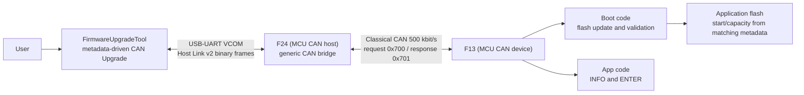

目前 F13 build 的 metadata 值：

- Classical CAN 500 kbit/s，不使用 CAN FD。
- Request ID `0x700`；response ID `0x701`；兩者皆為 standard data frame。
- Host使用exact response filter701；F13用control700 exact與raw data720..727／mask7F8，無receive-all。
- app 起點為 `0x2000`、容量為 `0x1E000`；兩者都是此 build 的 metadata，
  不是 tool 常數。update image 實際長度為 4-byte aligned，且必須落在
  metadata 的 minimum/capacity 範圍。
- 每區塊最多64 bytes，PC交易數為ceil(actual_image_size/64)；區塊內8筆raw frame
  各攜帶8 bytes，BEGIN／COMMIT帶offset與CRC32；只在COMMIT寫入成功後ACK。
- image manifest 位於 image offset `0x100`（此 build 為 device address
  `0x2100`），區域256 bytes、有效core128 bytes、format6；reserved128必須為0xFF，code仍從0x2200起。
- manifest 的 image-size 欄位必須等於 BIN 實際長度。
- CRC32 永遠位於 update BIN 最後 4 bytes，位址為
  `metadata.application_start + actual_image_size - 4`；CRC 範圍不含這 4 bytes。
- F24 與 F13 均不使用 WDT。復原依靠 bounded timeout、明確錯誤回覆、
  software reset、boot-mode retention，以及 manifest/CRC 驗證。

### 1.1 可變長度 F13 image 的產生與接受條件

post-build 以 linker map 的 loaded section end 決定 image 結尾；不能用
「最後一個非 `0xFF` byte」推算，因為合法程式資料也可能以 `0xFF` 結尾。
app 專案不需要、也不應新增「本次要做成 60K／80K／110K」的 image-size
define。`APP_REGION_SIZE` 是目前 boot/app 分區允許的最大容量；實際長度由
linker map 自動決定。若某次 build 的實際 image 為 60 KiB，CRC32 會寫在
該 60 KiB 的最後 4 bytes；下次程式成長為 110 KiB，CRC32 就移到該
110 KiB 的最後 4 bytes。只要實際長度不超過 metadata capacity、符合 minimum
與 4-byte alignment，兩者都可由同一個 Tool 更新。

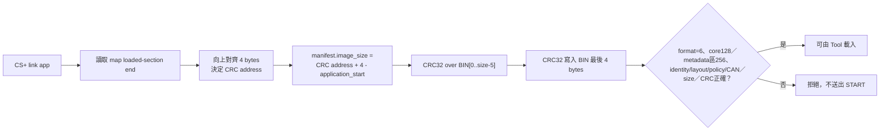

### 1.2 UI metadata 的來源與顯示時機

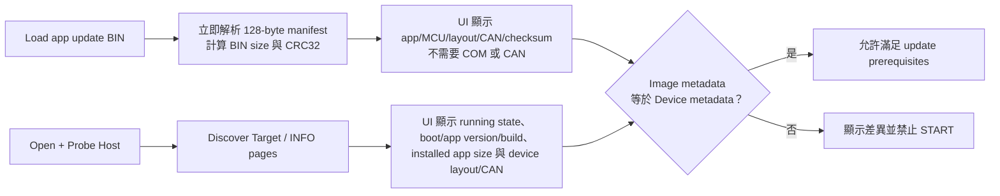

Tool 目前只載入 app update BIN，不載入 boot code BIN。因此 app BIN 的 metadata
可在離線狀態立即顯示；boot code 版本與 device 實際配置必須由 read-only INFO
handshake 取得。若未來要離線檢查 boot artifact，需另外定義 boot artifact
manifest，不能由 app BIN 猜測。

### 1.3 App UART log 與 boot/update 來源判讀

App 的 `APP_RUNTIME_LOG_TAG` 是 operator 用來快速辨識 image 的短字串。本版
預設為 `V2`，週期 log 為 `log(timer)-V2:...`。製作刻意可區分的測試 image
時可修改此 define，但 tag 本身只證明「現在跑的是哪個 image」，不能單獨
證明 image 是由 E2 Lite、combined HEX 或 bootloader 寫入。

為了判讀本次啟動路徑，boot/app 共用 `0xFF710..0xFF71F` no-init RAM：

- `0xFF710`：shared ISR owner，boot=`0xAA`、app=`0x55`。
- `0xFF714..0xFF717`：boot 驗證 image 後、handoff 前寫入一次性 signature。
- `0xFF718..0xFF71B`：CAN programming 完整成功後、驗證 reset 前寫入一次性
  signature。

App 在開中斷前讀取並清除兩個 signature，啟動時輸出：

- `app launch: boot-validated`：本次確實經 boot 驗證後 handoff。
- `CAN update: completed`：前一個 boot session 確實完成 CAN programming。
- `direct/unknown` 或 `not reported`：沒有對應的一次性證據；不是自動判定
  image 壞掉。

UI 將 BIN size、calculated CRC32、stored CRC32、checksum result、metadata
status、MCU、app version/build、target、protocol/format、flash layout 與 CAN
設定拆成各自的 label/value 欄位。尚未載入 BIN 時，每個 value 都顯示 `N/A`；
BIN metadata 不合法時保留可安全計算的 size/CRC 欄位，metadata 欄位不猜值，
並顯示 `INVALID` 與記錄詳細原因。

`App Start Override = Auto` 表示：載入 BIN 後使用 manifest 的
`application_start`；尚未載入 BIN 但已 Discover Target 時，可暫時顯示／使用
device INFO 的 start。真正開始更新前，Tool 仍要求 image metadata 與 device
metadata 的 start 完全相同。手動輸入只是額外的 safety assertion，不會搬移
BIN，也不能略過 address／identity 驗證。

### 1.4 Metadata 與 MCU CAN device 維護注意事項

- `image_size` 是本次 update BIN 的實際長度，包含最後 4-byte CRC；
  `application_capacity` 是上限，兩者不可混用。
- manifest 固定在 image offset `0x100`，不是固定 device address；device address
  為 `application_start + 0x100`。
- app start、capacity、code flash、boot reserve、erase block、minimum image 必須
  描述同一份實體 flash geometry，且 image range 不可越界或溢位。
- app manifest 與 boot INFO 必須同步 target、MCU family/part、protocol/format、
  CAN mode/bitrate、ID format、request/response ID；任何一欄不符都禁止 START。
- 修改 boot size 或 app start 時，需同步修改 boot config、重產 app `ftable.inc`、
  linker section、CS+ divided-output range，重建 boot/app 後再執行 artifact checker。
- F24 只轉送 Host Link 與 CAN frame，不得在 host firmware 內硬編碼 F13 flash
  address 或 image size。
- Standard/extended ID、Classical/CAN FD、nominal/data bitrate 都必須以 bitmask
  明確宣告；未支援的組合不可由 Tool 猜測或自動降級。
- CRC32 只能確認資料完整性，不能確認發行者身分；本版本沒有 digital signature、
  authentication 或 anti-rollback，不可把 CRC 描述成安全簽章。

## 2. F13 上電與 boot/app 選擇

### 2.1 已驗證的板端通訊基準

Boot/App 共用 `f13_board_support.c/.h`，對齊 Transfer 的 X1 4 MHz／PLL32：

- 4 MHz /2 x16 = PLL／CPU 32 MHz，MDIV=0；CAN 使用 fCLK/2=16 MHz。
- BRP register=1（除 2），SS/TSEG1/TSEG2=1/11/4 TQ，500K、sample point 75%。
- UART115200、TMRJ0 1 ms 與 FSL CPU32 的設定不變；不可套用 F24 flash library。
- reset startup 先寫 CMC 的 X1 模式，仍以 HOCO64/2 進入 main；之後才執行
  bounded X1／PLL 等待。app 繼承正確 PLL 時不停止它，亦不重寫 CMC。
- app `r_systeminit.c` 保留區的 R_CGC_Create→F13_BoardClockPrepare hook 必須
  留存；原本 generated HOCO-only function 不是目前的 active clock path。
- CAN init 先設 S HIGH、mask CAN IRQ、等 RAM 與 global/channel reset，再設定
  timing/filter；成功才設 S LOW。這也處理 boot→app 時 CAN 已啟動的狀態。
- Clock status：0=正常，1=設定不符，2=X1，3=main source，4=PLL lock，
  5=PLL select，6=fallback 失敗。clock 不符會禁止 CAN／FSL。

QB-R5F10BMG-TB 的 IC2 是 TJA1050T，VCC 接 EVDD，必須為 4.75-5.25 V。
P12 控制的是 S/silent mode，LOW 才能正常 TX；不是 standby。這塊板子的
3.3 V 測試失敗，改 5 V 後 Transfer 成功。變更供電前須斷電，確認沒有第二個
3.3 V 電源仍相接，也要確認 USB-UART 的電平相容。log 的 EVDD=5V required
是需求提示，不是 ADC 電壓量測。

**第一次請使用新版配對的 `boot_app.hex`。** 不要只換新版 boot、卻保留舊的
HOCO-only valid app；舊 app 可能停止 inherited X1／PLL。只燒 boot 的 recovery
測試須確保 app 區為空／無效。初次配對完成後，才透過 Tool 更新新 app BIN。

### 2.2 Boot decision、ENTER 與所有 boot→app 條件

<!-- F13_BOOT_DECISION_BEGIN -->
本節僅適用目前 F13 (MCU CAN device) boot/app（format6／CAN protocol5），不是 F24 (MCU CAN host)
host bridge 的 Misc／RUN 規則，也不是既有 UART／I2C 教材的 boot contract。
依據 `r_main.c` 的 `application_is_valid`／`condition_check`／`boot_main`，以及
`can_boot_transport.c` 的 manifest、START、END 與 timeout 實作；是 source 核對，非新增實板驗證。

#### A. 每次 reset 的 app 有效性檢查：全部通過才可啟動

| 檢查 | 目前 F13 build 必須符合 |
| --- | --- |
| Reset entry | `0x2000` 的第一個 DWORD 不為 `0xFFFFFFFF`；只檢查非 erased，沒有完整反組譯／驗證跳轉目的地 |
| Metadata header | `0x2100` magic=`CAN3`；format6、core length128、flags=`0x0003`；protocol ID1／version5、checksum type1（CRC32）、target=`0xF13B`、Classical CAN／standard ID 格式全部匹配 |
| Metadata reserved | 整區256 bytes 中後128 bytes（`0x2180..0x21FF`）全部為 `0xFF` |
| Metadata policy | UPD1 version1／size32、DEVICE_APP、允許CAN、無未知transport bit、F1V1 IRQ ABI；minimum boot不高於目前boot；policy保留16 bytes全0 |
| Image size | manifest size 含尾端 CRC4 bytes，介於516與122880 bytes，且4-byte aligned |
| App version | 不可為 `0xFFFFFFFF`；不要求比舊版新，不是 anti-rollback |
| Flash layout | app start=`0x2000`、capacity=`0x1E000`、code Flash=`0x20000`、boot reserve=`0x2000`、erase=`0x400`、minimum=`0x204`，均等於 boot 編譯設定 |
| CAN contract | nominal mask=`0x04`（500K）、data mask=0、request ID=`0x700`、response ID=`0x701`，均等於 boot 編譯設定 |
| CRC32 | 對 `[app_start, app_start + image_size - 4)` 計算 CRC32，等於該 image 最後4 bytes 的 LE32 stored CRC |

Boot 現在也直接比對 MCU ASCII family／part，要求 build 已初始化，並檢查
UPD1更新政策、IRQ ABI與最低boot版本。PC仍須另作image/live device比對。
CRC是完整性，不是簽章或身分認證；最低boot版本不等於app防回滾。

#### B. ENTER marker 與啟動路徑

1. app 有效且沒有 ENTER marker：正常返回 startup，轉到 `0x2000` 的 app table。
2. app 收到 standard data ID=`0x700`、DLC1、data=`06` 的明確 ENTER request 時，
   先嘗試送 ACK（ID=`0x701`、DLC2、`06 00`），再將 `0xAA55AA55` 寫入
   no-init RAM `0xFF700`，最後 software reset。ACK 不是 reset 的可靠送達保證。
3. boot 看見 marker 後立即清除，表示本次先進入更新模式，不是永久鎖住 boot。
   P13.7／INTP0 不參與 boot decision，也不要求 tool 或 analyzer 必須在線才能正常開 app。
4. app 無效：禁止跳 app；CAN ready 時留 boot 等完整更新，clock／CAN 初始化失敗則
   software reset 重試，不能藉此放行無效 app。
5. app 有效但要求進 boot，而 clock／CAN 初始化失敗：目前實作會返回有效 app，
   不會永久卡 boot；CAN ready／FSL ready 不是所有正常啟動都必須通過的額外 gate。
6. 真正交接前關中斷，寫 `0xFF714` handoff signature、將 `0xFF710` ISR owner
   設為 app（`0x55`），startup 再 branch app table。這些是 boot 的輸出，不是額外外部啟動要求。

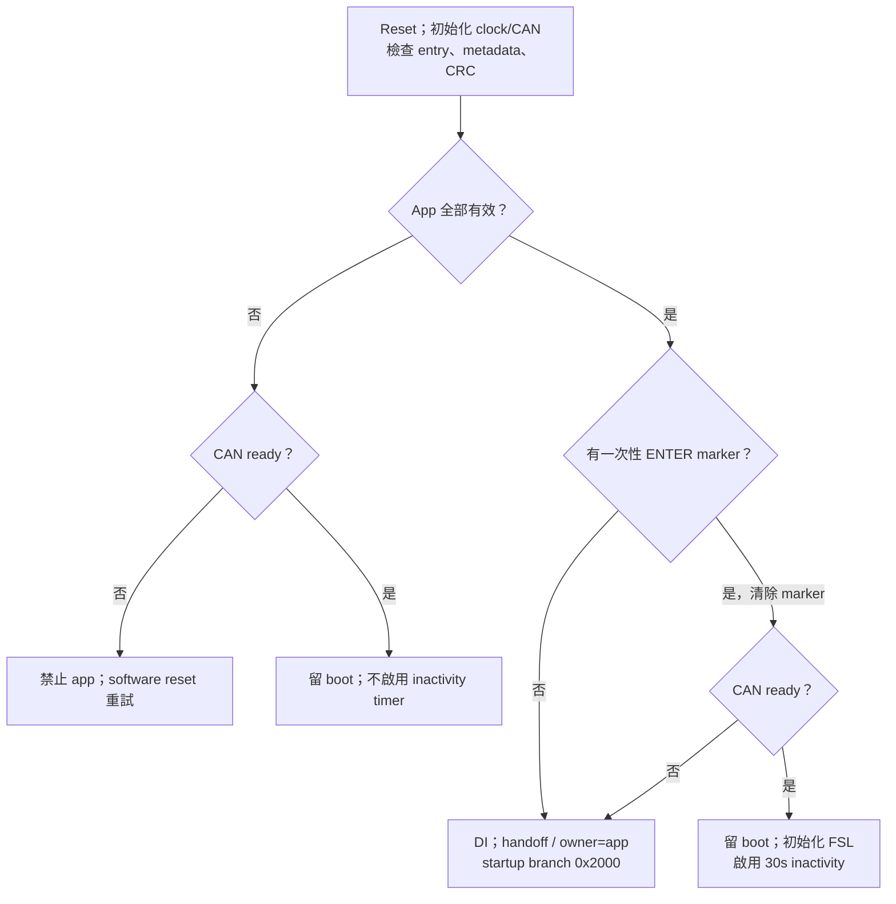

#### C. 30 秒 inactivity、START、失敗與更新成功

| 事件 | boot 的實際結果 |
| --- | --- |
| 原 app 有效、ENTER 後尚未接受 START | 連續30秒沒有符合底層接收條件的 CAN request，關閉已初始化的 FSL 後返回原 app |
| 持續 INFO／HELLO／其他符合接收條件的 frame | 都會刷新 inactivity；不是上電後固定30秒，也不是只由 DATA 刷新；未知 command／錯誤 DLC 也可能刷新 |
| 原 app 無效 | 從一開始不啟用 inactivity timer，接受 START 後也不會自動啟用；失聯仍留 boot 等重試 |
| START 被拒絕（protocol／target／size／FSL not ready） | 沒有進入 started state；不能把這個拒絕當成 app 已被擦寫；原 app 有效且 timer 啟用時仍可 inactivity 返回 |
| START 已接受後 inactivity 到期 | 若本次 timer 原本啟用，回 session-timeout error、留 boot、關閉後續自動返回；不跳可能只有部分內容的 app |
| ABORT／erase-write error／END metadata 或 CRC error | error 返回主迴圈，關閉後續自動返回，留 boot 等新 session；ABORT 即使在 START 前也走這條留 boot 路徑 |
| END 長度／state 尚不完整 | 回錯誤但保留 session；不得先宣布成功或跳 app |
| END 收齊、metadata size 等於 START size、Flash metadata 與 CRC 正確 | ACK 成功，關閉 FSL，寫 `0xFF718` update-complete marker，再 software reset；下次 reset 重新通過 A 節與 ENTER 判斷才進 app |
| 擦寫中掉電 | 下次上電重新跑 A 節；若 image 仍有效且無 ENTER 則可啟動，否則留 boot；不是保證有雙映像回復 |

底層接收條件為standard／非RTR、ID700或720..727、DLC>0；通過即刷新timer，之後才
檢查 command。計時由1ms TMRJ0 IRQ 累加，Flash 操作關 IRQ 時不是嚴格的 wall-clock
30秒。timer 已停用或未啟用時，PC 失聯不能期待 target 自動 timeout／reset；tool 的
bounded wait／ABORT 不能取代供電、Flash、IRQ 與掉電的實板驗證。

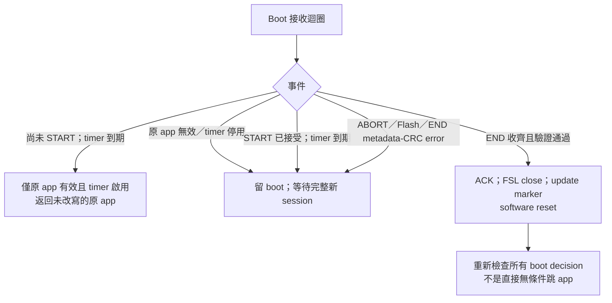
#### 固定完整 IRQ 介面：不同 app 專案沿用同一份 boot

F13 image format6／boot1.4.0 起，boot 固定擁有一般 vector 0x04..0x7C
的61個位置（包含保留位置，但 app 不可啟用保留 vector）。Reset 仍屬 boot；
0x02 保留，physical BRK 0x7E 不轉送，留給 debugger／device 設定。
App 的64個4-byte slot 固定在0x2000..0x20FF，公式是0x2000＋vector×2。

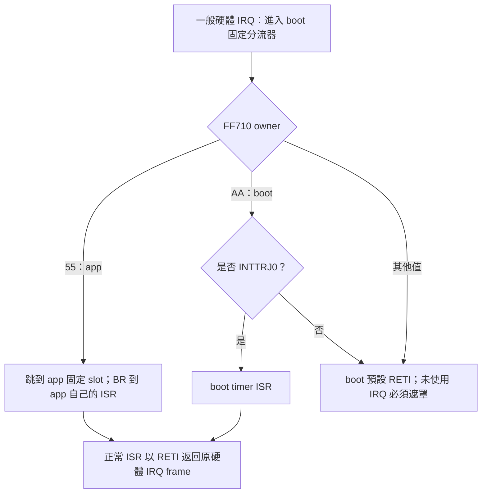

INTTRJ0 不再是普通 callback，與其他 app ISR 一樣使用無 vect 的 interrupt
pragma、以 RETI 返回。Boot 內部的 CALL／RET 僅用於壓縮組語分流，先移除
自己的暫存 call frame 再交給 ISR，並不是 C ISR 呼叫另一個 ISR。
分流暫存額外使用10 bytes stack，恢復 AX／HL／ES，原硬體 PC20／PSW frame
保持完整；未採用在分流期間重新 EI 的巢狀模式。

加入 app IRQ 只需：新增非 static ISR、在 app_irq_handlers.json 設定實體 vector
與函式名、將來源加入 app MTPJ、在 EI 前初始化／清旗標／設定優先權與解除遮罩。
App pre-build 會驗證 pragma 並產生 app_irq_table.inc；不要手改產物或 boot 向量。
未用 slot 指向 app 預設 RETI，不再是FFFFFFFF；預設返回不替你清除硬體原因，
所以不能把未處理的 IRQ 打開，否則可能反覆進中斷。

不同 app 專案可共用 boot 的前提：相同 R5F10BMG、8KiB boot／app2000、
完整跳轉表、FF700 recovery 與 FF710..FF71F no-init／stack 保留、startup 與
4MHz／PLL32／CAN16 交接、format6 的256-byte metadata／CRC32，以及
CAN protocol5／ID700與701。App 版本／build 由自己的 app_image.json 產生 ftable.inc／identity，
不綁定 boot 的編譯版本；若仍需 Tool 從 app ENTER 回 boot，該 app 必須實作
INFO／ENTER 與相同 reset request，不能只加入向量表。

**本次需先以燒錄器安裝 matching format6 boot＋app 一次。** 舊 format4 的
callback app 與新 RETI boot 不相容，即使 CRC 正確也拒絕；以後在上述契約內
換 app 專案、新增一般 IRQ 或改 app 版本，只更新 app，不需重燒 boot。
若改 MCU、分區、共用 RAM、boot 本身使用的 IRQ／更新通訊或 metadata ABI，
仍須評估並重新安裝 boot。完整向量不代表所有周邊已初始化。

F24 與 F13 現在採相同 app-facing 原則：boot 持有固定完整一般向量、依 owner
轉送 app slot、app ISR 都是 RETI。F24 用各向量直接分支；F13 為維持8KiB
boot 以共用組語分流節省 ROM，實作不同但 app 不再有 callback 特例。
目前軟體建置／HEX與stack模型檢查可執行；實板新增IRQ、E2 lite、update/reset
及斷電回復仍需驗證，不能把模型結果視為硬體通過。
<!-- F13_BOOT_DECISION_END -->

Analyzer 的 read-only 測試：standard ID `0x700`、DLC2、`07 00`。
page0 回覆為 ID `0x701`、DLC8，boot=`07 00 00 02 3B F1 04 06`，
app=`07 00 00 01 3B F1 04 06`。Tool 選 `CAN Upgrade` 與 Classical500K；
不可使用 Transfer 的 `0x710/0x711` 封包。

## 3. App code 的 INFO 與 ENTER

app code 只處理 exact request ID、standard data、非 RTR frame。INFO 是
read-only；discover 不得偷偷 reset target。ENTER 必須由 user 明確觸發。

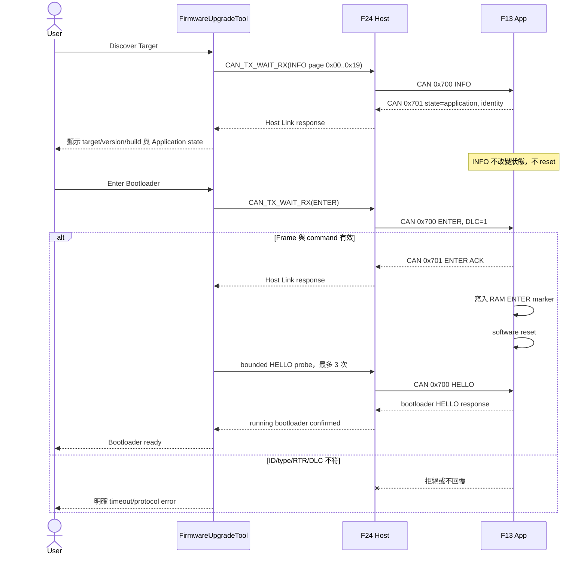

## 4. Shared ISR 共用中斷向量

RL78/F13 boot 與 app 不是兩套可各自獨立配置的 hardware vector table。
硬體 vector 由 boot project 持有；boot ISR 再依保留 RAM indicator 決定處理
boot peripheral，或跳到 app project 定義的 ISR jump-table entry。

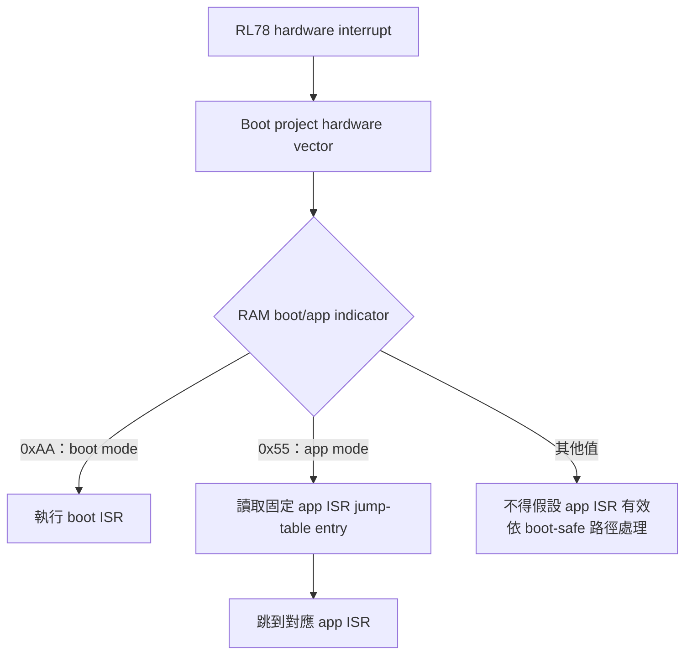

修改中斷時必須同時確認：

- boot hardware vector、app jump table 與 linker address 三者完全一致。
- app image 不可覆蓋 boot/FSL 保留區，也不可移動既定 jump-table 而只改一端。
- boot 跳 app 前才設定 app indicator；reset 後先以 boot context 啟動。
- 在固定契約內新增或刪除 app ISR，只需更新 app mapping、clean-build app，
  不修改或重燒 boot；再執行 artifact checker，最後用實板逐一觸發 ISR。
- 詳細配置與 CS+ 修改位置請搭配 F13 boot/app interrupt-vector guide 閱讀。

### 4.1 CS+ / E2 Lite 除錯模式

Boot 與 app 的 startup 入口不同，且 RL78 的 debug trace/self RAM 不能配置
一般變數：

| 專案 | CS+ Run-to-main symbol | 一般 RAM 起點 | Linker 保護 |
| --- | --- | --- | --- |
| F13 boot | `_boot_main` | `0xFE500` | `-OCDTR` |
| F13 app | `_main` | `0xFE500` | `-OCDTR` |

`0xFE300-0xFE4FF` 保留給 on-chip debug trace/self RAM。若 `.dataR/.bss`
從 `0xFE300` 開始，韌體可能在脫離 debugger 時可以執行，但進入 E2 Lite
debug session 後會與除錯資源衝突。

App 除錯必須先選擇目的：

- **Standalone app debug：**直接下載 app ABS；它會暫時把 app 自己的
  `.vect` 寫入 `0x0000`，可停在 app `main()`，但不代表正式 boot handoff
  或 shared ISR 已驗證。
- **Integrated boot-to-app debug：**先燒錄 `boot_app.hex` 或 boot 加有效 app，
  保留 boot 的 `0x0000-0x1FFF`，只載入 app symbol、不要下載 app `.vect`
  object；在 app `main()` 設 breakpoint，再由 reset 經 boot 與 jump table
  進入 app。正式 boot decision、CRC handoff 與 shared ISR 必須用此模式測試。

目前上述 CS+ 設定、clean linker map 與 artifact checker 已通過軟體檢查；
實體 E2 Lite 是否正常停在 `boot_main`／`main` 仍列為硬體待驗證項目。

## 5. Boot protocol 狀態機

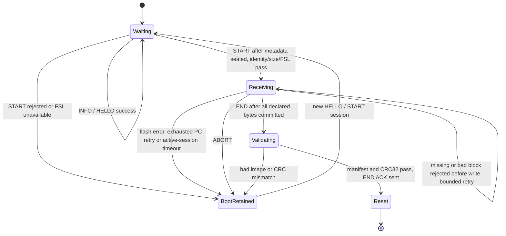

各 command 的接受條件：

| Command | boot code 的主要檢查與結果 |
| --- | --- |
| `HELLO` | FSL init 必須成功；回覆 metadata 宣告的 protocol、format、target、容量 |
| `INFO` | 以多頁回覆 running state、boot/app version/build、installed size、MCU、layout、CAN 能力與 ID |
| `METADATA_RESET / METADATA / SEAL` | 先清除舊RAM staging，64次4-byte依序收齊256 bytes，再驗證region CRC與全部metadata；不擦寫 |
| `START` | DLC 8、protocol 5、target相符、metadata已封存、size等於已驗證metadata且FSL ready；START本身不擦寫 |
| `BLOCK_BEGIN / raw / COMMIT` | 已START，offset64對齊，最多64-byte RAM收齊／CRC及metadata重疊驗證後才逐4-byte寫入；最後一次ACK |
| `END` | 已收到全部資料、address 到達 image end、manifest 與 CRC32 正確 |
| `ABORT` | 回覆目前 sequence/address，結束 session 並留在 boot |

即時前一個已提交block可重播：核對Flash CRC，回ACK但不重寫。缺段、錯CRC／
offset回NACK且不寫入；PC最多重送整區塊一次，仍失敗就ABORT。錯ACK或Flash錯誤
直接停止，不猜測續傳。完整細節見CAN_BLOCK_TRANSFER_V5_zh-TW.md。

## 6. 完整 F13 firmware update

PC 在送出任何 START 前，會先對本機 `.bin` 做 size、reset entry、128-byte
manifest、identity/layout/CAN 與 CRC32 檢查，並與 INFO/HELLO 的 device metadata
逐欄比對。無效檔案不會產生 START/BLOCK traffic。

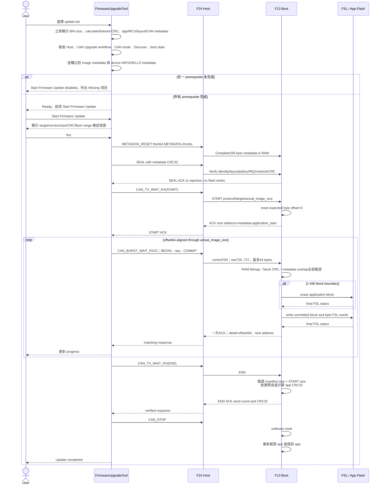

timeout policy：

- 一般control／區塊最後response：500 ms；F24每筆TX亦有界。
- 每個1 KiB erase boundary的第一個區塊：3000 ms。
- END manifest/CRC 驗證：5000 ms。
- target-level retry：一般control沿用一次；區塊只對TIMEOUT／BAD_SEQUENCE／CRC_ERROR整區塊重送一次。
- F13 update inactivity timeout：30 秒，僅原 app 有效、timer 啟用的 session；詳見2.2。
- tool 在 START 後遇到 cancel/error，先作 bounded best-effort ABORT，再
  `CAN_STOP`；通訊已中斷時，僅 timer 原本啟用的 F13 session 會 timeout，其他情況留 boot。

## 7. Flash、CRC 與失敗復原

FSL 採 internal automatic status mode；erase/write call 回傳最終 status。
source 中停用的 user-mode `FSL_BUSY` polling 不可重新啟用。本設計沒有 WDT，
也不以 watchdog reset 中斷 flash operation。

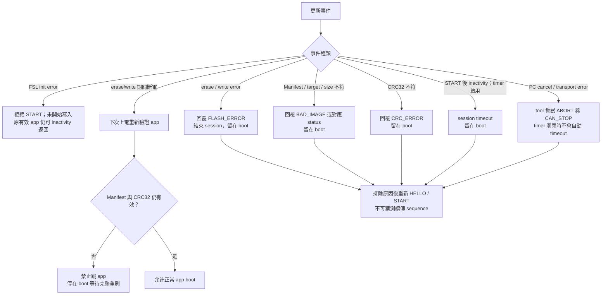

目前安全邊界是「compatibility + integrity」，不是 authenticity：

- CRC32 正確才允許進入 app，可避免執行 incomplete/corrupted image。
- 沒有 second bank 或 rollback image；斷電後若 app 無效，必須留在 boot 重刷。
- 沒有 digital signature、encryption 或 anti-rollback。
- CRC32 不能防止惡意修改；這是目前已接受的產品範圍，不應把 CRC 描述為
  firmware authentication。

## 8. PC tool 與 F24 host 輔助流程

### 8.1 Tool workflow

F24 支援的 preset 為 Classical CAN 500 kbit/s，以及 CAN FD nominal
500 kbit/s / data 2 Mbit/s；但 F13 boot/transfer profile 只允許 Classical
500 kbit/s。使用者選到 CAN FD 時，tool 會在送出 Host Link 設定前拒絕該
F13 workflow。

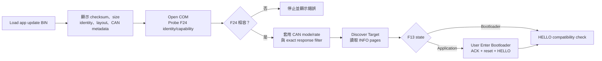

完成 target discovery 後，tool 才依 image/device metadata 決定是否開放更新：

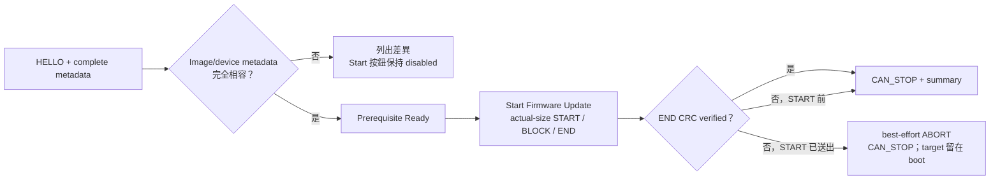

### 8.2 Discover Target：Tool、Host Link 與 F24 CAN

`Discover Target` 不是單一 CAN frame。PC worker 先透過 Host Link 完成
F24 CAN configuration、exact response filter 與 CAN start，再用三次 INFO
transaction 讀取完整 device metadata。F13 回報 boot state 時才追加 HELLO；回報
application state 時只啟用 ENTER，絕不在 discovery 中自動 reset。

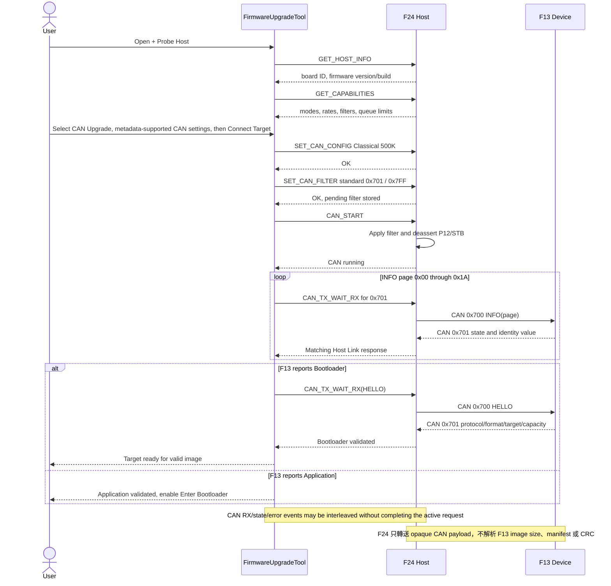

### 8.3 F24 generic transaction 與診斷

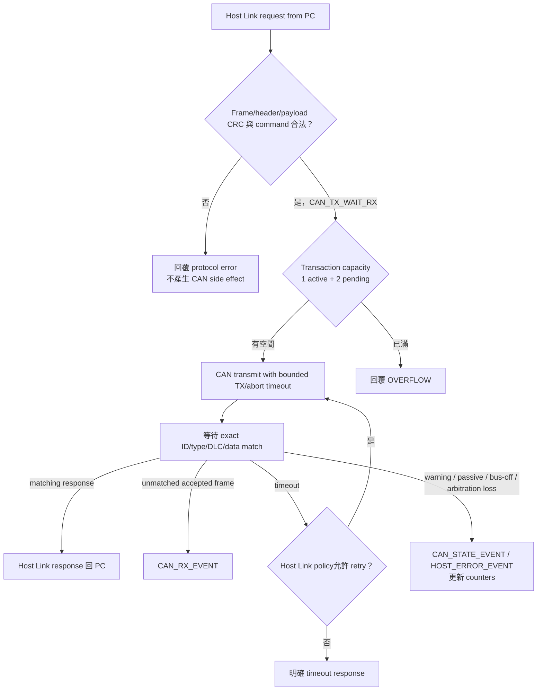

F24 的 P15/P16 是專用 binary Host Link UART，不能混入 `printf`、banner 或
任何文字 log。診斷透過 response、asynchronous event、counter 與 PC log
傳遞。目前來源碼已移除 hand-maintained code 的 `printf`/`putchar`。
UART disconnect、request timeout 或 host reset 都使用 bounded cleanup；
`RESET_HOST` 會先 ACK、等 UART TX idle 才 reset，PC 再關閉舊 handle，並在
同一 COM/baud 作一次 bounded reopen 與 identity/capability probe。

F24 LED 的來源碼狀態如下，仍待實板確認亮度、極性與實際轉換時機：

| 狀態 | LED 行為 |
| --- | --- |
| Idle | LED1 每 500 ms 切換 |
| Host connected | LED1 恆亮 |
| Transfer start | LED1 + LED2 恆亮 |
| Transfer active | LED1 恆亮，LED2 每 125 ms 切換 |
| Error | LED3 每 250 ms 切換 |

SW1 P32/INTP7 與 SW2 P70/INTP8 已接到 ISR flag 與 20 ms polling debounce；
目前沒有定義會影響更新流程的 button command。不可在未定義產品行為前讓
button 直接 erase、reset 或開始更新。

## 9. 非破壞性 MCU Device CAN Transfer 測試

在正式 erase/write 測試前，可選擇 `Custom Transfer`，以 request `0x710`、
response `0x711` 驗證 PC-F24-F13 path。此 protocol 不寫 flash，也不需要載入
app BIN；F13 專案只是第一個 reference target，不是 tool 綁死的 MCU profile。

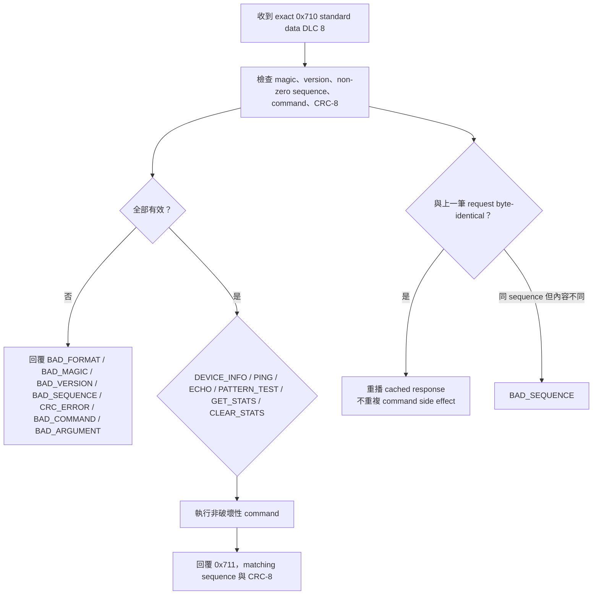

F13 reference target 預設開啟 `CAN_TRANSFER_UART_TRACE_ENABLE`。它只在
main loop 從 RX FIFO 取出 frame、或 CAN driver 接受 TX response 後輸出 UART0
文字；ISR 不會呼叫 `printf`。每行包含 ID、DLC、完整 8 bytes、sequence、
command 與獨立重算的 CRC-8 結果。

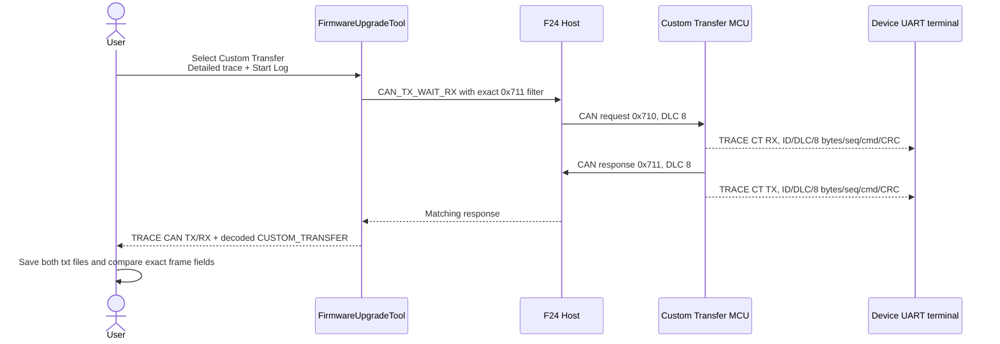

比對規則：

- PC `TRACE CAN TX id=0x710` 對 F13 `TRACE CT RX id=0x710`。
- F13 `TRACE CT TX id=0x711` 對 PC `TRACE CAN RX id=0x711`。
- ID、DLC、完整 8 bytes、sequence、command 與 `crc=OK` 必須一致；兩端
  timestamp 是各自的時間基準，不作相等比較。
- UART0 115200-baud 文字是 blocking diagnostic，會改變 main-loop timing。
  throughput、queue stress 或 timing test 前必須把
  `CAN_TRANSFER_UART_TRACE_ENABLE` 設為 `0` 並重建 target。
- Target 上電時會列出 `CAN init: OK/FAIL`、driver result、channel status、
  Classical 500K、request/response ID、exact filter 與 P12 standby 狀態。
  CAN error ISR 只保存 flags；main loop 才輸出解碼後的
  `TRACE CT CAN_ERROR`，不會在 ISR 內執行 `printf`。

## 10. User 操作成功條件與常見處置

| 階段 | 成功條件 | 失敗時先做什麼 |
| --- | --- | --- |
| Open COM | 顯示相容 F24 version/build/capability | 確認 COM、baud、FT234XD 與 P15/P16；不得用文字 terminal 測 binary link |
| CAN configure | 此 F13 build 為 Classical 500K、filter `0x701/0x7FF` | 檢查 tool mode/filter 與載入 image 的 CAN metadata |
| Discover | INFO 全部 metadata pages 內容一致 | 確認 request/response ID、termination、bitrate 與 target power |
| Enter | ENTER ACK 後 HELLO 確認 boot state | 保留 log，確認 app identity、reset marker 與 reset 後 CAN init |
| Prerequisites | 顯示 `Ready` 且 `Start Firmware Update` enabled | 依 `Missing` 清單完成 Host/Workflow/CAN/Discover/ENTER/image/metadata match |
| START | offset 0、next address 等於 metadata app start | 檢查 image/device metadata、實際 size/alignment、FSL init 與 HELLO identity |
| BLOCK | 每區塊ACK detail=offset/64、next address精確相符 | 限定錯誤重送一次，不能猜測位址；失敗ABORT後完整重刷 |
| END | word count 等於 `actual_image_size/4`、target CRC 與 local CRC 相同 | 保留 target status；重新檢查 post-build image 與傳輸 trace |
| Reset to app | reset 後 app INFO 可被讀取 | 若 app 無效，保持 boot 並重新完整更新 |
| Bus error | PC 顯示 raw flags 與 `BUS_ERROR` 等名稱；F13 可見 `TRACE CT CAN_ERROR` | 先確認 `CAN init: OK`，再檢查 CANH/CANL、共地、兩端 standby、termination、bitrate；若無 `TRACE CT RX`，尚未進入 protocol/filter response 階段 |

## 11. 實體硬體驗證與 release evidence

下列項目尚未因 source review、clean build 或 mock test 而自動完成：

- [ ] F24 P15/P16 經 FT234XD 的 binary UART 長時間傳輸，無文字輸出污染。
- [ ] Classical CAN 500K、實體 exact filter、wrong-ID/extended/RTR rejection。
- [ ] 分別以 32/60/80 KiB、接近目前 F13 120 KiB 容量，以及不同合法
      app-start/capacity metadata 的映像完成更新、reset、重新 discover app；
      確認START size、ceil(size/64)區塊數、raw frame DLC與END word count均依實際長度。
- [ ] 在 START 前、每個代表性 erase/write 點、END 驗證與 reset 時斷電。
- [ ] 每次斷電後皆只執行 CRC 有效 app，否則穩定留在 boot 等待重刷。
- [ ] shared ISR 的 CAN、timer 與其他已使用 vector 在 boot/app 兩種狀態皆正確。
- [ ] 注入 FSL init/erase/write failure，確認 `FLASH_ERROR` 與 boot retention。
- [ ] target inactivity、PC timeout/cancel、UART disconnect/reconnect、queue stress。
- [ ] CAN warning、error-passive、arbitration loss、bus-off 與 recovery。
- [ ] F24 SW1/SW2 debounce 與所有 LED 狀態的實際腳位、極性與可視性。
- [ ] 保存 PC summary/log、必要的 detailed log、CAN trace、build log、燒錄版本、
      option bytes、測試接線與電源中斷點。

硬體測試完成後，才可把本文件狀態改為 release-verified，並加入最終 UI
截圖、正常／錯誤 log 範例與繁中 PDF。Mermaid 圖若因程式行為變動而修改，
Markdown source 與 PDF 必須在同一 release 一起更新。

## 12. 相關文件

- [CAN Upgrade v5 Contract and F13 Baseline](./F13_BOOT_PROFILE.md)
- [F13 CRC Post-build](./F13_CRC_POST_BUILD.md)
- [F13 Transfer Protocol](./F13_TRANSFER_PROTOCOL.md)
- [F13 Boot/App 共用中斷向量指南](https://github.com/released/RL78_F13_Boot_loader_CAN/blob/main/INTERRUPT_VECTOR_GUIDE_zh-TW.md)
- [Host Link Protocol v2](./HOST_LINK_PROTOCOL_V2.md)
- [F24 Bring-up](./F24_BRINGUP.md)
- [Diagnostics and Logging](./DIAGNOSTICS.md)
- [Development Checklist](../DEVELOPMENT_CHECKLIST.md)
- [Self Check](../SELF_CHECK.md)

<!-- COMMON_IMAGE_POLICY_BEGIN -->
## 共用 Metadata 與跨介面防呆

Metadata固定256 bytes：前128 bytes為已定義內容（含32-byte UPD1政策），
後128 bytes必須為0xFF；app code仍從offset0x200開始。舊core96格式不相容。

| UI資訊 | 意義 |
| --- | --- |
| Update Policy | DEVICE APP或HOST APP，以及允許CAN／I2C／UART更新的清單 |
| Boot / IRQ ABI | 映像要求的最低boot版本，以及固定向量介面識別 |
| MCU、版本、分區、CRC | 仍來自載入BIN；不以目前TAB或在線device補造 |

允許更新介面不是app執行時使用的周邊。CAN-only BIN切到I2C仍顯示原本
MCU／版本／CRC32與政策，卡片及政策欄變紅並封鎖更新；不改解讀為G16 raw BIN。
Misc的目的地是HOST BRIDGE APP，不能拿DEVICE APP更新host。
PC到bridge的Host Link UART不算device更新介面；未實作UART device adapter。

上方Baud只管PC到bridge：上電115200，驗證APP支援後可協商460800／921600。
CAN／I2C／未來第二組UART不跟著換速。UART device映像的UPD1 policy version2
在metadata112..115宣告編譯時固定的device_uart_baud，Tool顯示UART @固定值，
不能由Host Link選單覆寫。boot/app須共用target編譯設定；version1 CAN／HOST
BIN保持原值與相容性。BUR1的uart_baud另指bridge自身BOOT固定更新速度。
目前僅準備UART policy解析、build helper與防呆；未提供UART device燒錄流程。

正常Close會盡力回115200；異常斷線後只對選定COM有限探測三組速度。
Misc ENTER改以BOOT描述器的固定baud重連，現行115200，不沿用APP高速。
F24分頻計算值115200→114942、460800→454545、921600→909090；Tool log
會列名義／計算值。高速度的FTDI、時鐘誤差及負載可靠性仍待實板驗證。

更新路徑必須同時受BIN政策、live boot能力、bridge選定port支援；並通過
MCU／target／分區／protocol／IRQ ABI／最低boot版本／CRC檢查。
UI與worker皆檢查，device boot在首次擦寫前再驗證完整metadata，不能只靠按鈕。
切換介面不能沿用另一介面的探索結果；port／address／rate改動後必須重新確認。

F13 (MCU CAN device) 使用CAN protocol5、image format6，DEVICE_APP／CAN／F1V1。
F24 (MCU CAN host) 使用BUR1 contract3，HOST_APP／UART／F2V1。
後續F24 (MCU CAN device) 是不同專案，不能因型號相同就套用HOST_APP／BUR1。
平台首次安裝須有matching Boot/App；不同更新協定或IRQ契約不能任意混用。
已有matching Boot時，可用Misc更新相容的Host App；Misc不更新boot本身。
精確配套版本與映像雜湊以交付說明、live INFO及BIN metadata為準。
已固定的完整一般向量轉送架構不變，未來相容app新增中斷仍只更新app。

G16新版I2C boot/app依使用者要求延後開發；舊範例保留參考及read-only探索，
不提供erase／write／app jump，也不因tool新增metadata就視為可安全更新。

正常更新／END CRC成功，不代表reset後App已執行，也不代表完整故障驗收。
自動測試包含錯映像、介面／目的地不符、
metadata重送／缺段／CRC錯、重設與768個模擬中斷寫入點。這不是實板斷電驗證；
實體CAN／FSL故障、UART斷線、
最大映像CRC耗時、debug／IRQ、斷電復原及1366×768／DPI視覺驗證仍需板測／目視。
CRC提供完整性，不是簽章、身分認證或防降版。

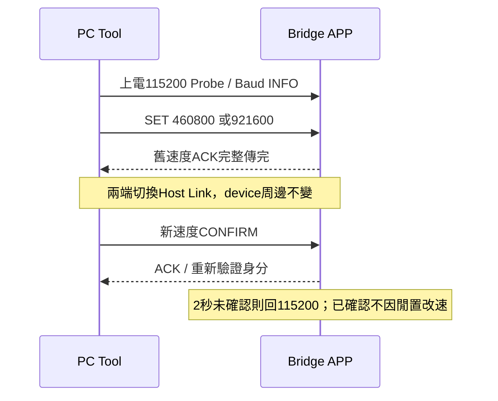

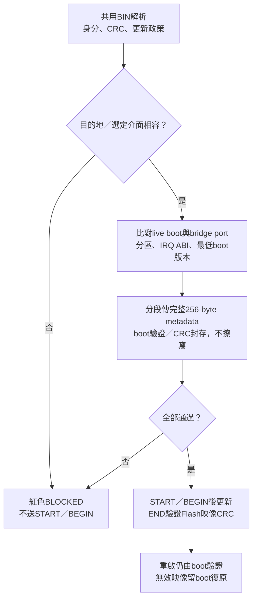
<!-- COMMON_IMAGE_POLICY_END -->
