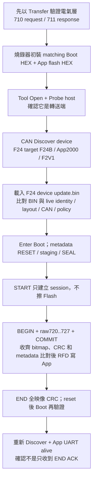

# F24 MCU CAN device：8 KiB Boot 與 App 工程配置

<!-- F24_DEVICE_BEGIN -->

## F24 (MCU CAN device)：獨立的 CAN Transfer／Boot／App

F24 除了擔任 **MCU CAN host**，也能在 CAN 另一端擔任 **MCU CAN device**。
兩者不是同一個 firmware：device 以板上的 4 MHz X1 運作，沿用 F13 的 CAN 更新架構，
但換成 F24 RS-CANFD 與 RFD driver。不能把 host 的 Misc 更新 BIN 當成 device App。

### 為什麼 F24 device 可以使用 8 KiB Boot？

Boot 大小取決於實作，不是 F24 必須預留 20 KiB。
此 device 版本使用固定 Classical CAN backend、移除未引用功能、預設關閉 Boot UART log，
保留 metadata／CRC／完整普通向量轉送／64-byte 區塊更新與 RFD RAM 執行鏈。
建置強制保留至少 512 bytes 餘裕；超限會失敗，不能靜默跨進 App。
新增 Boot 功能或開啟 log 時要重新量測；App／Transfer 仍保留獨立 UART log。

| 項目 | F24 (MCU CAN host) | F24 (MCU CAN device) |
| --- | --- | --- |
| 角色 | PC Host Link ↔ CAN 轉送 | CAN 接收、解碼、驗證及更新自身 App |
| 專案 | `RL78_F24_Bridge_boot`／`RL78_F24_Bridge_app` | `RL78_F24_CAN_Transfer`／`RL78_F24_Boot_loader_CAN`／`RL78_F24_Boot_loader_CAN_app` |
| 目前板上 X1 | 20 MHz | 4 MHz；Target Board R7F124FPJ5xFB |
| Boot／App 起點 | 20 KiB／`0x5000` | 8 KiB／`0x2000` |
| 更新自身 App | Misc／PC→host UART | CAN／host→device，Classical 500K |
| 映像／target／IRQ ABI | BUR1／host board ID／host ABI | CAN3／`0xF24B`／F2V1 |
| 實板證據 | 既有 host 測試紀錄 | 此 device 實作已建置及軟體模型驗證；實板驗證待執行 |

### F24 device Flash mapping

以下是 **F24 device**，不是 F24 host 的 BUR1 分區，也不是 F13 的容量。

| 絕對 address | 用途 | 產生／驗證位置 |
| --- | --- | --- |
| `0x00000..0x01FFF` | 唯讀 Boot、實體 vector／option；CAN 不可寫 | `can_boot_config.h`／`package_images.py` |
| `0x02000..0x020FF` | 64 組 4-byte BR：reset／普通 IRQ／default／BRK fallback | App 自有 `app_irq_handlers.json` → `device_vectors.asm` |
| `0x02100..0x0217F` | 128-byte metadata core；含 role、CAN permission、F2V1、min Boot | `app_image.json`＋Boot 契約 →生成 `.inc`／link／封裝；Boot `MetadataValid` |
| `0x02180..0x021FF` | 128 bytes 預留，固定 `FF` | 封裝／staging SEAL／Flash 驗證 |
| `0x02200..` | App code／startup／far constants | linker；不得侵入前面 metadata |
| `0x2000 + actual image size - 4` | CRC32 尾碼；actual size 隨建置決定 | 封裝／Tool offline／Boot END／reset launch |
| `0x3FC00..0x3FFFF` | 最後 1 KiB 整塊保護，含 debug monitor | RFD erase/write bounds／封裝 guard |

最大 App 容量 `0x3DC00`（247 KiB）；擦除單位 1 KiB，寫入單位 4 bytes。
metadata 每個欄位的格式沿用 [CAN3 byte 對照](https://released.github.io/slide_boot_loader_for_RL78/#flash-metadata-can-reference)，
但 target、MCU、geometry、IRQ ABI、版本與 CRC 必須取自此 F24 device 實際 BIN，
不可照抄 F13 的範例值。PC→host UART 速度不屬於 device CAN 映像的更新速度。

### 操作順序與資料路徑

| 層級 | 處理內容 | 不應處理的內容 |
| --- | --- | --- |
| Tool | BIN checksum／metadata；對比 live device；送 CAN protocol | 不根據 COM 名稱猜 MCU；不可用 PC override 繞過 geometry |
| F24 (MCU CAN host) App | Host Link 解包、generic CAN burst、等待 response | 不解 F24/F13 device Flash address 或 Boot state |
| F24 (MCU CAN device) Boot | CAN decode、metadata staging、block／CRC／replay、RFD、launch | 不接受 host BUR1 或不相容 device 映像 |
| F24 device App | 自有完整 IRQ table、INFO／ENTER、正常功能 | 不取代 Boot 的最終 Flash 驗證 |

普通 vectors `0x04..0x7C` 的轉送介面在 Boot 一次固定。不同 App 可自行增加／更換 ISR，
只需將無 `vect=` 的普通中斷函式加入自己的 MTPJ 與 JSON，再編譯 App；
只要 MCU、更新協定、layout、IRQ ABI 與 min Boot 相容，就不必因 IRQ 使用清單改變重燒 Boot。
硬體 BRK 不轉送；App 表保留 RETB fallback。更換 CAN／I2C 等更新協定仍是另一項相容性設計。

### 工程與驗證界線

Metadata 的可編輯／自動產生欄位、JSON 修改前後與新增 ISR 的完整流程，請讀
[F13／F24 device 實作教學](https://released.github.io/slide_boot_loader_for_RL78/#device-metadata-vector-workshop)。

三個 F24 device 專案置於同一父目錄；Boot 的 `common` 提供共用 board／clock／CAN backend，
App 與 Transfer 各使用自己的 SC。Boot 內附 F24 RFD 來源，不依賴個人的工作區路徑。
在 Boot 目錄執行 `build.ps1 -Kind all`；之後只改 App 可用 `-Kind app`。
MTPJ pre-build 產生啟動／vector projections，post-build 強制 ROM／RAM／向量／封裝檢查。

初裝 Boot 使用 `boot0000_1FFF.hex`，App 使用 `*_flash.hex`；CAN 更新只用 `*_update.bin`。
**不可直接燒 App 原始 MOT**：它含 device file 自動產生的實體記錄，封裝後才會排除。
不要用 Transfer 整機映像作為 App BIN，也不要在 Misc 更新外部 device。

目前已完成三專案 clean rebuild、8 KiB／512-byte spare guard、實際 vector／RETI bytes、
RFD RAM 位址與 map-visible reference 檢查、IRQ stack model、production C RAM metadata／block fault model，
以及現有 Tool production parser 對實際 F24 BIN 的驗證。這不是整顆 MCU 模擬器或實板測試。
CAN backend 的 register-level model、波形／ACK、RFD 實際擦寫、reset 後 App、斷線及斷電矩陣仍待驗證。
現有公開下載區的 F24 firmware 是 **host**；本節的 **device** 工程不可與其互換。
<!-- F24_DEVICE_END -->
