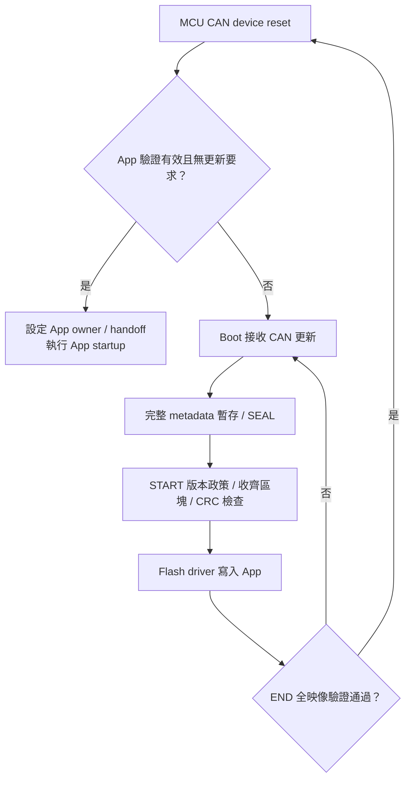

# F24 MCU CAN device：Boot／App 工程配置

<!-- F24_DEVICE_BEGIN -->
<a id="f24-can-device"></a>

## F24 (MCU CAN device)：Boot／App 工程配置

F24 CAN device 使用獨立的 Transfer、Boot 與 App 工程。
板端為 RL78/F24 Target Board R7F124FPJ5xFB。
正常 CAN App 更新已完成實板驗證，操作與 F13 device 相同：載入配對 BIN、Discover、必要時 Enter Boot、更新並確認 App。
完成報告與 UART counter 見 [F24 device 更新結果](https://released.github.io/slide_simple_renesas_isp_tool/#f24-device-update-example)。

<a id="guide-can-device-2"></a>

### 板端與更新設定

| 項目 | 設定 |
| --- | --- |
| X1／CPU／CAN clock | 4 MHz／40 MHz／40 MHz，PLL80 |
| CAN backend | RS-CANFD，Classical CAN 500K |
| CAN pins | P10 TX、P11 RX、P12 STB LOW |
| 診斷 UART | P15 TX、P16 RX、115200 |
| Flash driver | RFD Type02，programming-mode 路徑在 RAM 執行 |
| Target／IRQ ABI | `0xF24B`／F2V1 |
| IRQ owner | `0xAA`：Boot；`0x55`：App |
| CAN IDs | Control `0x700`、response `0x701`、raw `0x720..0x727` |
| 更新格式 | App image format6、CAN protocol5、64-byte blocks |

<a id="guide-can-device-3"></a>

### Flash 配置

| 絕對 address | 用途 |
| --- | --- |
| `0x00000..0x01FFF` | 8 KiB Boot，含實體 vector／option |
| `0x02000..0x020FF` | App 64 組4-byte跳轉表 |
| `0x02100..0x0217F` | 128-byte metadata core |
| `0x02180..0x021FF` | 128-byte metadata reserved FF |
| `0x02200..` | App startup／code／far constants |
| `app_start + image_size - 4` | App CRC32 尾碼 |
| `0x3FC00..0x3FFFF` | 最後1 KiB保留，含 debug monitor |

最大 App 容量為 `0x3DC00`（247 KiB），擦除單位1 KiB，寫入單位4 bytes。
建置檢查保留至少512 bytes Boot ROM 餘裕，預設關閉 Boot UART log。
完整欄位說明見 [Device metadata 位址表](https://released.github.io/slide_boot_loader_for_RL78/#flash-metadata-can-reference)。

### Boot 啟動與更新

Boot 檢查 metadata、跳轉表與全映像 CRC。
SW1（P137 LOW）或 ENTER marker 進入更新模式；有效 App 的 ENTER session 使用30秒 inactivity。
Flash 操作透過 RAM 中的 RFD 執行路徑更新 App 範圍。



<a id="guide-can-device-9"></a>

### 工程與建置

每個工程自備 `hal` API、設定 header、SC 與 MTPJ，可獨立建置。
目錄分工見 [工程目錄與程式入口](https://released.github.io/slide_boot_loader_for_RL78/#device-project-entry)。

在所選工程根目錄使用 PowerShell：

```powershell
# Rebuild this project and run its linked-image/package guards.
powershell.exe -NoProfile -ExecutionPolicy Bypass -File .\build.ps1

```

日常建置使用 Windows PowerShell、CS+／CC-RL。
CS+ hooks 依序執行產表與封裝；map、ROM／RAM、向量、metadata 與 CRC 由腳本核對。

C header 編輯、ISR 與 App-only 命令集中於 [Device App 設定與建置](https://released.github.io/slide_boot_loader_for_RL78/#device-app-build)。
初裝檔為 Boot `boot0000_1FFF.hex`＋App `flash_app_variable_CRC.hex`，核對兩者的地址範圍。
CAN 更新使用 App `*_update.bin`。App 產表為 `ftable.inc`、`app_identity.h`、`app_irq_table.inc`，
由 `ftable_RL78_F24.asm` 組譯；兩份 C header 仍是編輯入口。

<a id="guide-can-device-10"></a>

### 驗證項目

軟體檢查涵蓋編譯、向量／RETI、IRQ stack、RFD RAM 路徑及 metadata／區塊處理。
正常 500K CAN App 寫入、END CRC、reset 後 APP_READY／live INFO 與 UART timer counter 已確認。
CAN 波形量測、250K／1M、其他 IRQ、長時間壓力、取消、斷線及斷電復原分項驗證，
見 [更新驗證矩陣](https://released.github.io/slide_simple_renesas_isp_tool/#update-confirmation)。
<!-- F24_DEVICE_END -->
