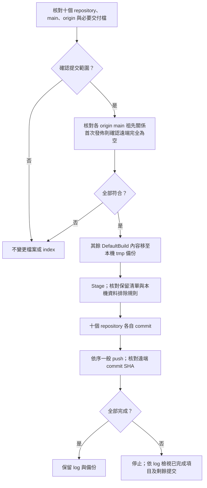

# GitHub 原始碼與交付檔同步

這個入口供維護原始碼與交付檔使用，與 Tool 的 MCU 韌體更新操作分開。
使用現有 Git for Windows、Windows PowerShell 5.1 及 Git 登入設定；不需 Python。

## 範圍與保留檔

固定順序為 F13 Boot／App／Transfer → F24 Classical Transfer／Boot／App → F24 CAN FD Transfer／Boot／App → Tool，
十個 repository 各自提交至對應 `origin/main`。
Tool repository 包含 F24 (MCU CAN host) 的 Bridge Boot／App。

| Repository／專案 | DefaultBuild 僅保留 |
| --- | --- |
| [F13 Boot](https://github.com/released/RL78_F13_Boot_loader_CAN) | `boot0000_1FFF.hex` |
| [F13 App](https://github.com/released/RL78_F13_Boot_loader_CAN_app) | `RL78_F13_Boot_loader_CAN_app_update.bin` |
| [F13 Transfer](https://github.com/released/RL78_F13_CAN_Transfer) | `RL78_F13_CAN_Transfer.mot`，燒錄器安裝獨立通訊測試映像 |
| F24 device `RL78_F24_CAN_Transfer` | `RL78_F24_CAN_Transfer.hex`，燒錄器安裝獨立通訊測試映像 |
| F24 device `RL78_F24_Boot_loader_CAN` | `boot0000_1FFF.hex`，燒錄器安裝 Boot |
| F24 device `RL78_F24_Boot_loader_CAN_app` | `RL78_F24_Boot_loader_CAN_app_update.bin`，Tool CAN 頁更新 App |
| F24 device `RL78_F24_CAN_FD_Transfer` | `RL78_F24_CAN_FD_Transfer.hex`，燒錄器安裝 FD 通訊測試映像 |
| F24 device `RL78_F24_Boot_loader_CAN_FD` | `boot0000_1FFF.hex`，燒錄器安裝 FD Boot |
| F24 device `RL78_F24_Boot_loader_CAN_FD_app` | `RL78_F24_Boot_loader_CAN_FD_app_update.bin`，Tool CAN FD 更新 App |
| [Tool](https://github.com/released/simple_renesas_isp_tool) 下的 `firmware/RL78_F24_Bridge_boot` | `RL78_F24_Bridge_boot.mot` |
| Tool 下的 `firmware/RL78_F24_Bridge_app` | `RL78_F24_Bridge_app_bridge_update.bin`、`RL78_F24_Bridge_app_flash.mot` |

只依明確檔名保留，不會因為副檔名是 BIN／HEX／MOT 就全部保留。
App 原始 `.mot` 與已封裝的 `_flash.mot` 用途不同，安裝方式見 [Host App 工程](https://released.github.io/slide_isp_tool_for_RL78/#host-app-engineering)。
其他原始碼、共用 driver、專案設定、根目錄的 App 初裝合併映像及正式文件不在清理範圍內。
F13 App 根目錄的 `boot_app.hex` 供燒錄器初裝；`boot_app.bin` 是相同內容的 raw binary，起點為 `0x0000`，不是 Tool 的 CAN 更新映像。
各操作應選用的檔案與下載連結集中於[下載與操作總覽](https://released.github.io/slide_isp_tool_for_RL78/#downloads)。
F24 device App 根目錄的 `boot_app.hex` 保留作 Boot／App 合併初裝，與 F13 的分工相同。
十二個 DefaultBuild 交付檔的清單集中於 `scripts/github_publish_catalog.ps1`，發佈與隔離測試引用同一份清單。
這個入口不重新編譯、不調整版號，也不納入 web repository。

## 路徑與執行

在 Tool repository 根目錄操作。
九個 MCU device checkout 可放在 Tool 相鄰目錄；其他位置可使用本機設定或環境變數：

| 專案 | 本機設定／命令參數 | 環境變數 |
| --- | --- | --- |
| F13 Transfer | `F13TransferProject` | `FIRMWARE_F13_DEVICE_TRANSFER_PROJECT` |
| F13 Boot | `F13BootProject` | `FIRMWARE_F13_BOOT_PROJECT` |
| F13 App | `F13AppProject` | `FIRMWARE_F13_APP_PROJECT` |
| F24 device Transfer | `F24TransferProject` | `FIRMWARE_F24_DEVICE_TRANSFER_PROJECT` |
| F24 device Boot | `F24BootProject` | `FIRMWARE_F24_DEVICE_BOOT_PROJECT` |
| F24 device App | `F24AppProject` | `FIRMWARE_F24_DEVICE_APP_PROJECT` |
| F24 FD Transfer | `F24FdTransferProject` | `FIRMWARE_F24_DEVICE_FD_TRANSFER_PROJECT` |
| F24 FD Boot | `F24FdBootProject` | `FIRMWARE_F24_DEVICE_FD_BOOT_PROJECT` |
| F24 FD App | `F24FdAppProject` | `FIRMWARE_F24_DEVICE_FD_APP_PROJECT` |

1. 複製 `scripts/github_push.paths.example.psd1` 為根目錄的 `github_push.local.psd1`。
2. 將九個值填為這台電腦的 checkout 完整路徑。
3. 此檔已排除於 Git；不放 token、密碼或其他登入資料。

路徑優先順序：命令參數 → 本機設定檔 → 環境變數 → Tool 相鄰目錄。

雙擊根目錄 `github_push.bat`，檢視十個 repository 的狀態與保留清單。
輸入 `PUSH` 後，才進行整理、commit 與 push；取消時不變更檔案或 Git index。
除了下述暫緩路徑，未被忽略的新增、修改與刪除會包含在提交內。
Tool 中路徑名稱含 `RH850` 的專用指南、腳本及測試不納入這個發佈清單，大小寫皆適用。
預覽的 `DEFERRED` 清單列出排除項目；既有 tracked 檔案的修改也不會提交，本機檔案保留原狀。
RH850 的獨立 MCU repository 不在清單內。此設定不提供略過參數，調整發佈範圍需修改清單並重新驗證。

僅預覽，不連線、不整理、不提交：

```powershell
.\scripts\push_github.ps1
```

指定提交說明，檢視清單後確認：

```powershell
.\scripts\push_github.ps1 -Execute -Message 'Update Tool and CAN firmware'
```

已檢視清單、需要非互動執行時可加 `-Yes`。
該參數只略過這次確認，不略過路徑、保留檔、Git 與遠端驗證。

## 整理、驗證與恢復



- `DefaultBuild` 其餘內容移至 `tmp/internal/github_publish/<本次執行>/`，沒有永久刪除。
  `f13_boot`、`f13_app`、`f13_transfer`、`f24_device_transfer`、`f24_device_boot`、`f24_device_app`、
  `f24_fd_transfer`、`f24_fd_boot`、`f24_fd_app`、`bridge_boot`、`bridge_app`
  對應表格中的十一個目錄；同一層保留 `publish.log`。
- 搬移任何輸出前，先檢查 `tmp/`、本機路徑設定、Tool 執行期 INI／log／reports。
  已被追蹤或未被忽略的本機資料會使流程停止，並列出 repository 與相對路徑；不自動刪除或取消追蹤。
- 缺少／空白交付檔、錯誤 origin、非 main、未處理的 staged changes、Git 操作未完成、junction／symlink，均停止。
  已明確取消本機資料追蹤的 staged deletion 可納入提交；其餘 staged 新增、修改或原始碼刪除仍停止。
  不自動切換分支、不 pull／merge／rebase、不 force push。
- 遠端 main 必須是本機 HEAD 的祖先。若遠端已有本機沒有的修改，先檢視及同步，再重新執行。
- 十個 repository 的 push **不是原子交易**。若第二個 push 失敗，第一個可能已完成。
  保留各 repository 的 commit 與備份，修正原因後重新執行；沒有變更時不另建空 commit。
- 只更新目前分支內容，不重寫 Git 歷史；先前已提交的建置輸出仍可由歷史版本查到。
- 編譯期間不要執行整理。核對後若 Git 狀態或交付檔變動，流程停止；鎖定檔案不會強制刪除。
- 預覽與整理不等於韌體驗證。交付前仍依各專案的編譯、metadata／CRC 與實板驗證程序確認。

需要恢復除錯輸出時，可正常重建，或由本次備份複製回原 `DefaultBuild`。
同名檔已重新產生時先比對內容，不直接覆寫。
隔離流程測試為 `scripts/verify_github_publish.ps1`，只使用本機測試 repository／bare remote，不連接 GitHub。

## 本機資料排除與重試

`.gitignore` 會排除尚未追蹤的檔案；已在 Git index 中的檔案，仍需另外取消追蹤。
出現 `Local-only data is tracked` 時，在訊息指出的 repository 中核對檔案，再以 `--cached` 保留本機內容：

```powershell
git ls-files -- tmp/
# Example: remove only the reviewed log from Git tracking, not from disk.
git rm --cached -- tmp/build/app_rebuild.log
```

同時在該 repository 的 `.gitignore` 加入 `/tmp/`，避免下一次 `git add` 再次納入。
`Local-only data is not ignored` 則表示檔案尚未追蹤，但目前忽略規則不足；調整 `.gitignore` 後再預覽。

取消追蹤會在 index 中顯示 `D`；對上述本機資料而言，這是待提交的追蹤移除，不代表本機檔案被刪除。
發佈腳本允許這類 staged deletion，其他原始碼或交付檔的既有暫存變更仍需另外檢視。
下一次發佈只更新目前分支；這項排除不會清除初始 commit 或其他歷史紀錄中的檔案。

若先前執行已搬移 DefaultBuild 輸出，可依 `publish.log` 與備份核對該次整理。
需要解除腳本留下的暫存刪除時，只處理已確認的個別路徑，保留其他 staged changes；不重設整個 index 或還原工作目錄。
確認後執行 `scripts/push_github.ps1` 預覽，再透過 `github_push.bat` 檢視清單並輸入 `PUSH`。

## 第一次加入 device repository

每個 checkout 需已有自己的 `.git`、`main`、至少一個本機 commit，以及正確 `origin`。
本入口不建立 GitHub repository、不初始化 Git、不替使用者選擇登入帳號或修改 remote。
缺少 `.git` 時在任何整理／stage／commit 之前停止。

F24 device 的預期 origin 分別對應 `released/RL78_F24_CAN_Transfer`、
`released/RL78_F24_Boot_loader_CAN`、`released/RL78_F24_Boot_loader_CAN_app`；
CAN FD 對應 `released/RL78_F24_CAN_FD_Transfer`、`released/RL78_F24_Boot_loader_CAN_FD`、
`released/RL78_F24_Boot_loader_CAN_FD_app`。
名稱是清單中的驗證值，不代表本腳本會建立遠端或已確認遠端存在。
首次 commit 前可參考 `scripts/github_push.device.gitignore.example`，
將本機 `tmp`、CS+ 中間檔及其他 DefaultBuild 輸出排除，並檢查預計提交的檔案。

已建立但完全為空的 origin 可作首次 main 發佈；若遠端有其他 refs 卻沒有 main，流程停止供檢視。
既有 main 仍須符合祖先檢查，不因首次加入專案而放寬覆寫保護。

<a id="fd-publication-layout"></a>

## FD 工程相依與生成路徑

FD App 與 FD Transfer 建置均引用同層的 `RL78_F24_Boot_loader_CAN_FD`；
三個 checkout 保持原有資料夾名稱，置於同一父目錄。各 README 列出使用的 build 入口。
發佈腳本不代替 MCU 建置，也不將共用來源複製成另一套。

FD 的 `tools/prepare_projects.ps1` 使用相對的產生器檔名與輸出目錄，
並整理 `iodefine.h` 命令註解；SFR 宣告、授權文字與 CS+ 工具鏈安裝設定保持不變。
SC 重新生成後依 README 執行準備／建置入口；`-CheckOnly` 會檢查上述路徑狀態。
公開原始碼不依賴某台電腦的工作區路徑；本機發佈路徑只保存在已忽略的 `github_push.local.psd1`。
