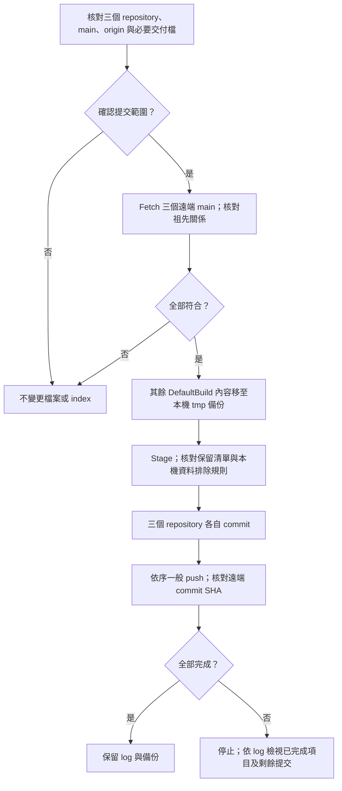

# GitHub 原始碼與交付檔同步

這個入口供維護原始碼與交付檔使用，與 Tool 的 MCU 韌體更新操作分開。
使用現有 Git for Windows、Windows PowerShell 5.1 及 Git 登入設定；不需 Python。

## 範圍與保留檔

固定順序為 F13 Boot → F13 App → Tool，各自提交至對應 `origin/main`。
Tool repository 包含 F24 (MCU CAN host) 的 Bridge Boot／App。

| Repository／專案 | DefaultBuild 僅保留 |
| --- | --- |
| [F13 Boot](https://github.com/released/RL78_F13_Boot_loader_CAN) | `boot0000_1FFF.hex` |
| [F13 App](https://github.com/released/RL78_F13_Boot_loader_CAN_app) | `RL78_F13_Boot_loader_CAN_app_update.bin` |
| [Tool](https://github.com/released/simple_renesas_isp_tool) 下的 `firmware/RL78_F24_Bridge_boot` | `RL78_F24_Bridge_boot.mot` |
| Tool 下的 `firmware/RL78_F24_Bridge_app` | `RL78_F24_Bridge_app_bridge_update.bin`、`RL78_F24_Bridge_app_flash.mot` |

只依明確檔名保留，不會因為副檔名是 BIN／HEX／MOT 就全部保留。
App 原始 `.mot` 與已封裝的 `_flash.mot` 用途不同，安裝方式見 [Host App 工程](https://released.github.io/slide_isp_tool_for_RL78/#host-app-engineering)。
其他原始碼、共用 driver、專案設定、根目錄的 App 初裝合併映像及正式文件不在清理範圍內。
F13 App 根目錄的 `boot_app.hex` 供燒錄器初裝；`boot_app.bin` 是相同內容的 raw binary，起點為 `0x0000`，不是 Tool 的 CAN 更新映像。
各操作應選用的檔案與下載連結集中於[下載與操作總覽](https://released.github.io/slide_isp_tool_for_RL78/#downloads)。
這個入口不重新編譯、不調整版號，也不納入其他 MCU CAN device repository 或 web repository。

## 路徑與執行

在 Tool repository 根目錄操作。
F13 Boot／App 可放在 Tool 相鄰目錄；其他位置可採既有的
`FIRMWARE_F13_BOOT_PROJECT`／`FIRMWARE_F13_APP_PROJECT` 環境變數，或使用本機設定：

1. 複製 `scripts/github_push.paths.example.psd1` 為根目錄的 `github_push.local.psd1`。
2. 將兩個值填為這台電腦的 Boot／App checkout 完整路徑。
3. 此檔已排除於 Git；不放 token、密碼或其他登入資料。

路徑優先順序：命令參數 → 本機設定檔 → 環境變數 → Tool 相鄰目錄。

雙擊根目錄 `github_push.bat`，檢視三個 repository 的狀態與保留清單。
輸入 `PUSH` 後，才進行整理、commit 與 push；取消時不變更檔案或 Git index。
現有未被忽略的變更都會包含在提交內，包括新增、修改與已刪除的檔案。

僅預覽，不連線、不整理、不提交：

```powershell
.\scripts\push_github.ps1
```

指定提交說明，檢視清單後確認：

```powershell
.\scripts\push_github.ps1 -Execute -Message 'Update Tool and CAN firmware'
```

已檢視清單、需要非互動執行時可加 `-Yes`。
該參數只略過這次確認，不略過路徑、保留檔、Git 與遠端驗證。

## 整理、驗證與恢復



- `DefaultBuild` 其餘內容移至 `tmp/internal/github_publish/<本次執行>/`，沒有永久刪除。
  `f13_boot`、`f13_app`、`bridge_boot`、`bridge_app` 對應表格中的四個目錄；同一層保留 `publish.log`。
- `tmp/`、本機路徑設定、Tool 執行期 INI／log／reports 不會上傳。
  若這些內容已被 Git 追蹤，腳本停止，待人工檢視 index；不自動刪除使用者資料。
- 缺少／空白交付檔、錯誤 origin、非 main、既有 staged changes、Git 操作未完成、junction／symlink，均停止。
  不自動切換分支、不 pull／merge／rebase、不 force push。
- 遠端 main 必須是本機 HEAD 的祖先。若遠端已有本機沒有的修改，先檢視及同步，再重新執行。
- 三個 repository 的 push **不是原子交易**。若第二個 push 失敗，第一個可能已完成。
  保留各 repository 的 commit 與備份，修正原因後重新執行；沒有變更時不另建空 commit。
- 只更新目前分支內容，不重寫 Git 歷史；先前已提交的建置輸出仍可由歷史版本查到。
- 編譯期間不要執行整理。核對後若 Git 狀態或交付檔變動，流程停止；鎖定檔案不會強制刪除。
- 預覽與整理不等於韌體驗證。交付前仍依各專案的編譯、metadata／CRC 與實板驗證程序確認。

需要恢復除錯輸出時，可正常重建，或由本次備份複製回原 `DefaultBuild`。
同名檔已重新產生時先比對內容，不直接覆寫。
隔離流程測試為 `scripts/verify_github_publish.ps1`，只使用本機測試 repository／bare remote，不連接 GitHub。
