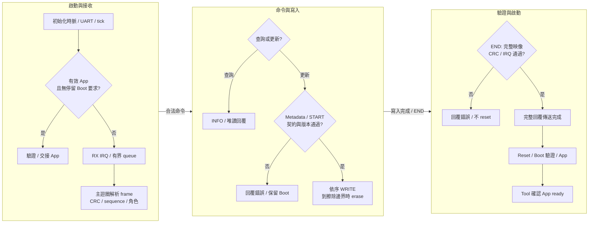
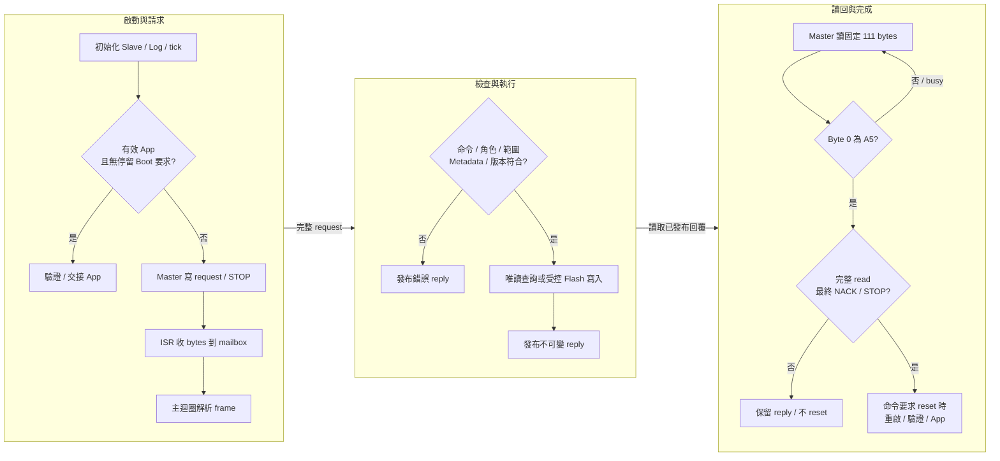
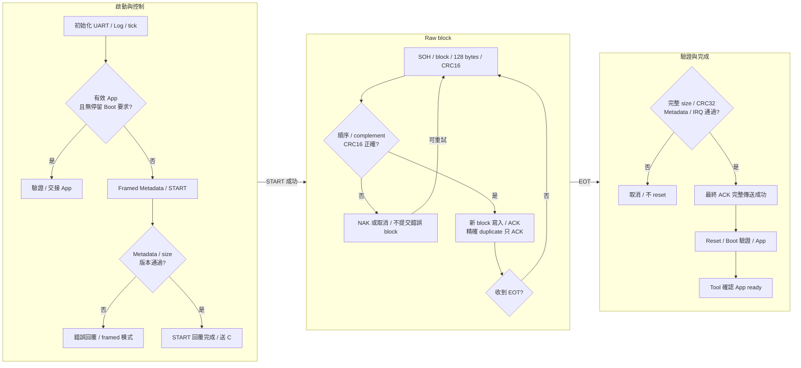

# MCU 串列 Bootloader：UART、I2C 與 Xmodem

各平台的工程、位址與中斷配置由各自指南說明。
本文件集中描述資料介面如何承載更新協定；完整共用封包與命令表見
[RL78 共用契約](https://released.github.io/slide_boot_loader_for_RL78/serial-device.html#guide-serial-device-5)／
[RH850 共用契約](https://released.github.io/slide_boot_loader_for_RH850/serial-device.html#guide-serial-device-5)。

<!-- UART_DEVICE_BEGIN -->
<a id="uart-bootloader"></a>

## UART Bootloader 與協定格式

本章使用 framed UART ISP；每份 Boot、App、Transfer 各自是獨立工程。
UART 資料與診斷 Log 分開接線；Tool 的 Host Baud 與 Device baud 也分別設定。

<a id="guide-uart-device-1"></a>

### 工程與接線

| 用途 | 工程或連線 | 詳細說明 |
| --- | --- | --- |
| Boot／App／Transfer | 選擇名稱含 UART 的對應工程；各自包含來源與建置工具 | [平台工程與周邊](serial-device.html#guide-serial-device-1) |
| ISP 資料 | Bridge 資料 UART TX 接 device RX，RX 接 TX；共地並核對電壓 | [Tool 接線與操作](https://released.github.io/slide_simple_renesas_isp_tool/serial-isp.html#uart-device-operation) |
| 診斷文字 | Device 的獨立 Log UART 接 terminal | [平台工程與周邊](serial-device.html#guide-serial-device-1) |
| 建置與下載檔 | 在所選工程執行 PowerShell 建置；Boot 安裝檔與 App 更新 BIN 分別使用 | [編輯、產生與建置](serial-device.html#guide-serial-device-2) |

App-only 建置使用 App 自己的契約與工具；安裝到板上的 Boot 仍需與 App 相容。
Custom Transfer 是獨立通訊診斷映像，不擦寫 App Flash。

<a id="guide-uart-device-2"></a>

### 通訊設定

| 修改來源 | 作用 | 同步核對 |
| --- | --- | --- |
| `isp_transport_config.h` 的 `ISP_UART_BAUD` | Device 資料 UART 速率，範例為 115200 bit/s、8-N-1 | 配對 Boot／App 的周邊分頻、INFO、BIN Metadata 與 Tool Device baud |
| `ISP_POLICY_UART_BAUD` | 映像契約宣告的 UART baud | 與實際初始化及上述速率相符 |
| `.scfg` 或各工程 board adapter | 周邊、腳位、來源時脈與分頻 | [SC 設定與重新產生](serial-device.html#guide-serial-device-4) |
| `ISP_INTERBYTE_TIMEOUT_MS` | 未完成封包的接收閒置期限，範例 200 ms | 與實際傳輸及接收處理相符 |
| `ISP_BOOT_IDLE_TIMEOUT_MS` | 有效 App 進入 Boot 後、更新尚未開始時的閒置返回期限，範例 30000 ms | 已開始的更新不套用此閒置返回 |

變更 baud 時重建配對 Boot／App，並安裝更新後的 Boot。
可選速率與必要條件集中於 [通訊設定與更新必要條件](https://released.github.io/slide_simple_renesas_isp_tool/serial-isp.html#serial-update-requirements)。
Metadata 欄位位置見 [Metadata offset 與協定配置](serial-device.html#guide-serial-device-3)。

<a id="guide-uart-device-3"></a>
<a id="uart-boot-flow"></a>

### Boot 執行流程



INFO 等唯讀命令也由主迴圈回覆；ISR 只處理接收資料與錯誤狀態。
Metadata staging 與 START 不擦除 Flash；第一個合法 WRITE 才依擦除邊界啟動 Flash 操作。

<a id="guide-uart-device-4"></a>
<a id="uart-protocol"></a>

### Protocol Format

UART 依 byte stream 傳送共用 ISP frame。接收端依 header 的 payload length 找到 CRC32 尾碼，
不以 UART idle、換行或 terminal 文字作為命令結尾。

| 層級 | 內容與長度 | 參考 |
| --- | --- | --- |
| Frame | 10-byte header ＋ 0..96-byte payload ＋ 4-byte CRC32，最長 110 bytes | [逐 byte 封包與命令表](serial-device.html#guide-serial-device-5) |
| METADATA `03` | LE16 Metadata offset ＋ 4..64 bytes；依序暫存全部 256 bytes | Offset 基準是 Metadata 起點 |
| START `04` | LE32 完整 BIN bytes ＋ LE32 映像末端 CRC32 | 驗證已暫存 Metadata、配置與版本政策 |
| WRITE `05` | LE32 BIN offset ＋最多 64 bytes；非末塊為 64 bytes | Offset 基準是 BIN 起點，實體位址＝App 起點＋offset |
| END `06` | 空 payload | 重新驗證完整已寫入映像，再回覆結果 |

CRC32 有兩個用途：frame 尾碼保護本次 header／payload；BIN 末端 4 bytes 保護映像中尾碼之前的內容。
兩者分別計算，不能以封包 CRC 正確推定 Flash 映像有效。

#### 完整封包範例

以下 INFO request 為 sequence＝1、command＝01、空 payload；可以送給 Boot、App 或 Transfer。
最後四個 bytes 是前十個 bytes 的 CRC32，採 little-endian。

```text
49 53 01 00 01 00 01 00 00 00 F1 8D B0 75
```

具體回覆的 88-byte INFO payload 取決於板上角色、MCU、分區與 installed App；欄位定義見共用契約。

#### 成功與錯誤回覆範例

下列為依格式計算的封包範例，不是板端擷取記錄。以Transfer角色為例，PING將payload原樣回覆；未知命令回覆`BAD_COMMAND=1`，兩者的sequence／command都對應request。

```text
PING request: 49 53 01 00 02 00 20 00 03 00 12 34 56 1F 91 6C 3F
PING reply:   49 53 01 01 02 00 20 00 03 00 12 34 56 21 FA AE D0
Unknown request: 49 53 01 00 03 00 7F 00 00 00 55 FB 98 B3
Error reply:     49 53 01 01 03 00 7F 01 00 00 D6 9A 2D 14
```

Header的response byte由00改為01；status為00成功、01未知命令。

每列最後4bytes分別對該列header與payload計算CRC32；錯誤回覆也有自己的有效CRC。


<a id="guide-uart-device-5"></a>

### 異常與完成條件

| 觀察 | Device／Tool 行為 | 核對方向 |
| --- | --- | --- |
| Frame 未收齊或 CRC 錯誤 | 不執行該命令；partial frame 超過設定期限後清除 | baud、接線、queue／硬體錯誤、封包長度 |
| 同一 sequence 重送 | 只接受完整相同 request，重播快取回覆 | 不把重播當作第二次寫入 |
| START／WRITE 被拒絕 | 回覆對應 status，不以錯誤 request 授權 Flash 操作 | [狀態碼與命令條件](serial-device.html#serial-status-codes) |
| END 驗證成功 | 完整回覆傳送完成後才 reset | Device 傳送完成與 Tool 收到回覆分別判斷 |
| App 確認尚未成功 | 保留報告並讀取即時狀態 | 不自動重複 erase／END／RUN 來推定結果 |

實際操作與報告判讀見 [Tool 串列操作](https://released.github.io/slide_simple_renesas_isp_tool/serial-isp.html)。
平台與實板驗證範圍見 [驗證範圍](serial-device.html#guide-serial-device-9)。

<a id="guide-uart-device-6"></a>

### 程式對照與診斷

| 程式位置 | 入口或 API | 責任 |
| --- | --- | --- |
| `custom_func.c` | `hardware_init()`／`loop()` | 平台初始化、封包處理及回覆完成後的交接順序 |
| `hal/isp/isp_protocol.c` | `IspStreamFeed()`／`IspEncode()` | 串流組包、長度與 frame CRC32 |
| `hal/isp/isp_device.c` | `IspDeviceProcess()`／`IspDeviceWrite()`／`IspDeviceFinish()` | 命令、角色、版本、範圍及更新狀態 |
| `hal/device` | 各平台 UART RX／Error ISR、board API | 有界 queue、周邊初始化與傳送完成 |
| `hal/image`／`hal/flash` | 映像驗證與 Flash API | Metadata、完整 CRC、IRQ 與實際擦寫 |

<a id="serial-uart-diagnostics"></a>

<a id="guide-serial-device-6"></a>

#### UART診斷格式

Command0x25不帶payload。只有INFO宣告bit6時才查詢；回覆是下表24bytes，多byte整數採little-endian。
回覆使用相同sequence快取規則；重播同一request不重新讀取硬體。

| Offset | Bytes | 內容與範例 |
| --- | --- | --- |
| 00 | 1 | 格式1 |
| 01 | 1 | 診斷種類1：Device UART |
| 02..03 | 2 | 欄位mask0x000F，代表本表四組計數／queue欄位均提供 |
| 04..07 | 4 | RX硬體錯誤次數 |
| 08..0B | 4 | RX queue丟棄新資料次數 |
| 0C..0F | 4 | 本機TX timeout次數 |
| 10..13 | 4 | RX queue最高使用bytes |
| 14..17 | 4 | 快照當下RX queue待處理bytes |

RL78硬體錯誤／丟棄／TX計數飽和於65535，RH850飽和於0xFFFFFFFF；欄位仍統一序列化為32bits。
最高量與待處理量是bytes，不是CAN frame數；reset後重新起算，不宣告跨重啟的累積量。
快照只短暫保留並還原對應IRQ遮罩，不清空接收queue或重設周邊。
`CLEAR_STATS`只清除協定計數，不清除此硬體診斷快照的累積量。
Tool保留支援／未提供／讀取失敗的區別；畫面與報告的用途見[Device串列診斷](https://released.github.io/slide_simple_renesas_isp_tool/serial-isp.html#serial-device-diagnostics)。
<!-- UART_DEVICE_END -->

<!-- I2C_DEVICE_BEGIN -->
<a id="i2c-bootloader"></a>

## I2C Bootloader 與協定格式

Device 使用 I2C Slave，bridge 使用 I2C Master。每份 Boot、App、Transfer 各自是獨立工程，
另保留獨立 UART 診斷文字。

<a id="guide-i2c-device-1"></a>

### 工程與接線

| 用途 | 工程或連線 | 詳細說明 |
| --- | --- | --- |
| Boot／App | 選擇名稱含 ISP_Boot_loader_I2C 的配對工程 | [平台工程與周邊](serial-device.html#guide-serial-device-1) |
| Custom Transfer | 名稱含 I2C_Slave_Transfer 的獨立診斷工程 | 透過相同 mailbox 驗證 PING／ECHO／計數，不擦 Flash |
| I2C 資料 | SCL、SDA、共地；核對上拉電壓、阻值與負載 | [Tool 接線與操作](https://released.github.io/slide_simple_renesas_isp_tool/serial-isp.html#uart-device-operation) |
| 診斷文字與產物 | 獨立 Log UART；Boot 安裝檔／App 更新 BIN 分開使用 | [編輯、產生與建置](serial-device.html#guide-serial-device-2) |

各工程包含自身建置來源，不需要其他工程 checkout 才能編譯。
燒錄後配對的 Boot／App 保持相同介面及映像契約。

<a id="guide-i2c-device-2"></a>

### 通訊設定

| 修改來源 | 作用 | 同步核對 |
| --- | --- | --- |
| `ISP_I2C_ADDRESS`／`ISP_LINK_PARAMETER_1` | 7-bit Slave address，範例 0x20 | Boot／App slave 初始化、BIN Metadata＋0x34 與 Tool 所選位址 |
| `ISP_BUS_RATE`／`ISP_LINK_PARAMETER_0` | 編譯 bus rate，範例 100000 Hz | Slave 時序、INFO、BIN Metadata＋0x30 與 Tool 100／400 kHz 能力 |
| `.scfg` 或各工程 board adapter | IICA／RIIC、腳位、時脈與中斷 | [平台配置](serial-device.html#guide-serial-device-1)、[SC 設定](serial-device.html#guide-serial-device-4) |
| `ISP_BOOT_IDLE_TIMEOUT_MS` | 有效 App 進入 Boot 後、更新尚未開始時的閒置返回期限 | 範例 30000 ms；active 更新不套用此條件 |

Tool 輸入 7-bit 位址 0x20，不是 address byte 0x40。
完整設定條件集中於 [通訊設定與更新必要條件](https://released.github.io/slide_simple_renesas_isp_tool/serial-isp.html#serial-update-requirements)。
INFO 不含 Slave address；Tool 使用實際交易位址，並核對讀回的 Metadata。

<a id="guide-i2c-device-3"></a>
<a id="i2c-boot-flow"></a>

### Boot 執行流程



START 檢查完整 staged Metadata；WRITE 依序寫入，END 驗證完整映像。
I2C ACK 只代表 bus byte／交易的接收，更新結果仍以 framed reply status 與 App 確認判斷。

<a id="guide-i2c-device-4"></a>
<a id="i2c-protocol"></a>
<a id="guide-serial-device-7"></a>

### Protocol Format

I2C 先寫入一份以 STOP 分隔的完整 request，再讀取固定 111-byte reply window。
ISR 只處理 bytes 與 START／NACK／STOP；主迴圈才解析、執行 Flash 並發布不可變回覆。

| 交易／byte | 長度與內容 | 意義 |
| --- | --- | --- |
| Write | START ＋ address/W ＋完整 ISP frame ＋ STOP | Frame 為 10-byte header＋0..96 payload＋CRC32，最長 110 bytes |
| Read byte 0 | 00 busy 或 A5 ready | 只有 A5 後才解析 framed reply |
| Read byte 1..N | 完整 framed reply，14..110 bytes | sequence／command 對應 request，status 回報命令結果 |
| Read 剩餘 bytes | FF padding，直到總計 111 bytes | 由內層 frame length 決定有效資料，不把 padding 納入 frame CRC |
| Read 結尾 | Master 最終 NACK，接著 STOP | 與完整 read 一起作為回覆完成條件 |

完整 header、各命令 payload、INFO 與 status 定義見 [共用封包與命令表](serial-device.html#guide-serial-device-5)。
UART／I2C 使用相同命令格式，I2C 外層 mailbox byte 不屬於內層 CRC 範圍。

#### 位址與交易範例

7-bit address＝0x20 時，線上 address byte 為寫入 0x40、讀取 0x41。
以下以 INFO request 為例；`[]` 表示說明佔位，不是線上 bytes。

```text
S 40 49 53 01 00 01 00 01 00 00 00 F1 8D B0 75 P
S 41 00 [busy read window] NACK P
S 41 A5 [完整 INFO framed reply] [FF padding] NACK P
```

`S` 為 START，`P` 為 STOP；每次 read window 都讀取 111 bytes。
busy 後只重讀 mailbox，不重新送出前一個 Flash request。

#### 成功與錯誤回覆範例

I2C內層沿用 [UART完整request／reply範例](uart-device.html#uart-protocol)。
以PING為例，ready window為`A5`＋上述PING reply＋`FF` padding至111bytes；未知命令則為`A5`＋error reply＋padding。
`A5`只表示已有完整回覆；更新是否獲接受仍看內層status。
busy window的首byte為`00`，不是`BAD_STATE`或CRC錯誤回覆。


<a id="guide-i2c-device-5"></a>

### 異常與完成條件

| 觀察 | Device／Tool 行為 | 核對方向 |
| --- | --- | --- |
| 無 address ACK | 尚無有效 ISP 回覆 | 7-bit 位址、接線、電壓、上拉、Slave 初始化 |
| Byte 0＝00 | 唯讀 poll 等待 ready | 不因 busy 重送 Flash request |
| Short read | 保留 reply；不執行 pending reset | 固定 111-byte read、最終 NACK 與 STOP |
| CRC／sequence／命令錯誤 | 不以錯誤交易授權 Flash；可解碼命令回報對應 status | [共用狀態碼](serial-device.html#serial-status-codes) |
| 回覆已完整讀取 | 僅已接受命令的 pending action 可執行 | ENTER／END 的重啟條件與 Tool App 確認 |

mailbox 的交易 lease 為 2 秒；逾時清除 mailbox 狀態不表示恢復已擦寫的 App。
更新／取消與報告見 [Tool 串列操作](https://released.github.io/slide_simple_renesas_isp_tool/serial-isp.html)。
平台與實板驗證範圍見 [驗證範圍](serial-device.html#guide-serial-device-9)。

<a id="guide-i2c-device-6"></a>

### 程式對照與診斷

| 程式位置 | 入口或 API | 責任 |
| --- | --- | --- |
| `custom_func.c` | `hardware_init()`／`loop()` | 初始化、主迴圈命令處理與 pending action |
| `hal/isp/isp_i2c_mailbox.c` | `IspMailboxStart()`／`IspMailboxReceive()`／`IspMailboxNext()`／`IspMailboxNack()`／`IspMailboxStop()` | 有界交易資料與狀態，不解析 ISP 命令 |
| 同一 mailbox 模組 | `IspMailboxGet()`／`Publish()`／`Release()` | 主迴圈取 request、發布及釋放 reply |
| `hal/isp/isp_protocol.c`／`isp_device.c` | `IspStreamFeed()`／`IspDeviceProcess()` | 內層 frame 與更新命令 |
| `hal/device` 與各平台 I2C adapter | IICA／RIIC ISR、reply-complete 判斷 | 暫存器、STOP／NACK／最後資料的完成邊界 |

各平台所用 peripheral、實體向量／EIINT 與 Flash API 集中於 [平台配置](serial-device.html#guide-serial-device-1)。
Metadata、IRQ 與 Flash 驗證維持各平台工程的契約。
<!-- I2C_DEVICE_END -->

<!-- XMODEM_DEVICE_BEGIN -->
<a id="xmodem-bootloader"></a>

## Xmodem Bootloader 與協定格式

本章使用 framed ISP control 搭配 XMODEM-CRC／128-byte block。
Tool 在 **UART / Xmodem → Workflow** 選擇對應功能；Device 使用獨立 Xmodem 工程，另保留 Log UART。

<a id="guide-xmodem-device-1"></a>

### 工程與接線

| 用途 | 工程或連線 | 詳細說明 |
| --- | --- | --- |
| Boot／App／Transfer | 選擇名稱含 Xmodem 的對應工程，各自可獨立建置 | [平台工程與周邊](serial-device.html#guide-serial-device-1) |
| 資料與文字 | 資料 UART 與獨立 Log UART 分別接線 | [Tool 接線與操作](https://released.github.io/slide_simple_renesas_isp_tool/serial-isp.html#uart-device-operation) |
| App 更新 | Tool 載入封裝的 `_update.bin`，以 XMODEM-CRC Workflow 更新 | [建置產物](serial-device.html#guide-serial-device-2) |
| Transfer 診斷 | 使用 STREAM_TEST 接收 RAM CRC32 sink | 不擦 Flash；不回報已安裝 App 的成功更新 |

<a id="guide-xmodem-device-2"></a>

### 通訊設定

| 修改來源或條件 | 作用 | 同步核對 |
| --- | --- | --- |
| `ISP_UART_BAUD`／`ISP_POLICY_UART_BAUD` | 資料 UART 速率，範例 115200 bit/s、8-N-1 | 配對 Boot／App 分頻、INFO、Metadata 與 Tool Device baud |
| `.scfg` 或 board adapter | UART、pin、clock 與接收中斷 | [SC 設定與重新產生](serial-device.html#guide-serial-device-4) |
| XMODEM-CRC128 | 固定 128-byte block，加 CRC16/XMODEM | 與 Tool 的 XMODEM-CRC Workflow 相符 |
| `ISP_BOOT_IDLE_TIMEOUT_MS` | 更新尚未開始時、有效 App 的 Boot 閒置窗口 | 範例 30000 ms；raw streaming 另有接收期限 |

Metadata 的 protocol 為 Xmodem；其 update transport 為 UART。
資料腳位相同不代表 UART framed WRITE 可取代 Xmodem raw block。
設定條件見 [通訊設定與更新必要條件](https://released.github.io/slide_simple_renesas_isp_tool/serial-isp.html#serial-update-requirements)。

<a id="guide-xmodem-device-3"></a>
<a id="xmodem-boot-flow"></a>

### Boot 執行流程



Boot 更新以 staged Metadata 與完整 BIN size 綁定串流，排除末塊 padding。
App／Transfer 的 STREAM_TEST 使用同一 block 接收方式，但資料只送入 RAM CRC32 sink。

<a id="guide-xmodem-device-4"></a>
<a id="xmodem-protocol"></a>
<a id="guide-serial-device-8"></a>

### Protocol Format

| Byte／控制 | 意義 |
| --- | --- |
| 0 | SOH01 |
| 1／2 | 8-bit block number／ones complement，可wrap |
| 3..130 | 128-byte payload，末塊unused positions填1A |
| 131／132 | CRC16/XMODEM high／low byte，poly1021、init0 |
| C／ACK／NAK／CAN | 43／06／15／18；兩個CAN取消 |
| EOT04 | 完整映像或診斷CRC32 finalization，只送一次 |

| 階段 | 線上格式 | 判斷依據 |
| --- | --- | --- |
| 準備 | 共用 ISP framed INFO／ENTER／METADATA／START | [共用 header、命令與 INFO](serial-device.html#guide-serial-device-5) |
| Raw data | SOH、block number、complement、128 bytes、CRC16，共 133 bytes | CRC16 只覆蓋 128-byte payload，尾碼 high byte 先送 |
| 末塊 | 不足 128 bytes 的位置填 1A | 只提交 START 宣告的 useful bytes |
| 結束 | EOT 與最終 ACK | Boot 完整 BIN CRC32／Metadata／IRQ 驗證通過後才完成 |

CRC16/XMODEM 使用 polynomial 1021h、initial 0000h、無反射、無 final XOR；`123456789` 的結果為 31C3h。
它保護單一 block；共用控制 frame 與完整映像仍各自使用 CRC32。

#### Block 範例

```text
01 01 FE [payload: 00 01 02 ... 7F，共 128 bytes] E8 0A
```

第一個 01 是 SOH，第二個 01 是 block number，FE 是其 ones complement。
E8 0A 為這組 128 bytes 的 CRC16 high／low byte；block number 以 8-bit wrap，從 FF 接到 00。

#### 成功與錯誤回覆範例

| Request／狀態 | Device回覆 | 意義 |
| --- | --- | --- |
| 上述block通過CRC、順序與寫入 | `06` ACK | 可以送下一block；完整映像仍待EOT驗證 |
| CRC錯誤或partial block超時 | `15` NAK | 重送相同block；不跳到下一block |
| 完整相同duplicate | `06` ACK | 重播接受結果，不再次寫入 |
| EOT且完整映像驗證通過 | `06`最終ACK，傳送完成後reset | Tool另行確認App ready |
| 取消或完整映像驗證失敗 | `18 18` CAN CAN | 不以ACK或重啟推定成功；保存結果後查詢狀態 |

ACK／NAK是raw單byte控制，不含ISP frame CRC；framed錯誤回覆只在framed控制階段使用。


<a id="guide-xmodem-device-5"></a>

### 異常與完成條件

| 條件 | 處理 | 完成判斷 |
| --- | --- | --- |
| Block CRC16／順序錯誤 | NAK；Tool 對相同 block 最多三次嘗試 | 尚未提交錯誤 block |
| 精確 duplicate block | 全部 128-byte 內容相同才重播 ACK | 不重複寫入 Flash |
| Partial block 閒置 200 ms | NAK 並清除 partial block | 等待合法 block |
| Streaming idle 10 秒或收到兩個 CAN | 取消串流，返回 framed parser | 不執行 pending reset |
| 本機 C／ACK／NAK 傳送失敗 | 取消串流並清除 pending reset | 不以未完成回覆授權重啟 |
| EOT 完整驗證成功 | 最終 ACK 完整傳送後才 reset | Tool 另行確認重連與 App ready |

EOT 只送一次；最終 ACK 遺失時保留映像與報告，再查詢即時狀態，不以重送 EOT 或重燒推定結果。
平台與實板驗證範圍見 [驗證範圍](serial-device.html#guide-serial-device-9)。

<a id="guide-xmodem-device-6"></a>

### 程式對照與診斷

| 程式位置 | 入口或 API | 責任 |
| --- | --- | --- |
| `custom_func.c` | `hardware_init()`／`loop()`、串流 callback | framed／raw 模式切換、sink 與回覆完成後動作 |
| `hal/isp/isp_protocol.c`／`isp_device.c` | `IspStreamFeed()`／`IspDeviceProcess()` | Metadata、START、版本與角色契約 |
| `hal/isp/isp_xmodem.c` | `IspXmodemInit()`／`IspXmodemFeed()`／`IspXmodemPoll()` | block、CRC16、duplicate、cancel 與接收期限 |
| 同一 Xmodem 模組 | `IspXmodemCrc()` | CRC16/XMODEM |
| `hal/image`／`hal/flash` | 映像驗證與 Flash API | Boot 寫入及完整 BIN 驗證；診斷 sink 不使用 Flash |

Tool 的 Xmodem Transfer 使用 389 useful bytes，涵蓋末塊填充及 CRC32。
UART queue 與硬體錯誤欄位沿用 [UART 診斷格式](uart-device.html#serial-uart-diagnostics)。
Tool 操作與報告集中於 [串列操作](https://released.github.io/slide_simple_renesas_isp_tool/serial-isp.html)。
<!-- XMODEM_DEVICE_END -->
