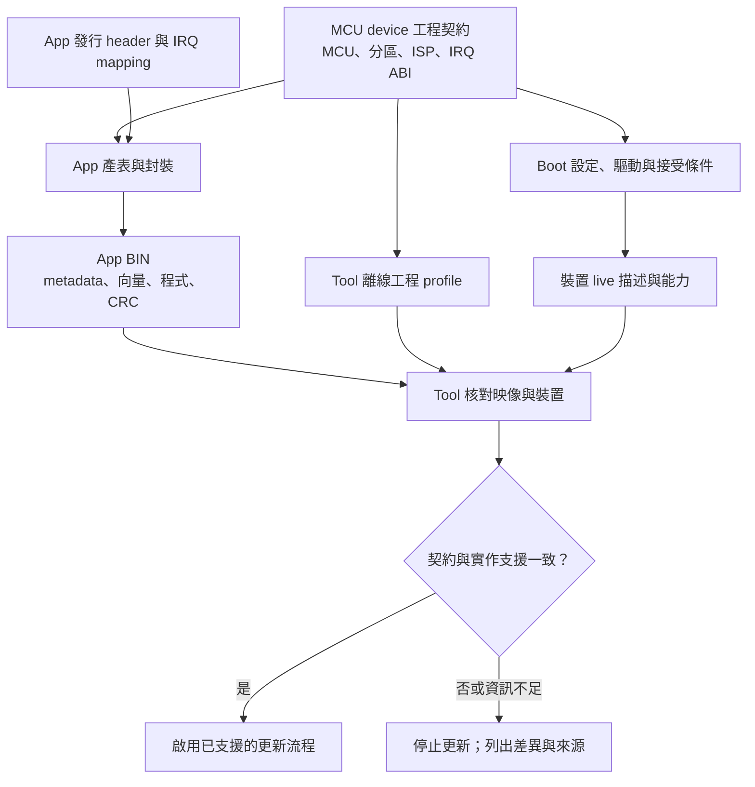
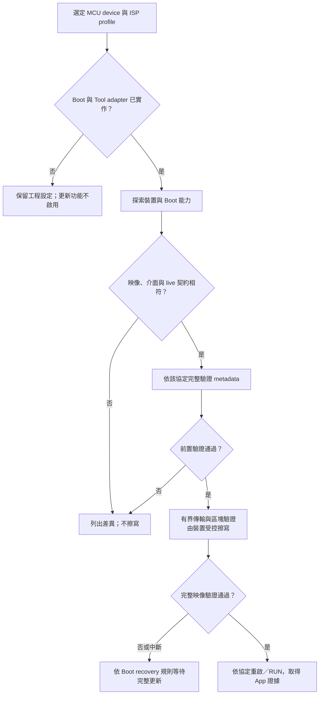
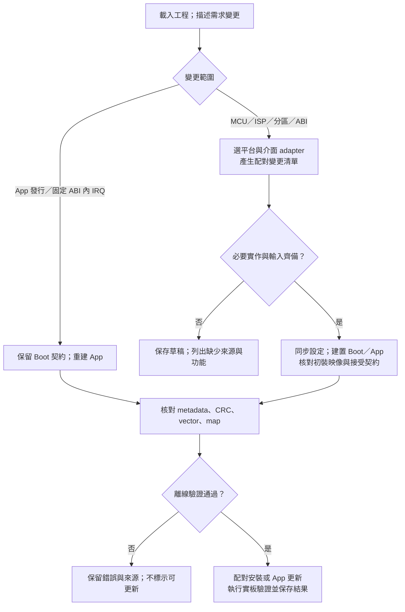

# Metadata 編輯器與跨 MCU／ISP 工程移植設計

## 1. 目的與適用範圍

本文整理在 FirmwareUpgradeTool 導入 Metadata 編輯器時，設定來源、產生流程、工程連動與相容性驗證的設計。
涵蓋固定 Boot 下的 App 發行，以及更換 MCU、ISP 周邊、分區或向量架構的工程移植。

本文屬於設計評估，不代表編輯器或各 MCU／介面組合已提供實作。
可執行的更新方式仍由實際 Tool adapter、Boot／App 工程、裝置能力與驗證結果決定。

核心原則是：共用欄位語意與產生／驗證流程，各工程持有自己的 MCU、分區、ISP 與 IRQ 契約。
所有欄位都能查閱用途、來源與修改入口；可修改的範圍由相依關係決定，而非僅顯示六個 define。

本設計使用五類資訊：

| 分類 | 主要內容 | 典型修改時機 |
| --- | --- | --- |
| App 發行設定 | App 版本、build、版本政策、最低 Boot 需求 | 發行 App 或調整相容需求 |
| MCU／Flash 工程配置 | MCU 身分、Flash／RAM、分區、startup、IRQ backend | 建立或移植工程 |
| ISP 通訊配置 | 更新介面、速度、ID／address、控制與資料路由 | 調整更新通訊或換介面 |
| 格式契約 | Magic、欄位格式、協定、IRQ ABI、擴充與保留規則 | 定義共通格式或介面契約 |
| 建置結果 | 實際大小、CRC、向量目的地、資源用量、產物雜湊 | 每次成功建置與封裝 |

## 2. Boot、App 與資料來源

本文所稱「F13 Boot CAN 對應 F13 device CAN」，表示同一 MCU 內的 CAN Boot 與 CAN App 配對。
其他 MCU／ISP 組合採用相同的角色定義。

### 2.1 三種資料的責任

| 資料 | 意義 | 來源與用途 |
| --- | --- | --- |
| Boot 工程契約 | 這份 Boot 接受哪些映像，以及如何接收、擦寫、驗證與啟動 | Boot 設定 header、實際驅動、linker、startup、向量實作 |
| App image metadata | 這份 App BIN 宣告的 MCU、分區、更新與啟動需求 | App 設定、配對工程契約與 post-build 結果 |
| Live Boot／App 資訊 | 目前連線裝置實際回報的契約、模式與已安裝映像資訊 | 裝置通訊回覆；Tool 更新前再次核對 |

Boot 的 metadata 在此指工程契約及可供查詢的描述資訊。
現有 CAN device 並未要求 Boot 映像也使用 App 的 256-byte manifest；若增加 Boot 映像描述區，其位置、格式與保護範圍需另行定義。

離線工程設定、已編譯 BIN 與 live 回覆分開顯示。
修改 header 不會同步改變已產生的 BIN，也不能作為裝置已燒錄相同設定的證據。

### 2.2 單一設定來源

工程契約同時供 Boot 編譯、App 產表、封裝與 Tool profile 使用，避免在四處各維護一份數值。
Boot 保存接受條件，App metadata 保存映像需求；兩者從相同工程設定衍生，但執行時仍各自驗證。

## 3. MCU／ISP 配對情境

下表描述配置與移植目標。I2C／UART 列表示需有相應實作的配對情境，不作為現有功能清單。
F13／F24 CAN 工程的來源與驗證狀態分別見 [工程基準](DEVICE_GOLDEN_SAMPLE_zh-TW.md) 與 [F24 device 工程](F24_CAN_DEVICE_DESIGN_zh-TW.md)。

| 配對情境 | MCU／IRQ 配置 | ISP 配置 | 對應 Boot／App 工作 |
| --- | --- | --- | --- |
| F13 Boot CAN ↔ F13 App CAN | F13 專屬 geometry、startup、IRQ ABI／合法向量 | CAN 模式、bitrate、控制／回覆／資料 ID | 沿用或調整 F13 CAN 工程契約 |
| F13 Boot I2C ↔ F13 App I2C | 以 F13 平台配置為基礎，核對 I2C ISR／RAM／Boot 用量 | 位址格式、App／Boot address、SCL、交易與回覆規則 | I2C Boot 接收、Flash 狀態機、App ENTER 與確認 |
| F13 Boot UART ↔ F13 App UART | 以 F13 平台配置為基礎，核對 UART ISR／RAM／Boot 用量 | App 控制與 Boot 更新 baud、frame、timeout | UART Boot 接收、Flash 狀態機、App ENTER 與確認 |
| F24 Boot CAN ↔ F24 App CAN | F24 專屬 geometry、startup、IRQ ABI／合法向量 | CAN 模式、bitrate、控制／回覆／資料 ID | 沿用或調整 F24 CAN 工程契約 |
| F24 Boot I2C ↔ F24 App I2C | 以 F24 平台配置為基礎，核對 I2C ISR／RAM／Boot 用量 | 位址格式、App／Boot address、SCL、交易與回覆規則 | I2C Boot 接收、Flash 狀態機、App ENTER 與確認 |
| F24 Boot UART ↔ F24 App UART | 以 F24 平台配置為基礎，核對 UART ISR／RAM／Boot 用量 | App 控制與 Boot 更新 baud、frame、timeout | UART Boot 接收、Flash 狀態機、App ENTER 與確認 |
| F14／F25 的指定 ISP 組合 | 依確切料號、device header、硬體手冊建立平台配置 | 僅宣告料號與工程實際實作的介面 | 新增平台 backend，接入共用產表／封裝／驗證 |
| 其他 CPU 架構的指定 ISP 組合 | 使用該架構的 reset、vector、startup 與交接規則 | 接入已定義的通訊協定或獨立 adapter | 保留共用欄位語意，另實作架構相關部分 |

F14、F25 或 RA6 等名稱不足以決定容量、IRQ 位址、Flash API 或可用 ISP 介面。
建立 profile 時需指定確切料號、板子、toolchain 與來源文件；資料不足時標示「需提供平台配置」，不代入另一 MCU 的數值。

## 4. 現行設定與編輯器的變動範圍

### 4.1 六個 define 的範圍

目前 `app_image_config.h` 包含 App version、build、target ID、role、update transports 與 version control。
其中 version、build、version control 是 App 發行設定；其餘三項須符合配對 CAN Boot 契約。

F13／F24 的 `app_config.ps1` 目前嚴格檢查這六個 define 與 CAN DEVICE_APP 條件。
增加可編輯欄位、接受其他更新介面或新 header 時，需同步讀取器、產生器、封裝與測試；在現有 header 額外增加 define 會被拒絕。

### 4.2 編輯方式比較

| 方式 | 涵蓋範圍 | 配套工作 |
| --- | --- | --- |
| 六欄 App header 編輯 | 既有工程的日常 App 發行 | 保留目前產生與驗證流程 |
| 完整工程配置編輯 | 跨 MCU、分區、ISP、格式與 IRQ 契約 | 增加工程 profile、欄位來源與連動輸出、平台／通訊 adapter |
| 直接改 BIN metadata | 變更已編譯映像的 bytes | 不作為工程配置流程；無法同步 linker、驅動與向量，且會改變完整性檢查結果 |

編輯器以第二種方式為完整目標，同時保留第一種方式作為一般 App 發行入口。
輸出以可註解、可版控的 C header／C 設定為主，工程可在沒有 Tool 的環境使用現有開發工具完成建置。

## 5. 完整欄位目錄與修改責任

以下 offset 皆相對「目前 CAN device 的 App metadata 起點」，多 byte 整數採 little-endian。
表中的位址是既有 CAN 格式的對照，I2C／UART profile 的介面專屬欄位配置需依 [第 8 節](#transport-profiles) 定義。
每個欄位在 UI 都有說明及來源；自動欄位提供產生與核對入口。

完整 byte 範例保留於 [Flash／Metadata 位址參考](FLASH_METADATA_CAN_FRAME_GUIDE_zh-TW.md)，此處聚焦編輯與變更影響。

### 5.1 App 發行設定

| Metadata offset | 欄位 | 現行來源／限制 | 編輯器行為與連動 |
| --- | --- | --- | --- |
| 0x10..0x13 | App version | `APP_IMAGE_VERSION`；0x00MMmmpp | 分別編輯三段 0..255；重建 App |
| 0x14..0x17 | App build | `APP_IMAGE_BUILD`；0..0xFFFFFFFE | 可編輯；日期可作初始建議，不作版本先後判斷 |
| 0x6C..0x6F | Minimum Boot | 產生器取配對 Boot version；Boot 作最低需求比較 | 可評估獨立為 App 需求；需同步產生／封裝檢查，並有相容測試依據 |
| 0x74..0x77 | Version control | `APP_IMAGE_VERSION_CONTROL`；0／1 | 預設 0；顯示此 App 安裝後採用的版本政策 |

App 版本與 Boot 版本各自獨立，不要求相等。
降低 Minimum Boot 的宣告不會產生缺少的 Boot 功能；版本下限與 IRQ／ISP／格式契約仍需共同核對。

目前有效已安裝 App 的政策決定一般更新能否降版，待更新 BIN 的政策在成功更新後才生效。
版控與單次維護降版操作見 [更新確認與版本政策](UPDATE_VALIDATION_zh-TW.md#force-old-version)。

### 5.2 MCU／Flash 工程配置

| Metadata offset | 欄位 | 現行來源／修改入口 | 連動與限制 |
| --- | --- | --- | --- |
| 0x0C..0x0D | Target ID | Boot `image_metadata_config.h`；App 對應 target define | 工程識別配置；Tool／Boot 核對，單改數字不完成 MCU 移植 |
| 0x1C..0x1F | App start | Boot 契約及 App linker | 同步向量、metadata 定位、封裝及 Boot 跳轉 |
| 0x20..0x23 | App capacity | Flash 分區設定 | 同步擦寫邊界、linker、更新範圍與測試 |
| 0x24..0x27 | Code Flash size | 確切 MCU 規格及工程設定 | 以實體可用區域為依據；不是任意增加容量 |
| 0x28..0x2B | Boot reserve | Boot 分區設定 | 核對 App 起點、Boot map、保護區與安裝映像 |
| 0x2C..0x2F | Erase size | MCU Flash geometry／driver | 核對 erase 對齊；非均勻 geometry 需另有分區描述 |
| 0x40..0x4F | MCU part | Boot 料號識別，16 bytes | 配合實際編譯 MCU、Tool 與 live 描述；不能當 App 專案名稱使用 |
| 0x50..0x5B | MCU family | Boot family 識別，12 bytes | 字串長度／padding 與實際 profile 一致 |
| 0x5C..0x5F | Minimum image size | 向量、metadata、尾端 CRC 等映像結構需求 | 由格式及架構計算／核對，不以任意小值放寬驗證 |

RAM、stack、保留區、Flash 實作與 clock 等並非都存在於目前 metadata 中，仍屬工程配置必要輸入。
不能以「BIN 中沒有這個欄位」推論移植時不需要處理。

### 5.3 ISP 通訊配置

| Metadata offset | 欄位 | 現行來源／修改入口 | 連動與限制 |
| --- | --- | --- | --- |
| 0x0E | CAN mode mask | Boot CAN 契約 | Classical／FD 與硬體、驅動、Tool 能力相符 |
| 0x0F | CAN ID format | Boot CAN 契約 | Standard／Extended 的寬度、filter 與協定支援 |
| 0x30..0x33 | CAN nominal bitrate mask | Boot timing 契約 | 實際 CAN clock／bit timing／App ENTER／Tool 配置一起核對 |
| 0x34..0x37 | CAN data bitrate mask | Boot FD timing 契約 | 僅於對應模式及實作支援時使用 |
| 0x38..0x3B | Request ID | Boot 通訊設定 | 同步 Boot 接收、App 控制、filter 與 Tool 路由 |
| 0x3C..0x3F | Response ID | Boot 通訊設定 | 同步 Boot／App 回覆與 Tool 接收比對 |
| 0x67 | Allowed update transports | App 宣告及 Boot 實作；CAN=0x01、I2C=0x02、UART=0x04 | 選項由工程實作與 profile 決定，bitmask 不自動增加 updater |
| 0x70..0x73 | Device UART baud | 已定義的 policy 欄位；目前 CAN device 要求 0 | UART profile 應描述 Boot 的更新 baud，與 PC Host Link／診斷 UART 分開 |

目前兩份 CAN device 產生器與 Boot 要求 DEVICE_APP／CAN 及配對的 CAN 參數。
這是現行接受條件；工程編輯器需要在修改前列出實際被影響的驅動、產生器與驗證端。

### 5.4 格式契約

| Metadata offset | 欄位 | 現行定義／來源 | 變更責任 |
| --- | --- | --- | --- |
| 0x00..0x03 | Image magic | CAN 加 NUL；0x004E4143 | 格式識別；不是通道編號，也不作產品名稱 |
| 0x04 | Image format | 欄位排列與解析規則 | producer、Tool、Boot、封裝及測試共同支援 |
| 0x05 | Core length | 128 bytes | 與定義欄位邊界一致，不能作為 UI 可任意填入的長度 |
| 0x06..0x07 | Flags | 現行格式要求 0x0003 | 每個 bit 有明確語意與接受規則 |
| 0x08..0x09 | Protocol ID | 更新協定識別 | 對應實際 codec／Boot 狀態機 |
| 0x0A | Protocol version | 通訊契約 | 以支援的命令、重試與回覆規則判斷，不只比大小 |
| 0x0B | Checksum type | CRC32 | 演算法、範圍、順序與存放位置一起定義 |
| 0x60..0x63 | Policy magic | UPD1；0x31445055 | 共用更新政策的識別與定位 |
| 0x64 | Policy version | 政策欄位語意 | 與 Boot／Tool／產生器支援集合一致 |
| 0x65 | Policy size | 32 bytes | 與政策邊界一致 |
| 0x66 | Image role | DEVICE_APP=1 | 由工程目的地設定；不同角色須使用對應映像流程 |
| 0x68..0x6B | IRQ ABI | 平台向量與交接契約識別 | 配合架構 backend、Boot 固定轉送及 App 產表 |
| 0x78..0x7F | Reserved zero | 8 bytes 填 0 | 依格式驗證，擴充前不作自訂資料 |
| 0x80..0xFF | Reserved FF | 128 bytes 填 0xFF | 依格式驗證，擴充規則見 [第 10 節](#compatibility-rules) |

### 5.5 建置結果

| 位置 | 結果 | 來源 | 編輯器呈現 |
| --- | --- | --- | --- |
| Metadata 0x18..0x1B | 實際 image size | Linker map 與封裝結果 | 唯讀；區分預估值與已驗證 BIN |
| BIN 最後 4 bytes | Stored CRC32 | 實際映像內容的 post-build 計算 | 顯示演算法／範圍／核對結果；不提供手填 CRC |
| 向量區／map | Slot、ISR 目的位址、預設 handler | 產表、linker 與已編譯內容 | 對照 App mapping，檢查實際輸出 |
| Map／build log | Boot 用量、餘裕、App／RAM／stack | 實際工具鏈結果 | 顯示容量限制與超限原因 |
| 產物檔案 | SHA-256、大小、工具鏈／設定來源摘要 | 成功建置的實際檔案 | HTML 編譯報告；雜湊用於一致性核對，不當作簽章 |

## 6. 設定檔與產生物的安排

編輯器是 C 設定的圖形化入口；C 設定仍可由使用者直接修改、加入註解並納入版控。
下表區分已存在的 C header 與編輯器需要整合的責任。

| 設定／產物 | 建議責任 | 來源狀態 |
| --- | --- | --- |
| `app_image_config.h` | App 發行資訊與 App 相容需求 | 已有六 define 輸入；擴充需同步讀取／封裝 |
| `app_irq_handlers.h` | 該 App 自己的 IRQ／ISR mapping | 已有輸入；不從另一 App 的啟用清單複製產表 |
| `image_metadata_config.h` | 格式、MCU／Flash、IRQ ABI、政策與 Boot 身分 | 各 Boot 的共用映像契約；產生器與驗證端引用 |
| `image_metadata.c/.h`、`image_metadata_profile.c` | 執行時解碼／驗證與工程接受值 | 共用 C90 模組、各工程 profile；編輯器須連動 config、profile、producer 與 Tool 契約 |
| `can_boot_config.h` | CAN 通訊參數、命令與接收規則 | 產生 metadata 時記錄相同參數，不再複製到另一設定檔 |
| `boot_app_handoff.h` | 共用 RAM、owner 與交接標記 | 與 startup／linker／向量產生器對應，不是 BIN metadata |
| 平台／ISP adapter | 編譯器、linker、startup、Flash、IRQ、周邊參數的轉換與核對 | 各平台／介面分別實作，不能只由 header 數值代替 |
| `ftable.inc`／identity／向量表 | pre-build 的自動產物 | 由設定與 adapter 產生，不作第二份手動設定來源 |
| Boot live 描述／App metadata | 同一工程契約的不同投影 | 描述接受能力及映像需求；並保留 runtime 核對 |
| 更新 BIN／初裝映像／HTML 報告 | post-build 的已驗證結果 | 僅以實際編譯、連結與封裝成功結果為準 |

工程可引用相鄰 Boot 的共用來源，但 Boot／App 都保持獨立可識別的專案。
App-only 產表不重建、不覆寫 Boot；設定來源變更造成 Boot 契約差異時，則列為配對工程變更。

每個設定只保留一個可編輯來源。
例如 App start 不應在 Boot header、App header、GUI INI 各存一份可獨立修改的數字；其餘位置使用產生值或進行一致性比對。

## 7. MCU／Flash／IRQ 平台移植

### 7.1 平台 profile 的必要資訊

| 項目 | 修改／核對位置 | 依據 |
| --- | --- | --- |
| 確切 MCU／Target ID | 工程契約、實際編譯 device、Tool／live 描述 | Part number、裝置識別分配與工程紀錄 |
| Flash base／範圍／保護區 | Boot 範圍檢查、linker、封裝 | 硬體手冊與 Flash driver |
| Erase／write 粒度 | Flash backend、buffer／block、對齊檢查 | Driver API 與實際 memory geometry |
| Boot／App 分區 | 工程契約、Boot 跳轉、linker、安裝範圍 | 實際 Boot map、RAM 與映像結構需求 |
| RAM／stack／no-init | startup、linker、Boot→App handoff | MCU RAM 範圍、ISR nesting、Flash RAM 執行需求 |
| Vector／IRQ | Device header、Boot dispatch、App generator | 該 MCU 的實體向量表與 compiler ISR 規則 |
| Clock／pin／transceiver | Board backend、SC 或相應設定來源 | 原理圖、clock tree、周邊計時與電氣規格 |
| Build／package | Project source、pre／post-build、map parser | 該 toolchain 的輸出與連結規則 |

單一 `erase_size` 或以 0 為起點的 Flash 配置不一定足以描述其他 MCU。
若新平台有非均勻 erase 區域、不同 Flash base、不同位址／向量對齊，需由平台 adapter 明確支援；資料模型不足時停止產生，不能以最接近的既有值代替。

### 7.2 IRQ table 的相容邊界

| 變更 | Boot | App／產表 | 驗證 |
| --- | --- | --- | --- |
| 固定契約內新增一般 IRQ | 維持相同固定轉送表 | 修改 App header／ISR；新 C 檔加入工程 | 合法向量、global ISR、實際 slot 目的地、stack 與板端 IRQ |
| App A／B 使用不同 IRQ 集合 | 同一份 Boot | 各 App 獨立持有 mapping 並產表 | 分別 clean build；確認 Boot 產物雜湊不變 |
| 換 MCU，但仍採相同轉送概念 | 核對該 MCU 的完整向量與 dispatch | 使用該 MCU 合法 IRQ、ABI 與 startup | 保留向量、entry、返回指令、RAM／owner 交接 |
| 更換 CPU／向量架構 | 使用對應架構的 Boot backend | 使用對應 vector／startup generator | 不套用另一架構的 slot 計算或 ISR 返回規則 |
| 改 slot 格式／表位置／呼叫約定 | 配對調整並更新 ABI | 同步 linker、產表與封裝 | Tool／Boot 拒絕 ABI 不符的映像 |

目前 RL78 CAN device 的表包含 64 個 4-byte slot，共 256 bytes；一般 slot 位置為 `app_start + vector_byte_address × 2`。
此為已定義的 RL78 ABI，不延伸為所有 MCU 的共通公式。

現有 RL78 配置的向量表占 App offset 0x000..0x0FF，metadata 占 0x100..0x1FF，程式從 offset 0x200 開始。
若新架構的 vector 大小、alignment 或啟動要求無法使用此配置，需明確定義對應 image layout，並同步 Tool 定位／解析、linker、Boot 與封裝；不能讓向量與 metadata 重疊後仍沿用原設定。

增加 ISR 數量不直接改變固定表大小，也不要求自動增加 Boot reserve。
周邊初始化、來源旗標、mask、priority、stack 與實際 ISR 執行仍需核對；詳細操作集中於 [Device IRQ 教學](DEVICE_METADATA_VECTOR_WORKSHOP_zh-TW.md#device-app-irq)。

## 8. ISP 通訊配置與介面專屬欄位

### 8.1 通訊 profile

| 介面 | 工程配置 | 更新前須確認 | Metadata／協定設計要求 |
| --- | --- | --- | --- |
| CAN | Channel、clock、mode、bitrate、ID format、控制／回覆／raw data IDs、filter | App ENTER 與 Boot 的實際速度／路由、ID 不衝突 | CAN 欄位與 backend 一致；資料 ID window 等能力不一定存在於 App metadata，需對應 live 協定 |
| I2C | Master／slave 角色、位址格式、App／Boot address、SCL、pull-up、transaction、timeout | 裝置 ACK、身份、Boot mode、回覆語意與 Flash 完成狀態 | Slave address、SCL 等尚無現行通用 CAN 欄位可直接承載；需定義 I2C profile 與欄位布局 |
| UART | Device channel、App 控制 baud、Boot 更新 baud、data bits／parity／stop bits、frame、timeout | 進 Boot 前後的速率／frame 與回覆身分 | 更新 baud 使用對應 UART profile；其餘參數需明確定義，不假定僅有 baud 即可互通 |

PC 到 MCU host 的 Host Link 速度、host 到 MCU device 的更新速度、device 的診斷 UART，是不同的設定來源。
編輯 device 更新配置不會改變 Host Link 或診斷介面的編譯設定。

I2C 的 bus ACK、UART 的資料已送出、CAN 的 TX complete，都不等同 Flash 寫入完成。
更新協定需另外定義成功回覆、失敗狀態、重送與重複寫入處理。

### 8.2 共用流程與介面實作

共用的是探索身分、核對契約、驗證 metadata、受控擦寫、完整性檢查及 App 確認等狀態語意。
CAN、I2C、UART 的封包、交易邊界與回覆編碼由各自 codec／Boot backend 定義；不假定相同 command byte 可直接跨介面使用。

### 8.3 介面欄位的表示方式

| 設計選項 | 適用條件 | 注意事項 |
| --- | --- | --- |
| 各介面有固定 profile／格式定義 | 欄位少、Boot 資源有限 | 相同 offset 的解釋必須由明確格式／profile 決定 |
| 共用 core 加型別化 transport 區 | 多介面、可擴充欄位 | 需定義 type、length、必填／可選、未知項目與長度上限 |

導入時先保留已定義 CAN profile 的 byte 語意；I2C／UART profile 先定義完整欄位及測試向量，再開放 Generate。
不得僅因目前選到 I2C TAB，就把 CAN request ID 的 bytes 解讀成 slave address。

單介面 Boot 只產生其實作的更新介面宣告。
多介面 Boot 需明確列出各介面的實作能力、映像允許集合與本次使用介面；App 正常功能使用 UART／I2C，不自動表示允許經該介面更新。

## 9. 各類變更的影響矩陣

「配對調整」表示需核對及修改相應實作，並不保證只重新產生 header 即可完成。

| 修改項目 | Boot | App／IRQ | Metadata／產生器 | Tool／更新條件 |
| --- | --- | --- | --- | --- |
| App version／build／version control | 接受契約維持 | 重建 App | 更新發行欄位／CRC | 核對 live 版本政策與結果 |
| 固定 ABI 內新增一般 ISR | 固定轉送維持 | 新 ISR、mapping、source／初始化 | 重產 App vector，封裝核對 | 沿用對應 ABI |
| Minimum Boot 需求 | 現有比較規則可沿用 | 確認實際依賴 | 擴充輸入／封裝下限檢查 | 核對 live Boot 及所需能力 |
| 更換 CAN ID／速度 | 配對調整 | ENTER／INFO／timing 配套 | 契約欄位與實際參數一致 | 相同路由／速度，能力支援 |
| CAN 改 I2C／UART | 接收、狀態機與 recovery 配套 | ENTER／回覆與所需 ISR | 定義對應 transport profile | 有可用 codec／worker 及 host backend |
| App start／Boot reserve／capacity | 跳轉、擦寫、保護邊界配套 | linker、startup、table／metadata 定位 | 同步分區及封裝 | 拒絕與 live layout 不符映像 |
| 更換 MCU | 平台、Flash、IRQ、clock 配套 | startup、linker、driver、IRQ 配套 | 身分、geometry、ABI 與產物解析 | 若沿用完整既有協定可共用 workflow；否則新增 adapter |
| 更改 IRQ ABI | Dispatch／handoff 配套 | 向量／startup 配套 | ABI、生成與已編譯檢查配套 | ABI 不符時禁止更新 |
| 更改 metadata／protocol 格式 | 解析與驗證配套 | 宣告／回覆配套 | producer、封裝及測試配套 | 明確支援或拒絕，不以忽略檢查通過 |
| 只改 GUI 顯示名稱／說明 | 不需變更 | 不需重建 | 不改 byte 語意 | 純顯示，不改傳輸能力 |

## 10. 相容性規則

### 10.1 分開管理的識別與版本

| 識別／版本 | 用途 | 不應替代的資訊 |
| --- | --- | --- |
| MCU／Target ID | 裝置與工程識別 | App 版本、protocol、分區或硬體能力 |
| App version／build | 發行順序及建置辨識 | Boot 支援功能與 IRQ ABI |
| Boot version／Minimum Boot | Boot 發行與 App 最低需求 | 完整 geometry／protocol／ABI 比對 |
| Image format／policy version | 欄位位置、長度與語意 | 實際通訊 codec 是否存在 |
| Protocol ID／version | 線上交易與回覆規則 | MCU 架構與 App vector 格式 |
| IRQ ABI | Table、entry、dispatch、ISR 返回及 handoff 契約 | App 啟用了哪些 IRQ |
| Editor schema／profile revision | 編輯器如何理解設定與產生物 | 板上已安裝版本或安全認證 |

版本數字較大不直接代表可接受所有其他格式。
不支援的 format／protocol／ABI 以明確錯誤拒絕；Minimum Boot 與 App 升降版比較分別處理。

### 10.2 保留區與擴充

目前兩份 CAN device Boot 逐項比對固定契約，並要求 metadata 0x78..0x7F 為 0、0x80..0xFF 為 0xFF。
因此在保留區填入產品名稱、硬體版本或其他描述，並非現有 Boot 可直接接受的操作。

若定義擴充區，需一起決定：

1. 格式識別、可接受長度、對齊、必填／可選欄位，以及相應支援條件。
2. 未知「必要」欄位拒絕；未知「可選」欄位僅在已定義安全略過規則時允許略過。
3. Metadata 暫存／傳輸、完整 image CRC、Flash 配置及 reserved 檢查同步更新。
4. 額外解析所需的 Boot ROM／RAM 與建置餘裕，不能藉停用驗證或移除 guard 配合。
5. Tool、Boot、App producer 與封裝的正反測試向量。

Magic 識別格式，不作專案名稱或 CAN channel 編號。
產品／App 名稱、硬體相容範圍等描述可另設有定義的欄位；會阻擋更新的欄位需有裝置端可核對的可信工程依據。
CRC、設定雜湊與公開維護確認碼不是韌體來源認證。

### 10.3 工程契約變更與安裝路徑

固定 Boot 的 App 更新流程只在其接受範圍內寫入 App。
需要改 Boot 的 MCU、ISP、分區或 ABI 契約時，建立配對安裝映像及安裝方式；不經一般 App 更新路徑覆寫 Boot。

若另有 Boot 自我更新設計，需獨立定義保護、恢復與安裝驗證，不由 Metadata 編輯器直接提供隱含權限。
改變 updater 介面也不會讓已燒錄、僅實作另一介面的 Boot 自動接收該介面的命令。

### 10.4 同 MCU 的不同產品與 App 專案

App A／B 可共用同一份 Boot，前提是兩者都符合該 Boot 的完整接受契約。
目前 MCU／Target ID、分區與 IRQ ABI 相同，不代表已另行驗證產品名稱、板型 revision 或 App 的業務用途。

若產品需要限制可接受的 App 家族，需定義 Product／Application ID 或硬體相容條件，並有裝置端可核對的設定及 Boot／Tool 規則。
離線 profile 名稱或 GUI 所選的專案不會自動成為板上的接受條件；需要的欄位與規則依擴充流程導入。

## 11. 編輯器 UI 與匯出行為

### 11.1 欄位完整性與單畫面配置

Metadata Editor 是離線工程工具頁，不是 CAN／I2C／UART 之外的更新介面。
新增頁面時，以明確的頁面種類與更新路由取代「不是 I2C／Misc 就當作 CAN」的判斷；Misc 保留自身更新目的地。

五類設定使用分類清單及欄位明細，不把所有資訊擠成大量常駐欄位。
維持 1366×768 的主畫面可操作、既有共用映像／log 的責任與更新 worker 狀態。

選到一個欄位時，明細提供：

| 資訊 | 內容 |
| --- | --- |
| 名稱／用途 | 語意、單位、範例與適用條件 |
| 值／可接受範圍 | 人類可讀值及必要的 raw 編碼；不支援項目附原因 |
| 位址／offset | 基準、寬度、順序；尚無 byte 配置的設計項目不填推測位址 |
| 來源 | C header／macro、linker／SC、產生器或實際 BIN |
| 編輯入口 | 此頁可編輯、切到工程配置、開啟來源或重建產生 |
| 連動 | Boot／App／IRQ／Tool／封裝需核對的項目 |
| 狀態 | 草稿、設定已驗證、需重建、BIN 已核對、live 不符 |

唯讀表示該值由另一來源決定，並提供來源與處理入口，不代表欄位對移植無影響。
顏色同時搭配文字，且編輯草稿不填入 live 資訊卡。

### 11.2 匯入與輸出

1. 選擇明確的 App 與配對 Boot 工程；載入既有設定，再選擇平台／ISP profile。
2. 首次建立提供 profile 預設值；開啟既有工程時不以預設值覆蓋。
3. 解析已定義的 C 設定語法，不執行使用者程式、任意 preprocessor 指令或下載的 script。
4. 檢查欄位範圍、互斥條件、來源一致性與 adapter 是否存在。
5. 顯示差異、受影響檔案及重建／安裝需求。
6. Generate 匯出帶英文欄位註解的 C header 與需同步的設定投影；不改 BIN、不發送 bus 命令。
7. 已存在檔案先預覽與備份；多檔輸出先完整驗證，再一次完成，失敗不得留下看似完成的部分配對。
8. 執行工程既有 clean build／產表／封裝，取得實際 HTML 編譯報告。
9. 在 Tool 載入實際 BIN，再做離線與 live 檢查。

輸出需要區分三種結果：「可直接重建 App」「需同步 Boot／App」「尚需補齊平台或通訊實作」。
第三種結果可保存工程草稿，不能標示為可更新韌體。

工程中未預期的 macro、條件編譯、重複定義或不支援的語法，需指出來源及拒絕原因，不能猜值後覆寫原檔。
檔案輸出限制在確認的工程目錄；不以整份專案重建或刪除內容作為匯出方式。
更新作業進行中，不套用會改變該作業路由／映像／來源檔的編輯或輸出；取消仍由 worker 清理交易。

## 12. 典型操作情境

### 12.1 固定 Boot，持續改進 App

保留工程契約與 ABI，修改 App 發行設定、功能及合法一般 IRQ mapping。
重建該 App，檢查 metadata／CRC／完整 table，並核對 Boot 映像雜湊不變。
完成更新後，取得 App 啟動及實際 IRQ／功能證據。

### 12.2 同 MCU 更換 ISP

保留可沿用的 MCU／Flash 配置，建立對應 ISP profile。
完成 Boot 接收與 recovery、App ENTER／INFO、介面 ISR、Tool codec／worker 及 host transport 能力核對。
若固定向量 ABI 不變，可保留轉送概念；仍需重新驗證 Boot 使用的 ISR、周邊交接及 App 啟動。
產生配對設定與初裝映像後，再以新介面驗證 App 更新。

### 12.3 更換 MCU

保留共用欄位語意、編輯流程、狀態機與測試規則，選定新的平台 adapter。
從確切料號的 memory／IRQ／compiler 依據建立配置，再接入所需 ISP。
實際產物必須由該平台工具鏈生成與核對，不能由另一 MCU 的 BIN 修改 target ID 取得。

## 13. 導入時的模組變動

| 模組 | 需要的變動 | 可保留的責任 |
| --- | --- | --- |
| Tool UI | 五類設定、欄位說明、來源／差異／匯出與離線頁面種類 | 共用 BIN／log、worker 擁有通訊、live 與 offline 分離 |
| Tool core | 工程設定模型、欄位目錄、受限 C 設定讀寫、相容性與影響分析 | 實際 BIN parser 及更新前驗證不由草稿取代 |
| 平台 adapter | MCU geometry、IRQ／startup、linker／map、Flash backend 的產生與核對 | 共用產物與驗收介面 |
| ISP adapter | CAN／I2C／UART 的參數、codec、能力、交易與恢復語意 | 更新安全狀態機與完整性要求 |
| Boot 工程 | 單一契約來源、接受條件、live 描述與 backend；按變更範圍處理 | 固定契約內的 App-only 更新維持 Boot 不變 |
| App 工程 | 發行 header、相容需求、IRQ mapping、ENTER／INFO 及建置 hook | App 各自獨立持有來源，不依賴 Tool 安裝才能編譯 |
| 產生／封裝 | F13／F24 共通讀取規格、平台投影、stale 與已連結內容檢查 | PowerShell／既有開發環境；不增加非開發 runtime 前提 |
| 文件／測試 | 欄位來源、變更矩陣、profile 範例、負向案例與驗證紀錄 | 單一完整說明位置，其餘使用連結 |

原始碼對照：Tool 的 `src/main_frame_bus.cpp`、`src/main_frame_image.cpp`、`src/main_frame_workflow.cpp` 處理頁面與路由；
`src/core/firmware_update_profile.cpp`、`firmware/common/image_policy.h` 處理映像與政策。
編輯器模型需與這些更新模型分工，不直接以 TAB index 推導更新目的地。

在各 device 工程內，來源與影響如下：

| 工程 | 設定／產生／驗證入口 |
| --- | --- |
| F13 Boot | `image_metadata_config.h`、`can_boot_config.h`、`boot_app_handoff.h`、`app_config.ps1`、`generate_irq_contract.ps1`、`can_boot_metadata.inc` |
| F13 App | `app_image_config.h`、`app_irq_handlers.h`、MTPJ pre／post-build、`generate_update_image.ps1` |
| F24 Boot | `image_metadata_config.h`、`can_boot_config.h`、`boot_app_handoff.h`、`tools/app_config.ps1`、`tools/device_common.ps1`、`tools/prepare_projects.ps1`、`tools/package_images.ps1`、`can_boot_metadata.inc` |
| F24 App | `app_image_config.h`、`app_irq_handlers.h`、MTPJ pre／post-build、App-local 生成物 |

上述路徑以各自工程根目錄為基準，並非共同磁碟安裝路徑。
新增平台／介面以 adapter 與工程配置接入，完整工程差異不散落成 Tool UI 內的 MCU 名稱判斷。

## 14. 最小變動的導入順序

| 階段 | 交付範圍 | 相容性驗收 |
| --- | --- | --- |
| 欄位導覽與 App 發行編輯 | 完整欄位可查閱、來源可定位；匯入／輸出現有 C header | 相同設定產生相同有效內容；不改 Boot／格式／傳輸 |
| 工程配置與影響分析 | MCU／Flash／ISP／IRQ 契約模型、差異摘要與配對輸出 | F13／F24 golden samples 同步；來源單一、stale／錯配拒絕 |
| 指定介面實作 | 逐一完成 MCU／ISP 組合的 Boot、App 與 Tool adapter | 完整正反測試、資源用量、Flash／中斷／電氣實板證據 |
| 平台擴充 | 確切新 MCU 的平台配置與 adapter | 保留同一編輯／產表／封裝概念，不假定地址與向量相同 |
| 格式擴充 | 必要的 transport／描述欄位及接受規則 | producer／Tool／Boot 明確協定，ROM／RAM 與保留區檢查通過 |

只有改變 Boot 接受契約或其實作時才安排 Boot 配對建置與安裝。
一般 App 發行及固定 ABI 內 IRQ 變更維持 App-only，避免把編輯器導入變成每次都重燒 Boot 的流程。

## 15. 驗收與負向情境

| 驗證項目 | 預期結果 |
| --- | --- |
| 設定匯入／匯出 round-trip | 數值與語意一致；註解、格式採明確輸出規格；不遺失不支援的來源內容後靜默覆寫 |
| MCU／target 與編譯 device 不符 | 產生／封裝或相容核對拒絕，指出來源 |
| 未提供 F14／F25 等確切平台配置 | 可保留草稿，不以其他 MCU 的 geometry／IRQ 代填成可用工程 |
| CAN-only 映像選 I2C／UART 更新 | UI 與 worker 阻擋；裝置亦有對應契約保護 |
| 只改 transports bit，沒有 updater 實作 | 工程驗證不通過，不啟用更新 |
| Speed／ID／address 與 Boot 不符 | 前置核對或有界通訊失敗，不自動擦寫或搜尋任意裝置 |
| App start／capacity 越界或地址運算溢位 | 在產生／封裝／寫入前拒絕，保護 Boot 及其他保留區 |
| 非均勻 erase／未知 Flash backend | 無對應 adapter 時拒絕可更新狀態 |
| 未知 format／必要欄位／IRQ ABI | 明確拒絕，不因 CRC 正確而略過相容檢查 |
| Reserved bytes 不符目前規則 | 封裝及 Boot 驗證拒絕 |
| 新 ISR 未登錄來源、vector 非法或 pragma 不符 | 產表／link／post-build 拒絕 |
| App A／B 不同合法 IRQ mapping | 各自產表及建置通過；原 Boot 雜湊不變 |
| Header 已改、HEX／map 未重建 | Stale metadata／vector 檢查拒絕；不發布有效編譯報告 |
| 輸出錯誤目錄、覆寫取消、檔案鎖定、部分輸出失敗 | 不修改來源或恢復一致狀態；提供可恢復的備份及錯誤摘要 |
| 同版／新版／降版與維護操作 | 依已安裝有效 App 政策與單次維護規則；不混用 Boot／App 版本 |
| 更新中斷、拔線、重送、斷電 | 依各 Boot／ISP 的狀態機恢復；不自動執行未定義續寫 |
| END 完成與 App 啟動確認 | 分別保存寫入完整性及執行證據，不把其一當成另一項 |
| 編輯頁切換與既有 CAN／I2C／Misc | 不改錯目的地、不產生非預期通訊，不影響進行中的 worker 交易 |

F13／F24 CAN device 的現有 Boot guard 為 8 KiB 分區及至少 512 bytes 餘裕。
增加 parser、descriptor 或 updater 後，仍以 clean build 的 map／RAM 結果檢查，不由 metadata 區預留大小推估程式用量。
其他平台採其核准分區與餘裕，不直接套用上述數字。

離線產生、編譯與模型測試，與實板 Flash／IRQ／速度／斷電驗證分開記錄。
新增介面不能僅因 header 成功產生或 mock 通過就列為實板支援。

## 16. 相關規格與完整操作來源

- [Device golden samples](DEVICE_GOLDEN_SAMPLE_zh-TW.md)：F13／F24 的共通輸入、產生與驗證基準。
- [Metadata／IRQ 操作教學](DEVICE_METADATA_VECTOR_WORKSHOP_zh-TW.md)：現有 C header、ISR、建置與 HTML 編譯報告。
- [Boot／App 移植指南](RL78_BOOT_APP_PORTING_GUIDE_zh-TW.md)：分區、startup、RAM、固定向量與安裝流程。
- [Flash／Metadata／CAN byte 參考](FLASH_METADATA_CAN_FRAME_GUIDE_zh-TW.md)：目前 CAN 格式的完整位址、byte 與範例來源。
- [共用映像政策](COMMON_IMAGE_METADATA.md)：Role、transport、minimum Boot、IRQ ABI 與版本政策。
- [新增 target／workflow](TARGET_PROFILE_GUIDE.md)：共用 CAN workflow 與不同協定 adapter 的責任。
- [更新確認與驗證](UPDATE_VALIDATION_zh-TW.md)：App 證據、報告、維護操作與故障驗收。

本文維護「編輯器與工程移植」設計；操作與 byte 細節由上述文件維護，避免多處重複定義。
