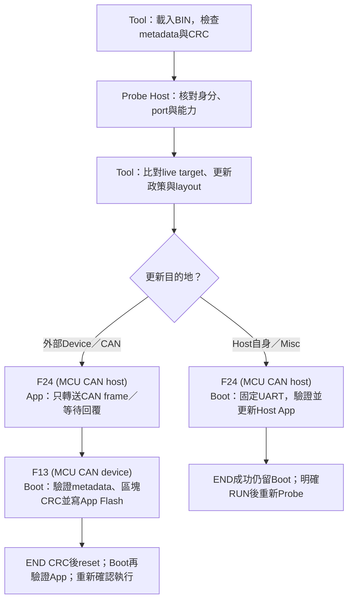
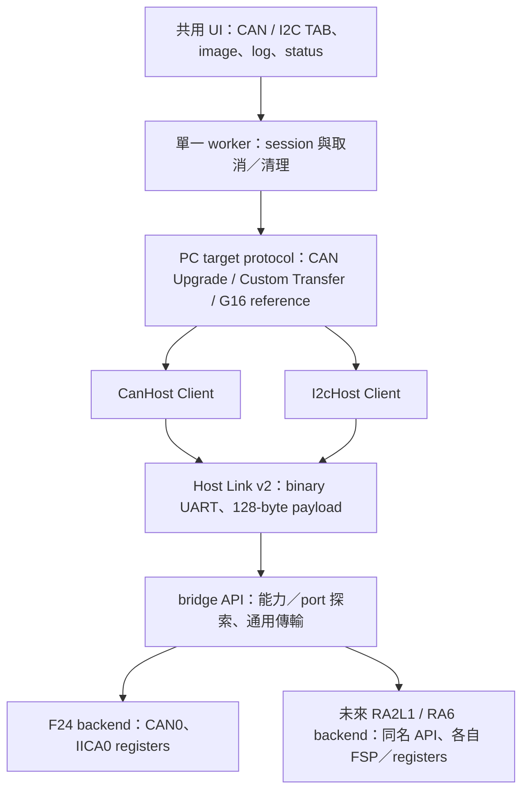
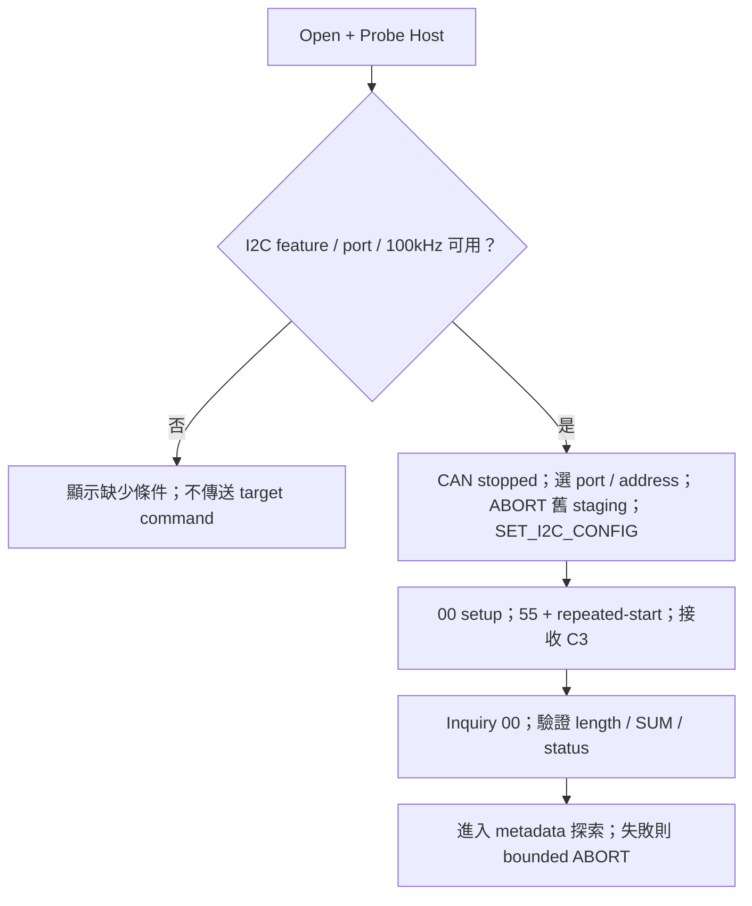
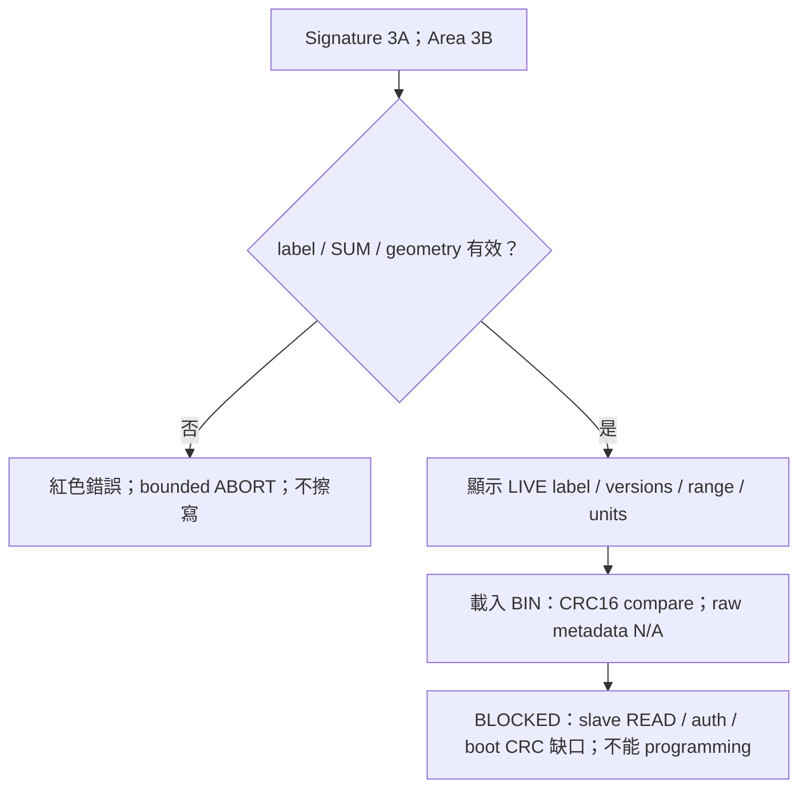
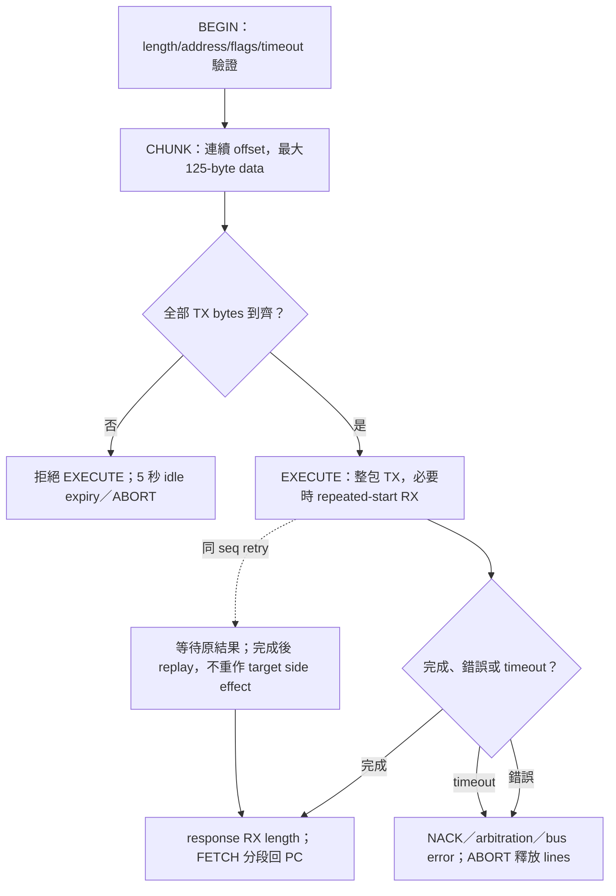
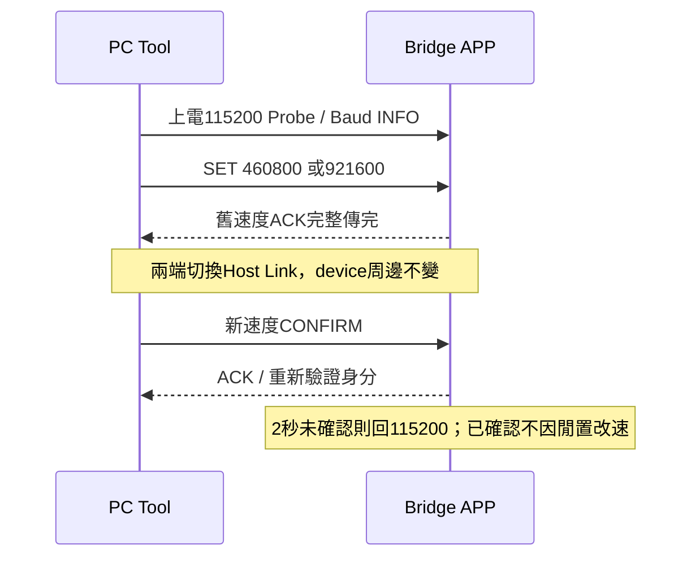
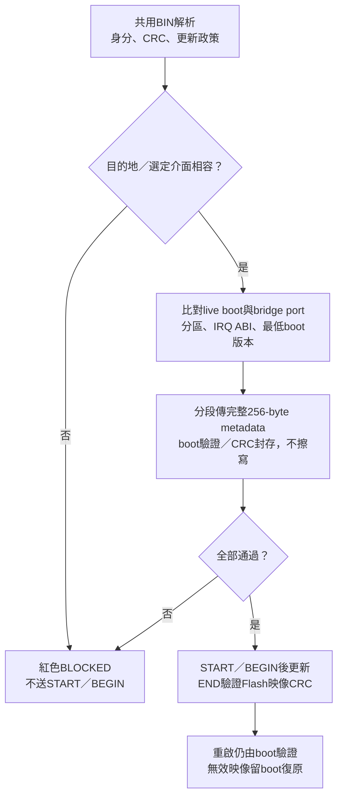

# FirmwareUpgradeTool 多匯流排設計與操作

2026-10-15 | FirmwareUpgradeTool0.1.0.0082 | Host Link128；I2C G16仍僅探索，尚不可擦寫

本版不相容96-byte host，須一起更新PC與bridge。F13 format6／F24 bridge contract3
使用固定256-byte metadata區（core128＋reserved128），程式碼仍從app offset0x200起。
Misc為HOST APP UART更新：先分段STAGE256 bytes並驗證，BEGIN才可擦除；Read Info及
更新read-back以四次READ_METADATA讀完整區域。首次須燒錄matching新boot/app。

<!-- PUBLIC_RESOURCES_BEGIN -->

## 下載與操作總覽

本頁現行CAN範例的角色為 **F24 (MCU CAN host)** 與 **F13 (MCU CAN device)**。
Host透過Host Link連接PC並橋接CAN，device是CAN另一端被更新的MCU。
後續 **F24 (MCU CAN device)** 的Boot/App是另一組專案與映像；
不可把下列F24 host韌體當成F24 device韌體。角色由專案與metadata決定，不由MCU型號推斷。
F24 host自身的App仍經Misc／UART更新；「CAN host」不表示其自身Boot改用CAN更新。

以下連結提供Tool、Host board與Device board的公開來源；不用原開發者的本機路徑。
首次安裝Boot使用燒錄器，之後更新App才使用對應的Tool流程；不可把Host與Device映像互換。

| 項目 | 下載／原始碼 | 適用方式 |
| --- | --- | --- |
| PC Tool | [Windows EXE](https://raw.githubusercontent.com/released/simple_renesas_isp_tool/main/build/FirmwareUpgradeTool.exe)／[完整原始碼](https://github.com/released/simple_renesas_isp_tool) | Windows x64；先安裝實際VCOM所需driver，再選COM並Probe Host |
| F24 (MCU CAN host) Boot | [Boot專案](https://github.com/released/simple_renesas_isp_tool/tree/main/firmware/RL78_F24_Bridge_boot)／[Boot MOT](https://raw.githubusercontent.com/released/simple_renesas_isp_tool/main/firmware/RL78_F24_Bridge_boot/DefaultBuild/RL78_F24_Bridge_boot.mot) | 首次以燒錄器安裝；Misc不更新Boot |
| F24 (MCU CAN host) App | [App專案](https://github.com/released/simple_renesas_isp_tool/tree/main/firmware/RL78_F24_Bridge_app)／[Host App BIN](https://raw.githubusercontent.com/released/simple_renesas_isp_tool/main/firmware/RL78_F24_Bridge_app/DefaultBuild/RL78_F24_Bridge_app_bridge_update.bin) | Misc／UART115200；完成後明確Run Validated Bridge App |
| F13 (MCU CAN device) Boot | [Boot專案](https://github.com/released/RL78_F13_Boot_loader_CAN)／[Boot HEX](https://raw.githubusercontent.com/released/RL78_F13_Boot_loader_CAN/main/DefaultBuild/boot0000_1FFF.hex) | 首次以燒錄器安裝matching Boot/App；不要保留不相容舊App |
| F13 (MCU CAN device) App | [App專案](https://github.com/released/RL78_F13_Boot_loader_CAN_app)／[初裝合併HEX](https://raw.githubusercontent.com/released/RL78_F13_Boot_loader_CAN_app/main/boot_app.hex)／[CAN更新BIN](https://raw.githubusercontent.com/released/RL78_F13_Boot_loader_CAN_app/main/DefaultBuild/RL78_F13_Boot_loader_CAN_app_update.bin) | 合併HEX供燒錄器初裝；CAN TAB載入_update.bin更新Device App |
| F13 (MCU CAN device) 通訊測試 | [Transfer範例](https://github.com/released/RL78_F13_CAN_Transfer) | Custom Transfer，不擦寫Flash；不是Boot/App更新映像 |

F24 firmware需下載完整Tool repository，保留firmware共用來源與scripts，不能只取Boot/App子目錄。
F13 Boot與App需以原repository名稱放在同一父目錄，App會引用相鄰Boot；Download ZIP
解壓後請移除-main尾碼。先build Boot，再build App；版本、metadata、IRQ ABI與CRC仍須相容。

### 六個操作與流程圖入口

| 想了解的動作 | 網站操作／流程圖 | Tool docs中的詳細說明 |
| --- | --- | --- |
| Tool／F24 (MCU CAN host) 流程與責任 | [Tool與bridge動作圖](https://released.github.io/slide_isp_tool_for_RL78/#tool-bridge-flow) | [多介面架構與流程](https://github.com/released/simple_renesas_isp_tool/blob/main/docs/MULTIBUS_TOOL_GUIDE_zh-TW.md) |
| F13 (MCU CAN device) Boot啟動、ENTER與逾時 | [F13 Boot→App完整條件圖](https://released.github.io/slide_isp_tool_for_RL78/#f13-boot-flow) | [Boot decision與更新流程](https://github.com/released/simple_renesas_isp_tool/blob/main/docs/F13_BOOT_UPDATE_FLOW_zh-TW.md) |
| Tool operation | [COM／Host識別與操作起點](https://released.github.io/slide_isp_tool_for_RL78/#tool-operation) | [共用畫面與操作指南](https://github.com/released/simple_renesas_isp_tool/blob/main/docs/SHARED_CONSOLE_BRIDGE_GUIDE_zh-TW.md) |
| 更新F24 (MCU CAN host) App | [Misc：Host App更新圖與RUN](https://released.github.io/slide_isp_tool_for_RL78/#host-bridge-firmware) | [F24 UART自更新協定](https://github.com/released/simple_renesas_isp_tool/blob/main/docs/BRIDGE_SELF_UPDATE_PROTOCOL.md) |
| 更新F13 (MCU CAN device) App | [CAN：驗證、Enter Boot、更新與確認](https://released.github.io/slide_isp_tool_for_RL78/#f13-device-update) | [CAN區塊更新及保護](https://github.com/released/simple_renesas_isp_tool/blob/main/docs/CAN_BLOCK_TRANSFER_V5_zh-TW.md) |
| Boot code如何移植 | [Boot/App移植與向量工程](https://released.github.io/slide_boot_loader_for_RL78/#boot-app-porting) | [完整移植指南](https://github.com/released/simple_renesas_isp_tool/blob/main/docs/RL78_BOOT_APP_PORTING_GUIDE_zh-TW.md) |

先用[CAN 更新逐層導讀](https://released.github.io/slide_isp_tool_for_RL78/#can-update-walkthrough)
對照 Tool 操作／BIN 驗證、F24 UART↔CAN 轉送、F13 metadata／receive／Flash 的表格與流程圖；
[MD](https://github.com/released/simple_renesas_isp_tool/blob/main/docs/CAN_UPDATE_WALKTHROUGH_zh-TW.md)／[PDF](https://github.com/released/simple_renesas_isp_tool/blob/main/docs/CAN_UPDATE_WALKTHROUGH_zh-TW.pdf)可離線閱讀。

Flash mapping、metadata全部256個byte的address／範例值、產生與解析程式，以及CAN逐byte格式，
請讀[Flash／Metadata／CAN移植對照](https://released.github.io/slide_boot_loader_for_RL78/#flash-metadata-can-reference)。

### Tool／F24 (MCU CAN host)／F13 (MCU CAN device) 動作分工

錯映像或不相容條件先封鎖，不送START／BEGIN。完整故障、斷電與高速可靠性仍須實板驗證；
CRC是完整性檢查，不是簽章。F13正常更新完成不等於已看到reset後App執行；兩者應分別留證。
<!-- PUBLIC_RESOURCES_END -->

## 1. 本版完成範圍

0082的CAN Upgrade v5改為64-byte區塊／一次ACK，raw CAN frame使用完整8-byte資料。
Bridge需bit12／泛用burst22，F24 App1.5.0可經Misc更新，F24 Boot1.2.0不變；
F13 Boot/App1.5.0須初次重燒，8KiB／0x2000／向量ABI不變。
見[區塊協定與板測](CAN_BLOCK_TRANSFER_V5_zh-TW.md)；I2C G16與UART device未因此開放。

第一版CAN單次實板證據為使用者182253 log：Host115200／CAN500K，19244B、301區塊、
10963ms／1755B/s，END CRC CA0DF55C相符；無重試、queue overflow警告或CAN錯誤。
只確認正常寫入與END；reset後App執行、故障矩陣與高速壓力測試尚未結案。
配套版本、安裝順序與SHA-256見[第一版交付](FIRST_DELIVERY_20261015_zh-TW.md)。

資料夾統一為 simple_renesas_isp_tool；產品、solution、project、EXE 與 INI 維持 FirmwareUpgradeTool。
CAN 與 I2C 使用同一個 binary UART Host Link v2 連線，共用 bridge 探索、BIN 載入、進度、log 與 summary。
0078修正共用進度列：長操作名稱與百分比維持單行，量測並預留100%寬度，
進度條／耗時／版本不重疊或超出底部列；字型幾何測試通過，實際DPI截圖待補。
上層不讀寫 MCU registers，也不根據 MCU 名稱猜測 port 數量。未實作的 RA2L1 / RA6 backend 不會因 UI 支援而自動成立。

狀態顏色同時搭配文字：綠色 OK / MATCH，琥珀色 REQUIRED / 等待，藍色 WORKING，紅色 ERROR / BLOCKED，灰色 N/A。
BIN未載入為N/A；checksum與metadata各自分欄。以1366×768單畫面為目標，無主視窗捲軸；左介面、中共用BIN／metadata、右共用log。CAN／I2C／Misc共用資源，只有log歷史與下拉清單可捲動；實際DPI／殘影仍待目視。

0074 的 TAB 只在左欄 INTERFACE SETTINGS，短標籤為 CAN／I2C／Misc。
中間 SHARED IMAGE / METADATA 與右側 SHARED LOG 有各自固定標題，
切換介面不建立另一套 BIN／metadata／log，也不讓 TAB 橫跨共用欄位。

0.1.0.0070 新增五張明亮角色卡：HOST BRIDGE / DEVICE TARGET / BOOT CODE /
INSTALLED APP / LOADED APP BIN。主要值加粗，文字依字型量測自動增高，hover看完整內容。
Host / device資訊來自當前通訊；載入BIN永遠標OFFLINE，不能填入live欄位。
Custom Transfer不提供boot/app資訊，顯示N/A；G16範例versions為回報常數，顯示琥珀色。
綠色不是認證或flash read-back；checksum MATCH也不是簽章。
詳見[資訊卡說明](./UI_IDENTITY_GUIDE_zh-TW.md)及
[PDF](./FirmwareUpgradeTool_UI_Identity_Guide_zh-TW.pdf)。

## 2. 分層與 port 選擇

GET_PORT_INFO 回報每種 bus 的 count、port ID、route label、rate mask、TX/RX 上限，以及 repeated-start／CAN FD 能力。
選單只列出 firmware 啟用的 port。port ID 是 backend 編號，不等於電路圖 connector 編號。
舊 CAN-only bridge 沒有 catalog feature 時，僅提供 implicit CAN0，不能假裝支援 I2C。

目前 F24：CAN TX P10、RX P11、STB P12；UART TX P15、RX P16；IICA0 SCL P62、SDA P63。
F24 I2C 首版只宣告 100 kHz。RA 板的多組 CAN / IIC 接線僅為設計參考，需由各板 firmware 明確宣告。

## 3. 使用 CAN

保留既有 Custom Transfer 與 CAN Upgrade。請先 Open + Probe Host，再選 bridge CAN port。
CAN rate 經 UART SET_CAN_CONFIG 在 CAN stopped 時切換；不是透過 CAN 500K 發出變速 command。
F24 支援 Classical 250K / 500K / 1M，CAN FD nominal 相同、data 固定 2M。
bridge 變速不會同時修改 target 的設定；仍需與 target／image metadata 一致。

Bridge Board Self Test 是實體 CAN 訊號測試：STD ID 0x123、DLC8，每秒 11 22 33 44 55 66 77 counter。
每次啟動 counter 從 00 遞增；需搭配 CAN analyzer 觀察，tool TX log 不是波形量測證據。
F13 Transfer 是已由使用者確認的通訊 benchmark，不需載入 BIN；不得拿它的 BIN 當 upgrade image。
F13 boot/app 已同步為 image format6、256-byte metadata region；須使用本輪重新建置的匹配 boot/app。詳細流程仍以 F13 guide 為準。

## 4. I2C 首版操作

1. 燒錄本版 F24 bridge firmware，再開啟新版 tool。不要把 UART terminal printf 接到 binary Host Link。
2. Open + Probe Host；選 I2C Master TAB。
3. 選 firmware 回報的 IICA0 port、100 kHz、7-bit slave address 0x09。
4. 確認共地、供電、pull-up 電壓與 SDA/SCL 接線，再按 Probe G16 Reference。
5. 查看 target 的 reported label、boot/app version、area range 與 erase/write/read units。
6. 可載入配套 G16 app BIN，先查看 CRC16 calculate、stored、compare；Start Firmware Update 仍鎖定。

位址欄輸入未左移的 7-bit 值 0x08..0x77；backend 才執行 address << 1。
不作 bus-wide address scan。更換 port、speed 或 address 後，舊 target 顯示不再視為 current，必須重新 Probe。
CAN/I2C 不能在同一 session 同時運作；CAN running 時先 Disconnect，才可換 TAB／port。
TAB、port、I2C speed/address 與既有 CAN 選項儲存在 EXE 同目錄的 FirmwareUpgradeTool.ini。

### 4.1 Metadata 與 image 確認

## 5. 離線 BIN 與在線 metadata 不能混淆

| 項目 | CAN Upgrade image | 配套 G16 raw app BIN |
| --- | --- | --- |
| 離線 size | 實際載入長度，不固定 120 KiB | 實際載入長度 |
| checksum | 末端 4 bytes CRC32 | 末端 4-byte slot 的前 2 bytes LE CRC16 |
| 計算範圍 | 全 image，排除末端 CRC32 | image [0,size-5]，排除最後 4 bytes |
| CRC 演算法 | CRC32，依 CAN image contract | CRC16/XMODEM，poly1021、init0000 |
| 離線 MCU / version / start | format6 metadata可讀取 | 沒有manifest，顯示N/A |
| 在线資訊 | INFO pages：MCU／boot/app／layout／CAN | signature label／常數 versions／area geometry |

CAN App Start Override=Auto 使用 image metadata 的 start address；手填值是相容性要求，不是任意重定位。
載入 BIN 後須與 live target metadata 完整匹配，不能只因 CRC MATCH 就認為可燒錄。
CAN post-build 依 linked image 的使用末端產生可變長度 CRC32 image；容量／保留區／start 仍由專案設定界定。
60K、80K、32K 等長度不能越過實際 target geometry；device flash／boot/data 區域不是由 tool 猜測。

G16 sample 的 reported label RL78_G16_FPB 不是 silicon part number；legacy type02 也不能推論為 RA2。
其 boot/app version 是範例常數，不是讀取或認證實際 app 的結果。
此配套 linker 的 code area 為 0x1000..0x7FFF、CRC16 放在 0x7FFC，完整 area BIN 為 28672 bytes。
這是 G16 reference 特例，不是所有 I2C MCU 的固定大小；後續應以版本化 image/target contract 提供彈性。

## 6. 為何 G16 擦寫仍鎖定

檢查同份樣例中的 slave source 後，確認 Inquiry 直接進入可接受 command 的階段，沒有真正比對 ID。
READ/0x15 與 ID/0x30 雖有 command size 定義，但 active received_handler 沒有處理 case。
master 的 read-back code 本身停用；不能把傳輸 ACK 當作 flash read-back PASS。

slave 地址處理會將 32-bit 欄位轉成 16-bit；ERASE 固定擦整個 app area；boot app entry 沒有有效 CRC gate。
SWITCH_APP 在完成最後寫入後可能跳過 CRC 計算。因此現版不發 auth、erase、write、app-jump，也沒有可啟動的 flash runner。
後續必須先建立修正後的 slave contract、身份／address bounds、flash read-back、boot CRC gate、power-loss recovery，再實作 programming。
本輪只讀取提供的參考 source，沒有修改或燒錄 G16 slave。

## 7. 整包 staging 與錯誤清理

G16一包最大256-byte payload加header/SUM/end共262 bytes，超過UART payload128。
BEGIN / CHUNK 只組裝 bridge buffer，不碰 slave；EXECUTE 才開始一個完整 physical transaction。
不得將每個 UART CHUNK 變成獨立 I2C packet 或在中間插 STOP。
FETCH 只取完成後的 RX，offset／length 不符即失敗，不回傳 partial data。

F24 IRQ 只移動有限 bytes／記錄 state，不 printf、不解析 target command、不作阻塞等待。
timeout、取消與 Close COM 都走 bounded cleanup；ABORT 釋放 open-drain，不強推 SDA/SCL HIGH。
若 slave 實際拉低 SDA，software ABORT 不保證可以復原；需由 analyzer／供電狀態確認。
本案仍不考慮 WDT。

## 8. 驗證與注意事項

0080僅調整共用PC串口接收為first-byte返回，移除短回覆20ms等待；無資料
等待每次最多50ms且受呼叫期限限制。CAN/I2C/Misc共用此層，未改bus協議或
韌體，G16擦寫仍封鎖。0079已有一次F13 CAN19224B更新成功的使用者證據，
DATA約142秒；0080加速幅度與實體高速可靠性仍待A/B。詳見HOST_LINK_BAUD_zh-TW.md。

已執行的自動測試包含 port catalog／legacy fallback、I2C-only host、多 port 選擇、262/512-byte 邊界、相同序號重試、NACK／arbitration／timeout／abort、G16 signature／geometry／CRC16，以及 F24 實際 backend 的 register/ISR mocks。
mock PASS 不代表波形 PASS。實機須確認 100kHz、rise time、pull-up、clock stretching、NACK、repeated-start 到最後 STOP、取消／timeout 復原，以及 CAN regression。
F13 EVB 的 TJA1050T 需符合板上 5V 供電；此前 3.3V 的 bus error 不能靠 UI 修正。

本輪 Windows Computer Use native pipe 無法連線，所以新版 UI 截圖、startup 與 100% / 125% DPI 確認未執行。
I2C 實機 discovery／programming／power-loss 與 release evidence 均未驗證；RA bridge firmware 尚未實作。
繁中文件與 Mermaid 是軟體設計／操作說明，不是硬體 release certificate。

<!-- COMMON_IMAGE_POLICY_BEGIN -->
## 共用 Metadata 與跨介面防呆

Metadata固定256 bytes：前128 bytes為已定義內容（含32-byte UPD1政策），
後128 bytes必須為0xFF；app code仍從offset0x200開始。舊core96格式不相容。

| UI資訊 | 意義 |
| --- | --- |
| Update Policy | DEVICE APP或HOST APP，以及允許CAN／I2C／UART更新的清單 |
| Boot / IRQ ABI | 映像要求的最低boot版本，以及固定向量介面識別 |
| MCU、版本、分區、CRC | 仍來自載入BIN；不以目前TAB或在線device補造 |

允許更新介面不是app執行時使用的周邊。CAN-only BIN切到I2C仍顯示原本
MCU／版本／CRC32與政策，卡片及政策欄變紅並封鎖更新；不改解讀為G16 raw BIN。
Misc的目的地是HOST BRIDGE APP，不能拿DEVICE APP更新host。
PC到bridge的Host Link UART不算device更新介面；未實作UART device adapter。

上方Baud只管PC到bridge：上電115200，驗證APP支援後可協商460800／921600。
CAN／I2C／未來第二組UART不跟著換速。UART device映像的UPD1 policy version2
在metadata112..115宣告編譯時固定的device_uart_baud，Tool顯示UART @固定值，
不能由Host Link選單覆寫。boot/app須共用target編譯設定；version1 CAN／HOST
BIN保持原值與相容性。BUR1的uart_baud另指bridge自身BOOT固定更新速度。
目前僅準備UART policy解析、build helper與防呆；未提供UART device燒錄流程。

正常Close會盡力回115200；異常斷線後只對選定COM有限探測三組速度。
Misc ENTER改以BOOT描述器的固定baud重連，現行115200，不沿用APP高速。
F24分頻計算值115200→114942、460800→454545、921600→909090；Tool log
會列名義／計算值。高速度的FTDI、時鐘誤差及負載可靠性仍待實板驗證。

更新路徑必須同時受BIN政策、live boot能力、bridge選定port支援；並通過
MCU／target／分區／protocol／IRQ ABI／最低boot版本／CRC檢查。
UI與worker皆檢查，device boot在首次擦寫前再驗證完整metadata，不能只靠按鈕。
切換介面不能沿用另一介面的探索結果；port／address／rate改動後必須重新確認。

F13 (MCU CAN device) 使用CAN protocol5、image format6，DEVICE_APP／CAN／F1V1。
F24 (MCU CAN host) 使用BUR1 contract3，HOST_APP／UART／F2V1。
後續F24 (MCU CAN device) 是不同專案，不能因型號相同就套用HOST_APP／BUR1。
平台首次安裝須有matching Boot/App；不同更新協定或IRQ契約不能任意混用。
已有matching Boot時，可用Misc更新相容的Host App；Misc不更新boot本身。
精確配套版本與映像雜湊以交付說明、live INFO及BIN metadata為準。
已固定的完整一般向量轉送架構不變，未來相容app新增中斷仍只更新app。

G16新版I2C boot/app依使用者要求延後開發；舊範例保留參考及read-only探索，
不提供erase／write／app jump，也不因tool新增metadata就視為可安全更新。

正常更新／END CRC成功，不代表reset後App已執行，也不代表完整故障驗收。
自動測試包含錯映像、介面／目的地不符、
metadata重送／缺段／CRC錯、重設與768個模擬中斷寫入點。這不是實板斷電驗證；
實體CAN／FSL故障、UART斷線、
最大映像CRC耗時、debug／IRQ、斷電復原及1366×768／DPI視覺驗證仍需板測／目視。
CRC提供完整性，不是簽章、身分認證或防降版。

<!-- COMMON_IMAGE_POLICY_END -->
