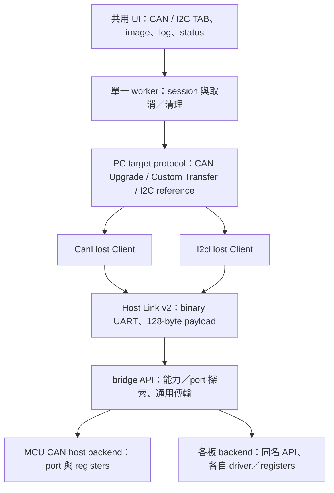
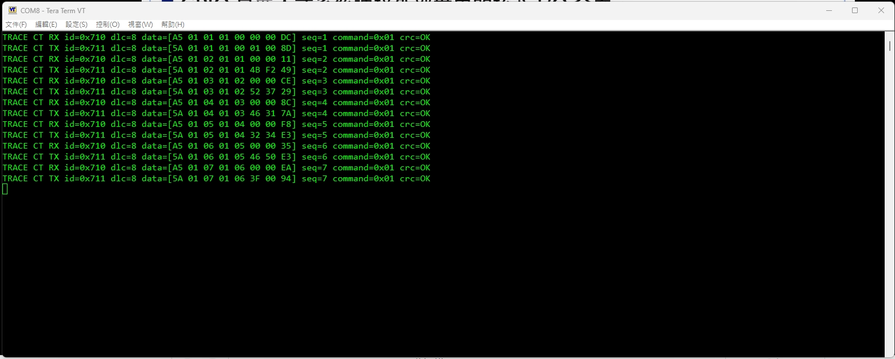
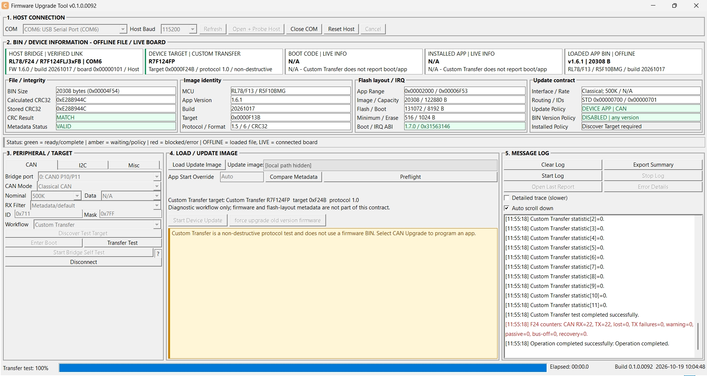
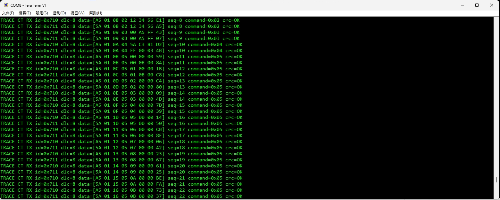
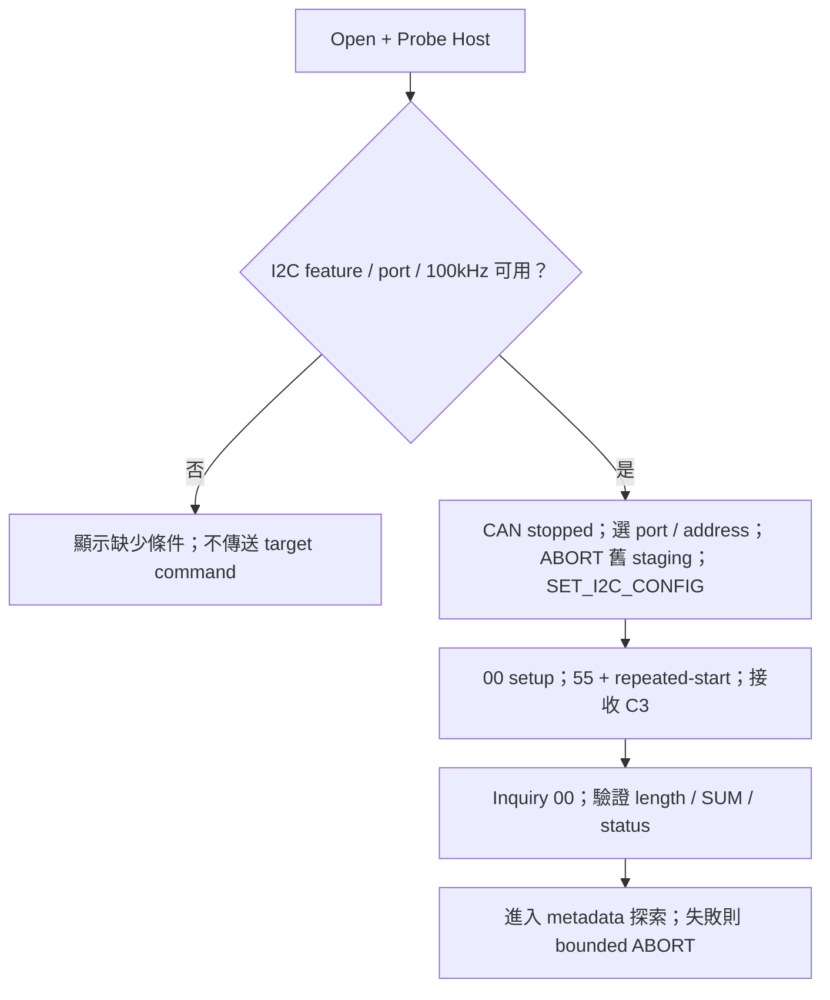
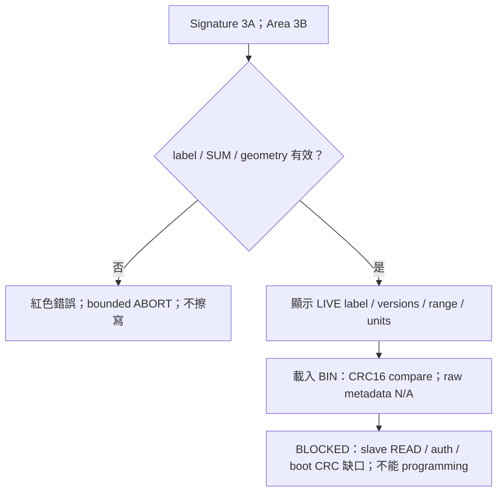
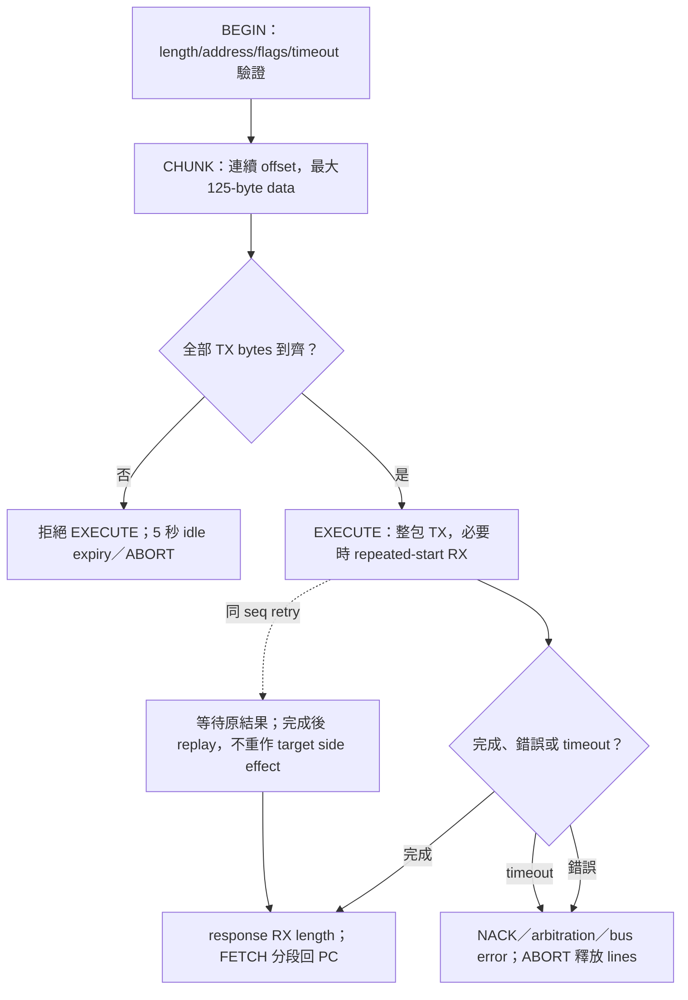

# FirmwareUpgradeTool 多匯流排設計與操作

本文件整理 CAN device 更新、I2C 探索與 Host App UART 更新。
Tool 以 live 裝置資訊及 BIN metadata 核對更新目的地。

<!-- PUBLIC_RESOURCES_BEGIN -->

## 下載與操作總覽

Host 透過 Host Link 連接 PC 並橋接 CAN；device 是 CAN 另一端接受更新的 MCU。
F13 (MCU CAN device)、F24 (MCU CAN device) 各自具有獨立的 Transfer／Boot／App 工程。
F24 (MCU CAN host) 使用獨立的 Bridge Boot／App，透過 Misc／UART 更新自身 App。

以下連結提供 Tool、MCU CAN host 與 MCU CAN device 的下載及原始碼。
首次安裝Boot使用燒錄器，之後更新App才使用對應的Tool流程；不可把Host與Device映像互換。

| 項目 | 下載／原始碼 | 適用方式 |
| --- | --- | --- |
| PC Tool | [Windows EXE](https://raw.githubusercontent.com/released/simple_renesas_isp_tool/main/build/FirmwareUpgradeTool.exe)／[完整原始碼](https://github.com/released/simple_renesas_isp_tool) | Windows x64；先安裝實際VCOM所需driver，再選COM並Probe Host |
| F24 (MCU CAN host) Boot | [Boot專案](https://github.com/released/simple_renesas_isp_tool/tree/main/firmware/RL78_F24_Bridge_boot)／[Boot MOT](https://raw.githubusercontent.com/released/simple_renesas_isp_tool/main/firmware/RL78_F24_Bridge_boot/DefaultBuild/RL78_F24_Bridge_boot.mot) | 首次以燒錄器安裝；Misc不更新Boot |
| F24 (MCU CAN host) App | [App專案](https://github.com/released/simple_renesas_isp_tool/tree/main/firmware/RL78_F24_Bridge_app)／[Misc 更新 BIN](https://raw.githubusercontent.com/released/simple_renesas_isp_tool/main/firmware/RL78_F24_Bridge_app/DefaultBuild/RL78_F24_Bridge_app_bridge_update.bin)／[燒錄器初裝 App MOT](https://raw.githubusercontent.com/released/simple_renesas_isp_tool/main/firmware/RL78_F24_Bridge_app/DefaultBuild/RL78_F24_Bridge_app_flash.mot) | Misc 載入 `_bridge_update.bin`，使用 UART115200；`_flash.mot` 搭配 Boot MOT 供燒錄器初裝 |
| F13 (MCU CAN device) Boot | [Boot專案](https://github.com/released/RL78_F13_Boot_loader_CAN)／[Boot 專用 HEX](https://raw.githubusercontent.com/released/RL78_F13_Boot_loader_CAN/main/DefaultBuild/boot0000_1FFF.hex) | 燒錄器安裝／重燒 Boot；範圍為 `0x0000..0x1FFF`，不包含 App |
| F13 (MCU CAN device) App | [App專案](https://github.com/released/RL78_F13_Boot_loader_CAN_app)／[初裝合併HEX](https://raw.githubusercontent.com/released/RL78_F13_Boot_loader_CAN_app/main/boot_app.hex)／[CAN更新BIN](https://raw.githubusercontent.com/released/RL78_F13_Boot_loader_CAN_app/main/DefaultBuild/RL78_F13_Boot_loader_CAN_app_update.bin) | 合併HEX供燒錄器初裝；CAN TAB載入_update.bin更新Device App |
| F13 (MCU CAN device) 通訊測試 | [Transfer範例](https://github.com/released/RL78_F13_CAN_Transfer) | Custom Transfer，不擦寫Flash；不是Boot/App更新映像 |
| F24 (MCU CAN device) Boot／App | [工程配置與建置說明](https://released.github.io/slide_boot_loader_for_RL78/#f24-can-device) | 燒錄器初裝 Boot HEX／App flash HEX；CAN 更新使用 App update BIN |
| F24 (MCU CAN device) 通訊測試 | [Custom Transfer 操作](https://released.github.io/slide_isp_tool_for_RL78/#custom-transfer) | `RL78_F24_CAN_Transfer` 獨立工程；連結為操作說明 |

F24 host firmware 使用完整 Tool repository，包含 firmware 共用來源與 scripts。
F13 Boot與App需以原repository名稱放在同一父目錄，App會引用相鄰Boot；Download ZIP
解壓後請移除-main尾碼。先build Boot，再build App；版本、metadata、IRQ ABI與CRC仍須相容。

### 交付檔與安裝範圍

Boot 使用燒錄器安裝；日常 App 更新才在 Tool 載入 BIN。
F24 host 的 `_bridge_update.bin` 用於 Misc；F13 device 的 `_update.bin` 用於 CAN。
F24 host 更新寫入完成後，按 `Run Validated Bridge App` 啟動並重新確認 Host App。

HEX（Intel HEX）與 MOT（Motorola S-record）含位址記錄；BIN 為連續映像資料，Tool 依 metadata 與 live Boot 契約核對目的地。
副檔名不能互換，檔案的文字大小也不等於 Flash 程式大小。

F13 App 根目錄 `boot_app.hex` 包含 Boot、App 與剩餘區域的 `0xFF`，供燒錄器整體初裝。
同目錄 `boot_app.bin` 內容相同，僅供需要 raw binary 的燒錄方式使用，起點為 `0x0000`；它不是 CAN 更新 BIN。
僅更新 App 時使用上表的更新 BIN，不使用合併映像。

F24 App 原始 `.mot` 與 F13 原始專案 `.hex` 是編譯／封裝輸入。
正式安裝使用已加入 metadata／CRC 的 `_flash.mot`、`flash_app_variable_CRC.hex` 或配套合併 HEX；日常更新使用對應的更新 BIN。
以燒錄器重燒 Boot／App 前，核對實際 MCU、檔案位址及 erase 設定；分區映像不代表燒錄器一定採分區擦除。

原始碼維護可使用 Tool 根目錄的 `github_push.bat`，同步 F13 Boot／App、F24 device Transfer／Boot／App 與 Tool（含 F24 MCU CAN host）。
保留檔清單、本機 `tmp` 排除、確認與恢復方式見 [GitHub 原始碼與交付檔同步](https://github.com/released/simple_renesas_isp_tool/blob/main/docs/GITHUB_PUBLISH_zh-TW.md)。

### 操作與工程入口

| 想了解的動作 | 網站操作／流程圖 | Tool docs中的詳細說明 |
| --- | --- | --- |
| Tool／F24 (MCU CAN host) 流程與責任 | [Tool與bridge動作圖](https://released.github.io/slide_isp_tool_for_RL78/#tool-bridge-flow) | [多介面架構與流程](https://github.com/released/simple_renesas_isp_tool/blob/main/docs/MULTIBUS_TOOL_GUIDE_zh-TW.md) |
| MCU CAN device Boot啟動、ENTER與逾時 | [Boot→App完整條件圖](https://released.github.io/slide_boot_loader_for_RL78/#f13-boot-decision) | [Boot decision與更新流程](https://github.com/released/simple_renesas_isp_tool/blob/main/docs/F13_BOOT_UPDATE_FLOW_zh-TW.md) |
| Tool operation | [COM／Host識別與操作起點](https://released.github.io/slide_isp_tool_for_RL78/#tool-operation) | [共用畫面與操作指南](https://github.com/released/simple_renesas_isp_tool/blob/main/docs/SHARED_CONSOLE_BRIDGE_GUIDE_zh-TW.md) |
| 更新確認／診斷／報告 | [App 確認、差異與驗證表](https://released.github.io/slide_isp_tool_for_RL78/#update-confirmation) | [更新確認與驗證紀錄](https://github.com/released/simple_renesas_isp_tool/blob/main/docs/UPDATE_VALIDATION_zh-TW.md) |
| 更新F24 (MCU CAN host) App | [Misc：Host App更新圖與RUN](https://released.github.io/slide_isp_tool_for_RL78/#host-bridge-firmware) | [F24 UART自更新協定](https://github.com/released/simple_renesas_isp_tool/blob/main/docs/BRIDGE_SELF_UPDATE_PROTOCOL.md) |
| 更新MCU CAN device App | [CAN：驗證、Enter Boot、更新與確認](https://released.github.io/slide_isp_tool_for_RL78/#f13-device-update) | [CAN區塊更新及保護](https://github.com/released/simple_renesas_isp_tool/blob/main/docs/CAN_BLOCK_TRANSFER_V5_zh-TW.md) |
| Custom Transfer 通訊驗證 | [Custom Transfer 操作](https://released.github.io/slide_isp_tool_for_RL78/#custom-transfer) | [通訊測試協定](https://github.com/released/simple_renesas_isp_tool/blob/main/docs/F13_TRANSFER_PROTOCOL.md) |
| Boot code如何移植 | [Boot/App移植與向量工程](https://released.github.io/slide_boot_loader_for_RL78/#boot-app-porting) | [完整移植指南](https://github.com/released/simple_renesas_isp_tool/blob/main/docs/RL78_BOOT_APP_PORTING_GUIDE_zh-TW.md) |

先用[CAN 更新逐層導讀](https://released.github.io/slide_isp_tool_for_RL78/#can-update-walkthrough)
對照 Tool 操作／BIN 驗證、MCU CAN host 轉送、MCU CAN device metadata／receive／Flash 的表格與流程圖；
[MD](https://github.com/released/simple_renesas_isp_tool/blob/main/docs/CAN_UPDATE_WALKTHROUGH_zh-TW.md)／[PDF](https://github.com/released/simple_renesas_isp_tool/blob/main/docs/CAN_UPDATE_WALKTHROUGH_zh-TW.pdf)可離線閱讀。

Flash mapping、metadata全部256個byte的address／範例值、產生與解析程式，以及CAN逐byte格式，
請讀[Flash／Metadata／CAN移植對照](https://released.github.io/slide_boot_loader_for_RL78/#flash-metadata-can-reference)。

<!-- PUBLIC_RESOURCES_END -->

## 1. 目前功能

| 功能 | 操作 |
| --- | --- |
| CAN | 自測、Custom Transfer、device App 更新 |
| I2C | 指定 port／address 的 reference 探索 |
| Misc | Host App UART 更新 |

## 2. 分層與 port 選擇

GET_PORT_INFO 回報每種 bus 的 count、port ID、route label、rate mask、TX/RX 上限，以及 repeated-start／CAN FD 能力。
選單只列出 firmware 啟用的 port。port ID 是 backend 編號，不等於電路圖 connector 編號。
未宣告 port catalog 的 CAN bridge 僅列出 CAN0；I2C 操作需具有對應能力。

目前 F24：CAN TX P10、RX P11、STB P12；UART TX P15、RX P16；IICA0 SCL P62、SDA P63。
F24 I2C 提供 100 kHz。RA 板的多組 CAN / IIC 接線僅為設計參考，需由各板 firmware 明確宣告。

## 3. 使用 CAN

保留既有 Custom Transfer 與 CAN Upgrade。請先 Open + Probe Host，再選 bridge CAN port。
CAN rate 經 UART SET_CAN_CONFIG 在 CAN stopped 時切換；不是透過 CAN 500K 發出變速 command。
F24 支援 Classical 250K / 500K / 1M，CAN FD nominal 相同、data 固定 2M。
bridge 變速不會同時修改 target 的設定；仍需與 target／image metadata 一致。

Bridge Board Self Test 是實體 CAN 訊號測試：STD ID 0x123、DLC8，每秒 11 22 33 44 55 66 77 counter。
每次啟動 counter 從 00 遞增；需搭配 CAN analyzer 觀察，tool TX log 不是波形量測證據。
F13 Transfer 是已由使用者確認的通訊 benchmark，不需載入 BIN；不得拿它的 BIN 當 upgrade image。
MCU CAN device 的 Boot 啟動條件與 App 工程設定，見 [MCU CAN device 章節](https://released.github.io/slide_boot_loader_for_RL78/)。

<!-- TRANSFER_DIAGNOSTICS_BEGIN -->

### Custom Transfer 診斷

Device UART（P15／P16，115200）的啟動與錯誤訊息，可對照初始化、CAN 連線及封包處理。

| Device UART 欄位 | 意義與核對方式 |
| --- | --- |
| `CAN init: OK/FAIL`、`result` | CAN 初始化結果；`0x0000` 表示成功，非零值依各 MCU driver 定義 |
| `global_status`／`channel_status` | F24 controller 原始狀態；保留完整值供診斷，不與 F13 的狀態數值直接比較 |
| `stage` | F24 初始化階段；`5` 表示 ready，未完成的 `1..4` 見下表 |
| `CAN config` | 編譯設定：Classical 500K、request `0x710`、response `0x711`、filter `0x710/0x7FF` |
| `STB=P12_LOW/HIGH` | MCU 的 P12 output latch；成功後應為 LOW，初始化失敗維持 HIGH。這不是供電或腳位電壓量測 |
| `TRACE CT RX/TX` | ID、DLC、完整資料、sequence、command 與 CRC；TX 表示 driver 接受傳送，不等於已收到 CAN ACK |
| `TRACE CT CAN_ERROR` | 已擷取的 Classical CAN 錯誤旗標與名稱；重複故障期間最多每 250 ms 輸出一次 |

| F24 stage 1..4 | 檢查位置 | 未通過時的核對方向 |
| ---: | --- | --- |
| 1 | driver configuration | 保留 result，核對 SC 與 clock／CAN 設定 |
| 2 | ID／global／channel reset state | 核對 request ID 與 controller raw status |
| 3 | start communication | 核對 driver result 與 mode transition |
| 4 | communication active | 等待有界；逾時回報 WAITING，核對 controller／bus 狀態 |

F24 的 `clock status: OK` 表示時鐘初始化檢查通過，不是頻率量測。
若時鐘初始化未通過，程式保留 standby，且不使用尚未符合 clock 設定的 UART 輸出。

GET_STATS index 7／8／9 分別是 warning／error-passive／bus-off 擷取計數，index 11 是最後擷取的錯誤旗標。
F13 由 error ISR 擷取；F24 由主迴圈輪詢並清除已觀察旗標，不在 ISR 格式化文字。
硬體旗標可能合併多次事件，計數表示軟體擷取次數；counter 飽和於 `0xFFFF`。
`CLEAR_STATS` 會重設統計，因此零次紀錄不等於已量測到沒有實體錯誤。

比對封包時開啟 Tool 的 `Detailed trace (slower)` 與 Log，另存 device UART 與 analyzer trace。
量測速度時將 device 的 `CAN_TRANSFER_UART_TRACE_ENABLE` 設為 `0U` 後重建，並關閉 Tool detailed trace；
錯誤擷取與 GET_STATS 仍運作。
完整 byte／command／counter 定義見 [通訊測試協定](https://github.com/released/simple_renesas_isp_tool/blob/main/docs/F13_TRANSFER_PROTOCOL.md)。
<!-- TRANSFER_DIAGNOSTICS_END -->

<!-- CUSTOM_TRANSFER_MEDIA_BEGIN -->

### F24 (MCU CAN device)：Custom Transfer 操作範例

範例使用 `RL78_F24_CAN_Transfer`，Classical CAN 500K，request／response 為 `0x710／0x711`。
操作畫面與 MCU UART 可對照 discovery、測試命令及結果；點選圖片可開啟原尺寸。

畫面上方保留的 F13 App BIN 屬於 **OFFLINE** 檔案資訊，Custom Transfer 不使用此 BIN。
實際連線的 device 以 **DEVICE TARGET** 的 live 回覆為準；此例為 `R7F124FP`、target `0xF24B`。
Custom Transfer 不回報 Boot／App metadata，對應 LIVE INFO 顯示 `N/A` 是此模式的正常狀態。

#### 1. Tool：選擇通訊測試

Host 連線完成後，CAN 頁選擇 `Custom Transfer`、Classical 500K，再執行 `Discover Test Target`。

圖：Host 已連線、device 尚未探索。此模式使用通訊測試命令，更新按鈕不啟用。

#### 2. MCU UART：Discovery 回覆

`DEVICE_INFO` 的 sequence 1..7 依序回覆 protocol、target、part prefix 與 capabilities。
圖中的 RX／TX 分別是 `0x710／0x711`，各筆顯示 `crc=OK`；target page 的 `4B F2` 為 little-endian `0xF24B`。

圖：Device discovery 的 CAN request／response，可核對相同 sequence、command、payload 與 CRC。

#### 3. Tool：Transfer Test 完成

探索完成後，DEVICE TARGET 顯示 `R7F124FP / 0xF24B / protocol 1.0`。
執行 `Transfer Test` 後，Log 顯示 `Custom Transfer test completed successfully`，進度為 100%。

圖：正常通訊測試完成。Log 的 `F24 counters: CAN RX=22, TX=22` 是 **MCU host** 的統計；
`Custom Transfer statistic[index]` 則來自 **MCU device** 的 GET_STATS 回覆。

#### 4. MCU UART：測試命令與統計

Sequence 8..22 可對照 PING（`0x02`）、ECHO（`0x03`）、PATTERN_TEST（`0x04`）與 GET_STATS（`0x05`）。
UART 圖中各筆 request／response 均顯示 `crc=OK`，可與 Tool 結果交叉核對。

圖：Device 的測試命令與統計回覆。Counter 定義與判讀見 [Custom Transfer 診斷](#transfer-diagnostics)。

這組操作紀錄呈現正常 discovery／通訊測試；不包含 CAN 波形量測、故障注入、斷線恢復或 Boot／App 擦寫驗證。
<!-- CUSTOM_TRANSFER_MEDIA_END -->

CAN 更新通過 END 後，Tool 自動核對 APP_READY 與 live INFO；符合載入映像的版本、build 與大小後顯示 App confirmed。
未確認時保留「已寫入／App 未確認」結果，不自動重寫；詳細判定與補充檢查見 [更新確認](https://released.github.io/slide_isp_tool_for_RL78/#update-confirmation)。

## 4. I2C reference 探索

1. 接好 MCU CAN host 並開啟 Tool；Host Link UART 使用 binary protocol。
2. Open + Probe Host；選 I2C Master TAB。
3. 選 firmware 回報的 IICA0 port、100 kHz、7-bit slave address 0x09。
4. 確認共地、供電、pull-up 電壓與 SDA/SCL 接線，再按 Probe G16 Reference。
5. 查看 target 的 reported label、boot/app version、area range 與 erase/write/read units。
6. 可載入配套 G16 app BIN，先查看 CRC16 calculate、stored、compare；Start Firmware Update 仍鎖定。

位址欄輸入未左移的 7-bit 值 0x08..0x77；backend 才執行 address << 1。
不作 bus-wide address scan。更換 port、speed 或 address 後，舊 target 顯示不再視為 current，必須重新 Probe。
CAN/I2C 不能在同一 session 同時運作；CAN running 時先 Disconnect，才可換 TAB／port。
TAB、port、I2C speed/address 與既有 CAN 選項儲存在 EXE 同目錄的 FirmwareUpgradeTool.ini。

### 4.1 Metadata 與 image 確認

## 5. 離線 BIN 與 live metadata 的比對

| 項目 | CAN Upgrade image | 配套 G16 raw app BIN |
| --- | --- | --- |
| 離線 size | 實際載入長度，不固定 120 KiB | 實際載入長度 |
| checksum | 末端 4 bytes CRC32 | 末端 4-byte slot 的前 2 bytes LE CRC16 |
| 計算範圍 | 全 image，排除末端 CRC32 | image [0,size-5]，排除最後 4 bytes |
| CRC 演算法 | CRC32，依 CAN image contract | CRC16/XMODEM，poly1021、init0000 |
| 離線 MCU / version / start | format6 metadata可讀取 | 沒有manifest，顯示N/A |
| 在线資訊 | INFO pages：MCU／boot/app／layout／CAN | signature label／常數 versions／area geometry |

CAN App Start Override=Auto 使用 image metadata 的 start address；手填值是相容性要求，不是任意重定位。
載入 BIN 後，比對 live target metadata 的身分、分區、更新介面與契約。
CRC MATCH 表示檔案完整性通過；更新仍以全部相容條件符合為前提。
CAN post-build 依 linked image 的使用末端產生可變長度 CRC32 image；容量／保留區／start 仍由專案設定界定。
映像長度須在 live target geometry 的允許範圍內；Flash／Boot／data 區域以裝置回報及映像契約核對。

G16 sample 的 reported label RL78_G16_FPB 不是 silicon part number；legacy type02 也不能推論為 RA2。
其 boot/app version 是範例常數，不是讀取或認證實際 app 的結果。
此配套 linker 的 code area 為 0x1000..0x7FFF、CRC16 放在 0x7FFC，完整 area BIN 為 28672 bytes。
此容量由配套 G16 linker 決定。

## 6. I2C reference 支援範圍

目前提供 Inquiry、Signature 與 Area 探索，以及離線 BIN CRC16 檢查。
擦除、寫入、讀回與 App 啟動未開放；連線 ACK 表示傳輸完成，不代表 Flash 讀回驗證。

## 7. 整包 staging 與錯誤清理

G16一包最大256-byte payload加header/SUM/end共262 bytes，超過UART payload128。
BEGIN / CHUNK 只組裝 bridge buffer，不碰 slave；EXECUTE 才開始一個完整 physical transaction。
不得將每個 UART CHUNK 變成獨立 I2C packet 或在中間插 STOP。
FETCH 只取完成後的 RX，offset／length 不符即失敗，不回傳 partial data。

F24 IRQ 只移動有限 bytes／記錄 state，不 printf、不解析 target command、不作阻塞等待。
timeout、取消與 Close COM 都走 bounded cleanup；ABORT 釋放 open-drain，不強推 SDA/SCL HIGH。
若 slave 實際拉低 SDA，software ABORT 不保證可以復原；需由 analyzer／供電狀態確認。

## 8. 驗證項目

軟體測試涵蓋 port catalog、staging 邊界、相同序號重送、NACK／arbitration／timeout／abort、signature／geometry／CRC16 與 backend register／ISR 模型。
實板檢查另記錄 bus speed、rise time、pull-up、clock stretching、repeated-start 至最後 STOP，以及取消／timeout 復原。

更新與測試時可保留 Tool log、CAN／I2C analyzer trace 與 reset 後 App 的觀察結果。
版本與量測數據收於 [交付紀錄](FIRST_DELIVERY_20261015_zh-TW.md)。

<!-- COMMON_IMAGE_POLICY_BEGIN -->

## 更新政策與通訊速度

BIN 的更新目的地、允許介面、Boot／IRQ ABI 與 Host Link 速度，集中於 ISP Tool 的更新政策章節。
[閱讀完整章節](https://released.github.io/slide_isp_tool_for_RL78/#image-update-policy)
<!-- COMMON_IMAGE_POLICY_END -->
