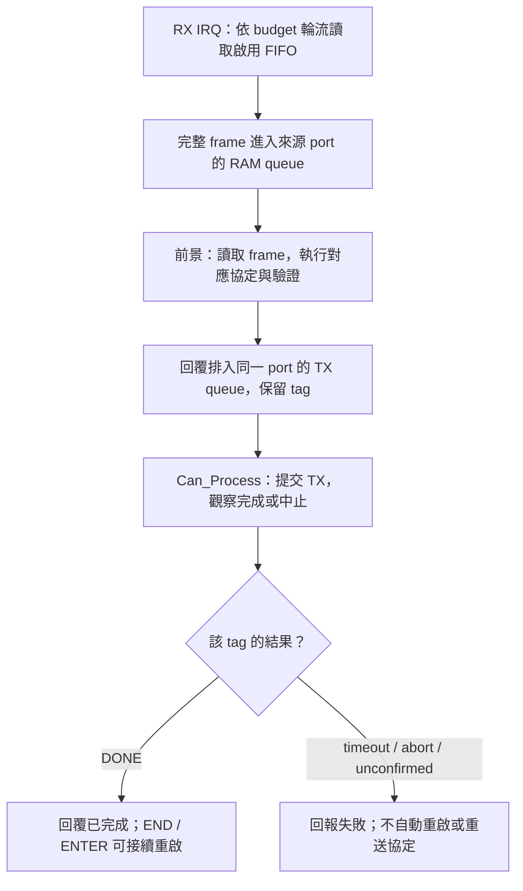
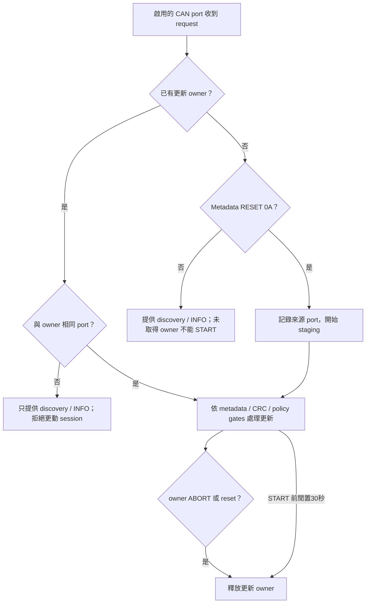
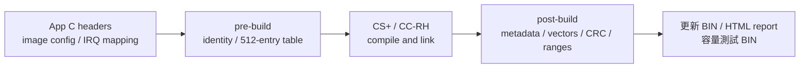
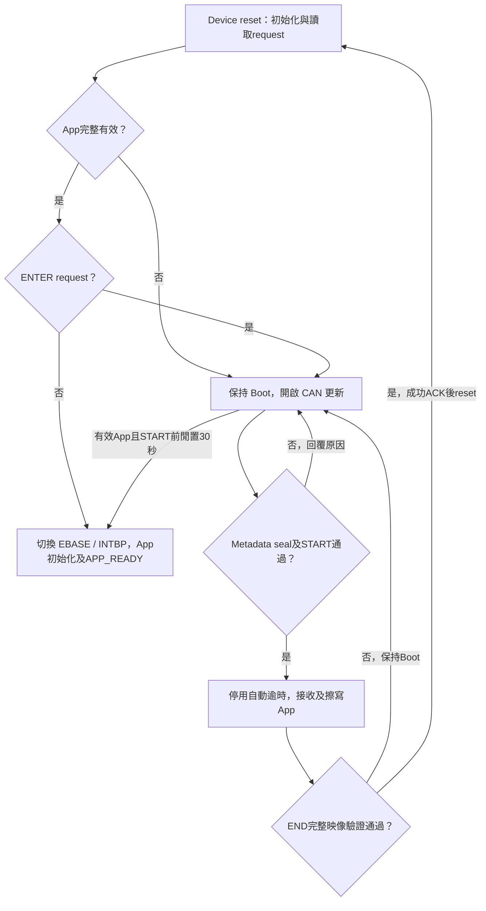
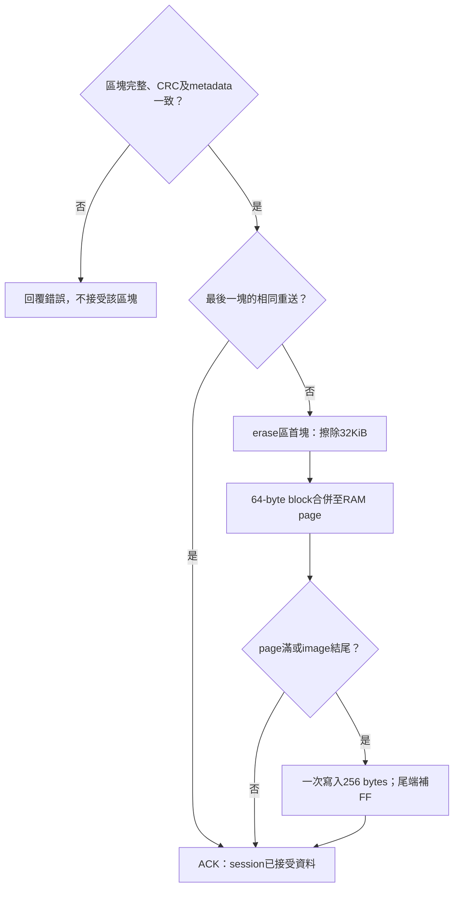

<a id="article_top"></a>

# RH850 MCU CAN device：Transfer、Boot 與 App

UART／Xmodem／I2C 的獨立工程、資料／診斷 UART、中斷與主迴圈完成邊界見
[RH850 串列 ISP 工程配置](https://released.github.io/slide_boot_loader_for_RH850/serial-device.html)。
分章閱讀入口見 [RH850 Bootloader 指南](https://released.github.io/slide_boot_loader_for_RH850/)，量測資料見 [CAN FD 更新時間](https://released.github.io/slide_boot_loader_for_RH850/app-development.html#rh850-update-timing)。

<!-- RH850_DEVICE_BEGIN -->
<!-- RH850_CAN_INTRO_BEGIN -->
<a id="rh850-can-device"></a>

## RH850 MCU CAN device 工程

R7F701684 EVM 使用獨立的 Classical CAN 與 CAN FD 工程。
App 發行設定與 IRQ mapping 由 C header 編輯，PowerShell 在 CS+ 建置前產生 identity／向量表，建置後核對實際映像並封裝 BIN。

<a id="guide-can-device-1"></a>

### 工程與用途

| 模式 | Transfer | Boot | App |
| --- | --- | --- | --- |
| Classical CAN | `Sample_Project_RH850_S1_CAN_Transfer` | `Sample_Project_RH850_S1_Boot_loader_CAN` | `Sample_Project_RH850_S1_Boot_loader_CAN_app` |
| CAN FD | `Sample_Project_RH850_S1_CAN_FD_Transfer` | `Sample_Project_RH850_S1_Boot_loader_CAN_FD` | `Sample_Project_RH850_S1_Boot_loader_CAN_FD_app` |

這些名稱是工程識別；此處未提供原始碼下載網址。
Boot、App 與 Transfer 各自包含 CAN adapter、設定與建置工具，可獨立編譯。
來源分工與使用者入口見 [工程目錄與程式入口](https://released.github.io/slide_boot_loader_for_RH850/porting.html#rh850-project-entry)。

Transfer 的共通通訊驗證與操作見 [Custom Transfer](https://released.github.io/slide_simple_renesas_isp_tool/#custom-transfer)。
一般更新與報告操作見 [Tool 操作](https://released.github.io/slide_simple_renesas_isp_tool/#tool-operation)。

<a id="guide-can-device-2"></a>

### 板端與更新設定

| 項目 | 本工程設定 | 依據／程式位置 |
| --- | --- | --- |
| MCU | RH850/F1KM-S1、R7F701684、100 pins、1 MiB Code Flash | EVM 手冊、CS+ device |
| Clock | X1 16 MHz、CPU 120 MHz、CAN communication clock 40 MHz | SC 設定、`generated_projection/evm_clock.c`、`Device_ClockInherited()` |
| CAN | CAN1 TX P10_7 Alt4／RX P10_6 Alt4；CAN4 TX P0_10 Alt5／RX P0_9 Alt5 | `can_port_config.h`、`hal/can/can_board.c` |
| Classical | nominal 500 kbit/s；standard request／response `0x700`／`0x701` | `can_boot_config.h` 與 `Device_CanInit()` |
| FD | nominal 500 kbit/s、data 2 Mbit/s、BRS、64-byte raw data frame | FD 工程的同名設定與 adapter |
| Transfer IDs | request／response `0x710`／`0x711` | 各 Transfer 的 `can_transfer_config.h` |
| UART log | UART0 TX P0_2、115200 bit/s | SC UART0；主迴圈有限次數等待，UART CPU IRQ 保持遮罩 |
| RX | 每個啟用 port 使用獨立 FIFO／16 格 SPSC queue（15 格可用），共用 EIINT23 | `Device_CanRxIsr()`；每次總計最多讀取16幀，接收無 polling fallback |
| Tick | OSTM0、EIINT84、1 ms | SC OSTM0 與 `ostmr_1ms_IRQ()` |

硬體設定來源為 [RH850/F1KM 硬體手冊](https://www.renesas.com/en/document/mah/rh850f1km-rh850f1kh-users-manual-hardware) 的時脈、Port、RS-CANFD 與中斷章節。
兩塊 EVM 的手冊皆列出 CAN／CAN FD 收發器；2 Mbit/s 的接線、終端與實際波形仍需實板核對。

<a id="rh850-evm-can-ports"></a>

#### EVM 連接、port 選擇與 CAN RAM

依據為 [BLDC Starter Kit V2 手冊](https://www.renesas.com/en/document/mat/rh850f1km-s1-bldc-starter-kit-v2-users-manual) §4.1.8.3、Tables27／28，
以及 [Starter Kit V3 手冊](https://www.renesas.com/en/document/mat/rh850f1km-s1-starter-kit-v3-user-manual-hardware) §4.2.7.3、Tables24／25。
板上 **CAN0／CAN1 連接器**分別連到 **MCU CAN1／CAN4**。

| MCU channel | 板上連接器 | BLDC V2 路由 | ASK V3 路由 |
| --- | --- | --- | --- |
| CAN1 | CAN0／CN6 | S7_6、S7_5 ON | J20 1-2、3-4 |
| CAN4 | CAN1／CN8 | S7_4、S7_2 ON；S7_3、S7_1 OFF | J20 5-6、7-8 |

獨立 bus 測試時，S4_3／S4_4 保持 OFF，避免板內將兩路互接。
S4_1／S4_2 分別控制兩路終端電阻，依實際 bus 兩端配置；兩塊板的 USB／電源與 UART 跳線也依各自手冊設定。

各工程根目錄的 `can_port_config.h` 選擇本工程的 CAN port。
搭配安裝的 Boot／App 分別設定相容的 port、速率與 ID；Transfer 使用自己的設定。
每一項填0或1，至少啟用一個 port：

```c
#define ENABLE_PORT_CAN0 (0U)
#define ENABLE_PORT_CAN1 (1U)
#define ENABLE_PORT_CAN2 (0U)
#define ENABLE_PORT_CAN3 (0U)
#define ENABLE_PORT_CAN4 (1U)
#define ENABLE_PORT_CAN5 (0U)
```

其他四路的既定 pin mapping 如下；使用時需另行配置板端接線與收發器。
來源為硬體手冊 Tables2C.41／2C.47 的100-pin alternative functions。

| MCU channel | TX | RX |
| --- | --- | --- |
| CAN0 | P0_0 Alt2 | P0_1 Alt7 |
| CAN1 | P10_7 Alt4 | P10_6 Alt4 |
| CAN2 | P0_4 Alt1 | P0_5 Alt7 |
| CAN3 | P0_8 Alt5 | P0_7 Alt7 |
| CAN4 | P0_10 Alt5 | P0_9 Alt5 |
| CAN5 | P0_14 Alt5 | P0_13 Alt7 |

| 資源 | 分配方式 | CAN1／CAN4 預設配置 |
| --- | --- | --- |
| 硬體 RX FIFO | index＝MCU channel，每路深度16 | FIFO1／FIFO4 |
| RX rule | 每路獨立 exact control ID；Boot 另有 raw rule | 不跨 FIFO 路由 |
| CPU RAM queue | 只為啟用 port 配置，16格／15可用 | 兩組獨立 queue／counter |
| TX buffer | 各 channel 的 local buffer0 | status index32／128 |
| CPU TX queue | 每路4筆，含尚未讀取的 completion credits | ISP 一次等待一筆協定回覆；實際 RAM／stack 另由 linker guard 核對 |
| RX Message Buffer／共用 TX-RX FIFO | 不配置 | 0個 |

硬體手冊 §24.10.1.5 的 RX／FIFO RAM 計算式為 `depth × (12 + payload bytes)` 加總。
六通道可用量為 `3584 × 6 = 21504 bytes`，不含固定 TX buffer 區。
Classical 每路用320 bytes；FD 每路用1216 bytes，兩路共2432 bytes，六路共7296 bytes。
程式以64-byte payload 的上界作編譯檢查；CPU RAM queue 另行計算，不與 CAN RAM 混用。

共用 RX IRQ 輪流讀取啟用 FIFO，一次總計最多16幀；滿批後再請求中斷。
Main loop 輪流讀取各路 RAM queue，response 回到 request 的來源 bus。
IRQ counter 表示該 port 在 ISR 中實際取得 frame 的入口次數，空 FIFO 不增加該計數。
Queue／drop／error observations 依 port 記錄；硬體 lost indication 不等於精確遺失幀數。

<a id="rh850-can-service"></a>

<a id="guide-can-device-7"></a>

### 接收與中斷

#### CAN service、回覆完成與錯誤處理

Classical／FD 的 Boot、App 與 Transfer 共用 MultiCHv4 的 service／driver 核心。
硬體設定與協定 adapter 則由各工程持有，沿用本頁的 EVM、mode、ID、速率及 IRQ 配置。



| 檔案／層級 | 負責內容 | 可編輯位置 |
| --- | --- | --- |
| `can_port_config.h` | 啟用的 MCU channel、靜態 RX queue／CAN RAM 上界 | 各工程根目錄 |
| `hal/can/can_config.c` | 每路 FIFO、timing、exact control／raw ID filters、初始化前資源檢查 | 工程通訊配置 |
| `hal/can/can_board.c` | EVM pin mux、實際 clock 檢查、INTC、channel-local 操作 | 板端移植 |
| `hal/can/can_service.c/.h` | 完整 frame queue、IRQ budget、TX tag／completion、timeout／cancel／診斷 | 共用核心 |
| `hal/can/rs_canfd*` | frame／DLC／FIFO／rule／共享 RAM 驗證及 register driver | 共用核心 |
| `rh850_can_ports.c/.h` | ISP API、來源 channel 回覆、wire format 檢查及 TX 完成判定 | 協定接合 |
| `device_can.c`／`rh850_can.c` | Boot／App／Transfer 的既有介面 | 各模式工程 |

各工程使用自己的 `hal/can` service／driver 與 adapter。
Firmware 建置使用工程內的副本，不需要另行取得 standalone v4 或安裝其他執行環境。

`CanPorts_Read()` 呼叫 `Can_Process()` 處理 TX／status，再讀取 RAM queue。
IRQ-owned FIFO 不由 main loop 輪詢；RX ISR 不解析協定、不輸出 UART，也不等待 TX。
`CanPorts_Send()` 只有取得相同 tag 的 `CAN_TX_DONE` 才回傳成功，排入 queue 不是傳輸完成。
既有 END／ENTER 的 reset gate 因而仍以回覆完成為條件，metadata／Flash／CRC／版本政策另由原協定檢查。

| 狀態／操作 | 行為 |
| --- | --- |
| RX queue 滿 | 保留已排入的資料，丟棄新 frame 並增加該 port 的 drop observation |
| TX 逾時 | 提交後100 ms 未完成時請求一次 abort，再以100 ms 上限觀察中止結果 |
| TX 結果未確認 | 鎖住該 channel 的 TX；不自動重新送出或重啟 CAN，其他 channel 獨立運作 |
| `Can_StopChannel()`／`Can_RecoverChannel()` | 前景 C API；恢復時清除該 channel 的 CPU RX queue，保留 completion／診斷，不重新配置其他 channel 或全域 CAN RAM |
| `Can_CancelTx(channel, tag)` | 取消最早一筆相符的 outstanding tag；硬體已完成的競爭結果仍為 DONE，未確認結果不宣稱已取消 |
| 狀態／診斷讀取 | 保留硬體 error flags；`CLEAR_STATS` 僅處理協定統計，不重設 CAN 或清除硬體錯誤證據 |

Stop／recover／cancel 不新增 Tool 操作或 CAN ISP 命令。
自訂程式使用這些 API 時，先結束目前協定交易並保存診斷；它們不釋放 Boot 的更新 owner，也不解除更新保護。
Boot 更新工作區的規則集中於[多 port 更新工作區](#rh850-update-port-owner)。

<a id="rh850-update-port-owner"></a>

#### 多 port 更新工作區

Transfer 的 protocol context、統計與重送快取依 port 獨立。
Boot 的 App Flash 與 metadata staging 則只有一份，採單一更新 owner：



非 owner 的更動命令回覆 `BAD_STATE=2`，detail 為 owner 的 MCU channel；raw data／BEGIN 不回覆、不進入工作區。
收到其他 bus 的 discovery／INFO 不會延長既有 staging lease。
START 後不自動釋放或讓另一 port 接管；由 owner ABORT 或重置結束工作階段。
ABORT 清除 RAM session，不還原已擦寫的 App。

個別測試時將 host 接到 CAN1，完成 Transfer 或更新；再改接 CAN4 重做相同流程。
Tool 的 Bridge port 選單選擇的是 **host 的 port**，device port 由實際接線及上述編譯設定決定。

<a id="guide-can-device-3"></a>

### Flash 配置

Boot64KiB、App起點10000h及RAM monitor／FCL配置集中於 [Flash與映像配置](https://released.github.io/slide_boot_loader_for_RH850/porting.html#rh850-flash-layout)。
App、Transfer與燒錄器檔案的範圍依各自的封裝產物核對。

<a id="guide-can-device-9"></a>

### 工程與建置

Boot／App／Transfer均在自己的根目錄使用`build.ps1`或CS+ Rebuild。
完整產物表見 [建置與使用產物](https://released.github.io/slide_boot_loader_for_RH850/app-development.html#rh850-build-products)。

<a id="guide-can-device-10"></a>

### 驗證項目

| 項目 | 本工程的核對內容 |
| --- | --- |
| Clock／pin | R7F701684、16MHz、CPU120／CAN40MHz、CAN1／CAN4路由 |
| 接收 | 共用RX IRQ、各port獨立FIFO與CPU queue、overflow／drop observations |
| 回覆 | source port、TX tag／DONE、完整回覆後才允許reset |
| 更新契約 | Metadata／target／mode／rate／layout／policy／CRC／vectors |
| Flash | FCL RAM鏈、38個blocks、256-byte page、Boot範圍保護 |
| App | EBASE／完整INTBP、APP_READY、live identity與獨立counter |

<!-- RH850_CAN_INTRO_END -->

<!-- RH850_FLASH_BEGIN -->
<a id="rh850-flash-layout"></a>

### Flash 與 RAM 位址

以下為 byte address，範圍包含起訖。
Flash erase／write 單位依 [Flash hardware interface](https://www.renesas.com/en/document/mah/rh850f1k-users-manual-flash-hardware-interface) 及 FCL 裝置資訊核對。

| 區域 | 位址／大小 | 用途與來源 |
| --- | --- | --- |
| Boot | `0x00000000..0x0000FFFF`，64 KiB | reset／Boot INTBP／FCL／驗證；保留至少512 bytes 建置餘裕 |
| App entry | `0x00010000..0x000100FF` | 起始 `jr32 __start` 與預留；`app_entry.asm` |
| App metadata | `0x00010100..0x000101FF`，256 bytes | core128＋reserved128；`image_metadata_profile.c` |
| App exception table | `0x00010200..0x000103FF`，512 bytes | EBASE；32個16-byte exception slots |
| App EIINT table | `0x00010400..0x00010BFF`，2048 bytes | INTBP；512個 LE32 handler address |
| App code／constants | `0x00011000` 起 | `device_build.ps1` linker layout |
| App capacity | `0x00010000..0x000FFFFF`，960 KiB | 實際 image 最後4 bytes 為 CRC32，依 image size 決定位置 |
| Flash erase | Boot block0..7各8 KiB；App block8..37各32 KiB | FCL 初始化核對38 blocks、block7 end及最後 block end |
| Flash program | 256-byte aligned page | `flash_geometry.c`、`Device_FlashWritePage()` |
| 一般 RAM／stack | `0xFEDF0000` 起，使用範圍限制於 `0xFEDF4800` 前 | post-build map guard |
| E2 monitor 預留 | `0xFEDF4800..0xFEDF6DFF` | CS+ Work RAM 使用 global alias `0xFEBF4800`、9728 bytes |
| RAM reader | `0xFEDF7000..0xFEDF7FFF`，4 KiB | copied `RAM_READ.text`；解析可能空白的 Flash 資料 |
| FCL copy 預留 | `0xFEDF8000..0xFEDFEFFF`，28 KiB | `FCL_RAM_ADDRESS`；post-build 檢查區段次序與 copy extent |
| RAM handoff | `0xFEDFFFF0..0xFEDFFFFF`，16 bytes | signature／request／反碼／owner；`boot_app_handoff.h` |

Cold reset 初始化 handoff RAM 的 ECC；Boot→App 與 software reset 保留已初始化的 cookie。
EVM startup 的 LRAM ECC 初始化從 `0xFEDE0000` 開始，涵蓋96 KiB LRAM；上表為本工程目前實際配置的子區域。
Cookie 是啟動交接資訊，不是認證機制，也不是斷電後保留的版控儲存區。

<!-- RH850_FLASH_END -->

<!-- RH850_APP_BEGIN -->
<a id="rh850-app-editing"></a>

## Device 開發實作：編輯 Metadata、增加 IRQ、產生並驗證 App

<a id="guide-app-development-1"></a>

### A. 專案配置與共用介面

#### Metadata：輸入、產生與驗證

| 分類 | 修改位置 | 產生／使用位置 |
| --- | --- | --- |
| App 發行 | `app_image_config.h`：version、build、target、role、update transports、version control | pre-build → `generated_projection/app_identity.h` |
| MCU／Flash／格式 | 各工程的 `image_metadata_config.h` | Boot／App 各自編譯 `image_metadata_profile.c` |
| CAN 模式／速率／ID | 各工程的 `can_boot_config.h` 與 `hal/can/can_config.c` | 實際 register timing 與 metadata masks 需一致 |
| IRQ | App 的 `app_irq_handlers.h` | pre-build → `generated_projection/device_vectors.c` |
| 建置結果 | 實際 `.mot`／`.map` | post-build → image size、尾端 CRC32、更新 BIN、HTML report |
| 裝置驗證 | `hal/image/image_metadata.c/.h`、`device_image.c/.h` | 獨立 C90 解析、profile、範圍、CRC 與向量檢查 |

更換 MCU 時，將 Flash geometry、FCL支援、clock／pins、ECC／RAM、exception／EIINT來源及 metadata profile 作為一組工程配置核對。
App 發行 identity、IRQ header、建置生成及實際映像驗證的流程保持一致。
Boot／App 的版本各自獨立；App minimum Boot 取自配對的 Boot contract，不要求 App version 等於 Boot version。

欄位的逐 byte 定義見 [metadata byte reference](https://released.github.io/slide_boot_loader_for_RH850/reference.html#rh850-metadata-bytes)。
該表的欄位 offset 可共用；實際絕對位址以本節 mapping 換算。
例如 metadata `0x74..0x77` 在本工程為 `0x10174..0x10177`，保存 App version control 的 LE32 值。

本 profile 的 target 是 `0x8501`，IRQ ABI 是 `0x31563852`（R8V1）。
`APP_IMAGE_VERSION_CONTROL=0` 是預設；目前有效 App 設為1時，普通 START 接受同版／新版，拒絕較舊版本。
維護降版操作仍經過 identity、layout、CRC、IRQ 與 minimum Boot 檢查，操作見 [版本政策](https://released.github.io/slide_simple_renesas_isp_tool/#force-old-version)。
沒有有效 App 時，不保留獨立的版本下限。


#### A1. 設定檔與產物分工

| 檔案 | 使用者修改的內容 | 建置結果／使用者核對 |
| --- | --- | --- |
| `app_image_config.h` | App version、build、target、role、transport、version control | `generated_projection/app_identity.h`、實際 BIN 的 Metadata |
| `app_irq_handlers.h` | EIINT index 與 global ISR symbol | `generated_projection/device_vectors.c`、完整512-entry table |
| `image_metadata_config.h` | MCU、Flash、Boot reserve、IRQ ABI、最低 Boot 契約 | Boot／App 各自的 profile 與 linker／封裝檢查 |
| `can_boot_config.h` | CAN mode、IDs、編譯速率宣告 | Boot／App INFO、Metadata 與 driver timing 一致 |
| `boot_app_handoff.h` | RAM cookie、signature／request／owner | startup 與交接 API 使用相同定義 |
| `DefaultBuild/*_update.bin` | 由封裝器產生 | 使用 Tool 載入；不手動修改 bytes |

<a id="guide-app-development-2"></a>

### B. Metadata 設定與產生來源

#### 編輯 app_image_config.h

在所選 Classical CAN 或 CAN FD App 根目錄編輯這六項發行設定。
本表以 CAN App 為例；UART／Xmodem／I2C 的允許介面由各自工程配置。

| Define | 範例 | 用途與修改條件 |
| --- | --- | --- |
| `APP_IMAGE_VERSION` | `0x00010203UL` | 1.2.3；三個 byte 分別是 major／minor／patch，不是十進位日期 |
| `APP_IMAGE_BUILD` | `20261027UL` | build 識別，獨立於版本排序；可採 YYYYMMDD 慣例 |
| `APP_IMAGE_TARGET_ID` | `0x8501U` | 此 EVM 工程契約；只改成其他 target 不會完成移植，profile 不符會被拒絕 |
| `APP_IMAGE_ROLE` | `1U` | DEVICE_APP；例如5不是此 App 的有效角色，產生／驗證會停止 |
| `APP_IMAGE_UPDATE_TRANSPORTS` | `0x01U` | CAN=01、I2C=02、UART=04；CAN 工程必須符合其 Boot 的更新介面 |
| `APP_IMAGE_VERSION_CONTROL` | `0U`／`1U` | 0允許任意版本；有效 installed App 設為1時，普通 START 僅接受同版／新版 |

```c
/* Example release identity for the existing CAN engineering contract. */
#define APP_IMAGE_VERSION           (0x00010203UL)
#define APP_IMAGE_BUILD             (20261027UL)
#define APP_IMAGE_TARGET_ID         (0x8501U)
#define APP_IMAGE_ROLE              (1U)
#define APP_IMAGE_UPDATE_TRANSPORTS (0x01U)
#define APP_IMAGE_VERSION_CONTROL   (0U)
```

#### 用 address 與 byte 核對結果

| 欄位 | Metadata offset | BIN offset | 此 App 的 Flash address |
| --- | --- | --- | --- |
| version／build | `0x10`／`0x14` | `0x110`／`0x114` | `0x10110`／`0x10114` |
| image_size | `0x18` | `0x118` | `0x10118` |
| target | `0x0C` | `0x10C` | `0x1010C` |
| role／transports | `0x66`／`0x67` | `0x166`／`0x167` | `0x10166`／`0x10167` |
| IRQ ABI／minimum Boot | `0x68`／`0x6C` | `0x168`／`0x16C` | `0x10168`／`0x1016C` |
| version control | `0x74` | `0x174` | `0x10174` |

四個 byte 的整數採 little-endian；例如 version1.2.3 在 Metadata0x10..13 為 `03 02 01 00`。
完整256 bytes 見 [Metadata 位址與範例](https://released.github.io/slide_boot_loader_for_RH850/reference.html#rh850-metadata-bytes)。

#### Metadata 產生路徑


#### Metadata C 模組與移植入口

| 模組 | 責任 | 移植時核對 |
| --- | --- | --- |
| `hal/image/image_metadata.c/.h` | 解析與驗證256-byte 格式 | endian、32-bit word、長度與 reserved；不呼叫 CAN／Flash API |
| `hal/image/image_metadata_profile.c` | 本工程預期 MCU／Flash／介面／政策 | 配對 Boot／App 的格式契約 |
| `hal/image/device_image.c/.h` | 完整映像 CRC、entry、exception／INTBP 與範圍 | RH850 layout、512個目的地、App code 範圍 |
| 工程的 RAM reader | 安全讀取可能空白／中斷更新的 Code Flash | ECC 控制、RAM copy 與讀取結果 |
| `tools/app_config.ps1`／`tools/device_build.ps1` | C header 讀取、生成、封裝與實際映像檢查 | 本工程輸入及輸出，不依賴另一份 Boot checkout |

移植順序為 MCU／Flash 契約 → reader／Flash API → profile → startup／IRQ → 封裝與實際 BIN 驗證。
App 發行設定依既定工程契約修改；Boot 版本與 App 版本分開維護。

<a id="guide-app-development-3"></a>

### C. App Vector Table：新增 IRQ 範例

#### IRQ 編輯與 Boot／App 交接

`app_irq_handlers.h` 的數字是 **EIINT channel index**。
來源是本 MCU 的 SC `r_cg_intvector.c` 及硬體手冊 interrupt table；不是 Flash byte address。
例如 channel23 的 App table entry address 是 `0x10400 + 23 × 4 = 0x1045C`。

```c
/* App-local normal EIINT handlers; generated table contains all512 entries. */
#define APP_IRQ_HANDLERS(X) \
    X(23U, Device_CanRxIsr) \
    X(84U, r_Config_OSTM0_interrupt)
```

#### C0. Boot／App 中斷入口與交接

<a id="rh850-irq-entry"></a>

#### IRQ 入口與交接成本

CAN RX／OSTM0 的 TB 設為 table reference，App EIINT 不逐次回 Boot 讀 owner；`Device_JumpAsm()` 僅在交接時切換 EBASE／INTBP。
App EIINT 路徑為 CPU → App INTBP entry → App ISR → EIRET。硬體中斷接受、table 存取及 ISR 前言／結尾仍有成本，依 CPU／memory wait 配置量測；可用 GPIO pulse 分別觀察 IRQ 進入與 ISR 執行時間。
設定依據為 [Renesas RH850 初始化說明](https://tool-support.renesas.com/autoupdate/support/onlinehelp/csp/V8.14.00/CS%2B.chm/Compiler-CCRH.chm/Output/ccrh08c0201y.html)。

| 項目 | 此工程的行為 | 來源 |
| --- | --- | --- |
| reset／Boot table | Boot 管理 reset 入口與自己的完整 EIINT table | Boot startup、產表與 linker |
| App table | EBASE=`0x10200`，INTBP=`0x10400`，512個4-byte entries | `app_entry.asm`、`device_vectors.c` |
| owner | Boot=`AA`、App=`55`，保存在 RAM handoff | `boot_app_handoff.h` |
| App IRQ 執行路徑 | CPU → App INTBP entry → App ISR → EIRET | 啟用 table reference 的 EIINT／CC-RH pragma |
| channel23 槽位 | `0x10400 + 23 × 4 = 0x1045C` | CAN RX 的 EIINT index |
| IRQ 數量增加 | 編輯 mapping 後重建 App；固定512-entry table 的大小不變 | local generator／post-build guard |

CPU120MHz 下1cycle約8.33ns、120cycles為1µs。這是單位換算；IRQ 接受與 ISR 前後言耗時需依實際指令、memory wait 與 GPIO 邊界量測。

#### C1. 加入一般 ISR，並在 App MTPJ 註冊來源

1. 由 RH850 硬體手冊 interrupt table 及 SC 的 `r_cg_intvector.c` 查出實際 EIINT index。
2. 設定所需周邊 clock／pin／IRQ；ISR 中讀取資料並依 driver 清除或處理旗標。
3. 定義 global ISR，使用本工程 CC-RH 的 interrupt pragma，不加 `channel=`。
4. 新增 `.c` 時在 App CS+ source registration 加入檔案；同一映像內的 symbol 不能重複定義。
5. 在 `APP_IRQ_HANDLERS(X)` 保留既有 CAN RX23與 tick84，再加入所選周邊的 index／symbol。

```c
/* Add the real peripheral's EIINT index to APP_IRQ_HANDLERS. */
#pragma interrupt app_aux_irq(enable=false, fpu=true, callt=false)
void app_aux_irq(void)
{
    /* Read/acknowledge the configured source and queue bounded work. */
}
```

#### C2. Mapping、產生結果與核對欄位

例如在SC啟用UART1（RLIN31）RX，依其產生的interrupt table核對EIINT122後，保留原本兩項並新增一項：

```c
#define APP_IRQ_HANDLERS(X) \
    X(23U, Device_CanRxIsr) \
    X(84U, r_Config_OSTM0_interrupt) \
    X(122U, app_aux_irq)
```

`app_aux_irq` 的內容依該UART driver完成資料讀取、旗標處理及queue；mapping不代替周邊初始化。

| 修改 | 核對結果 |
| --- | --- |
| `X(index, app_aux_irq)` | index 是 EIINT索引；不是 Flash address，也不是 RL78 vector byte offset |
| ISR 定義 | 產生表中的32-bit address 指向 App code；CC-RH 以 EIRET 返回 |
| 未使用槽位 | 仍由產生器填入預設 handler，沒有刪除 table entries |
| SC 再產生 | 原始 SC 保留；工程採其受控 no-channel projection，避免重複 table／ISR |
| 4組 IRQ 改為10組 | linker 的 EBASE／INTBP 區域沿用；新增來源、mapping、初始化及旗標處理都要完成 |

<a id="guide-app-development-4"></a>

### D. 產生與建置

#### D0. 第一次操作：逐步完成一次 App 變更

1. 在 App 工程的 `app_image_config.h` 編輯 version／build。target、role、transports 與 version control 的用途由 header 註解說明；MCU／Flash／介面契約有變動時，同步核對搭配的 Boot。
2. 在 SC 與本 MCU 的 `r_cg_intvector.c`／硬體手冊查出周邊的 EIINT channel index，再編輯 `app_irq_handlers.h`。目前 CAN RX 使用23，OSTM0 使用84；這些數字是中斷索引。
3. ISR 使用 global、非 static 的 EIRET handler，不加 `channel=`。周邊資料讀取、旗標清除與中斷允許依所選 SC driver 的實際來源處理；ISR 只留下有界資料或事件，前景工作放在 `custom_func.c`。
4. 新增 `.c` 時，將檔案加入該 App 的 CS+ source registration。既定 linker／512-entry table 可容納新增 mapping，不因 IRQ 數量由4增至10而另外調整 table 容量。
5. 在 App 根目錄執行 `powershell -NoProfile -ExecutionPolicy Bypass -File .\build.ps1`，或 CS+ Rebuild。pre-build 產生 identity／vector；post-build 驗證實際映像後產生更新 BIN。
6. 開啟 `DefaultBuild/app_build_report.html`，核對版本、Metadata、CRC、全部512個 IRQ entries 與目的地。`test_bins/auto/index.html` 提供由同一份 App 產生的容量測試 BIN；實板更新另以 Tool 的 Firmware update report 記錄結果。

App-only 建置使用本工程來源與設定，不需要 Boot checkout。搭配安裝的兩份映像仍使用相容的 Flash／IRQ／格式契約。



#### D1. App-only 建置

<!-- RH850_BUILD_BEGIN -->
<a id="rh850-build-products"></a>

#### 建置與使用產物

需要現有 CS+ CC／CC-RH 與 Windows PowerShell，不需要 Python 作為 firmware 建置環境。
在所選 Boot、App 或 Transfer 工程的根目錄執行：

```powershell
powershell -NoProfile -ExecutionPolicy Bypass -File .\build.ps1
```

Classical CAN 與 CAN FD 各工程使用相同的本機建置方式。
App 來源、設定與工具均包含在 App 工程中，建置不需要另一份 Boot checkout，也不重建 Boot。
CS+ Rebuild 使用相同的 pre／post 檢查；SC 重新產生後，核對工程設定再執行 Rebuild。

| 產物（各工程 `DefaultBuild`） | 用途 |
| --- | --- |
| Boot `boot0000_FFFF.hex` | 燒錄器安裝64 KiB Boot，範圍不含 App |
| App `<AppProject>_update.bin` | Tool 的 CAN Upgrade 載入檔；包含 entry、metadata、vectors、code及尾端CRC |
| App `flash_app_variable_CRC.hex` | 燒錄器直接安裝 App，帶絕對位址，範圍不含 Boot |
| App `app_build_report.html` | 瀏覽器閱讀實際 BIN 的 size／CRC／SHA256、256-byte metadata與512個IRQ entries |
| Transfer `<TransferProject>.mot` | 從零位址執行的獨立通訊測試，使用燒錄器安裝 |
| 原始 linker `.mot`／`.abs`／`.map`／`.asm` | 工程診斷及封裝檢查；App 原始 MOT 尚未封裝 image size／尾端CRC，不作更新輸入 |

更新操作與報告見 [Tool 操作入口](https://released.github.io/slide_boot_loader_for_RH850/tool-guides.html)。
完成後可對照 App 確認與獨立 UART 的 image tag、`log(timer)-V1` 遞增 counter。
<!-- RH850_BUILD_END -->

#### D3. 以瀏覽器核對編譯摘要

開啟 `DefaultBuild/app_build_report.html`，對照實際封裝 BIN 的 size、CRC32、SHA256、版本／build、256-byte Metadata 與512個 IRQ entries。
編譯摘要描述產物；板上啟動以 Tool 的 App 確認及獨立 Log 核對。

#### 由現有 App BIN 產生 FF 填充測試映像

成功封裝後自動產生 `test_bins/auto/`；開啟其中的 `index.html` 選擇實際長度與 CRC。
手動保留一組批次時，在同一 App 根目錄執行 `generate_test_bins.bat`，或：

```powershell
powershell -NoProfile -ExecutionPolicy Bypass -File .\generate_test_bins.ps1
```

| 項目 | RH850 工程配置 |
| --- | --- |
| Code Flash／Boot reserve | 1024／64 KiB |
| App 最大完整 BIN | 960 KiB，含 entry、Metadata、vectors、code、填充及末端 CRC32 |
| 例：Flash級距128／256／512／1024 KiB | App BIN為64／192／448／960 KiB；來源 App 放不下的級距略過 |
| `0xFF` 延伸 | 保留可執行內容與 IRQ；調整 image_size，重新計算最後4-byte CRC32 |
| `index.html`／`manifest.csv`／`skipped.csv` | 長度、CRC、SHA256、來源及略過原因 |
| 自動／手動批次 | `auto` 僅替換歸屬與雜湊符合的產物；手動批次各自獨立，`test_bins` 不上傳 |

本機 PowerShell 讀取該 App 的契約，不需另一份 Boot 工程；不重編 Boot，也不修改正式 `*_update.bin`。
實際耗時見 [App BIN 更新耗時參考](https://released.github.io/slide_boot_loader_for_RH850/app-development.html#rh850-update-timing)。

<a id="rh850-runtime-log"></a>

#### D4. App 執行標籤與每秒 counter

App 的 `app_runtime_log.h` 設定 `APP_RUNTIME_LOG_TAG`，例如V1／V2。
`custom_func.c` 在前景輸出每秒遞增 counter；ISR 僅提供 tick／事件。

```text
app image tag: V1
log(timer)-V1: 0
log(timer)-V1: 1
```

文字輸出直接使用專案內 `retarget.c`／`retarget.h` 的 `tiny_printf()`。
在 `custom_func.c` 引入 `retarget.h` 後，可於 UART0 初始化完成後的前景流程使用：

```c
tiny_printf("log(timer)-" APP_RUNTIME_LOG_TAG ": %lu\r\n", counter++);
tiny_printf("status=0x%08lX byte=0x%02X\r\n", status, (unsigned int)byte);
```

在專案內的 `retarget_config.h` 選擇格式器模式，修改後重新建置：

```c
#define TINY_PRINTF_FULL 1 /* Full C99 format mode; use 0 for Current mode. */
```

| 模式 | 格式與行為 | 回傳值 |
| --- | --- | --- |
| `1`：Full，預設 | C99 格式、動態欄寬／precision、完整長度修飾、十進位及十六進位浮點；固定 C locale、nearest／ties-to-even 捨入 | 成功交給 UART 的字數；格式、字數溢位、字元轉換或 UART timeout 時回傳負值 |
| `0`：Current | 保留既有格式及有限值捨入方式；固定數值欄寬／precision | 計算嘗試輸出的字數；不回報 UART timeout |

兩個模式共用的格式如下：

| 格式 | 用途 | 範例 |
| --- | --- | --- |
| `%s`、`%c`、`%%` | 字串、字元、百分號 | `"name=%s char=%c %%"` |
| `%d`／`%i`、`%u` | 有號／無號十進位 | `"value=%d count=%u"` |
| `%x`／`%X`、`%o`、`%p` | 十六進位、八進位、指標 | `"byte=%02X ptr=%p"` |
| `l`／`ll` | `long`／`long long` 整數 | `"count=%lu total=%llu"` |
| `%f`／`%F`、`%e`／`%E` | 浮點與科學記號 | `"voltage=%.3f value=%.2e"` |
| 欄寬、precision、格式旗標 | 補零、靠左、正號、字串長度等 | `"[%+08d][%-12.8s]"` |

`unsigned long` 使用 `%lu`／`%lX`；`unsigned long long` 使用 `%llu`／`%llX`。
byte／short 搭配 `%u`／`%X` 時轉成 `unsigned int`；指標搭配 `%p` 時轉成 `void *`。
浮點數的 NaN／Inf 以 `nan`／`inf` 顯示，大寫格式使用大寫字樣；負零保留負號。
科學記號輸出完整指數。
小數位依 precision 逐字輸出，不受固定字串緩衝區長度限制；位數越多，UART 輸出時間也越長。

| Full 模式新增格式 | 用途 | 範例 |
| --- | --- | --- |
| `*` 欄寬、`.*` precision | 從 `int` 引數取得；負欄寬為靠左，負 precision 為未指定 | `tiny_printf("[%*.*f]", 12, 3, voltage);` |
| `hh`、`h`、`j`、`z`、`t` | 對應窄整數、`intmax_t`、`size_t`、`ptrdiff_t` | `tiny_printf("size=%zu delta=%td", size, delta);` |
| `L` | 對應 `long double`；精度仍依工程的浮點型別設定 | `tiny_printf("%.6Lg", value);` |
| `%g`／`%G` | 依有效位數選擇固定小數或科學記號 | `tiny_printf("%.6g", value);` |
| `%a`／`%A` | 十六進位浮點及二進位指數 | `tiny_printf("%a", value);` |
| `%n` 及其整數長度修飾 | 將目前成功輸出的字數寫入對應型別的指標 | `tiny_printf("ABC%n", &count);` |
| `%lc`／`%ls` | 固定 C locale 的 ASCII wide 字元轉換 | `tiny_printf("%lc %ls", L'A', L"ABC");` |

Full 的 `%#x` 會產生 `0x` 前綴；整數 precision 為 0 且數值為 0 時不輸出數字，`%#.0o` 則輸出 `0`。
整數指定 precision 時忽略 `0` 補零旗標，靠左時也忽略 `0`。
`%p` 採 `0x` 加十六進位，空指標為 `0x0`；這是本格式器的指標表示方式。

C99 定義格式行為，CC-RH library 則是編譯器提供的實作；兩者的涵蓋範圍並不完全相同。
Full 以 C99 格式為基準，不委派給 CC-RH 原生 `printf`。
此 MCU 版本固定使用 C locale 與 nearest／ties-to-even，不提供動態 locale 或浮點捨入環境切換。
`%lc`／`%ls` 遇到無法以 ASCII 表示的字元會回傳負值；`%s` 仍可逐 byte 輸出既有編碼字串。
CC-RH 專案的 `double`／`long double` 由 `-Xdbl_size` 決定；增加輸出小數位不會增加原始浮點有效位數。
Full 的格式定義參考 [C11 草案 §7.21.6](https://www.open-std.org/jtc1/sc22/wg14/www/docs/n1570.pdf)；CC-RH 的格式與 `%p` 定義見 [原廠 sprintf 說明](https://tool-support.renesas.com/autoupdate/support/onlinehelp/csp/V8.14.00/CS%2B.chm/Compiler-CCRH.chm/Output/ccrh07c0407y1300.html)。

`retarget.c` 使用 C99，CS+ 專案已包含對應編譯設定；其餘手寫模組維持 C90 的編寫方式。
`SendChar()` 保留既有 UART 等待上限，成功寫入資料暫存器時回傳 byte，timeout 時回傳 `-1`。
Full 會停止這次文字輸出並回傳負值；成功字數不代表 UART 線路上的接收端已確認收到。

格式器透過 `putchar()` 呼叫 `SendChar()` 輸出至 UART0，每個字元保留有限等待上限。
Log 放在前景流程；ISR 保留接收、tick 或事件記錄，Flash 擦寫期間也不執行文字格式化。
CAN、UART／Xmodem 與 I2C 的 ISP 資料傳輸各自使用其資料介面。

Log 標籤不參與版本排序；版本／build 仍由 Metadata 提供。

<a id="guide-app-development-5"></a>

### E. BIN 與向量驗證

| 檢查層 | 核對內容 | 不符合時 |
| --- | --- | --- |
| pre-build | C header有效值、IRQ index／symbol、生成檔新鮮度 | 停止編譯或生成 |
| linker／post-build | entry、EBASE、512-entry INTBP、code／RAM／FCL區域 | 停止封裝 |
| 實際 BIN | 256-byte Metadata、identity、layout、IRQ ABI、size、CRC32 | 不產生可交付更新檔 |
| Tool 載入與 discovery | offline BIN 與 live Boot／App 身分、mode、rate、minimum Boot及policy | 不允許 START |
| Boot START／END／reset | 完整契約、允許範圍、完整映像及向量目的地 | 拒絕擦寫或留在 Boot |
| 更新後 | END成功、APP_READY／live identity、獨立 UART counter | 保存報告與現場，依實際結果檢查 |

完整操作與報告欄位見 [Simple Renesas ISP Tool](https://released.github.io/slide_simple_renesas_isp_tool/status-and-reports.html#update-confirmation)。

<a id="guide-app-development-6"></a>

### F. 常見錯誤與只換 App 的邊界

| 情況 | 檢查位置／處理方向 |
| --- | --- |
| target／role／transport不符 | App header與已安裝Boot profile；改身分值不會自動完成 MCU／介面移植 |
| IRQ symbol無法連結 | global定義、來源註冊、mapping拼字及重複ISR |
| table／入口驗證失敗 | 實際BIN的EBASE／INTBP、index、handler範圍與生成檔 |
| Metadata 或 CRC不符 | 重新執行正常生成／封裝，核對載入的是 `*_update.bin` |
| 同版可更新、舊版被拒絕 | 讀取有效installed App的version control；維護操作見Tool版本政策 |
| 只修改App功能、version、既定IRQ mapping | App-only重建；Boot Flash與其產物保持原樣 |
| 改App起點、Boot reserve、IRQ ABI或更新介面 | 配對Boot／App契約、linker與產生器一併核對，分別安裝相容映像 |

<a id="guide-app-development-7"></a>

### G. Device CAN 速率：250K／500K／1M

<!-- RH850_CAN_TIMING_BEGIN -->
#### 速率、ID 與移植

更改 CAN nominal／data rate 時，分別修改搭配 Boot／App 的 `hal/can/can_config.c` timing／profile 與 `can_boot_config.h` masks，再重建 Boot、App 及其 BIN。
Tool 的速率設定只改 MCU CAN host，不改 device 的暫存器。
500K 的 nominal mask 是 `0x04`；250K 為 `0x02`、1M 為 `0x10`，對應 Tool preset index 2、1、4。
mask 描述實際編譯的 timing，不能單獨改 mask 代表硬體速率已改變。
FD data mask `0x02` 表示2M，並檢查 BRS 與 DLC／length。
本頁範例採500K／FD data2M；其他 timing 依40MHz communication clock計算並核對實板條件。
<!-- RH850_CAN_TIMING_END -->

#### G1. 修改位置與計算來源

| 輸入 | Boot／App一起核對的檔案 | 核對方式 |
| --- | --- | --- |
| 實際nominal／data timing | `hal/can/can_config.c` 的 `rs_canfd_bit_timing_t` | communication clock40MHz及driver的encoded fields |
| 宣告bps | `g_can_profiles[].nominal_bps`／`data_bps` | 與實際register timing相同 |
| Metadata／INFO宣告 | `can_boot_config.h` 的 nominal／data masks | 250K=`02`、500K=`04`、1M=`10`；FD2M=`02` |
| channel／ID | `can_port_config.h`、`can_boot_config.h`、filters | 實際接線、回覆bus與request／response／raw IDs |

以下值依driver的encoded fields計算：`bit/s = 40000000 / ((NBRP+1) × (1+NTSEG1+1+NTSEG2+1))`。

| nominal | NBRP | NTSEG1 | NTSEG2 | NSJW | sample point | Metadata mask |
| --- | --- | --- | --- | --- | --- | --- |
| 250K計算範例 | 1 | 58 | 19 | 19 | 75% | 02h |
| 工程預設500K | 0 | 58 | 19 | 19 | 75% | 04h |
| 1M計算範例 | 0 | 28 | 9 | 9 | 75% | 10h |

FD data phase的預設DBRP／DTSEG1／DTSEG2／DSJW為0／13／4／4，對應2M。
表中250K與1M為暫存器換算範例；實際sample point、收發器及bus條件另行核對。

#### G2. 以250 kbit/s完成一次配置

在搭配的 Boot／App 分別選擇40MHz下的250K nominal timing，將 profile bps 改為250000，並將現有 nominal mask 宣告改為`0x02`。
FD data phase若維持2M，保留其data timing、mask與BRS配置。
重建並安裝相容Boot，再使用App正常封裝的BIN；Tool選同樣的nominal／data設定。
Transfer是獨立工程，測試該速率時也需核對它自己的timing與宣告。

#### G3. 驗證與錯誤定位

先核對編譯的timing與Metadata，再核對live INFO、Tool選項、channel接線、終端與收發器。
request／response、CAN錯誤與UART Log應使用同一測次交叉核對；更改Tool選項不會寫入device timing。
<!-- RH850_APP_END -->

<!-- RH850_BOOT_FLOW_BEGIN -->
<a id="rh850-boot-flow"></a>

<a id="guide-can-device-4"></a>

### Boot 啟動與更新

#### 更新與啟動流程

App 有效性包含 metadata、CRC、entry、exception 及512-entry IRQ table。
更新後由 Tool 的 APP_READY 及 live identity／version／build／size 比對確認 App；100% 本身不是 App 已執行的證據。

交接時停止本次 Boot 已啟用的周邊。
CAN adapter 的 `CanPorts_Stop()` 以 `Can_IsReady()` 確認服務狀態；有效 App 直接啟動且尚未開啟 CAN 時直接返回，
已啟用 CAN 時則完成控制器停止與待送資料清理，再交接給 App。



<!-- RH850_BOOT_FLOW_END -->

<!-- RH850_CAN_FD_BEGIN -->
<a id="guide-can-device-5"></a>

## MCU CAN FD device 工程設定

<a id="guide-can-device-6"></a>

### 設定來源

| 項目 | FD工程設定 | 修改來源 |
| --- | --- | --- |
| Mode／BRS | FD+BRS，control8bytes／raw64bytes | FD工程`RH850_CAN_FD`、`can_boot_config.h`與adapter |
| Clock／timing | CAN40MHz，nominal500K／data2M | `hal/can/can_config.c`及`rs_canfd.h`timing preset |
| IDs | control700h／reply701h，raw720h | CAN設定header與各port exact filters |
| RX | 每個啟用port各有16-depth FIFO及CPU queue | `can_port_config.h`與CAN service |
| IRQ | 共用RX EIINT23；tick84 | SC／工程table與ISR |
| 映像 | format6、256-byte Metadata、64KiB Boot、R8V1 IRQ ABI | 中性image配置與實際post-build guards |

### Flash與建置

FD沿用本工程的256-byte Flash page與FCL RAM鏈；完整mapping、產物與建置命令集中於 [移植與Flash](https://released.github.io/slide_boot_loader_for_RH850/porting.html) 及 [App建置](https://released.github.io/slide_boot_loader_for_RH850/app-development.html#rh850-build-products)。

<!-- RH850_PAGE_BEGIN -->
<a id="rh850-can-page-flow"></a>

<a id="guide-can-device-8"></a>

### 更新區塊與 Flash 交接

<a id="rh850-can-block-write"></a>

#### CAN 區塊與 Flash page

Tool 先完成 BIN／live 契約比對、metadata staging／seal 與 START，再依序傳送 BEGIN／raw data／COMMIT。
每個 COMMIT 的處理如下。



CAN Classical 的 raw ID 為 `0x720..0x727`，每幀最多8 bytes；CAN FD 使用 `0x720`／DLC15／64 bytes。
控制幀及 byte 格式見 [CAN frame reference](https://released.github.io/slide_boot_loader_for_RH850/reference.html#rh850-can-frames)。
每次 COMMIT 接受最多64 bytes；ACK 表示該 session 已接受區塊，未滿256-byte page 的資料仍在 RAM。
最後一塊重送由 RAM cache 核對，不再次擦寫。
斷電會遺失未寫滿的 RAM page；重新上電依完整映像驗證決定留在 Boot 或啟動有效 App，更新重新從起點進行。

擦寫由 FCL internal-handler mode 的 RAM 執行鏈完成，期間 IRQ 遮罩。
可能空白或中斷的 Flash 資料由 RAM reader 暫時關閉 VCI data ECC 後讀取並恢復設定；PE instruction ECC 不變。
這是 raw data／CRC 檢查，不是硬體 blank check 或 ECC 狀態驗證。

<!-- RH850_PAGE_END -->
<!-- RH850_CAN_FD_END -->

<!-- RH850_DEVICE_END -->
