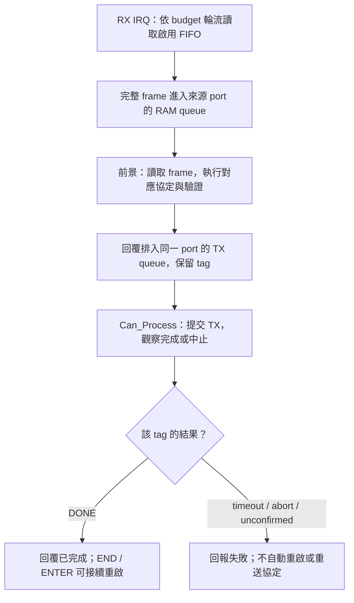
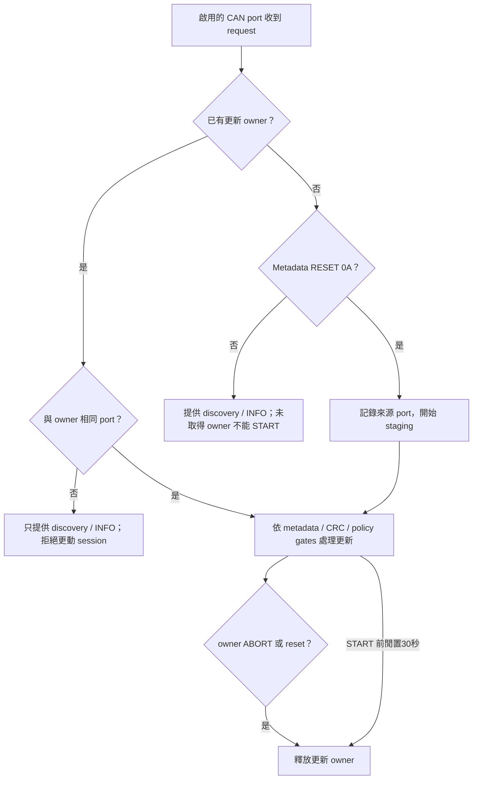
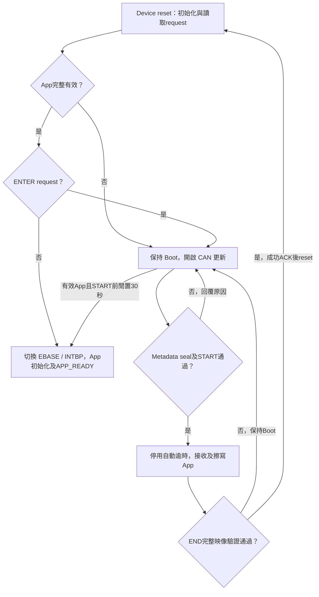
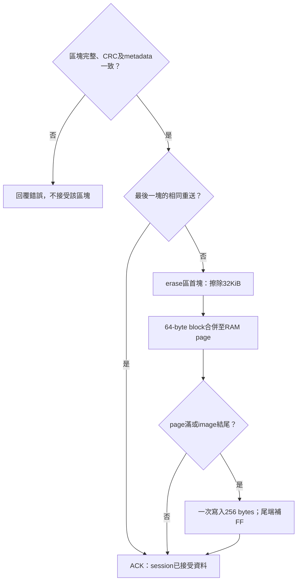

<a id="article_top"></a>

# RH850 MCU CAN device：Transfer、Boot 與 App

UART／Xmodem／I2C 的獨立工程、資料／診斷 UART、中斷與主迴圈完成邊界見
[RH850 串列 ISP 工程配置](RH850_ISP_DEVICE_DESIGN_zh-TW.md)。
本文件集中於 Classical CAN／CAN FD，不重複串列操作教學。

<!-- RH850_DEVICE_BEGIN -->
<a id="rh850-can-device"></a>

## RH850 MCU CAN device 工程

R7F701684 EVM 使用獨立的 Classical CAN 與 CAN FD 工程。
App 發行設定與 IRQ mapping 由 C header 編輯，PowerShell 在 CS+ 建置前產生 identity／向量表，建置後核對實際映像並封裝 BIN。

目前已完成離線建置、實際映像檢查與軟體模型。
實板 CAN／CAN FD、FCL 擦寫、reset／App 交接及斷電恢復尚未驗證。

### 工程與用途

| 模式 | Transfer | Boot | App |
| --- | --- | --- | --- |
| Classical CAN | `Sample_Project_RH850_S1_CAN_Transfer` | `Sample_Project_RH850_S1_Boot_loader_CAN` | `Sample_Project_RH850_S1_Boot_loader_CAN_app` |
| CAN FD | `Sample_Project_RH850_S1_CAN_FD_Transfer` | `Sample_Project_RH850_S1_Boot_loader_CAN_FD` | `Sample_Project_RH850_S1_Boot_loader_CAN_FD_app` |

這些名稱是工程識別；此處未提供原始碼下載網址。
App 建置需要同層、同模式的 Boot 工程，引用其中的 `common` 與 `tools`。
CAN FD Transfer 也引用同層 FD Boot 的 CAN 接收 adapter 與建置工具。
Classical Transfer 為獨立工程。

Transfer 的共通通訊驗證與操作見 [Custom Transfer](https://released.github.io/slide_isp_tool_for_RL78/#custom-transfer)。
一般更新與報告操作見 [Tool 操作](https://released.github.io/slide_isp_tool_for_RL78/#tool-operation)。

### 板端與時脈

| 項目 | 本工程設定 | 依據／程式位置 |
| --- | --- | --- |
| MCU | RH850/F1KM-S1、R7F701684、100 pins、1 MiB Code Flash | EVM 手冊、CS+ device |
| Clock | X1 16 MHz、CPU 120 MHz、CAN communication clock 40 MHz | SC 設定、`generated_projection/evm_clock.c`、`Device_ClockInherited()` |
| CAN | CAN1 TX P10_7 Alt4／RX P10_6 Alt4；CAN4 TX P0_10 Alt5／RX P0_9 Alt5 | `common/can_port_config.h`、`can_v4/can_board.c` |
| Classical | nominal 500 kbit/s；standard request／response `0x700`／`0x701` | `common/can_boot_config.h` 與 `Device_CanInit()` |
| FD | nominal 500 kbit/s、data 2 Mbit/s、BRS、64-byte raw data frame | FD 工程的同名設定與 adapter |
| Transfer IDs | request／response `0x710`／`0x711` | 各 Transfer 的 `can_transfer_config.h` |
| UART log | UART0 TX P0_2、115200 bit/s | SC UART0；主迴圈有限次數等待，UART CPU IRQ 保持遮罩 |
| RX | 每個啟用 port 使用獨立 FIFO／16 格 SPSC queue（15 格可用），共用 EIINT23 | `Device_CanRxIsr()`；每次總計最多讀取16幀，接收無 polling fallback |
| Tick | OSTM0、EIINT84、1 ms | SC OSTM0 與 `ostmr_1ms_IRQ()` |

硬體設定來源為 [RH850/F1KM 硬體手冊](https://www.renesas.com/en/document/mah/rh850f1km-rh850f1kh-users-manual-hardware) 的時脈、Port、RS-CANFD 與中斷章節。
兩塊 EVM 的手冊皆列出 CAN／CAN FD 收發器；2 Mbit/s 的接線、終端與實際波形仍需實板核對。

<a id="rh850-evm-can-ports"></a>

### EVM 連接、port 選擇與 CAN RAM

依據為 [BLDC Starter Kit V2 手冊](https://www.renesas.com/en/document/mat/rh850f1km-s1-bldc-starter-kit-v2-users-manual) §4.1.8.3、Tables27／28，
以及 [Starter Kit V3 手冊](https://www.renesas.com/en/document/mat/rh850f1km-s1-starter-kit-v3-user-manual-hardware) §4.2.7.3、Tables24／25。
板上 **CAN0／CAN1 連接器**分別連到 **MCU CAN1／CAN4**。

| MCU channel | 板上連接器 | BLDC V2 路由 | ASK V3 路由 |
| --- | --- | --- | --- |
| CAN1 | CAN0／CN6 | S7_6、S7_5 ON | J20 1-2、3-4 |
| CAN4 | CAN1／CN8 | S7_4、S7_2 ON；S7_3、S7_1 OFF | J20 5-6、7-8 |

獨立 bus 測試時，S4_3／S4_4 保持 OFF，避免板內將兩路互接。
S4_1／S4_2 分別控制兩路終端電阻，依實際 bus 兩端配置；兩塊板的 USB／電源與 UART 跳線也依各自手冊設定。

Boot 的 `common/can_port_config.h` 是配對 Boot／App 的共同輸入。
Classical Transfer 使用自己工程中的同名 header；FD Transfer 引用 FD Boot 的 header。
每一項填0或1，至少啟用一個 port：

```c
#define ENABLE_PORT_CAN0 (0U)
#define ENABLE_PORT_CAN1 (1U)
#define ENABLE_PORT_CAN2 (0U)
#define ENABLE_PORT_CAN3 (0U)
#define ENABLE_PORT_CAN4 (1U)
#define ENABLE_PORT_CAN5 (0U)
```

其他四路的既定 pin mapping 如下；使用時需另行配置板端接線與收發器。
來源為硬體手冊 Tables2C.41／2C.47 的100-pin alternative functions。

| MCU channel | TX | RX |
| --- | --- | --- |
| CAN0 | P0_0 Alt2 | P0_1 Alt7 |
| CAN1 | P10_7 Alt4 | P10_6 Alt4 |
| CAN2 | P0_4 Alt1 | P0_5 Alt7 |
| CAN3 | P0_8 Alt5 | P0_7 Alt7 |
| CAN4 | P0_10 Alt5 | P0_9 Alt5 |
| CAN5 | P0_14 Alt5 | P0_13 Alt7 |

| 資源 | 分配方式 | CAN1／CAN4 預設配置 |
| --- | --- | --- |
| 硬體 RX FIFO | index＝MCU channel，每路深度16 | FIFO1／FIFO4 |
| RX rule | 每路獨立 exact control ID；Boot 另有 raw rule | 不跨 FIFO 路由 |
| CPU RAM queue | 只為啟用 port 配置，16格／15可用 | 兩組獨立 queue／counter |
| TX buffer | 各 channel 的 local buffer0 | status index32／128 |
| CPU TX queue | 每路4筆，含尚未讀取的 completion credits | ISP 一次等待一筆協定回覆；實際 RAM／stack 另由 linker guard 核對 |
| RX Message Buffer／共用 TX-RX FIFO | 不配置 | 0個 |

硬體手冊 §24.10.1.5 的 RX／FIFO RAM 計算式為 `depth × (12 + payload bytes)` 加總。
六通道可用量為 `3584 × 6 = 21504 bytes`，不含固定 TX buffer 區。
Classical 每路用320 bytes；FD 每路用1216 bytes，兩路共2432 bytes，六路共7296 bytes。
程式以64-byte payload 的上界作編譯檢查；CPU RAM queue 另行計算，不與 CAN RAM 混用。

共用 RX IRQ 輪流讀取啟用 FIFO，一次總計最多16幀；滿批後再請求中斷。
Main loop 輪流讀取各路 RAM queue，response 回到 request 的來源 bus。
IRQ counter 表示該 port 在 ISR 中實際取得 frame 的入口次數，空 FIFO 不增加該計數。
Queue／drop／error observations 依 port 記錄；硬體 lost indication 不等於精確遺失幀數。

<a id="rh850-can-service"></a>

### CAN service、回覆完成與錯誤處理

Classical／FD 的 Boot、App 與 Transfer 共用 MultiCHv4 的 service／driver 核心。
硬體設定與協定 adapter 則由各工程持有，沿用本頁的 EVM、mode、ID、速率及 IRQ 配置。



| 檔案／層級 | 負責內容 | 可編輯位置 |
| --- | --- | --- |
| `can_port_config.h` | 啟用的 MCU channel、靜態 RX queue／CAN RAM 上界 | Boot `common`；Classical Transfer 為工程根目錄 |
| `can_v4/can_config.c` | 每路 FIFO、timing、exact control／raw ID filters、初始化前資源檢查 | 工程通訊配置 |
| `can_v4/can_board.c` | EVM pin mux、實際 clock 檢查、INTC、channel-local 操作 | 板端移植 |
| `can_v4/can_service.c/.h` | 完整 frame queue、IRQ budget、TX tag／completion、timeout／cancel／診斷 | 共用核心 |
| `can_v4/rs_canfd*` | frame／DLC／FIFO／rule／共享 RAM 驗證及 register driver | 共用核心 |
| `rh850_can_ports.c/.h` | ISP API、來源 channel 回覆、wire format 檢查及 TX 完成判定 | 協定接合 |
| `device_can.c`／`rh850_can.c` | Boot／App／Transfer 的既有介面 | 各模式工程 |

App 與 FD Transfer 使用配對 Boot 的 `common/can_v4`；Classical Transfer 有自己的 `can_v4`。
Firmware 建置使用工程內的副本，不需要另行取得 standalone v4 或安裝其他執行環境。

`CanPorts_Read()` 呼叫 `Can_Process()` 處理 TX／status，再讀取 RAM queue。
IRQ-owned FIFO 不由 main loop 輪詢；RX ISR 不解析協定、不輸出 UART，也不等待 TX。
`CanPorts_Send()` 只有取得相同 tag 的 `CAN_TX_DONE` 才回傳成功，排入 queue 不是傳輸完成。
既有 END／ENTER 的 reset gate 因而仍以回覆完成為條件，metadata／Flash／CRC／版本政策另由原協定檢查。

| 狀態／操作 | 行為 |
| --- | --- |
| RX queue 滿 | 保留已排入的資料，丟棄新 frame 並增加該 port 的 drop observation |
| TX 逾時 | 提交後100 ms 未完成時請求一次 abort，再以100 ms 上限觀察中止結果 |
| TX 結果未確認 | 鎖住該 channel 的 TX；不自動重新送出或重啟 CAN，其他 channel 獨立運作 |
| `Can_StopChannel()`／`Can_RecoverChannel()` | 前景 C API；恢復時清除該 channel 的 CPU RX queue，保留 completion／診斷，不重新配置其他 channel 或全域 CAN RAM |
| `Can_CancelTx(channel, tag)` | 取消最早一筆相符的 outstanding tag；硬體已完成的競爭結果仍為 DONE，未確認結果不宣稱已取消 |
| 狀態／診斷讀取 | 保留硬體 error flags；`CLEAR_STATS` 僅處理協定統計，不重設 CAN 或清除硬體錯誤證據 |

Stop／recover／cancel 不新增 Tool 操作或 CAN ISP 命令。
自訂程式使用這些 API 時，先結束目前協定交易並保存診斷；它們不釋放 Boot 的更新 owner，也不解除更新保護。
Boot 更新工作區的規則集中於[多 port 更新工作區](#rh850-update-port-owner)。

<a id="rh850-update-port-owner"></a>

### 多 port 更新工作區

Transfer 的 protocol context、統計與重送快取依 port 獨立。
Boot 的 App Flash 與 metadata staging 則只有一份，採單一更新 owner：



非 owner 的更動命令回覆 `BAD_STATE=2`，detail 為 owner 的 MCU channel；raw data／BEGIN 不回覆、不進入工作區。
收到其他 bus 的 discovery／INFO 不會延長既有 staging lease。
START 後不自動釋放或讓另一 port 接管；由 owner ABORT 或重置結束工作階段。
ABORT 清除 RAM session，不還原已擦寫的 App。

個別測試時將 host 接到 CAN1，完成 Transfer 或更新；再改接 CAN4 重做相同流程。
Tool 的 Bridge port 選單選擇的是 **host 的 port**，device port 由實際接線及上述編譯設定決定。

### Flash 與 RAM 位址

以下為 byte address，範圍包含起訖。
Flash erase／write 單位依 [Flash hardware interface](https://www.renesas.com/en/document/mah/rh850f1k-users-manual-flash-hardware-interface) 及 FCL 裝置資訊核對。

| 區域 | 位址／大小 | 用途與來源 |
| --- | --- | --- |
| Boot | `0x00000000..0x0000FFFF`，64 KiB | reset／Boot INTBP／FCL／驗證；保留至少512 bytes 建置餘裕 |
| App entry | `0x00010000..0x000100FF` | 起始 `jr32 __start` 與預留；`app_entry.asm` |
| App metadata | `0x00010100..0x000101FF`，256 bytes | core128＋reserved128；`image_metadata_profile.c` |
| App exception table | `0x00010200..0x000103FF`，512 bytes | EBASE；32個16-byte exception slots |
| App EIINT table | `0x00010400..0x00010BFF`，2048 bytes | INTBP；512個 LE32 handler address |
| App code／constants | `0x00011000` 起 | `device_build.ps1` linker layout |
| App capacity | `0x00010000..0x000FFFFF`，960 KiB | 實際 image 最後4 bytes 為 CRC32，依 image size 決定位置 |
| Flash erase | Boot block0..7各8 KiB；App block8..37各32 KiB | FCL 初始化核對38 blocks、block7 end及最後 block end |
| Flash program | 256-byte aligned page | `flash_geometry.c`、`Device_FlashWritePage()` |
| 一般 RAM／stack | `0xFEDF0000` 起，使用範圍限制於 `0xFEDF4800` 前 | post-build map guard |
| E2 monitor 預留 | `0xFEDF4800..0xFEDF6DFF` | CS+ Work RAM 使用 global alias `0xFEBF4800`、9728 bytes |
| RAM reader | `0xFEDF7000..0xFEDF7FFF`，4 KiB | copied `RAM_READ.text`；解析可能空白的 Flash 資料 |
| FCL copy 預留 | `0xFEDF8000..0xFEDFEFFF`，28 KiB | `FCL_RAM_ADDRESS`；post-build 檢查區段次序與 copy extent |
| RAM handoff | `0xFEDFFFF0..0xFEDFFFFF`，16 bytes | signature／request／反碼／owner；`boot_app_handoff.h` |

Cold reset 初始化 handoff RAM 的 ECC；Boot→App 與 software reset 保留已初始化的 cookie。
EVM startup 的 LRAM ECC 初始化從 `0xFEDE0000` 開始，涵蓋96 KiB LRAM；上表為本工程目前實際配置的子區域。
Cookie 是啟動交接資訊，不是認證機制，也不是斷電後保留的版控儲存區。

<a id="rh850-irq-entry"></a>

#### IRQ 入口與交接成本

CAN RX／OSTM0 的 TB 設為 table reference，App EIINT 不逐次回 Boot 讀 owner；`Device_JumpAsm()` 僅在交接時切換 EBASE／INTBP。
RL78 software dispatcher 的38 clocks 不適用本工程；硬體接受、table 存取與 ISR 仍需時間，見 [中斷成本與量測](https://released.github.io/slide_boot_loader_for_RL78/#device-irq-dispatch-cost)。
設定依據為 [Renesas RH850 初始化說明](https://tool-support.renesas.com/autoupdate/support/onlinehelp/csp/V8.14.00/CS%2B.chm/Compiler-CCRH.chm/Output/ccrh08c0201y.html)。

### Metadata：輸入、產生與驗證

| 分類 | 修改位置 | 產生／使用位置 |
| --- | --- | --- |
| App 發行 | `app_image_config.h`：version、build、target、role、update transports、version control | pre-build → `generated_projection/app_identity.h` |
| MCU／Flash／格式 | Boot 的 `common/image_metadata_config.h` | Boot／App 各自編譯 `image_metadata_profile.c` |
| CAN 模式／速率／ID | Boot 的 `common/can_boot_config.h` 與 `can_v4/can_config.c` | 實際 register timing 與 metadata masks 需一致 |
| IRQ | App 的 `app_irq_handlers.h` | pre-build → `generated_projection/device_vectors.c` |
| 建置結果 | 實際 `.mot`／`.map` | post-build → image size、尾端 CRC32、更新 BIN、HTML report |
| 裝置驗證 | `common/image_metadata.c/.h`、`device_image.c/.h` | 獨立 C90 解析、profile、範圍、CRC 與向量檢查 |

更換 MCU 時，將 Flash geometry、FCL支援、clock／pins、ECC／RAM、exception／EIINT來源及 metadata profile 作為一組工程配置核對。
App 發行 identity、IRQ header、建置生成及實際映像驗證的流程保持一致。
Boot／App 的版本各自獨立；App minimum Boot 取自配對的 Boot contract，不要求 App version 等於 Boot version。

共同欄位的逐 byte 定義見 [metadata byte reference](https://released.github.io/slide_boot_loader_for_RL78/#flash-metadata-can-reference)。
該表的欄位 offset 可共用；實際絕對位址以本節 mapping 換算。
例如 metadata `0x74..0x77` 在本工程為 `0x10174..0x10177`，保存 App version control 的 LE32 值。

本 profile 的 target 是 `0x8501`，IRQ ABI 是 `0x31563852`（R8V1）。
`APP_IMAGE_VERSION_CONTROL=0` 是預設；目前有效 App 設為1時，普通 START 接受同版／新版，拒絕較舊版本。
維護降版操作仍經過 identity、layout、CRC、IRQ 與 minimum Boot 檢查，操作見 [版本政策](https://released.github.io/slide_isp_tool_for_RL78/#force-old-version)。
沒有有效 App 時，不保留獨立的版本下限。

### IRQ 編輯與 Boot／App 交接

`app_irq_handlers.h` 的數字是 **EIINT channel index**。
來源是本 MCU 的 SC `r_cg_intvector.c` 及硬體手冊 interrupt table；不是 Flash byte address。
例如 channel23 的 App table entry address 是 `0x10400 + 23 × 4 = 0x1045C`。

```c
/* App-local normal EIINT handlers; generated table contains all512 entries. */
#define APP_IRQ_HANDLERS(X) \
    X(23U, Device_CanRxIsr) \
    X(84U, r_Config_OSTM0_interrupt)

#pragma interrupt app_aux_irq(enable=false, fpu=true, callt=false)
void app_aux_irq(void) { /* Acknowledge source; queue bounded work. */ }
```

新增 IRQ 時，先用 SC 設定所需周邊、pin、clock 與 IRQ，再將其 global ISR 登錄於 App header。
App ISR 不使用 `channel=`；產生器負責 table mapping。
若採用 SC 的 OSTM ISR，建置使用保留原始 SC 的 no-channel projection。
CS+ 的固定 linker layout 不需隨 IRQ 數量增加而調整；有新增 `.c` 時仍需加入該 App 的 source registration。

Boot 與 App 分別連結完整512-entry table，未使用項目共用預設 handler。
Boot 保留 reset 入口；交接時遮罩 IRQ、停止 Boot 周邊、設定 owner=`0x55`、App EBASE／INTBP 及 PSW.EBV，再進入 App startup。
Boot owner 為 `0xAA`。
各映像可以使用相同 ISR 函式名稱；同一映像內的重複定義由 linker 拒絕。
EIINT handler 使用 EIRET；exception table 另行處理。

### 更新與啟動流程

App 有效性包含 metadata、CRC、entry、exception 及512-entry IRQ table。
更新後由 Tool 的 APP_READY 及 live identity／version／build／size 比對確認 App；100% 本身不是 App 已執行的證據。



### CAN 區塊與 Flash page

Tool 先完成 BIN／live 契約比對、metadata staging／seal 與 START，再依序傳送 BEGIN／raw data／COMMIT。
每個 COMMIT 的處理如下。



CAN Classical 的 raw ID 為 `0x720..0x727`，每幀最多8 bytes；CAN FD 使用 `0x720`／DLC15／64 bytes。
共同控制幀及 byte 格式見 [CAN frame reference](https://released.github.io/slide_boot_loader_for_RL78/#flash-metadata-can-reference)。
每次 COMMIT 接受最多64 bytes；ACK 表示該 session 已接受區塊，未滿256-byte page 的資料仍在 RAM。
最後一塊重送由 RAM cache 核對，不再次擦寫。
斷電會遺失未寫滿的 RAM page；重新上電依完整映像驗證決定留在 Boot 或啟動有效 App，更新重新從起點進行。

擦寫由 FCL internal-handler mode 的 RAM 執行鏈完成，期間 IRQ 遮罩。
可能空白或中斷的 Flash 資料由 RAM reader 暫時關閉 VCI data ECC 後讀取並恢復設定；PE instruction ECC 不變。
這是 raw data／CRC 檢查，不是硬體 blank check 或 ECC 狀態驗證。

### 建置與使用產物

需要現有 CS+ CC／CC-RH 與 Windows PowerShell，不需要 Python 作為 firmware 建置環境。
從 `simple_renesas_isp_tool` 執行，以下相對位置依實際 checkout 位置調整：

```powershell
.\scripts\build_rh850_can_device.ps1 `
  -BootProject ..\Sample_Project_RH850_S1_Boot_loader_CAN `
  -AppProject ..\Sample_Project_RH850_S1_Boot_loader_CAN_app -Prepare

# App-only build uses its own C headers and does not rebuild Boot.
.\scripts\build_rh850_can_device.ps1 `
  -BootProject ..\Sample_Project_RH850_S1_Boot_loader_CAN `
  -AppProject ..\Sample_Project_RH850_S1_Boot_loader_CAN_app -Kind app
```

CAN FD 使用同名 FD Boot／App 位置。
FD Transfer 以 `-Kind transfer -TransferProject ..\Sample_Project_RH850_S1_CAN_FD_Transfer` 選定，並提供 `-BootProject` 指向 FD Boot。
`-Prepare` 對齊 source registration、linker／pre／post hooks 與生成檔案；SC 再生成後執行。
完成 Prepare 後，也可直接在 CS+ Rebuild，使用同一組 pre／post 檢查。

| 產物（各工程 `DefaultBuild`） | 用途 |
| --- | --- |
| Boot `boot0000_FFFF.hex` | 燒錄器安裝64 KiB Boot，範圍不含 App |
| App `<AppProject>_update.bin` | Tool 的 CAN Upgrade 載入檔；包含 entry、metadata、vectors、code及尾端CRC |
| App `flash_app_variable_CRC.hex` | 燒錄器直接安裝 App，帶絕對位址，範圍不含 Boot |
| App `app_build_report.html` | 瀏覽器閱讀實際 BIN 的 size／CRC／SHA256、256-byte metadata與512個IRQ entries |
| Transfer `<TransferProject>.mot` | 從零位址執行的獨立通訊測試，使用燒錄器安裝 |
| 原始 linker `.mot`／`.abs`／`.map`／`.asm` | 工程診斷及封裝檢查；App 原始 MOT 尚未封裝 image size／尾端CRC，不作更新輸入 |

Tool 更新步驟為：Open + Probe Host → 選定模式／速率 → 載入對應 App BIN → Discover Target。
若 live target 是 App，選 Enter Boot；若已在 Boot，直接開始更新。
有效 App 在 ENTER 後閒置逾時會回 App，需重新 Discover／Enter。
正常完成後核對 Tool 的 App 確認及 Firmware update report；UART 會顯示 image tag 與 `log(timer)-V1` 遞增 counter。

### 速率、ID 與移植

更改 CAN nominal／data rate 時，同步修改配對 Boot 的 `common/can_v4/can_config.c` timing／profile 與 `can_boot_config.h` masks，再重建 Boot、App 及其 BIN。
Tool 的速率設定只改 MCU CAN host，不改 device 的暫存器。
500K 的 nominal mask 是 `0x04`；250K 為 `0x02`、1M 為 `0x08`。
mask 描述實際編譯的 timing，不能單獨改 mask 代表硬體速率已改變。
FD data mask `0x02` 表示2M，並檢查 BRS 與 DLC／length。
首輪驗證以本頁設定的500K／FD data2M進行，其他 timing 需依40MHz communication clock計算並實板確認。

<!-- RH850_DEVICE_END -->
