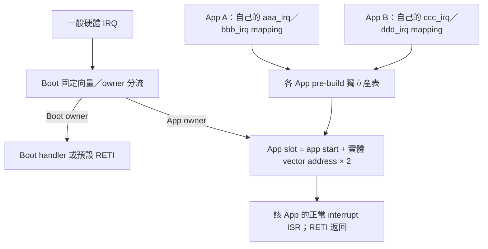
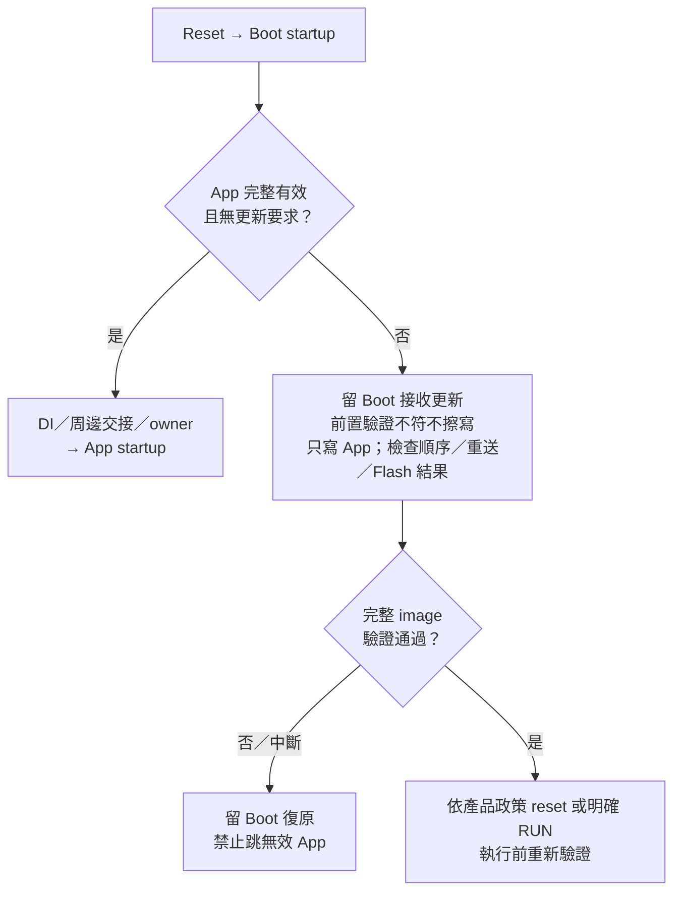

# RL78 Boot Code / App Code 移植指南

2026-10-15｜依目前 firmware 原始碼整理｜文件版，未新增實板驗證

本文件是 firmware 開發者入口，不要求先學會 FirmwareUpgradeTool。
適用於 CC-RL／CS+ 的現行 F13 (MCU CAN device) 與 F24 (MCU CAN host) Boot/App 範例；
不是所有 RL78 型號、編譯器或舊 UART／I2C 範例都可直接套用的二進位規格。

<!-- RL78_PORTING_BEGIN -->
## 自訂 Bootloader／App：先選導入方式

本節現行配套為 **F13 (MCU CAN device)** 與 **F24 (MCU CAN host)**。
F24 host的Boot/App走Misc／UART自更新，不是後續F24 (MCU CAN device) 的CAN Boot/App；
型號相同不代表板子角色、映像政策或更新協定相同。舊UART／I2C教材依各自專案判定角色。

| 需求 | 建議切入方式 | 必須保留的邊界 |
| --- | --- | --- |
| 沿用現有 Boot，只換自己的 App | 從同 MCU 的已整合 App 複製專案，再加入應用功能 | 固定 MCU、分區、IRQ ABI、startup／RAM、metadata／CRC、更新契約 |
| 自己設計更新 command／傳輸流程 | 參考向量、startup、Flash 保護與映像產生架構，另行實作更新狀態機 | 自己定義並驗證 Boot/App 共同契約，不能直接宣稱相容現有 Tool |
| 移植到另一顆 MCU／板子 | 先核對硬體手冊、device file 與該系列 Flash library，再建立 matching Boot/App | 不能直接複製 F13/F24 的 register、clock、Flash driver 或 HEX |

若只參考 firmware 架構，不必採用 Host Link、F24 bridge 或現有 CAN commands。
若仍要由 FirmwareUpgradeTool 更新，則必須保留對應 image／live descriptor／
protocol，或另行開發 PC target adapter；不能只修改 BIN 的 MCU 名稱或版本。

### 1. 選定目前的參考專案

F13與F24範例皆可由下列GitHub連結取得，不需要開發者的本機工作區。
F24 Boot／App位於同一Tool repository的firmware目錄，應下載完整repository，
不能只下載個別資料夾而省略共用driver、SC、library與scripts。

| 項目 | F13 (MCU CAN device) | F24 (MCU CAN host) |
| --- | --- | --- |
| CAN通訊測試 | [RL78_F13_CAN_Transfer](https://github.com/released/RL78_F13_CAN_Transfer)；不擦寫Flash | 搭配同一通用bridge；不是Host App更新映像 |
| Boot 專案 | [RL78_F13_Boot_loader_CAN](https://github.com/released/RL78_F13_Boot_loader_CAN) | [RL78_F24_Bridge_boot](https://github.com/released/simple_renesas_isp_tool/tree/main/firmware/RL78_F24_Bridge_boot) |
| App 專案 | [RL78_F13_Boot_loader_CAN_app](https://github.com/released/RL78_F13_Boot_loader_CAN_app) | [RL78_F24_Bridge_app](https://github.com/released/simple_renesas_isp_tool/tree/main/firmware/RL78_F24_Bridge_app) |
| MCU | R5F10BMG，128 KiB Flash | R7F124FLJ3xFB，256 KiB Flash |
| 更新契約 | image format6、CAN protocol5、IRQ ABI F1V1；需matching Boot/App | BUR1 contract3、IRQ ABI F2V1；需matching Boot/App |
| 更新入口 | CAN 500K，standard ID 0x700／0x701 | PC UART，Host Boot 固定115200；Tool 的 Misc |
| Flash library | F13 FSL | F24 RFD Type02，programming-mode 路徑在 RAM 執行 |

F13_CAN_Transfer 是通訊 benchmark，不是 Boot/App 移植模板。先使用Transfer
確認傳輸，再依需要安裝Boot/App；Transfer與Boot/App是不同的device韌體。

下載Boot與App時，必須保留以下相鄰目錄及名稱。App會引用Boot的共用board來源、
CAN設定及產表腳本；只下載App，或保留ZIP解壓後的-main尾碼，不能直接重建。

```text
examples/
  RL78_F13_CAN_Transfer/
  RL78_F13_Boot_loader_CAN/
  RL78_F13_Boot_loader_CAN_app/
```

可在同一空目錄依序執行：

```powershell
git clone https://github.com/released/RL78_F13_CAN_Transfer.git
git clone https://github.com/released/RL78_F13_Boot_loader_CAN.git
git clone https://github.com/released/RL78_F13_Boot_loader_CAN_app.git
```

若使用Download ZIP，解壓後將目錄改成上方名稱。首次先build Boot，再build App
產生matching boot_app.hex；後續更新使用App產生的_update.bin。不能把兩種檔案互換。

舊 F24_Boot_loader_UART／I2C／CRC 教材可參考原理，不可把其 callback ISR、
固定 CRC 位址或舊封裝流程混入現行固定完整 RETI 向量與 metadata 契約。
G16 新版 I2C Boot/App 尚未開發；舊範例不代表已具備相同安全條件。

### 2. 先固定記憶體與映像配置

| 區域 | F13 (MCU CAN device) 目前設定 | F24 (MCU CAN host) 目前設定 |
| --- | --- | --- |
| Boot | 0x0000..0x1FFF，8 KiB | 0x0000..0x4FFF，20 KiB |
| App 可用區 | 0x2000..0x1FFFF，120 KiB | 0x5000..0x3FBFF，235 KiB |
| App 跳轉表 | 0x2000..0x20FF | 0x5000..0x50FF |
| Metadata 整區 | 0x2100..0x21FF，256 bytes | 0x5100..0x51FF，256 bytes |
| 已定義 core | 0x2100..0x217F，128 bytes | 0x5100..0x517F，128 bytes |
| Reserved metadata | 0x2180..0x21FF，128 bytes，填0xFF | 0x5180..0x51FF，128 bytes，填0xFF |
| App code 起點 | 0x2200 | 0x5200 |
| Image CRC32 | 實際 update image 最後4 bytes，little-endian | 同左 |
| 其他保護 | Boot/FSL 至少保留512 bytes ROM 餘量；保留 debug trace RAM | 0x3FC00..0x3FFFF 最後1 KiB 不可更新 |

App 前512 bytes 不是整塊空白：前256 bytes 是64個4-byte 跳轉入口，
後256 bytes 是 metadata。一般 code 從 app start＋0x200 開始。
CRC32 涵蓋從 app start 到尾端 CRC 前的全部 bytes，包含表、metadata 與填洞0xFF。
BIN 長度由 linker map 的實際 loaded section 決定、4-byte 對齊，最小516 bytes；
不是每次固定輸出整個 App capacity，也不是把 CRC 永遠放在 Flash 最後4 bytes。

F13 layout／CAN identity 來源是 Boot 的 can_boot_config.h／user_def.h，
App ftable.inc 與 linker／分割 HEX 設定必須一致；版本／build 是 App 自己的欄位。
F24 分區集中在 firmware/f24_bridge_common/f24_bridge_layout.h，
App 版本／build 由該 App 自己的 app_image.json 提供。
改分區時須一起調整 linker、產表／封裝／驗證腳本及 metadata，重新安裝 matching Boot/App。
現行 generator 有固定 ABI 位址檢查，不能假設只改一個 define 就能任意搬移。

### 3. 向量：Boot 固定介面，App 自己決定 handler



固定表有64個4-byte slot；例如 F13 vector 0x34 的 App slot 是0x2068，
F24 則是0x5068。JSON 的 key 是實體 vector 位址，不是 IRQ 序號或 slot 位址。
Boot 固定涵蓋一般位置0x04..0x7C；其中保留位置不可啟用。
合法可用 IRQ 必須依本 MCU 的 device header／硬體手冊及 generator 檢查，
不能因表內有位置就認為有對應周邊。

Reset 仍由 Boot 擁有；App table 第一個 slot 轉到 App startup，不是直接跳 main。
0x02 保留。Physical BRK 0x7E 不由此介面轉送，留給 device/debugger；
App 的 BRK 保留 slot 使用 RETB，不是一般 IRQ 的 RETI，正式 App 不應把它當通用 API。

一般 App ISR（包含 F13 INTTRJ0）採下列寫法，來源必須加入該 App 的 MTPJ：

```c
#pragma interrupt your_handler
void __near your_handler(void)
{
    /* Acknowledge the interrupt source and capture bounded state. */
}
```

- 必須 global、非 static、正常 interrupt pragma；不要帶 vect= 或另加競爭的 -VECTN。
- ISR 以 RETI 返回，不是普通 C callback；不可用一般函式呼叫 ISR。
- Boot/App 分別連結，可以使用相同 ISR 函式名；真正禁止的是重複擁有實體 vector。
- 新 IRQ 在 EI 前須完成周邊初始化、清 pending flag、優先權及 mask 設定。
- 未用 IRQ 必須遮罩；預設 RETI 不會替你清除硬體中斷原因。
- Code Generator／Smart Configurator 重產後，要重新核對 pragma、export、mapping 與 user hook。

F13 以 near CALL＋literal 與共用組語 dispatcher 節省 ROM，暫時額外使用10 bytes stack，
最終保留原硬體 frame 交由 ISR RETI。F24 使用逐向量直接分支。
這是內部實作差異，不是 App 可改回普通 RET callback 的理由。

### 4. CS+／Startup／RAM 必須一起移植

| 檢查位置 | 移植時必做事項 |
| --- | --- |
| Project device／CC-RL | 選正確 MCU、記憶體模型與 Flash library，保留原授權聲明；不抄另一系列設定 |
| Source tree | 登錄自己的 table、startup、ISR、identity、必要 board support；不是只把檔案放進資料夾 |
| Linker section start | 表、metadata、code、RAM、stack 互不重疊；核對實際 map，不只看 IDE 畫面 |
| RAM／stack 初始化 | 保留 recovery／owner／handoff no-init，檢查 .bss／.data／stack 初始化不會清掉它們 |
| Build events | 保留 pre-build 產表與 post-build 封裝／拒絕條件；生成檔不可手改 |
| Option bytes／debug | Boot/App 設定一致且符合產品需求；保留 debug monitor／trace RAM，不由 App 更新覆寫 |
| 跨目錄搬移 | 修正 source／include／library／preinclude／hook 路徑，不能只改 MTPJ 名稱 |

兩個目前範例都使用 FF700 recovery 與 FF710 owner，但 marker 值不是同一協定：
F13 的 AA=Boot、55=App；F24 Boot 初始化為00，只有 A5 才轉送 App，其餘走 Boot handler／預設。
Recovery cookie 的值與後續交接資料也不可跨系列照抄。
F13 額外使用 FF714 handoff、FF718 update-complete，在 FF710..FF71F 中保留；
須在 App startup 消耗與清除一次性標記，不能把上次 log 當成本次更新成功。
F13 normal data 從0xFE500以上開始，保留0xFE300..0xFE4FF trace RAM。
F24 明確配置4 KiB stack 並避開交接 RAM；不能任由 stack 初始化掃過 cookie／owner。

Boot 關中斷並交接，不表示 App 可以略過自己的 startup 或周邊初始化。
Clock、UART/CAN/I2C 狀態、pending flag、stack 與 RAM 都必須有明確責任。
F13 需保留 f13_board_support 與生成檔 user-area clock hook，不能在 App 停掉已有效的 inherited PLL。
其板端 X1=4 MHz、CPU32／CAN16；F24 App X1=20 MHz、PLL80／CPU40，Boot 用 HOCO40。
這些是本板設定，不是其他 RL78 的預設值。

### 5. F13 (MCU CAN device)：把應用功能加進已整合 App

保留的主要檔案／責任：

| 檔案 | 責任 |
| --- | --- |
| cstart.asm | App runtime startup 與 RAM／stack 初始化 |
| ftable.inc、ftable_RL78_F13.asm | layout／App identity 與256-byte metadata |
| app_irq_handlers.json | 此 App 的實體 vector → ISR 名稱 |
| app_irq_table.inc、app_identity.h | pre-build 生成，不手改 |
| generate_update_image.ps1 | map 導出長度、metadata 檢查、CRC 與安裝／更新產物 |
| Boot 的 generate_irq_contract.ps1 | -Mode App 時只產此 App 表與 identity；Boot 表獨立 |
| f13_board_support、App INFO／ENTER | clock／周邊交接、在線資訊及回 Boot 入口 |

1. 複製已整合 App，先不改 MCU／分區。備份原 Boot image 與已知可用 App。
2. 將自己的功能來源加入 MTPJ；保留仍需要的 timer／UART／INFO／ENTER。
3. 在自己的 app_irq_handlers.json 加入合法 IRQ；在 ftable.inc 改 App version／build。
4. CS+ pre-build 保留以下命令，搬移後修正腳本路徑；post-build 保留 generate_update_image.ps1。

```powershell
powershell.exe -NoProfile -ExecutionPolicy Bypass `
  -File "..\RL78_F13_Boot_loader_CAN\generate_irq_contract.ps1" `
  -Mode App -AppProject "."
```

5. Clean rebuild 該 App；檢查 log、map、更新 BIN、CRC 與低位址排除結果。
6. 在 Tool root 執行 scripts/verify_f13_artifacts.ps1，可傳 -BootProject／-AppProject。
   產表只檢查時用 generate_irq_contract.ps1 -Mode App -AppProject 路徑 -CheckOnly。
7. 用 matching Boot 測整合啟動，再以更新 BIN 測只換 App；比較 Boot 區內容確認沒被改寫。

目前 F13 封裝與 artifact checker 仍有參考 MTPJ／map／BIN 名稱及 sibling Boot 路徑。
-AppProject 不代表已支援任意改名的一鍵工程：先保留參考檔名／目錄關係；
若要改名或搬離原樹，須一併調整 post-build 的 -MapFile／輸出命名、Boot HEX 路徑、
MTPJ 與 checker 的檔名假設，再重新驗證。這不需要為 ISR 名稱重編 Boot，
但不能跳過工程路徑整合。不是 standalone 專案只加 JSON 就能變成 boot-compatible App。

### 6. F24 (MCU CAN host)：各 App 自己產表、封裝，不動共用 Boot

1. 從 firmware/RL78_F24_Bridge_app 建立自己的專案資料夾，保留唯一 MTPJ、
   全部 App .c／.h、generated_projection、table 登錄與 BRIDGE_SPLIT_APP 定義。
2. 保留 app5000／code5200、4 KiB stack、FF700／FF710 與最後1 KiB保護。
   共用硬體／driver／SC 來源在 firmware/f24_board，不在 projection 重產 SC。
   Bridge_boot／Bridge_app 是唯一兩份產品專案，f24_board 沒有 MTPJ 或燒錄產物。
3. 自己維護 app_irq_handlers.json 與 app_image.json；保留仍在用的 UART／timer／bus mapping。
4. Pre-build 使用 scripts/prepare_f24_app_irq.ps1 -AppProject "."；
   post-build 使用 scripts/package_f24_bridge.ps1 -Kind app -AppProject "."。
   生成 bridge_vectors.asm／f24_app_identity.generated.h，不手改。
5. 在 Tool root 建置自己的 App，例如：

```powershell
.\scripts\build_f24_bridge.ps1 -Kind app -AppProject ".\ProjectA"
.\scripts\build_f24_bridge.ps1 -Kind app -AppProject ".\ProjectB"
```

上述路徑是使用者自訂位置的例子。搬移時必須先修正所有來源與 build hook 路徑。
只檢查生成檔可用 prepare_f24_app_irq.ps1 -AppProject 路徑 -CheckOnly。
App-only 建置／封裝不寫 Boot，並依該 MTPJ stem 產生各自的 BIN／flash MOT。
此 wrapper 仍是特定 F24 bridge integration，不是任意 RL78 App 的通用建置器。

只有 canonical SC 確實重產時，才對 reference projection 使用
prepare_f24_bridge_projects.ps1 -Kind app。日常 App-only 更新不要呼叫省略 Kind
的雙專案 prepare，也不要對自訂 App 直接使用 reference 重產腳本覆寫設定。
Boot 自己的硬體／layout 改變才另行 prepare／build Boot。
SC 唯一設定為 f24_board/f24_board.scfg，輸出在 f24_board/src/smc_gen。
搬移工作目錄後先 prepare -Kind app 刷新 SC 路徑，再從 App MTPJ 開啟。
prepare 讀取各自既有 MTPJ，保留專案選項／hook 與 App JSON，不再由第三個專案產生。
App main／Host Link／CAN service 在 App；共用 UART／timer 透過最小 hooks
由 Boot、App 分別實作。SC 新路徑 GUI 重產尚待操作確認。

### 7. 初次安裝、後續更新與除錯不可混用

| 用途 | F13 (MCU CAN device) | F24 (MCU CAN host) |
| --- | --- | --- |
| 初次 matching 安裝 | App 專案根目錄 boot_app.hex，包含 Boot＋封裝 App | Boot 的 .mot 加 App 的 *_flash.mot；先確認燒錄工具不會全片擦除另一區 |
| 後續只更新 App | DefaultBuild/RL78_F13_Boot_loader_CAN_app_update.bin | DefaultBuild/*_bridge_update.bin，載入 Misc |
| 不應當正式安裝檔 | App raw ABS／暫時低位址 vector；raw HEX 不能當 update BIN | App raw .mot／.abs 的低位址 placeholder，不是 *_flash.mot |

F24 也可首次只用 programmer 安裝 Boot；沒有有效 App 會留在 recovery，
再以 tool Misc／115200 安裝 matching App BIN、驗證後明確 RUN。Misc 不更新 Boot。

F13 Boot CS+ Run-to-symbol 是 _boot_main；App standalone 是 _main。
Standalone ABS 下載可能覆寫 Boot 實體向量，不算 Boot→App 整合測試。
正式 handoff 除錯需保留已燒入的 matching Boot/App，只載入 App symbols，
從 reset 經 Boot 再停在 App main；核對 CS+ download／erase 設定與 -OCDTR。
F24 同樣不可用 raw App 下載覆蓋低位 Boot vector；E2 lite halt／continue／stop 要實測。

Misc 僅更新 Host App，不更新 Boot。現行 F24 Host Boot 的更新 UART 在編譯時固定115200；
Host App 的一般 Host Link 可協商115200／460800／921600，與 Device 更新速度獨立。
高速 App 先在原速度完成 ENTER ACK，再 reset 進 Boot，PC 以115200重新核對身分。
單純切 TAB 不會立即改速；活動更新不允許切 TAB。未來 Device UART 的固定 baud
由其 Boot/App 編譯契約與 BIN policy 決定，不是上方 Host Baud，也不是 Misc 的115200。
目前 F24 I2C 只有100K，Device UART adapter 尚未啟用，不能把400K／1M／9M當成既有能力。

### 8. 若改用自己的 Boot 更新流程



這是移植檢查骨架，不是兩個既有產品狀態機完全相同。
F13 CAN：有效 App＋ENTER 在接受 START 前可因30秒 inactivity 返回舊 App；
無效 App 從不啟用這個自動返回。START 後 timeout／ABORT／fatal write error 留 Boot；
END 成功 reset，重新驗證才啟動。完整細節以 F13 flow guide 第2.2節為準。
F24 Misc：END 成功仍留 Boot，必須明確 RUN；有效 magic 採最後提交。
兩者都不等於雙映像 rollback，不能宣稱掉電一定保留舊 App。

自己設計流程至少必須定義：更新要求／清除方式、身分與 geometry 檢查、
擦寫 allowlist、命令與 offset 邊界、duplicate／retry、斷線／timeout／cancel、
完整 image CRC 與有效性提交、上電重新驗證、周邊交接與復原入口。
F13 FSL 與 F24 RFD 不能互換；F24 programming mode 的 code／常數／IRQ
不可從 code Flash 取用，driver 與必要 hooks 須在 RAM，並配置足夠 stack。

若沿用現有 Tool：metadata 整區256、core128、reserved128FF，UPD1 的 role、
允許更新介面、IRQ ABI、最低 Boot 版本都要匹配 live Boot；CAN-only Device BIN
不能切 I2C／UART 更新，Device BIN 也不能用 Misc 更新 Host。
F13 必須 RESET metadata／64段各4 bytes／SEAL 再 START；
F24 必須四段64-byte STAGE 驗完整區再 BEGIN。傳輸 chunk 不是 metadata 區域大小。
CRC32 只有完整性，不是身分認證、簽章或防回滾；有資安需求必須另設計。
現行參考專案不使用 WDT；自己的產品若啟用 WDT，須重新設計 Flash／timeout／交接行為。

### 9. 哪些變更只更新 App？如何驗收？

| 變更 | 可否保留同一份 Boot |
| --- | --- |
| 相容 App 新增／刪除一般 IRQ、換 handler 名稱 | 可以，更新自己的 mapping、正常 ISR、初始化與封裝即可 |
| App A 換成 App B、版本或一般功能變更 | 可以，但必須保持既定 MCU／layout／RAM／startup／IRQ／image／更新契約 |
| 改 MCU、分區、owner RAM、IRQ ABI、Boot 自己的 IRQ 或更新 protocol | 不屬於 App-only；須重新評估 Boot，必要時重新安裝 matching pair |
| 只改 peripheral clock／pin 或 Flash library | 不可假設相容；核對 Boot 使用與交接責任，再決定是否需改 Boot |

每次移植至少完成以下 gates，不能只看 compile 成功：

1. 靜態：確認 MTPJ 登錄、table64 slots、branch 目的地／RETI／RETB、ROM／RAM／stack／保護區。
2. 產物：長度、完整256-byte metadata、role／transport／ABI、CRC 與安裝檔排除低位 vector。
3. App-only 隔離：保存更新前後 Boot 區／Boot 產物雜湊；App A/B 使用不同 IRQ／版本確認仍相容。
4. 實板：上電、無有效 App、正常 App、ENTER、更新、明確 RUN（若適用）、新增 IRQ 與原有 IRQ。
5. 實板故障：錯映像、重送、斷線、取消、reset／斷電、CRC 錯、Flash failure 與 recovery。
6. 除錯：保留 Boot vector 測 App main、E2 lite halt／continue／stop；獨立確認 UART／CAN/I2C 電氣與時鐘。

現有 build／map／HEX／mock／stack model 是軟體證據，不能代替以上實板驗證。
F13 Transfer benchmark 只證明當時通訊；不代表目前 Boot/App 完整更新已驗證。
本次指南僅整理工程流程，不編譯新 firmware、不開 COM、不燒錄、不發布網站。
<!-- RL78_PORTING_END -->

## 相關文件與來源入口

- [F13 向量詳細指南](https://github.com/released/RL78_F13_Boot_loader_CAN/blob/main/INTERRUPT_VECTOR_GUIDE_zh-TW.md)
- [F13 Boot 專案與來源索引](https://github.com/released/RL78_F13_Boot_loader_CAN)
- [F13 App 建置與除錯](https://github.com/released/RL78_F13_Boot_loader_CAN_app)
- [F13 boot decision、ENTER、timeout 與更新流程](F13_BOOT_UPDATE_FLOW_zh-TW.md)
- [F24 各 App 獨立產表與 Bridge 指南](SHARED_CONSOLE_BRIDGE_GUIDE_zh-TW.md)
- [共用 image policy 與 Metadata](COMMON_IMAGE_METADATA.md)
- [F24 UART self-update contract](BRIDGE_SELF_UPDATE_PROTOCOL.md)
- [Host Link 與 Device UART baud 分工](HOST_LINK_BAUD_zh-TW.md)

Web 技術內容以本文件 RL78_PORTING 標記區為來源，透過
scripts/sync_rl78_porting_guide.ps1 同步到 slide_boot_loader_for_RL78。
本機編輯與驗證不等於 Git commit／push／公開發布。
