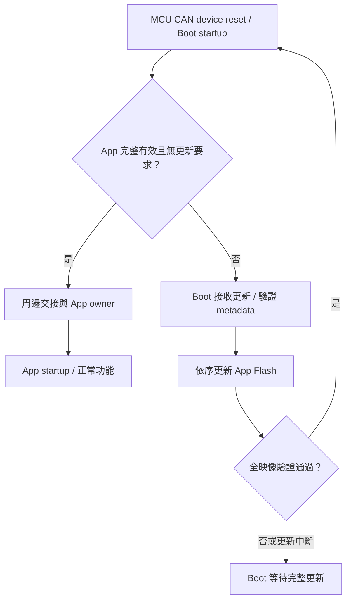

# RL78 MCU CAN device：Boot/App 移植指南

<!-- RL78_PORTING_BEGIN -->
<a id="boot-app-porting"></a>

## MCU CAN device：Boot 與 App 工程

本節整理 MCU CAN device 的分區、startup、RAM、向量與映像產生方式。
F13、F24 各自維護獨立的 Boot／App 工程，使用相同的流程概念與 C header 設定方式。
兩份工程共同作為後續 MCU 的 [工程基準](https://github.com/released/simple_renesas_isp_tool/blob/main/docs/DEVICE_GOLDEN_SAMPLE_zh-TW.md)。

Metadata 編輯與新增 IRQ 的逐步操作集中於 [Device App 設定](https://released.github.io/slide_boot_loader_for_RL78/#device-metadata-vector-workshop)。
本節著重移植時各項工程設定的關係。

### 1. 工程來源

| 工程 | F13 (MCU CAN device) | F24 (MCU CAN device) |
| --- | --- | --- |
| Boot | [RL78_F13_Boot_loader_CAN](https://github.com/released/RL78_F13_Boot_loader_CAN) | `RL78_F24_Boot_loader_CAN` |
| App | [RL78_F13_Boot_loader_CAN_app](https://github.com/released/RL78_F13_Boot_loader_CAN_app) | `RL78_F24_Boot_loader_CAN_app` |
| MCU | R5F10BMG | R7F124FPJ5xFB |
| Flash driver | FSL | RFD Type02 |
| Target／IRQ ABI | `0xF13B`／F1V1 | `0xF24B`／F2V1 |
| 板端時鐘 | X1 4MHz、CPU32／CAN16 | X1 4MHz、PLL80、CPU／CAN40 |
| 工程配置 | [F13 啟動與更新](https://released.github.io/slide_boot_loader_for_RL78/#f13-boot-decision) | [F24 工程配置](https://released.github.io/slide_boot_loader_for_RL78/#f24-can-device) |

各 App 引用相鄰 Boot 工程提供的共用來源與建置腳本。
工程放置方式如下，F13 與 F24 可依需要分別使用：

```text
examples/
  RL78_F13_Boot_loader_CAN/
  RL78_F13_Boot_loader_CAN_app/
  RL78_F24_Boot_loader_CAN/
  RL78_F24_Boot_loader_CAN_app/
```

ZIP 解壓後的目錄名稱與 MTPJ 引用路徑保持一致。
F13 原始碼可在同一目錄取得：

```powershell
git clone https://github.com/released/RL78_F13_Boot_loader_CAN.git
git clone https://github.com/released/RL78_F13_Boot_loader_CAN_app.git
```

### 2. Flash 與映像配置

| 區域 | F13 device | F24 device |
| --- | --- | --- |
| Boot | 0x0000..0x1FFF，8 KiB | 0x0000..0x1FFF，8 KiB |
| App 可用區 | 0x2000..0x1FBFF，119 KiB | 0x2000..0x3FBFF，247 KiB |
| App 跳轉表 | 0x2000..0x20FF | 0x2000..0x20FF |
| Metadata core | 0x2100..0x217F | 0x2100..0x217F |
| Metadata reserved FF | 0x2180..0x21FF | 0x2180..0x21FF |
| App code 起點 | 0x2200 | 0x2200 |
| Flash 尾端保護 | 0x1FC00..0x1FFFF，1 KiB | 0x3FC00..0x3FFFF，1 KiB |
| Image CRC32 | 實際 BIN 最後4 bytes、LE32 | 實際 BIN 最後4 bytes、LE32 |

App 前512 bytes 由256-byte向量表與256-byte metadata 組成。
BIN 的實際長度由 linker map 決定，尾端四位元組對齊並加上 CRC32。

各 Boot 的 `image_metadata_config.h` 定義映像契約；`can_boot_config.h` 定義 CAN，`boot_app_handoff.h` 定義 RAM 交接。
完整編輯分工見 [設定檔與產物](https://released.github.io/slide_boot_loader_for_RL78/#device-metadata-vector-workshop)。
獨立 `image_metadata.c/.h` 搭配工程專用 `image_metadata_profile.c`；API 與移植方式見 [Metadata C 模組](https://released.github.io/slide_boot_loader_for_RL78/#device-metadata-parser)。
逐 byte 位址見 [Flash／metadata 參考](https://released.github.io/slide_boot_loader_for_RL78/#flash-metadata-can-reference)。

<a id="device-debug-monitor"></a>

#### 重要事項：Boot 燒錄方式與 Flash 尾端保護

**若 App 需要用滿 F13 的 120 KiB／F24 的 248 KiB，Boot 只能使用 Renesas Flash Programmer（RFP）安裝。**
**不可使用 CS+「下載並除錯」安裝 Boot 後，再執行滿容量 App 更新；更新可能通過 END CRC，但 App 啟動、UART Log 或 CAN 連線仍出現異常。**

CS+ Debug 下載會在 Code Flash 尾端放入 debug monitor，並使用除錯啟動路徑。
移除 E2 Lite 或離開 Debug mode，並不代表 Flash 中的 monitor 已移除。
更新若擦寫到該區，會破壞除錯啟動所需的內容；不能只憑 END CRC 通過判定重啟一定正常。

| 配置 | F13 device | F24 device（Classical CAN／CAN FD） |
| --- | --- | --- |
| Code Flash／Boot | 128／8 KiB | 256／8 KiB |
| 目前 CS+ monitor 範圍 | `0x1FE00..0x1FFFF`，512 bytes | `0x3FF00..0x3FFFF`，256 bytes |
| 預設保護範圍 | `0x1FC00..0x1FFFF`，1 KiB | `0x3FC00..0x3FFFF`，1 KiB |
| 預設 App 最大 BIN | **119 KiB**（121856 bytes） | **247 KiB**（252928 bytes） |
| 預設配置的 Boot 安裝方式 | CS+ Debug 下載或 RFP | CS+ Debug 下載或 RFP |
| 自訂滿容量 App BIN | **120 KiB：僅限 RFP 安裝 Boot** | **248 KiB：僅限 RFP 安裝 Boot** |

Monitor 大小會隨 MCU 與除錯選項改變；表中是目前工程的設定。
Flash 擦除單位為 1 KiB，因此保留完整末端區塊，而非只扣除 monitor 的 256／512 bytes。
App BIN 容量包含向量表、metadata、程式／填充與最後 4 bytes CRC32；1 KiB＝1024 bytes。

需要滿容量時，工程配置與安裝方式須一起調整：

1. 在 Boot 的 `image_metadata_config.h` 設定 `IMAGE_APPLICATION_CAPACITY`：F13 為 `0x1E000`，F24 為 `0x3E000`。
2. 重新建置配對的 Boot 與 App，確認 Flash 擦寫邊界、產生的 metadata、封裝範圍與 Tool live capacity 一致；重新產生測試 BIN。
3. **使用 RFP 安裝配對的 Boot HEX**，再以 Tool 更新 App BIN；不可將 CS+ Debug 下載當作這一步的替代方式。
4. 若之後再次使用 CS+ Debug 下載，滿容量更新前須重新以 RFP 安裝 Boot。

僅改用 RFP、不修改配對工程，預設 Boot 仍只接受 119／247 KiB 以內的 App。
目前操作依據可參閱 Renesas [E1／E20／E2／E2 Lite RL78 附加手冊](https://www.renesas.com/en/document/mat/e1e20e2-emulator-e2-emulator-lite-additional-document-users-manual-notes-connection-rl78) §3.3.1（monitor 區域）、§3.5.1（self-programming）及 §3.8.2（離開除錯後獨立運作）。

### 3. Startup、RAM 與中斷交接

| 項目 | 工程設定與檢查位置 |
| --- | --- |
| Project device／CC-RL | MCU、記憶體模型、Flash driver |
| Startup | stack、data／bss 初始化、App 起點 |
| No-init RAM | `0xFF710..0xFF71F` owner／handoff／update marker；startup 與 linker 保留此區 |
| ENTER marker | F13：`0xFF700`，見 r_main.c；F24：`0xFF71C`，見 boot_main.c |
| IRQ owner | `0xAA`：Boot；`0x55`：App |
| RAM／stack | linker map 確認與 no-init 區間分離 |
| Flash 執行路徑 | F24 RFD programming-mode 路徑及必要資料位於 RAM |
| Build events | App pre-build 產表；post-build 驗證及封裝 |

Boot 交接前關閉中斷、整理周邊狀態並寫入 App owner。
App 經自己的 startup 初始化後，再啟用所需周邊與 IRQ。

F13 的 `f13_board_support` 與 startup user-area clock hook 負責時鐘交接。
F24 的 `common` 與 startup projection 負責板端初始化及 RFD RAM 配置。
這些來源分別保留在各自工程中。

### 4. 固定向量介面

一般 IRQ 的 owner 分流、16-bit 實體入口、App 槽位換算及轉送成本集中於
[Boot／App 中斷所有權](https://released.github.io/slide_boot_loader_for_RL78/#device-irq-ownership)。
新增 App ISR 的操作與來源查找見 [IRQ 設定與來源對照](https://released.github.io/slide_boot_loader_for_RL78/#device-app-irq)。

<a id="device-irq-porting"></a>

固定 Boot 與 App 跳轉表可沿用同一設計概念；跨 MCU 時，依目標硬體與編譯器建立工程配置。

| 項目 | 需要依 MCU 核對的內容 | 來源與核對結果 |
| --- | --- | --- |
| IRQ 配置 | 有效 vector、保留槽位、特殊中斷與返回方式 | 硬體手冊 Interrupt Functions、工程 `iodefine.h`、生成表及實際 RETI／RETB |
| Flash 分區 | Boot 大小、App 起點、擦除單位與保護範圍 | 硬體手冊、`image_metadata_config.h`、linker map 與封裝映像範圍 |
| startup／linker | 區段位置、近／遠跳轉、ISR 編譯規則 | startup、MTPJ 選項、Boot stub 的低位址範圍及 App BR 的實際目的地 |
| RAM／交接 | owner、stack、周邊停止與待處理中斷清除 | `boot_app_handoff.h`、no-init 區段、交接函式與 App 初始化 |
| Flash 更新 | 對應 Flash library、RAM 執行要求及擦寫期間的中斷條件 | 該 MCU 的 FSL／RFD 手冊、RAM copy 範圍、DI／EI 與 Flash 呼叫路徑 |

軟體向量轉送決定一般 IRQ 的執行目的地；Flash 擦寫期間能否取指、讀取常數或處理中斷，
仍依 MCU 與 Flash library 的限制配置。
若擦寫期間需要啟用中斷，另核對從實體 vector、stub、dispatcher 到 handler 與資料的完整路徑是否仍可存取。

### 5. 設定檔與建置

| 內容 | F13 device | F24 device |
| --- | --- | --- |
| App 資訊 | `app_image_config.h` | `app_image_config.h` |
| IRQ mapping | `app_irq_handlers.h` | `app_irq_handlers.h` |
| pre-build | `generate_irq_contract.ps1 -Mode App` | `prepare_projects.ps1 -Kind app` |
| post-build | `generate_update_image.ps1` | `package_images.ps1 -Kind app` |
| App-only 更新 | App update BIN | App update BIN |

兩個工程的日常產表與封裝均使用 Windows PowerShell、CS+／CC-RL。
來源搬移或改名時，source／include／hook、map 與輸出檔名一併調整。
完整命令集中於 [產生與建置](https://released.github.io/slide_boot_loader_for_RL78/#device-app-build)。

### 6. 初次安裝與後續更新

| 用途 | F13 device | F24 device |
| --- | --- | --- |
| 燒錄器初裝 | App 根目錄 `boot_app.hex` | App 根目錄 `boot_app.hex`，或 Boot `boot0000_1FFF.hex`＋App `flash_app_variable_CRC.hex` |
| CAN 更新 App | `DefaultBuild/*_update.bin` | `DefaultBuild/*_update.bin` |
| 除錯檢查 | 保留 Boot 實體向量，載入 App symbols | 保留 Boot 實體向量，載入 App symbols |

Tool 操作見 [CAN device 更新](https://released.github.io/slide_isp_tool_for_RL78/#mcu-can-device)。
以燒錄器安裝時，核對每個檔案的範圍與 erase 設定。
App raw ABS／MOT 與封裝後的安裝映像分別使用於編譯除錯及正式初裝。

### 7. 啟動與更新流程



各工程的 marker、逾時與 Flash 操作由各自 Boot 處理。
F13 的狀態條件見 [F13 Boot 啟動與更新](https://released.github.io/slide_boot_loader_for_RL78/#f13-boot-decision)。
F24 的狀態路徑見 [F24 device 工程配置](https://released.github.io/slide_boot_loader_for_RL78/#f24-can-device)。

### 8. App 變更與驗證

| 變更 | 檢查範圍 |
| --- | --- |
| App 功能、版本、一般 IRQ | App 來源、C header、初始化、生成表與更新 BIN |
| MCU、Flash 分區、RAM、IRQ ABI | Boot／App 共同契約、linker 與封裝 |
| 更新介面、CAN IDs／speed | Boot／App 通訊、metadata 與 Tool target adapter |

App 更新時可保存 Boot 映像雜湊，確認 App-only 作業的範圍。
靜態檢查包含 BR entry、RETI／RETB、metadata、CRC、ROM／RAM／stack。
實板驗證包含上電、ENTER、更新後 App、各 IRQ、重送、斷線與斷電復原。
<!-- RL78_PORTING_END -->
