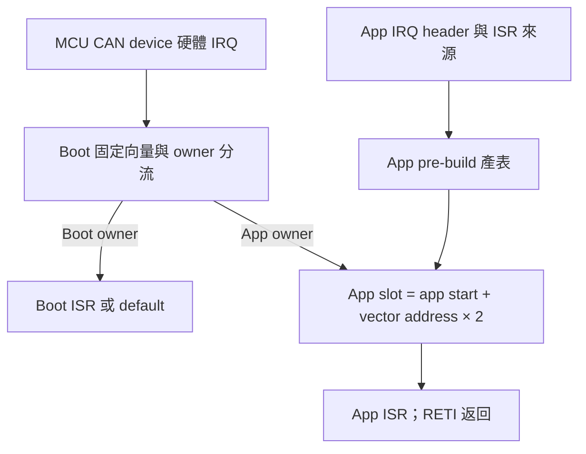
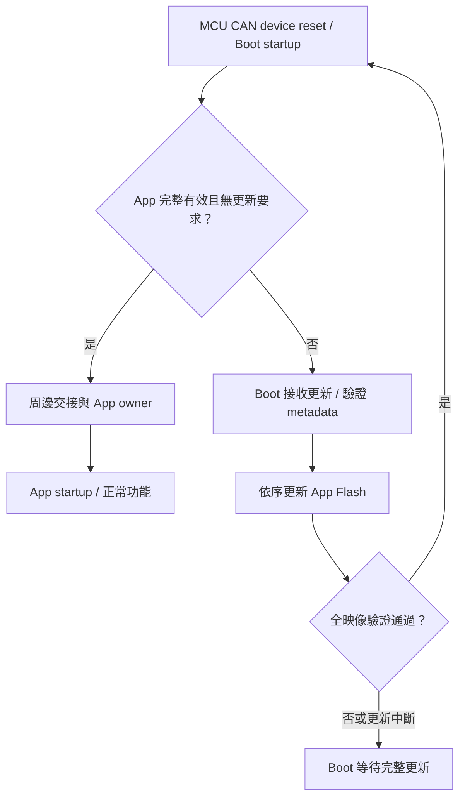

# RL78 MCU CAN device：Boot/App 移植指南

<!-- RL78_PORTING_BEGIN -->
<a id="boot-app-porting"></a>

## MCU CAN device：Boot 與 App 工程

本節整理 MCU CAN device 的分區、startup、RAM、向量與映像產生方式。
F13、F24 各自維護獨立的 Boot／App 工程，使用相同的流程概念與 C header 設定方式。
兩份工程共同作為後續 MCU 的 [工程基準](https://github.com/released/simple_renesas_isp_tool/blob/main/docs/DEVICE_GOLDEN_SAMPLE_zh-TW.md)。

Metadata 編輯與新增 IRQ 的逐步操作集中於 [Device App 設定](https://released.github.io/slide_boot_loader_for_RL78/#device-metadata-vector-workshop)。
本節著重移植時各項工程設定的關係。

### 1. 工程來源

| 工程 | F13 (MCU CAN device) | F24 (MCU CAN device) |
| --- | --- | --- |
| Boot | [RL78_F13_Boot_loader_CAN](https://github.com/released/RL78_F13_Boot_loader_CAN) | `RL78_F24_Boot_loader_CAN` |
| App | [RL78_F13_Boot_loader_CAN_app](https://github.com/released/RL78_F13_Boot_loader_CAN_app) | `RL78_F24_Boot_loader_CAN_app` |
| MCU | R5F10BMG | R7F124FPJ5xFB |
| Flash driver | FSL | RFD Type02 |
| Target／IRQ ABI | `0xF13B`／F1V1 | `0xF24B`／F2V1 |
| 板端時鐘 | X1 4MHz、CPU32／CAN16 | X1 4MHz、PLL80、CPU／CAN40 |
| 工程配置 | [F13 啟動與更新](https://released.github.io/slide_boot_loader_for_RL78/#f13-boot-decision) | [F24 工程配置](https://released.github.io/slide_boot_loader_for_RL78/#f24-can-device) |

各 App 引用相鄰 Boot 工程提供的共用來源與建置腳本。
工程放置方式如下，F13 與 F24 可依需要分別使用：

```text
examples/
  RL78_F13_Boot_loader_CAN/
  RL78_F13_Boot_loader_CAN_app/
  RL78_F24_Boot_loader_CAN/
  RL78_F24_Boot_loader_CAN_app/
```

ZIP 解壓後的目錄名稱與 MTPJ 引用路徑保持一致。
F13 原始碼可在同一目錄取得：

```powershell
git clone https://github.com/released/RL78_F13_Boot_loader_CAN.git
git clone https://github.com/released/RL78_F13_Boot_loader_CAN_app.git
```

### 2. Flash 與映像配置

| 區域 | F13 device | F24 device |
| --- | --- | --- |
| Boot | 0x0000..0x1FFF，8 KiB | 0x0000..0x1FFF，8 KiB |
| App 可用區 | 0x2000..0x1FFFF | 0x2000..0x3FBFF |
| App 跳轉表 | 0x2000..0x20FF | 0x2000..0x20FF |
| Metadata core | 0x2100..0x217F | 0x2100..0x217F |
| Metadata reserved FF | 0x2180..0x21FF | 0x2180..0x21FF |
| App code 起點 | 0x2200 | 0x2200 |
| 其他保留區 | debug trace RAM | Flash最後1 KiB |
| Image CRC32 | 實際 BIN 最後4 bytes、LE32 | 實際 BIN 最後4 bytes、LE32 |

App 前512 bytes 由256-byte向量表與256-byte metadata 組成。
BIN 的實際長度由 linker map 決定，尾端四位元組對齊並加上 CRC32。

分區來源為各 Boot 的 `can_boot_config.h`，linker、產生器與封裝使用同一契約。
位址與每個 byte 的欄位對照集中於 [Flash／metadata 參考](https://released.github.io/slide_boot_loader_for_RL78/#flash-metadata-can-reference)。

### 3. Startup、RAM 與中斷交接

| 項目 | 工程設定與檢查位置 |
| --- | --- |
| Project device／CC-RL | MCU、記憶體模型、Flash driver |
| Startup | stack、data／bss 初始化、App 起點 |
| No-init RAM | `0xFF710..0xFF71F` owner／handoff／update marker；startup 與 linker 保留此區 |
| ENTER marker | F13：`0xFF700`，見 r_main.c；F24：`0xFF71C`，見 boot_main.c |
| IRQ owner | `0xAA`：Boot；`0x55`：App |
| RAM／stack | linker map 確認與 no-init 區間分離 |
| Flash 執行路徑 | F24 RFD programming-mode 路徑及必要資料位於 RAM |
| Build events | App pre-build 產表；post-build 驗證及封裝 |

Boot 交接前關閉中斷、整理周邊狀態並寫入 App owner。
App 經自己的 startup 初始化後，再啟用所需周邊與 IRQ。

F13 的 `f13_board_support` 與 startup user-area clock hook 負責時鐘交接。
F24 的 `common` 與 startup projection 負責板端初始化及 RFD RAM 配置。
這些來源分別保留在各自工程中。

### 4. 固定向量介面



App table 具有64個4-byte slot。
例如 vector `0x0A` 的 slot 是 `0x2000 + 0x0A × 2 = 0x2014`。

一般 ISR 使用無 `vect=` 的 interrupt pragma，Boot 擁有實體向量。
Reset entry 經 App startup；Physical BRK 的保留 slot 使用 RETB。

vector ? 的查找來源、C 函式寫法與生成表的檢查，集中於 [IRQ 設定與來源對照](https://released.github.io/slide_boot_loader_for_RL78/#device-app-irq)。

### 5. 設定檔與建置

| 內容 | F13 device | F24 device |
| --- | --- | --- |
| App 資訊 | `app_image_config.h` | `app_image_config.h` |
| IRQ mapping | `app_irq_handlers.h` | `app_irq_handlers.h` |
| pre-build | `generate_irq_contract.ps1 -Mode App` | `prepare_projects.ps1 -Kind app` |
| post-build | `generate_update_image.ps1` | `package_images.ps1 -Kind app` |
| App-only 更新 | App update BIN | App update BIN |

兩個工程的日常產表與封裝均使用 Windows PowerShell、CS+／CC-RL。
來源搬移或改名時，source／include／hook、map 與輸出檔名一併調整。
完整命令集中於 [產生與建置](https://released.github.io/slide_boot_loader_for_RL78/#device-app-build)。

### 6. 初次安裝與後續更新

| 用途 | F13 device | F24 device |
| --- | --- | --- |
| 燒錄器初裝 | App 根目錄 `boot_app.hex` | App 根目錄 `boot_app.hex`，或 Boot `boot0000_1FFF.hex`＋App `flash_app_variable_CRC.hex` |
| CAN 更新 App | `DefaultBuild/*_update.bin` | `DefaultBuild/*_update.bin` |
| 除錯檢查 | 保留 Boot 實體向量，載入 App symbols | 保留 Boot 實體向量，載入 App symbols |

Tool 操作見 [CAN device 更新](https://released.github.io/slide_isp_tool_for_RL78/#mcu-can-device)。
以燒錄器安裝時，核對每個檔案的範圍與 erase 設定。
App raw ABS／MOT 與封裝後的安裝映像分別使用於編譯除錯及正式初裝。

### 7. 啟動與更新流程



各工程的 marker、逾時與 Flash 操作由各自 Boot 處理。
F13 的狀態條件見 [F13 Boot 啟動與更新](https://released.github.io/slide_boot_loader_for_RL78/#f13-boot-decision)。
F24 的狀態路徑見 [F24 device 工程配置](https://released.github.io/slide_boot_loader_for_RL78/#f24-can-device)。

### 8. App 變更與驗證

| 變更 | 檢查範圍 |
| --- | --- |
| App 功能、版本、一般 IRQ | App 來源、C header、初始化、生成表與更新 BIN |
| MCU、Flash 分區、RAM、IRQ ABI | Boot／App 共同契約、linker 與封裝 |
| 更新介面、CAN IDs／speed | Boot／App 通訊、metadata 與 Tool target adapter |

App 更新時可保存 Boot 映像雜湊，確認 App-only 作業的範圍。
靜態檢查包含 BR entry、RETI／RETB、metadata、CRC、ROM／RAM／stack。
實板驗證包含上電、ENTER、更新後 App、各 IRQ、重送、斷線與斷電復原。
<!-- RL78_PORTING_END -->
