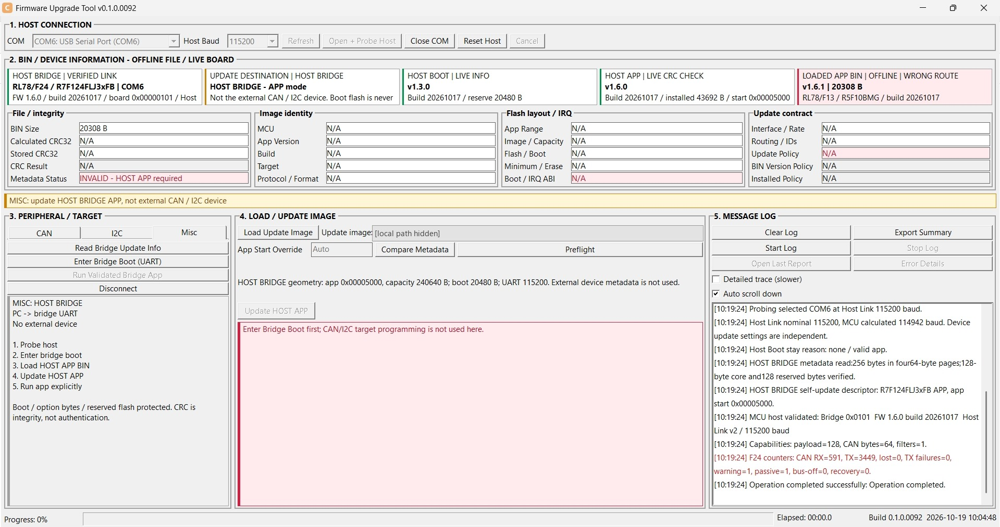
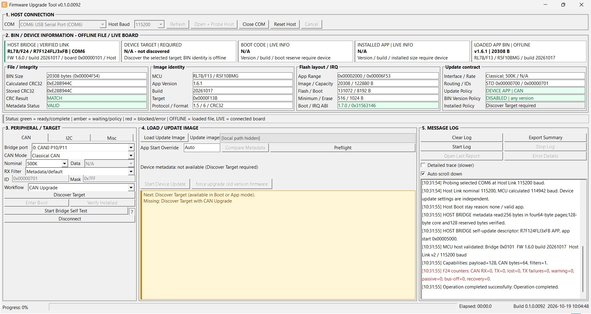
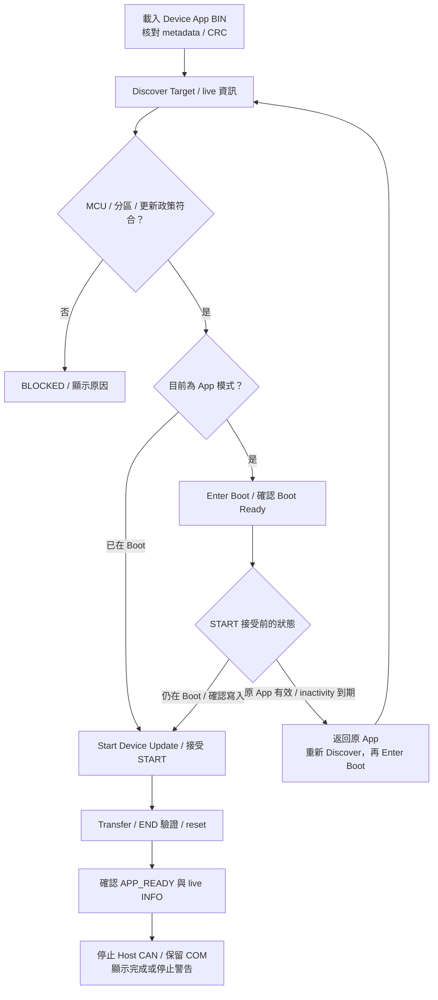
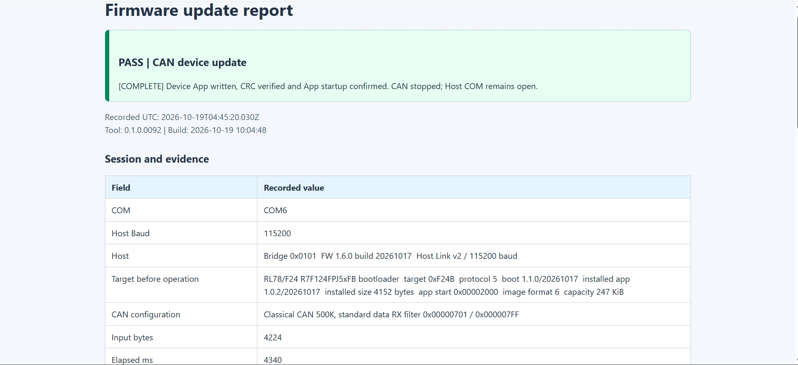
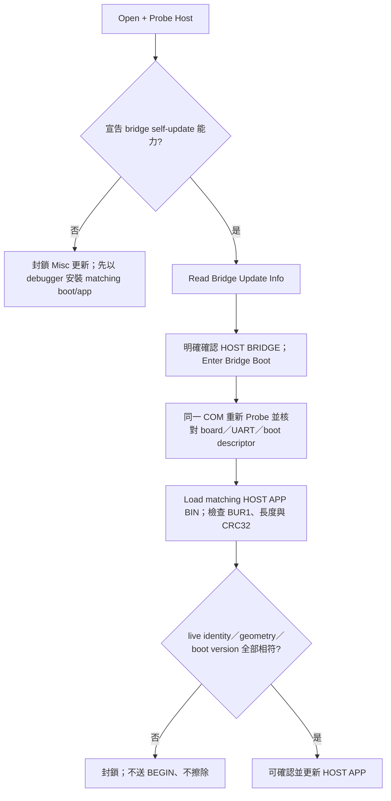
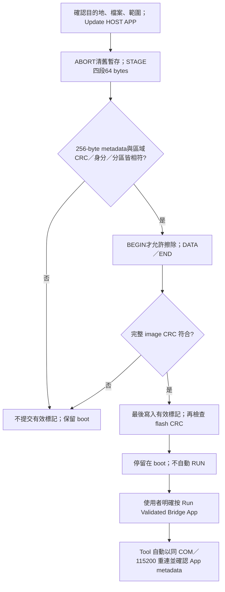
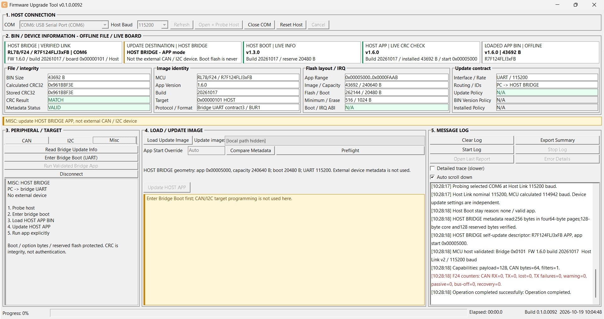
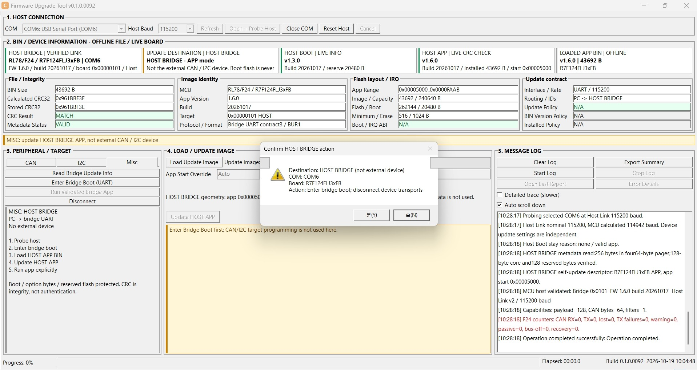
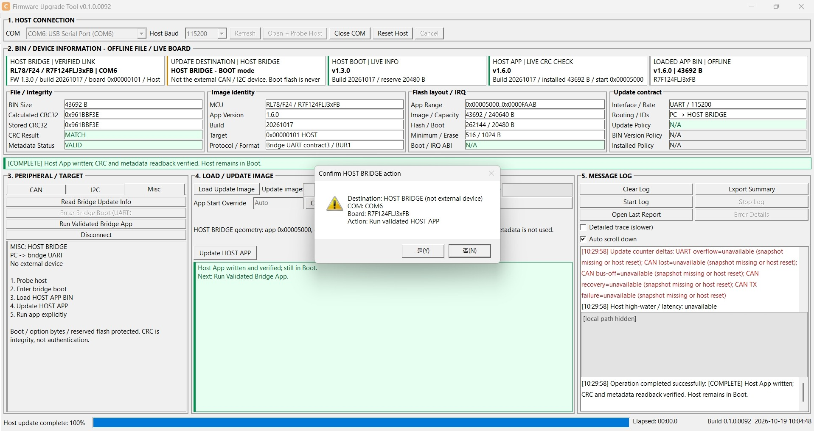
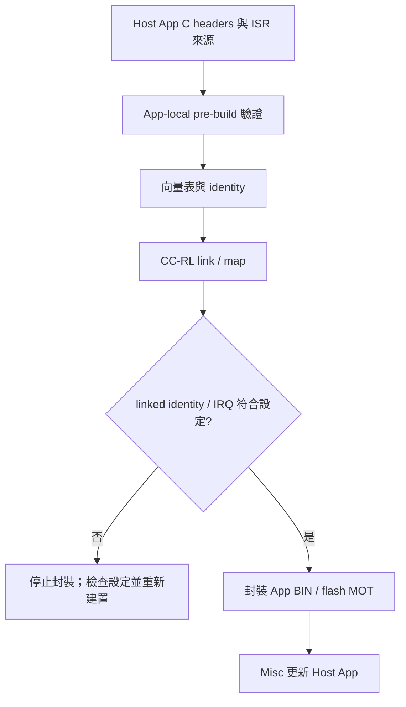

# 共用單畫面與 Bridge UART 更新指南

本指南整理 Tool 的共用畫面，以及 MCU CAN host 的 UART App 更新與工程設定。

## 1. 共用畫面與操作群組

畫面以1366×768配置呈現上方連線、BIN／裝置資訊，以及下方周邊設定、載入／更新、Message Log 五個群組。
使用 Windows 系統灰白配色與加粗邊框；狀態色保留於判定結果與提示。
主視窗沒有上下捲軸，Log 歷史與下拉清單可捲動；最小視窗高度隨字型尺寸調整。
五張摘要卡同列顯示，hover 可讀全文。

BIN、檔案路徑、20個metadata欄位與Log由各TAB共用。

CAN 與 I2C TAB 提供 port、speed、ID／mask 或 slave address 等介面參數及適用的 image contract。
最後一個 TAB 是 Misc，更新目的地為 host bridge。

CAN／I2C／Misc TAB 只位於左下 PERIPHERAL / TARGET 群組。
上方 BIN 資訊、中下 LOAD / UPDATE IMAGE 與右下 MESSAGE LOG 固定獨立，切換 TAB 保留共用資料。
完整[群組與欄位對照](https://released.github.io/slide_isp_tool_for_RL78/#tool-console-layout)及
[Auto scroll down／INI 設定](https://released.github.io/slide_isp_tool_for_RL78/#tool-log-auto-scroll)集中於 Tool operation。

| 顏色與文字 | 意義 |
| --- | --- |
| 綠色 READY／MATCH | 條件符合或資料完整性相符，不代表身分認證 |
| OFFLINE／WORKING 文字 | 本地 BIN 資訊或執行中，以系統灰白底呈現 |
| 黃色 REQUIRED／REFERENCE | 等待必要條件或僅為範例回報資訊 |
| 紅色 ERROR／BLOCKED | 錯誤、CRC 不符或不允許操作 |
| 灰色 N/A | 尚未取得或該協定未提供；離線 BIN 資料與 live 資訊分開顯示 |

## 2. Host、Device 與 BIN 的資訊來源

COM 清單的 USB friendly name 用於辨識轉接器。
`Open + Probe Host` 取得實際 bridge board 的 board ID、韌體版本、能力與可選 port。
UI 依 Host Link／backend 回報的能力顯示功能與 port。

CAN／I2C 模式的 BOOT／INSTALLED APP 卡來自外部 device 的 live INFO；LOADED BIN 是離線檔案。Custom Transfer 不提供 boot/app metadata，所以顯示 N/A。G16 範例回報的版本是常數，使用黃色；其 erase/write/jump 仍封鎖。

Misc 的 BOOT／APP 卡改為 host bridge 自己的資訊，且目的地卡明確顯示 HOST BRIDGE。離線 BIN 仍獨立。CRC 是完整性檢查，不是簽章、授權或防回滾。

<!-- TOOL_CONNECT_MEDIA_BEGIN -->
<a id="tool-connect-example"></a>

### COM 連線操作圖

選擇 COM 與 Host Baud 後按 `Open + Probe Host`，核對 `HOST BRIDGE | VERIFIED LINK` 與實際 MCU。
下圖的 COM 已驗證，但 Misc 仍保留 Device CAN BIN，因此出現 `INVALID - HOST APP required`；連線成功與選檔相容是兩項獨立判斷。
進行更新前，依[下載與操作總覽](https://released.github.io/slide_isp_tool_for_RL78/#downloads)載入對應目的地的 App BIN。

圖中的版本、COM 與大小是操作範例；本機檔案與報告路徑已遮蔽，狀態與操作結果保留。
網頁上的操作圖可點選開啟原尺寸，方便查看欄位與訊息。

[](images/tool_operation/tool_connect_COM.jpg)
<!-- TOOL_CONNECT_MEDIA_END -->

## 2.1 CAN：更新 MCU CAN device App

<!-- TOOL_DEVICE_MEDIA_BEGIN -->
<a id="device-update-example"></a>

### Device App 更新操作圖

先完成 Host Probe，在 CAN 頁選取 `CAN Upgrade`、Bridge port 與 device 使用的 bitrate。
以下圖片使用 F13 (MCU CAN device)，各欄數值來自所載入 BIN 與 live device；操作順序依回報模式選擇。
F13 與 F24 device 的正常 CAN App 更新皆已完成實板驗證，使用相同的載入、探索、進 Boot、更新及 App 確認流程。
F24 的完成報告與執行畫面見 [F24 device 更新結果](#f24-device-update-example)。
完整[欄位與狀態判讀](https://released.github.io/slide_isp_tool_for_RL78/#tool-ui-fields)集中於 Tool operation。

#### 1. 載入 Device App BIN

`Load Update Image` 選取 `RL78_F13_Boot_loader_CAN_app_update.bin`，核對 MCU、App version、Metadata VALID 與 CRC MATCH。
此時尚未 Discover，LIVE 資訊為 N/A；離線驗證通過不代表已與 device 連線。

[](images/tool_operation/tool_CAN_update1_load_image.jpg)

#### 2. Discover Target

`Discover Target` 讀取目前模式、Boot 與 installed App 資訊。
圖中為 `APPLICATION MODE`，下一步是 Enter Boot；若回報 `BOOTLOADER MODE`，直接進入步驟 4。

[](images/tool_operation/tool_CAN_update2_discover_target.jpg)

#### 3. Enter Boot 與操作等待時間

按 `Enter Boot`，等 DEVICE TARGET 回報 `BOOTLOADER MODE` 與 prerequisite 的 Ready。

F13 Boot 在**原 App 有效、ENTER 後尚未接受 START**時，若連續約 **30 秒沒有符合接收條件的 CAN request**，會返回原 App。
這是 inactivity 計時，不是 ENTER 後固定等待 30 秒；符合條件的 INFO 等 request 也會刷新計時。
在確認視窗停留過久，裝置也可能已返回 App，無法直接開始更新。

此時重新 `Discover Target`；若為 App 模式，再 `Enter Boot`，確認目前仍在 Boot 後執行 `Start Device Update`。
畫面先前取得的 Boot 資訊不是持續連線保證。
原 App 無效、START 已接受或錯誤處理後的行為，見 [Boot 逾時與更新狀態](https://released.github.io/slide_boot_loader_for_RL78/#f13-boot-decision)，不沿用此「返回原 App」條件。

[](images/tool_operation/tool_CAN_update3_enter_boot.jpg)

#### 4. 確認並開始更新

按 `Start Device Update`，核對確認視窗的 MCU、檔案、版本、size、CRC 與改寫範圍，再確認寫入。
若出現狀態已改變、Boot 未就緒或 timeout，依步驟 3 重新取得目前模式，再確認更新條件。
Tool 在真正更新前會重新讀取模式；`Device is no longer in Boot; update not started.` 表示沒有開始更新，需重新 Discover／Enter Boot。

[](images/tool_operation/tool_CAN_update4_start_update.jpg)

#### 5. 更新進行中

觀察階段、progress 與 Log。保持供電及 CAN 連線；`Cancel` 取消目前工作，`Close COM` 會取消並結束連線。
START 已接受後失聯不會沿用步驟 3 的自動返回原 App 行為；取消、錯誤與不完整映像的處理見 Boot 狀態章節。

[](images/tool_operation/tool_CAN_update5_during_update.jpg)

#### 6. 更新完成與 App 確認

只有 END／CRC 通過、APP_READY 與 live INFO 核對完成後，才顯示 `[COMPLETE]` 與 Device App update complete。
正常完成會停止 Host CAN、保留 COM（Host UART），讓使用者檢查 App 與板上功能；因此 DEVICE TARGET 回到 N/A 並要求再次 Discover 是完成清理後的狀態。
App 未確認或 CAN STOP 未確認時，依[完成提示與下一步](https://released.github.io/slide_isp_tool_for_RL78/#update-completion)處理，不自動重寫。
Tool 自動保存 Firmware update report；右下 `MESSAGE LOG` 的 `Open Last Report` 可開啟報告，操作見[更新報告](https://released.github.io/slide_isp_tool_for_RL78/#update-html-report)。

[](images/tool_operation/tool_CAN_update6_after_update.jpg)



<a id="f24-device-update-example"></a>

### F24 (MCU CAN device)：更新結果與 App 執行

F24 device 已確認可完整執行正常 CAN App 更新：配對 Boot 驗證映像、寫入 App、
END／CRC 通過、reset 後回報 APP_READY，Tool 再核對 live INFO 並停止 Host CAN。
操作沿用上方六個步驟，載入檔案改為 `RL78_F24_Boot_loader_CAN_app_update.bin`，
並核對 F24 device 自己的 MCU、target、Flash 配置與 IRQ ABI。

#### 更新報告

HTML 報告的 `PASS | CAN device update` 與 `[COMPLETE]` 表示寫入、CRC 及 App 啟動確認均完成，
不以進度到達 100% 單獨判定成功。圖中 Host Link 為 115200，CAN 為 Classical 500K。

[](images/tool_operation/firmware_update_report.png)

| 報告項目 | 判讀方式 |
| --- | --- |
| `Target before operation` | 更新前的 device 模式與已安裝 App；不是更新後版本 |
| `Input bytes` | 此次載入並傳送的 App BIN 長度，與 Flash capacity 分開 |
| `App version / Build / Image bytes` 比對 | 完整 HTML 的 live 值與載入 BIN 相符，代表重啟後辨識到此次 App |
| `CAN stopped; Host COM remains open` | App 確認後停止 CAN、保留 Host COM；下一次更新先重新 Discover |

開啟方式、完整欄位與錯誤判讀集中於 [更新報告](https://released.github.io/slide_isp_tool_for_RL78/#update-html-report)。

#### Device UART 執行紀錄

UART 畫面顯示 `boot-validated`、`CAN update: completed`，以及 `log(timer)-V1` counter 從 0 持續遞增。
這份紀錄與 Tool 的 APP_READY／live INFO 一起確認 App 已啟動、timer 與主迴圈持續運作。
V1 是可編輯的觀察標籤，不取代 metadata 的版本號；修改位置見 [App 執行標籤](https://released.github.io/slide_boot_loader_for_RL78/#device-app-runtime-log)。

[](images/tool_operation/MCU_F24_Device_app_log.png)

以上確認正常 115200 Host Link／500K CAN 更新與 App 執行。
250K／1M、長時間壓力、其他 IRQ、取消、拔線及斷電復原各自依 [實板驗證矩陣](https://released.github.io/slide_isp_tool_for_RL78/#update-confirmation) 保留測試結果。
<!-- TOOL_DEVICE_MEDIA_END -->

## 3. Misc：PC 透過 UART 更新 Host App

Misc 透過 PC ↔ host 的 UART 更新 Host App。
UART baud rate 與 CAN bitrate 分別設定。



### 3.1 寫入與啟動分開

寫入與執行是不同動作，成功寫入後不會直接跳轉。



開始寫入前，確認視窗會列出目的地 HOST BRIDGE、COM、MCU part、檔案、app start 與大小。預設選 No。TAB 切換、載入檔案、Read Info 都不會擦寫。STAGE只有RAM暫存，缺段、衝突、總長／CRC／身分不符均不擦Flash。Read Info在有有效app時以相同READ_METADATA command、offset0/64/128/192讀回完整metadata並核對descriptor。更新完成也分段read-back核對；成功後仍需明確RUN。Close COM可取消，tool嘗試ABORT清除staging再關閉；BEGIN前取消不改舊app，BEGIN後不保證舊app仍在。

未宣告 self-update 能力的 bridge 不開放 Misc 寫入，不推測位址或接受 raw BIN。

更新後確認、Compare Metadata、分階段進度、Cancel 與自動報告，集中於
[更新確認與驗證紀錄](https://released.github.io/slide_isp_tool_for_RL78/#update-confirmation)。

<!-- TOOL_BRIDGE_MEDIA_BEGIN -->
<a id="bridge-update-example"></a>

### Host App 更新操作圖

以下使用 F24 (MCU CAN host)。Misc 更新的是 PC 所連接 host 自身的 App，固定以 UART115200 操作。
初裝 Boot MOT、燒錄器 App MOT 與 Misc BIN 的選用，見[下載與操作總覽](https://released.github.io/slide_isp_tool_for_RL78/#downloads)。

#### 1. 載入 Host App BIN

選取 Misc，載入 `RL78_F24_Bridge_app_bridge_update.bin`。
核對目的地為 HOST BRIDGE、MCU、metadata、CRC MATCH 與 UART115200；Device App BIN 會因目的地不符而被拒絕。

[](images/tool_operation/tool_Bridge_update1_load_image.jpg)

#### 2. 確認 Enter Bridge Boot

按 `Read Bridge Update Info` 取得目前資訊，再按 `Enter Bridge Boot (UART)`。
確認視窗列出的 HOST BRIDGE、COM 與 MCU；此步進入 Boot，不擦寫 App。

[](images/tool_operation/tool_Bridge_update2_enter_boot.jpg)

#### 3. 確認 Host Boot 已連線

等 Tool 以同一 COM／115200 重新 Probe。
目的地回報 `HOST BRIDGE - BOOT mode`，且 prerequisite 為 Ready 後，才可更新。

[](images/tool_operation/tool_Bridge_update3_enter_boot.jpg)

#### 4. 確認並寫入 Host App

按 `Update HOST APP`，核對檔案、MCU、App start 與 size，確認後開始寫入。
保持 UART 與供電；Boot／option／保留區不在 Misc App 寫入範圍。

[](images/tool_operation/tool_Bridge_update4_start_update.jpg)

#### 5. 寫入完成，仍停留 Boot

`Host App update complete - RUN required` 表示映像寫入、CRC 與 metadata readback 通過，**還沒有啟動 App**。
下一步是明確執行 RUN，不需再次燒錄。
此次寫入結果會自動保存為 Firmware update report，可按 `Open Last Report` 查看；[報告操作](https://released.github.io/slide_isp_tool_for_RL78/#update-html-report)說明儲存位置與判讀方式。

[](images/tool_operation/tool_Bridge_update5_after_update.jpg)

#### 6. Run Validated Bridge App

按 `Run Validated Bridge App`，核對 HOST BRIDGE 目的地後確認。

[](images/tool_operation/tool_Bridge_update6_run_valid.jpg)

#### 7. Host App 啟動確認

Tool 自動重連同一 COM，重新讀取並核對已安裝 App 資訊。
`Host App startup confirmed` 與 `[COMPLETE] Host App is running` 表示此階段完成；之後可選擇 CAN 等 device 介面。
若 Log 的 counter 顯示 unavailable，代表該次重啟前後無可比對的 snapshot，不等於此處的 App 更新失敗。
此時 `Open Last Report` 開啟的是本次 RUN 確認報告；先前的寫入報告仍保留於 `reports/`。

[](images/tool_operation/tool_Bridge_update7_update_finish.jpg)
<!-- TOOL_BRIDGE_MEDIA_END -->

## 4. F24 (MCU CAN host) 分區與建置

實際 MCU：R7F124FLJ3xFB，256 KiB code flash。Boot 為 20 KiB，App start 為 0x5000。最後 1 KiB 保留，不列入更新範圍。

| 區域 | 位址／容量 | 規則 |
| --- | --- | --- |
| Boot | 0x00000..0x04FFF，20 KiB | Misc 絕不更新 boot |
| Host app | 0x05000..0x3FBFF，235 KiB | 動態 image length，4-byte 對齊 |
| 保留區 | 0x3FC00..0x3FFFF，1 KiB | 包含 debug monitor，不可由 boot 擦寫 |
| IRQ 跳轉表 | app offset 0x000..0x0FF | 64 組四位元組 BR 入口 |
| BUR1 metadata區 | app offset 0x100..0x1FF | 256 bytes：core128／reserved128，區分HOST APP與外部device image |
| App code | app offset 0x200 起 | 由 linker 決定實際結尾 |
| CRC32 | 實際 image 最後 4 bytes | 對前面全部 bytes 計算，little-endian 儲存 |

區域容量256、有效core長度128、UART payload128、metadata chunk64是四個獨立尺寸。8-bit長度欄位表示core128，分段offset／total則使用16-bit。最小image為516 bytes，避免最後CRC覆蓋metadata。Reserved 欄位依契約驗證。

分區與身分來源為 `firmware/f24_bridge_common/image_metadata_config.h`。
唯一兩份 CS+ 產品專案是 `RL78_F24_Bridge_boot` 與 `RL78_F24_Bridge_app`；兩者引用 `firmware/f24_board` 的硬體來源。
共用目錄提供來源，projection 由 Smart Configurator 原稿與準備腳本產生。

參考專案硬體設定重新產生後，以 `scripts/prepare_f24_bridge_projects.ps1 -Kind app` 更新 app projection／專案；它保留 app-local mapping，不更新 boot。只有明確修改 boot 自己的設定才使用 `-Kind boot`；省略 Kind 仍表示同時產生兩者，不用於日常 app-only 更新。CS+ app pre-build 會產表，post-build 會檢查並封裝。

App 的 `DefaultBuild/*_bridge_update.bin` 是 Misc 要載入的檔案；`*_flash.mot` 是已加入 metadata／CRC 且排除低位向量、option、debug 區的初次 app 燒錄產物。不要把原始 app `.mot`／`.abs` 當成獨立可啟動韌體：device file 會產生未綁定的低位向量 placeholder。

首次安裝 Boot 使用 debugger／programmer，可採下列方式：

- 同時安裝 Boot `.mot` 與 matching App `_flash.mot`。
- 只安裝 Boot，沒有有效 App 時停留 recovery；再於 Misc／115200 載入 matching `_bridge_update.bin`，驗證及更新後執行 `Run Validated Bridge App`。

Misc 僅更新 Host App。
調整分區時，Boot 與 App 的配置須一致，並以燒錄器重新安裝對應 Boot。

<!-- F24_APP_IRQ_BEGIN -->
<a id="host-app-engineering"></a>

### F24 (MCU CAN host)：App 工程

本節供需要閱讀或調整 host firmware 的開發者參考。

| 來源目錄 | 內容 |
| --- | --- |
| `firmware/RL78_F24_Bridge_boot` | Host Boot、UART recovery |
| `firmware/RL78_F24_Bridge_app` | Host App、Host Link dispatch、bus service |
| `firmware/f24_board` | 共用 board／driver／SC |
| `firmware/f24_bridge_common` | Host App 分區與自更新契約 |

#### 設定、解析與介面分工

Host App 擁有自己的 `app_image_config.h` 與 `app_irq_handlers.h`。
以 C header 編輯發行資訊與 IRQ mapping，Windows PowerShell／CS+ 負責產表與封裝。
MCU 建置不需要 Python 或 JSON 設定檔。

| 來源 | 職責 | 修改範圍 |
| --- | --- | --- |
| App 的 `app_image_config.h` | 版本、build、board ID、role、允許更新介面 | App 發行設定；身分與介面須符合 Boot 契約 |
| App 的 `app_irq_handlers.h` | `APP_IRQ_HANDLERS(X)` 對照 vector byte address 與 ISR | App 功能使用的中斷 |
| `f24_bridge_common/image_metadata_config.h` | MCU 身分、Flash 分區、Boot 版本、IRQ ABI、固定 UART | 工程配置；調整時核對 Boot／App、linker 與 backend |
| `f24_bridge_common/image_metadata_profile.c/.h` | 將工程配置組成 live descriptor 的預期值 | MCU／board profile，不操作 register |
| `common/bridge_image_metadata.c/.h` | BUR1／BUI1 欄位解碼、格式驗證及契約比對 | 可移植 C90 模組，不包含更新命令或 Flash driver |
| `common/bridge_update_contract.h`、`bridge_update_engine.c/.h` | 更新命令、狀態機與 Flash callback | 收包、staging、CRC 與更新時序 |
| `f24_bridge_common/boot_app_handoff.h` | recovery cookie 與 IRQ owner 的 no-init RAM 位址 | startup／linker／交接設定 |

Pre-build 產生 `bridge_vectors.asm`／`f24_app_identity.generated.h`。
Post-build 核對實際 linked App 身分、向量目的地及 RETI／RETB，再封裝更新映像。
單獨重新產生 header 不會改變已編譯映像的身分；不符時需重新建置。



#### 編輯 App metadata

在 App 專案開啟 `app_image_config.h`；每個 define 的註解包含用途、範例與修改條件。

| Define | 範例 | 判斷方式 |
| --- | --- | --- |
| `APP_IMAGE_VERSION` | `0x00010600UL` = 1.6.0 | `0x00MMmmpp`，各一 byte；非日期或十進位字串 |
| `APP_IMAGE_BUILD` | `20261017UL` | 發行識別，允許 0..0xFFFFFFFE |
| `APP_IMAGE_TARGET_ID` | `0x0101U` | 等於 Boot 的 board ID；單獨改為 `0xF33BU` 會停止產生 |
| `APP_IMAGE_ROLE` | `2U` = HOST BRIDGE APP | 本工程使用 2；`5U` 等未定義值會停止產生 |
| `APP_IMAGE_UPDATE_TRANSPORTS` | `0x04U` = UART | bitmap：CAN=0x01、I2C=0x02、UART=0x04；此契約要求 UART |

例如發行 1.6.1 時，只調整版本與 build，再 clean build App。
Boot 版本與 App 版本是各自的發行身分，不要求數值相同。
Host App 的版本用於識別；更新仍依 board／分區／相容性與 CRC 判斷。

Misc 更新 UART 固定 115200，來源是 `image_metadata_config.h`。
App 執行時的 Host Link 115200／460800／921600、CAN bitrate 與 I2C speed 不會改寫這項更新契約。
Magic、core／region 長度與 policy 格式由 `bridge_image_metadata.h`／`image_policy.h` 定義；App 發行時維持格式契約。

#### 編輯 App IRQ mapping

在 App 的 `app_irq_handlers.h` 加入 `X(vector, handler)`。
Vector 是硬體 vector 的 byte address，來源為此專案的 `iodefine.h` 中斷定義及 MCU 硬體手冊的 Interrupt Functions 表。
例如 `INTST0=0x16` 對應表內的 UART send ISR；slot 位址為 `0x5000 + 0x16 × 2 = 0x502C`。

新增一般中斷時，將 ISR C 檔加入 App MTPJ，再於 X-macro 加入對應項目：

```c
/* Example INTP0 mapping; initialize its flag/mask/pin separately. */
X(0x08, app_aux_irq)
```

ISR 使用 global、無 `vect=` 的 interrupt pragma，並由編譯器產生 RETI。
Pre-build 檢查合法 vector、重複項目、實際登錄來源與 ISR 定義，產生完整 64-slot 表。
未列入的正常 IRQ 使用 default ISR；硬體初始化、旗標與 mask 仍由 App 配置。
固定向量介面內新增 mapping 不需修改 Boot 或 linker 的表長度。

#### 移植 metadata C 模組

| API | 輸入 | 成功表示 |
| --- | --- | --- |
| `Bu_ParseManifest(p, length, &manifest)` | 至少 128 bytes 的 BUR1 core | core 欄位及 geometry 格式合法 |
| `Bu_ParseMetadataRegion(p, length, &manifest)` | 完整 256 bytes | core 合法且後 128 bytes 全為 FF |
| `Bu_ParseInfo(p, length, &info)` | 至少 96 bytes 的 BUI1 descriptor | live descriptor 格式合法 |
| `Bu_MatchesDevice(&manifest, &info)` | 已解析的兩份資料 | board、MCU、分區、UART、IRQ ABI 與 minimum Boot 相符 |

Parse API 檢查 null／可用長度並回傳 1 或 0；失敗時不使用 output。
以 byte buffer 解碼 little-endian 欄位，無需將 wire buffer 強制轉型成 C struct。
編譯環境需提供 8-bit `uint8_t`、16-bit `uint16_t` 與 32-bit `uint32_t`；現有工程由 toolchain 的 `stdint.h` 提供。
`Bu_Read16/32`、`Bu_Write16/32` 是已確認 2／4-byte 範圍後使用的低階 helper。
格式與契約相符不代表完整映像 CRC、簽章或可啟動；完整 CRC 與執行條件由更新引擎及 Boot 檢查。

移植時將 metadata C 檔單獨加入 Boot／App 的編譯來源，保留 `image_policy.h` 格式定義。
以自己的 config／profile 提供 MCU 契約，再接上更新引擎的 Flash callback、UART 收包及 linker／startup。
只有 backend 使用該 MCU 的 register／Flash library；metadata parser 不引用這些介面。

#### App-only 建置

1. 建立自己的 App 工程，保留 MTPJ、startup、兩份 C header 與來源登錄。
2. Pre-build 使用 `prepare_f24_app_irq.ps1 -AppProject "."`。
3. Post-build 使用 `package_f24_bridge.ps1 -Kind app -AppProject "."`。
4. 在 Tool root 執行對應 App 的建置：

```powershell
.\scripts\build_f24_bridge.ps1 -Kind app -AppProject ".\ProjectA"
```

封裝輸出 `<專案名>_bridge_update.bin` 與 `<專案名>_flash.mot`。
產表與封裝會核對 App mapping、BR 目的地及 RETI／RETB。
更新操作集中於 [Misc／UART](https://released.github.io/slide_isp_tool_for_RL78/#host-bridge-firmware)。

#### Smart Configurator

SC 設定為 `firmware/f24_board/f24_board.scfg`。
搬移或重新產生 SC 後，以 `prepare_f24_bridge_projects.ps1 -Kind app` 整理 App 的相對路徑與來源登錄，再建置 App。
Host Boot 的硬體設定調整時，另以 `-Kind boot` 整理及建置。
<!-- F24_APP_IRQ_END -->

## 5. MCU 程式與硬體注意事項

Boot UART 使用 HOCO40 與 115200；app 沿用已確認的 X1 20 MHz、PLL80、CPU/CAN40 設定。CAN TX/RX=P10/P11，STB=P12；UART TX/RX=P15/P16；IICA0=P62/P63。

RFD Type02 與執行中的 flash driver 都必須從 RAM 執行；programming mode 期間禁止 code flash 的程式、常數或 IRQ 取用。程式已使用 RAM relocation、關閉 IRQ、有限次數 sequencer polling，回到 non-programmable mode 才回傳；無法安全恢復時由 RAM 重置並留在 boot。這些是 source／linker 檢查，不是實際電氣與 flash 時序驗證。

明確配置 4 KiB stack，避免自動 stack 初始化覆蓋 FF700 的 recovery cookie 與 FF710 的 IRQ dispatch selector。BEGIN 僅可擦 app 區；DATA 連續且四位元組對齊。有效 manifest magic 最後才寫入；完整 image CRC 不符、傳輸未完成、重上電遇到無效 image 都不能跳 app。SW1 可要求 boot recovery。

0x7E 的 BRK 是軟體中斷，需要 RETB 而非一般 IRQ 的 RETI；boot 不覆寫／轉送該 physical vector，保留給 debugger／device file。App 表仍保留對應 slot。CS+ halt、continue、stop 與 E2 lite 連線仍須實際測試。

CAN analyzer self test 的資料為 standard ID 0x123、DLC8、`11 22 33 44 55 66 77 XX`，每秒一次；每次開始 XX 從 00 遞增。須搭配 CAN analyzer 觀察實體 bus，UART TX log 不能證明實際波形正確。

接線時依各板 transceiver 的規格核對供電及 standby，並確認 CAN H/L 終端、共地與 analyzer bitrate。

## 6. 驗證紀錄

軟體檢查涵蓋 map／向量／RAM／封裝、parser 與更新狀態機。
實板檢查涵蓋 UART 傳輸、Flash 擦寫、reset 後 App、IRQ、取消與斷電復原。
版本與量測結果收於 [交付紀錄](FIRST_DELIVERY_20261015_zh-TW.md)。

<!-- COMMON_IMAGE_POLICY_BEGIN -->
<a id="image-update-policy"></a>

## 更新政策與通訊速度

BIN 的更新目的地、允許介面、Boot／IRQ ABI 與 Host Link 速度，集中於 ISP Tool 的更新政策章節。
[閱讀完整章節](https://released.github.io/slide_isp_tool_for_RL78/#image-update-policy)
<!-- COMMON_IMAGE_POLICY_END -->
