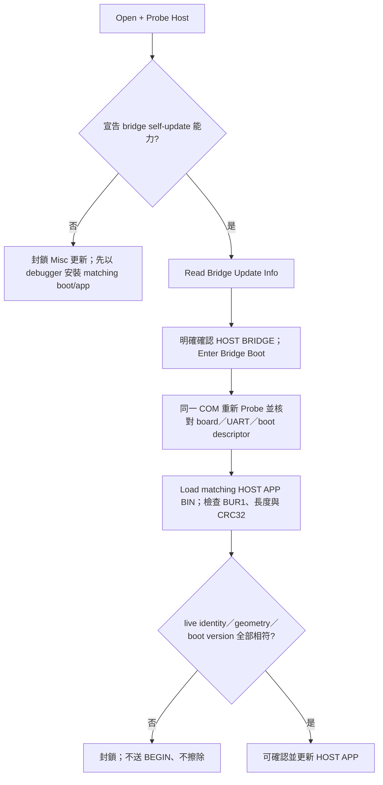
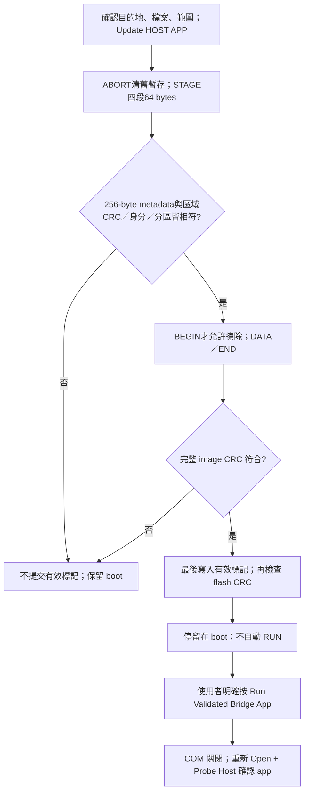
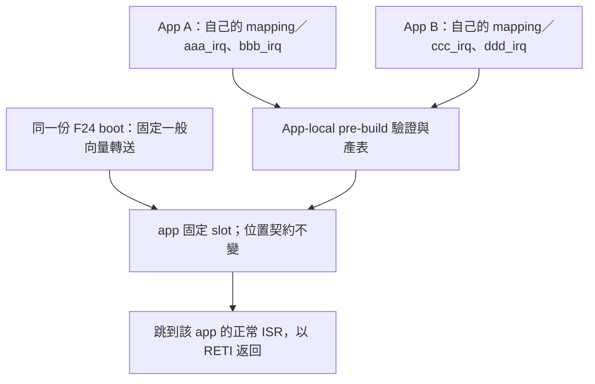
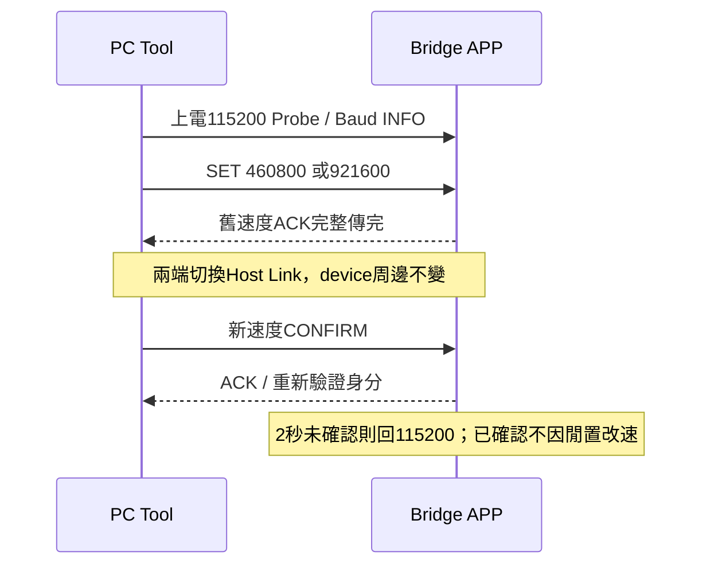
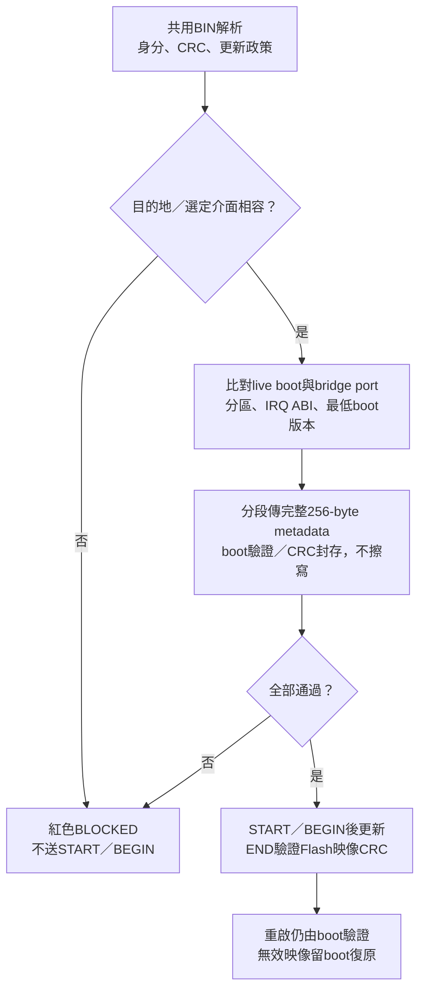

# 共用單畫面與 Bridge UART 更新指南

FirmwareUpgradeTool 0.1.0.0082 | 2026-10-15 | CAN工程第一版；完整故障矩陣未結案

本版 Host Link payload 上限改為128 bytes，完整 UART frame 最多142 bytes；不支援舊96-byte host，PC與bridge firmware須一起更新。metadata區固定256 bytes，目前有效core128 bytes，餘128 bytes填0xFF；code起點仍為app offset0x200。F13需重燒format6的matching boot/app；F24需安裝bridge contract3的matching boot/app，不能只用Misc替換舊app。

## 1. 一個畫面，三個工作區

以1366×768單畫面為目標：上方識別卡、左側介面設定、中間共用BIN／metadata／checksum、右側共用log、底部progress／elapsed。主視窗沒有上下捲軸，只有log歷史與下拉清單可捲動。五張卡於小畫面同列、大畫面分兩列，hover可讀全文。

BIN、檔案路徑、18個metadata欄位與log只有一份，不是每個TAB各建一套。

CAN 與 I2C TAB 只改變 port、speed、ID／mask 或 slave address 等介面參數與適用的 image contract。日後 UART device 也應加入同一層 adapter，不得另建 BIN／metadata／log console。最後一個 TAB 是 Misc，目的地為 host bridge，而不是外部 device。

0074 將 CAN／I2C／Misc 短標籤限制在左欄 INTERFACE SETTINGS 下方。
中欄 SHARED IMAGE / METADATA 與右欄 SHARED LOG 的標題與內容固定獨立，
不再放在跨全寬 TAB 下方。這是版面邊界調整，不是新增三份 BIN／metadata 資料。

| 顏色與文字 | 意義 |
| --- | --- |
| 綠色 READY／MATCH | 條件符合或資料完整性相符，不代表身分認證 |
| 藍色 OFFLINE／WORKING | 本地 BIN 資訊或執行中 |
| 黃色 REQUIRED／REFERENCE | 等待必要條件或僅為範例回報資訊 |
| 紅色 ERROR／BLOCKED | 錯誤、CRC 不符或不允許操作 |
| 灰色 N/A | 尚未取得或該協定未提供，不以 BIN 填入假裝是 live 資訊 |

## 2. 先分清楚 Host、Device 與 BIN

COM 清單的 USB friendly name 只用於辨識轉接器。必須 Open + Probe Host 後，才能知道實際 bridge board 的 board ID、韌體版本、能力與可選 port。UI 不預設一定是 F24，也不從 MCU 名稱推測 RA6 的 port 數量。F14／RA6 仍須實作並宣告相同 Host Link／backend contract，才能使用對應功能。

CAN／I2C 模式的 BOOT／INSTALLED APP 卡來自外部 device 的 live INFO；LOADED BIN 是離線檔案。Custom Transfer 不提供 boot/app metadata，所以顯示 N/A。G16 範例回報的版本是常數，使用黃色；其 erase/write/jump 仍封鎖。

Misc 的 BOOT／APP 卡改為 host bridge 自己的資訊，且目的地卡明確顯示 HOST BRIDGE。離線 BIN 仍獨立。CRC 是完整性檢查，不是簽章、授權或防回滾。

## 3. Misc：PC 透過 UART 更新 Host App

此流程不經 CAN，不經 I2C，也不是使用 500K CAN 發送切換命令。UART 連線與 CAN bitrate 相互獨立。



### 3.1 寫入與啟動分開

寫入與執行是不同動作，成功寫入後不會直接跳轉。



開始寫入前，確認視窗會列出目的地 HOST BRIDGE、COM、MCU part、檔案、app start 與大小。預設選 No。TAB 切換、載入檔案、Read Info 都不會擦寫。STAGE只有RAM暫存，缺段、衝突、總長／CRC／身分不符均不擦Flash。Read Info在有有效app時以相同READ_METADATA command、offset0/64/128/192讀回完整metadata並核對descriptor。更新完成也分段read-back核對；成功後仍需明確RUN。Close COM可取消，tool嘗試ABORT清除staging再關閉；BEGIN前取消不改舊app，BEGIN後不保證舊app仍在。

舊的 standalone bridge firmware 不宣告 self-update bit，所以 Misc 顯示不支援且不開放寫入；不會猜測位址或降級成 raw BIN。

## 4. F24 分區與建置

實際 MCU：R7F124FLJ3xFB，256 KiB code flash。依本次確認採 boot 20 KiB，app start 0x5000。最後 1 KiB 保留，不列入更新範圍。

| 區域 | 位址／容量 | 規則 |
| --- | --- | --- |
| Boot | 0x00000..0x04FFF，20 KiB | Misc 絕不更新 boot |
| Host app | 0x05000..0x3FBFF，235 KiB | 動態 image length，4-byte 對齊 |
| 保留區 | 0x3FC00..0x3FFFF，1 KiB | 包含 debug monitor，不可由 boot 擦寫 |
| IRQ 跳轉表 | app offset 0x000..0x0FF | 64 組四位元組 BR 入口 |
| BUR1 metadata區 | app offset 0x100..0x1FF | 256 bytes：core128／reserved128，區分HOST APP與外部device image |
| App code | app offset 0x200 起 | 由 linker 決定實際結尾 |
| CRC32 | 實際 image 最後 4 bytes | 對前面全部 bytes 計算，little-endian 儲存 |

區域容量256、有效core長度128、UART payload128、metadata chunk64是四個獨立尺寸。長度欄位原有8-bit仍表示core128，分段offset／total則使用16-bit；不把256塞進8-bit。最小image為516 bytes，避免最後CRC覆蓋metadata。未來reserved欄位啟用須升版，不能默默忽略未知必要欄位。

單一分區來源為 `firmware/f24_bridge_common/f24_bridge_layout.h`。唯一兩份 CS+ 產品專案是 `RL78_F24_Bridge_boot` 與 `RL78_F24_Bridge_app`；兩者引用 `firmware/f24_board` 的硬體來源。共用目錄沒有 MTPJ／可燒錄產物；不要在 projection 內另行修改 Smart Configurator 輸出。

參考專案硬體設定重新產生後，以 `scripts/prepare_f24_bridge_projects.ps1 -Kind app` 更新 app projection／專案；它保留 app-local mapping，不更新 boot。只有明確修改 boot 自己的設定才使用 `-Kind boot`；省略 Kind 仍表示同時產生兩者，不用於日常 app-only 更新。CS+ app pre-build 會產表，post-build 會檢查並封裝。

App 的 `DefaultBuild/*_bridge_update.bin` 是 Misc 要載入的檔案；`*_flash.mot` 是已加入 metadata／CRC 且排除低位向量、option、debug 區的初次 app 燒錄產物。不要把原始 app `.mot`／`.abs` 當成獨立可啟動韌體：device file 會產生未綁定的低位向量 placeholder。

首次安裝 Boot 仍需 debugger／programmer。可同時安裝 boot `.mot`＋matching app `_flash.mot`；也可只安裝 Boot，沒有有效 App 就留在 recovery，再於 Misc／115200 載入 matching `_bridge_update.bin`，驗證、更新後明確按 Run Validated Bridge App。Misc 不會更新 Boot。本次未執行任何實板燒錄。調整分區時必須重新安裝 matching boot，不能只換 app。

<!-- F24_APP_IRQ_BEGIN -->
### F24：各 app 專案獨立產表，沿用同一份 boot

Boot 固定轉送一般 IRQ 到 app start＋實體 vector×2；app 的64個4-byte slot
固定佔用 offset000h..0FFh。各專案決定 slot 要跳到哪個函式，boot 不認識
aaa_irq／ccc_irq 等 app 名稱。這項流程不改 UART boot、分區或 BUR1 contract3。



工程只保留兩個產品：Bridge_boot 是唯一 Boot；Bridge_app 是唯一正常 App。
f24_board 提供共用 board／driver／SC，不是第三份可燒錄韌體。
App 的 main、Host Link dispatch、CAN service 已回到 App 自己的目錄；
共用 UART／timer 僅依賴 f24_runtime_hooks.h，由 Boot／App 分別實作。
可攜式 I2C staging 在 common；分區／BUR1 支援在 f24_bridge_common。

SC 唯一設定為 firmware/f24_board/f24_board.scfg，輸出為同目錄 src/smc_gen。
搬移工作目錄後先執行 prepare_f24_bridge_projects.ps1 -Kind app 更新 SC 路徑，
由 App MTPJ 開啟並核對輸出位置。重產後再 prepare -Kind app、build App；
僅 Boot 自己的硬體設定改變才另行 prepare -Kind boot、build Boot。
prepare 讀取各自既有 MTPJ，保留 build options／hook 與 App JSON，不再複製第三個專案。
SC 新位置的 GUI 重產仍待操作確認；目前已驗證現有設定、來源與乾淨編譯。

每個 app 根目錄保存兩份來源：app_irq_handlers.json 對應實體 vector 與
函式名；app_image.json 保存自己的 packed version／build。產生的
bridge_vectors.asm 與 f24_app_identity.generated.h 不可手改；版本同時用於
Host Link 回報及 BIN metadata，不必修改共用 boot layout header。

```json
{"0x08":"aaa_irq","0x0A":"bbb_irq"}
```

上例只展示新增 IRQ；從 bridge 範例建立專案時，必須保留仍有使用的 UART／
timer／CAN／I2C mapping，不可用這兩筆覆蓋必要的清單。B 專案可改用其他合法
vector／函式名。來源需加入該 app MTPJ；ISR 必須 global、非 static、正常
interrupt pragma 且無 vect=，函式定義為 void handler(void)，以 RETI 返回。
未用的 IRQ 必須停用或遮罩，預設 RETI 不會替你清除周邊原因。

整合順序：

1. 以已整合的 F24 split app 為範本，建立自己的 app 專案；每個資料夾一份
   MTPJ。保留 R7F124FLJ3xFB、BRIDGE_SPLIT_APP、startup／4KiB stack／
   FF700與FF710保留、app5000／code5200／末1KiB保護等契約。不是任意
   standalone 專案加入 JSON 就能完成整合。
2. 複製專案時一併保留自己的全部 App .c／.h、generated_projection、兩份 JSON
   及 bridge_vectors.asm 的專案登錄。若移到不同目錄，先在 CS+ 修正相對
   source／include／library／preinclude 路徑；不要重新產生或覆寫共用 boot。
3. CS+ pre-build 呼叫 prepare_f24_app_irq.ps1 -AppProject "."；post-build
   呼叫 package_f24_bridge.ps1 -Kind app -AppProject "."。腳本路徑指向
   tool 的 scripts，跨目錄專案請使用正確完整路徑；不要呼叫雙專案 prepare。
4. 登錄各 app 自己的 ISR、修改 mapping／app_image.json 後，只執行：

```powershell
.\scripts\build_f24_bridge.ps1 -Kind app -AppProject "D:\MyApps\ProjectA"
.\scripts\build_f24_bridge.ps1 -Kind app -AppProject "D:\MyApps\ProjectB"
```

也可從 CS+ clean rebuild，hook 會自動執行。只驗證產物是否最新使用
prepare_f24_app_irq.ps1 -AppProject 專案路徑 -CheckOnly，不會寫檔。
產表不讀其他 app 的 IRQ 清單；build 的 -AppProject 與 -Prepare 不可併用，
避免誤重建參考專案。App-only 操作不產生／編譯／寫入 boot。

封裝依各 MTPJ 檔名找 DefaultBuild 下的 map／MOT，輸出各自的
專案名_bridge_update.bin／專案名_flash.mot。除原本分區、stack、flash/RAM、
metadata／CRC 檢查，還逐 slot 比對實際 branch 與 mapping，核對 ISR 的
真實 RETI／保留 BRK slot 的 RETB。Physical BRK 仍不轉送。Build 失敗時
舊 BIN 可能仍保留，不得把前次產物當成這次成功輸出。

本輪 A／B 實際 CC-RL 編譯與封裝、不同 mapping／版本、輸入拒絕及 boot
向量／MTPJ／MOT 雜湊隔離測試通過；測試沒有啟用新 IRQ，也沒有燒錄 MCU。
先安裝policy contract3 matching boot/app；之後相容的app-only IRQ改動不需重燒boot。
CAN區塊更新需要bridge宣告泛用CAN burst22／bit12，以live能力判斷，不以版號猜測。
已有相容Boot時，可用Misc115200更新App。實板只換 app、新舊 IRQ／UART ENTER、reset／斷電
與 E2 lite 仍待驗證。
F13 保留既有 app-local mapping 流程；未新增 F13 I2C boot。

若舊F24 App重新連線時INFO成功、接著0x57回BAD_COMMAND，可能是外層分派
漏了READ_METADATA。應安裝包含完整metadata讀回支援的App，不可略過驗證。復原方式：

1. 關閉COM，按住實體SW1（P32，LOW），同時重置／重新上電，讓既有Boot留在recovery。
2. 開啟Tool，Host Baud115200，Open + Probe Host；確認live顯示BOOT。
3. Misc重新Load Update Image，選交付套件中與此Boot相容的_bridge_update.bin，確認metadata及CRC。
4. Update HOST APP成功後另按Run Validated Bridge App；再重新Probe並關閉／重開Tool確認實際App身分。

若Boot、分區與IRQ契約仍相容，不必重燒Boot。步驟為source／mock驗證，實板復測待補。
<!-- F24_APP_IRQ_END -->

## 5. MCU 程式與硬體注意事項

Boot UART 使用 HOCO40 與 115200；app 沿用已確認的 X1 20 MHz、PLL80、CPU/CAN40 設定。CAN TX/RX=P10/P11，STB=P12；UART TX/RX=P15/P16；IICA0=P62/P63。不能直接複製其他 package 或 F13 的 clock／flash library 設定。

RFD Type02 與執行中的 flash driver 都必須從 RAM 執行；programming mode 期間禁止 code flash 的程式、常數或 IRQ 取用。程式已使用 RAM relocation、關閉 IRQ、有限次數 sequencer polling，回到 non-programmable mode 才回傳；無法安全恢復時由 RAM 重置並留在 boot。這些是 source／linker 檢查，不是實際電氣與 flash 時序驗證。

明確配置 4 KiB stack，避免自動 stack 初始化覆蓋 FF700 的 recovery cookie 與 FF710 的 IRQ dispatch selector。BEGIN 僅可擦 app 區；DATA 連續且四位元組對齊。有效 manifest magic 最後才寫入；完整 image CRC 不符、傳輸未完成、重上電遇到無效 image 都不能跳 app。SW1 可要求 boot recovery。

0x7E 的 BRK 是軟體中斷，需要 RETB 而非一般 IRQ 的 RETI；boot 不覆寫／轉送該 physical vector，保留給 debugger／device file。App 表仍保留對應 slot。CS+ halt、continue、stop 與 E2 lite 連線仍須實際測試。

CAN analyzer self test 的資料為 standard ID 0x123、DLC8、`11 22 33 44 55 66 77 XX`，每秒一次；每次開始 XX 從 00 遞增。須搭配 CAN analyzer 觀察實體 bus，UART TX log 不能證明實際波形正確。

F13 EVB 的 TJA1050T VCC 必須符合 5 V 工作條件，S/STB 為 LOW；先前 3.3 V 造成收發錯誤已由使用者改 5 V 後排除。CAN H/L 終端、共地、時鐘與 analyzer bitrate 仍需量測確認。

## 6. 已驗證與尚待驗證

0080修正共用PC串口接收：有資料即返回，不再等短回覆的20ms讀取逾時；
無資料才按剩餘期限、每次最多50ms等待。保留分段parser／CRC／取消／重送，
未改F13/F24韌體、baud預設或FTDI驅動。50ms不是逐包延遲。
使用者0079實板log164225與UART截圖已證明一次F13 CAN更新／reset／App啟動：
19224B、4806筆DATA、約142秒／135B/s、CRC1DE10DCD，錯誤與重送皆0。
使用者0080 log171150同BIN／CRC的DATA約77秒、完整約79秒，trace有缺行。
0082以64-byte／一次ACK及8-byte raw frame減少往返，需F24 App1.5.0與F13配套v5。
使用者182253 log已確認COM6／115200重新Probe為F24 App1.5.0，完整metadata讀回；
F13更新19244B、301區塊／10963ms／1755B/s，END CRC CA0DF55C相符且無重試／CAN錯誤。
這不替代Misc完整擦寫／RUN trace或F13 reset後App證據；高速與多次效能仍待測。
交付檔案與SHA-256見[第一版交付說明](FIRST_DELIVERY_20261015_zh-TW.md)。
詳見[CAN v5指南](CAN_BLOCK_TRANSFER_V5_zh-TW.md)。

0079同時避免啟動欄位EN_CHANGE在INI路徑建立前儲存造成空路徑error5。
載入完成前不儲存、底層拒絕空路徑；真正檔案拒絕存取仍保留完整路徑與錯誤碼。

0078 修正更新時底部進度文字被裁切：操作名稱與百分比強制單行，依實際字型
量測並預留「100%」寬度；進度條使用剩餘空間，耗時與版本資訊保持在底部列內。
只有操作名稱改變才重新配置，不會每筆進度都重排。已測長名稱及100／125／150%
字體幾何；實際桌面DPI、更新畫面截圖仍待驗證，不代表實板更新通過。

安全自動驗證：PC Release／Debug 編譯、既有 CAN／F13／I2C tests；共用 console 幾何；BUR1 身分／geometry／CRC 拒絕；實際 C parser／engine 與 PC uploader 端對端；60K／110K 長度；分塊重送不二次擦寫；commit 前重啟、錯位移與 flash failure；F24 clean rebuild 與 linker／封裝檢查。

尚待實際驗證：1366×768 啟動、TAB 切換無殘影、100%／125% DPI，以及0078更新進度列的實際畫面；真實 UART 進 boot、IRQ handoff、app 啟動、RFD erase/write、取消／斷電／CRC 故障復原。Computer Use native pipe 仍回報 os error 2，無法進行 UI 目視檢查。離線 layout／GDI量測 PASS 不等於目視 PASS，流程圖不是實際測試截圖。

新 F24 boot/app 為待實板驗證整合版本。先備份既有可用韌體與接線；實板驗證後才補上 tool log、UART／CAN trace 與操作截圖。既有 web slides 本輪未發布或推送。

<!-- COMMON_IMAGE_POLICY_BEGIN -->
## 共用 Metadata 與跨介面防呆

Metadata固定256 bytes：前128 bytes為已定義內容（含32-byte UPD1政策），
後128 bytes必須為0xFF；app code仍從offset0x200開始。舊core96格式不相容。

| UI資訊 | 意義 |
| --- | --- |
| Update Policy | DEVICE APP或HOST APP，以及允許CAN／I2C／UART更新的清單 |
| Boot / IRQ ABI | 映像要求的最低boot版本，以及固定向量介面識別 |
| MCU、版本、分區、CRC | 仍來自載入BIN；不以目前TAB或在線device補造 |

允許更新介面不是app執行時使用的周邊。CAN-only BIN切到I2C仍顯示原本
MCU／版本／CRC32與政策，卡片及政策欄變紅並封鎖更新；不改解讀為G16 raw BIN。
Misc的目的地是HOST BRIDGE APP，不能拿DEVICE APP更新host。
PC到bridge的Host Link UART不算device更新介面；未實作UART device adapter。

上方Baud只管PC到bridge：上電115200，驗證APP支援後可協商460800／921600。
CAN／I2C／未來第二組UART不跟著換速。UART device映像的UPD1 policy version2
在metadata112..115宣告編譯時固定的device_uart_baud，Tool顯示UART @固定值，
不能由Host Link選單覆寫。boot/app須共用target編譯設定；version1 CAN／HOST
BIN保持原值與相容性。BUR1的uart_baud另指bridge自身BOOT固定更新速度。
目前僅準備UART policy解析、build helper與防呆；未提供UART device燒錄流程。

正常Close會盡力回115200；異常斷線後只對選定COM有限探測三組速度。
Misc ENTER改以BOOT描述器的固定baud重連，現行115200，不沿用APP高速。
F24分頻計算值115200→114942、460800→454545、921600→909090；Tool log
會列名義／計算值。高速度的FTDI、時鐘誤差及負載可靠性仍待實板驗證。

更新路徑必須同時受BIN政策、live boot能力、bridge選定port支援；並通過
MCU／target／分區／protocol／IRQ ABI／最低boot版本／CRC檢查。
UI與worker皆檢查，device boot在首次擦寫前再驗證完整metadata，不能只靠按鈕。
切換介面不能沿用另一介面的探索結果；port／address／rate改動後必須重新確認。

F13使用CAN protocol5、image format6，DEVICE_APP／CAN／F1V1。
F24使用BUR1 contract3，HOST_APP／UART／F2V1。
平台首次安裝須有matching Boot/App；不同更新協定或IRQ契約不能任意混用。
已有matching Boot時，可用Misc更新相容的Host App；Misc不更新boot本身。
精確配套版本與映像雜湊以交付說明、live INFO及BIN metadata為準。
已固定的完整一般向量轉送架構不變，未來相容app新增中斷仍只更新app。

G16新版I2C boot/app依使用者要求延後開發；舊範例保留參考及read-only探索，
不提供erase／write／app jump，也不因tool新增metadata就視為可安全更新。

正常更新／END CRC成功，不代表reset後App已執行，也不代表完整故障驗收。
自動測試包含錯映像、介面／目的地不符、
metadata重送／缺段／CRC錯、重設與768個模擬中斷寫入點。這不是實板斷電驗證；
實體CAN／FSL故障、UART斷線、
最大映像CRC耗時、debug／IRQ、斷電復原及1366×768／DPI視覺驗證仍需板測／目視。
CRC提供完整性，不是簽章、身分認證或防降版。




<!-- COMMON_IMAGE_POLICY_END -->
