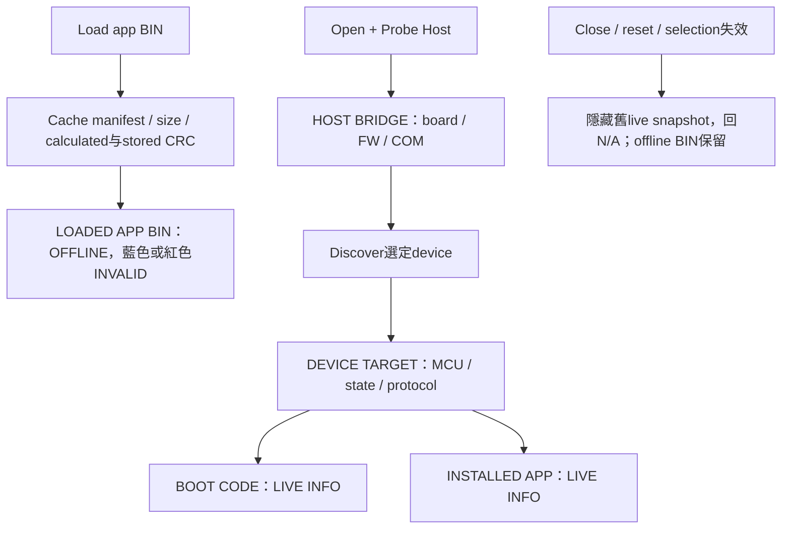

# FirmwareUpgradeTool 主機、裝置與映像資訊卡

2026-10-15 | 0.1.0.0070 | UI source / mock tests；實際桌面截圖與DPI待驗證

## 1. 先分清五種資訊

| 卡片 | 資料來源 | 確認重點 |
| --- | --- | --- |
| HOST BRIDGE | binary UART GET_HOST_INFO | host family、COM、board ID、FW version/build、Host Link v2 |
| DEVICE TARGET | CAN INFO / Transfer DEVICE_INFO，或G16 reference signature | device MCU/target、目前Application / Bootloader / Transfer mode |
| BOOT CODE | 當前device INFO | boot version/build、boot reserve、app start |
| INSTALLED APP | 當前device INFO | 板上app version/build、installed size、capacity；不是read-back CRC |
| LOADED APP BIN | 本機image inspection | app version/build、MCU/start、實際size；不會填入live資訊 |

Host目前回報的是board family/ID，不含精確silicon part number。
COM friendly name只幫助選adapter，不證明MCU identity；必須Open + Probe Host。
Device MCU family/part來自CAN metadata，而非COM或BIN推論。

## 2. 顏色與文字都要看

| 顏色 | 文字意義 | 限制 |
| --- | --- | --- |
| 綠色 | VERIFIED LINK / LIVE INFO，protocol資料已探索 | 不等於身份認證、firmware簽章或flash read-back |
| 藍色 | LOADED APP BIN / OFFLINE | 僅本機檔案，不能证明板上版本 |
| 琥珀色 | REPORTED CONSTANT / 等待必要條件 | G16範例常數不是實際installed image驗證 |
| 紅色 | INVALID / ERROR / BLOCKED | 檢查log、CRC/metadata欄位與prerequisite；不可跳過 |
| 灰色 | N/A / unavailable | 尚未探索、未載BIN或此protocol不提供 |

卡片主值加粗、字型量測後換行與增高；hover可讀完整內容。
小高度視窗用右側捲軸查看log。未知資料保留N/A，不填猜測的0或固定F13/F24值。

## 3. Offline 與 live 的資料流

Custom Transfer不包含boot/app資訊，因此兩張卡N/A，不把Transfer韌體當boot。
G16 signature的boot/app版本為reference回報常數，顯示琥珀色；Start Update保持BLOCKED。
更換I2C port、speed或address後重新Probe；斷線時不能繼續把舊資料當current。

## 4. BIN 與地址安全

CAN BIN size是實際檔案長度，含尾端4bytes CRC32；capacity只是最大app區。
Calculated CRC32排除最後4bytes，Stored為尾端LE32；MATCH仍須metadata validation。
32K/60K/80K/110K可變，仍要符合minimum/capacity、4-byte alignment、MCU/protocol/layout/CAN。
App Start Override Auto使用BIN metadata start；手動值必須與image/device一致，不能重定位已compile app。
Boot/app/data區調整須在device linker與metadata同步定義，tool不猜保留空間。

G16 raw BIN使用不同CRC16/XMODEM規則，沒有MCU/version/start manifest，不能套用CAN metadata。
Bridge變速經UART SET_CAN_CONFIG（bus stopped），不會自動改device bitrate。

## 5. 功能截圖與驗證狀態

新版UI screenshot / Release與Debug startup / 100%與125% DPI：NOT RUN。
Computer Use native pipe os error2，retry及session reset後仍不可用。
Web browser surfaces也不存在，因此網頁外觀未宣稱PASS；HTTP、靜態連結與Mermaid另行檢查。

既有使用者Transfer benchmark PCAN與MCU log只證明非破壞性傳輸；不是新版UI或Boot/App更新證據。
Device firmware ready後補App INFO、Enter、Boot INFO、更新確認、progress、新版確認与故障復原。
I2C須先修正slave READ/auth/boot CRC/recovery，不為截圖開放不安全擦寫。
本輪不更改MCU firmware、不燒錄、不觸發bus traffic，不發布網站。
