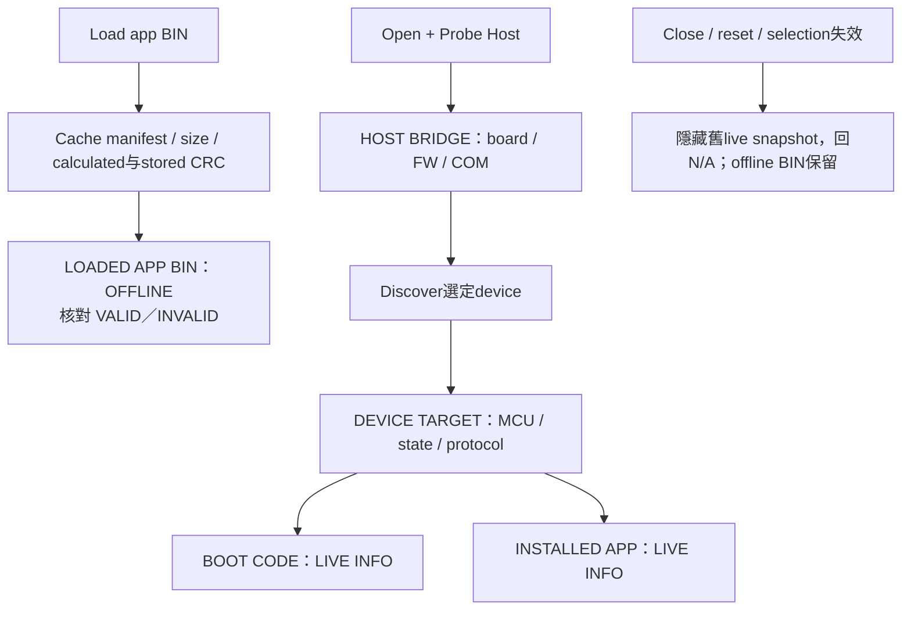

# FirmwareUpgradeTool 主機、裝置與映像資訊

本文件整理連線裝置與載入映像的資料來源。
各欄位、狀態及錯誤訊息的完整對照見 [Tool 欄位說明](https://released.github.io/slide_isp_tool_for_RL78/#tool-ui-fields)。

## 1. 五種資訊來源

| 資訊區 | 資料來源 | 確認重點 |
| --- | --- | --- |
| HOST BRIDGE | binary UART GET_HOST_INFO | host family、COM、board ID、FW version/build、Host Link v2 |
| DEVICE TARGET | CAN INFO / Transfer DEVICE_INFO，或G16 reference signature | device MCU/target、目前Application / Bootloader / Transfer mode |
| BOOT CODE | 當前device INFO | boot version/build、boot reserve、app start |
| INSTALLED APP | 當前device INFO | 板上app version/build、installed size、capacity；不是read-back CRC |
| LOADED APP BIN | 本機image inspection | app version/build、MCU/start、實際size；不會填入live資訊 |

Host 的 board family／ID、MCU 與 firmware 資訊來自實際 Probe 回覆。
COM friendly name只幫助選adapter，不證明MCU identity；必須Open + Probe Host。
Live device MCU family／part 來自 device 的 CAN 回覆，而非 COM 或載入 BIN 推論。

## 2. 分組、狀態顏色與文字

畫面採系統灰／白與群組邊框；連線、映像資訊、周邊設定、更新操作及 Log 分區呈現。
狀態顏色用於結果與必要條件，不以整片底色代替 host、device 或 offline 身分文字。

| 顏色 | 文字意義 | 限制 |
| --- | --- | --- |
| 綠色 | OK／VALID／MATCH／READY 等條件成立 | 不等於身份認證、firmware簽章或flash read-back |
| 藍色 | WORKING／資訊性提示 | 身分仍依 LIVE／OFFLINE 及資料來源文字判讀 |
| 琥珀色 | REPORTED CONSTANT / 等待必要條件 | G16範例常數不是實際installed image驗證 |
| 紅色 | INVALID / ERROR / BLOCKED | 檢查log、CRC/metadata欄位與prerequisite；不可跳過 |
| 灰色 | N/A / unavailable | 尚未探索、未載BIN或此protocol不提供 |

資訊主值加粗，BIN metadata 依欄位用途分組。
Log 歷史可捲動，主視窗不以整頁捲軸切換資訊；未知資料保留 N/A，不填猜測值。

## 3. Offline 與 live 的資料流

Custom Transfer不包含boot/app資訊，因此兩個資訊區為N/A，不把Transfer韌體當boot。
G16 signature的boot/app版本為reference回報常數，顯示琥珀色；Start Update保持BLOCKED。
更換I2C port、speed或address後重新Probe；斷線時不能繼續把舊資料當current。

## 4. BIN 與地址安全

CAN BIN size是實際檔案長度，含尾端4bytes CRC32；capacity只是最大app區。
Calculated CRC32排除最後4bytes，Stored為尾端LE32；MATCH仍須metadata validation。
32K/60K/80K/110K可變，仍要符合minimum/capacity、4-byte alignment、MCU/protocol/layout/CAN。
App Start Override Auto使用BIN metadata start；手動值必須與image/device一致，不能重定位已compile app。
Boot/app/data區調整須在device linker與metadata同步定義，tool不猜保留空間。

G16 raw BIN使用不同CRC16/XMODEM規則，沒有MCU/version/start manifest，不能套用CAN metadata。
Bridge變速經UART SET_CAN_CONFIG（bus stopped），不會自動改device bitrate。

## 5. 操作圖與驗證範圍

COM 連線、Device App 更新與 Host App 更新的實際畫面集中於 [Tool 操作圖](https://released.github.io/slide_isp_tool_for_RL78/#device-update-example)。
F13 與 F24 device 的正常 CAN App 更新、CRC 及重啟後 App 確認皆已完成實板驗證；
F24 的報告與 UART counter 見 [更新結果](https://released.github.io/slide_isp_tool_for_RL78/#f24-device-update-example)。

畫面中的 PASS 描述該次操作，不涵蓋其他速率、所有 IRQ 或斷電復原。
各項測試與證據範圍集中於 [更新驗證矩陣](https://released.github.io/slide_isp_tool_for_RL78/#update-confirmation)。
