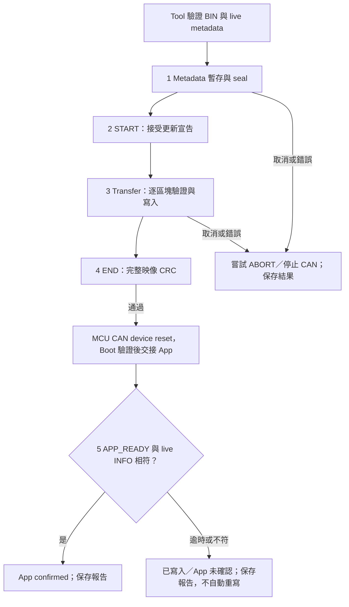

# 更新結果確認與驗證紀錄

<!-- UPDATE_EVIDENCE_BEGIN -->
<a id="update-confirmation"></a>

## 更新確認、差異表與報告

更新流程把「資料已寫入」與「App 已開始執行」分開記錄。
CAN device 更新完成後由 Tool 自動確認 App；Misc 的 RUN 仍由使用者明確執行。
[MD 原稿](https://github.com/released/simple_renesas_isp_tool/blob/main/docs/UPDATE_VALIDATION_zh-TW.md)／
[PDF](https://github.com/released/simple_renesas_isp_tool/blob/main/docs/UPDATE_VALIDATION_zh-TW.pdf)提供離線說明與測試表。

| 操作 | 成功條件 | 未確認時 |
| --- | --- | --- |
| CAN Start Device Update | metadata、START、所有區塊及 END CRC 通過；同一路 CAN 收到 APP_READY，再取得 live INFO，版本／build／實際大小與載入 BIN 相符 | 顯示 END 已完成但 App 未確認；不自動重寫 |
| Misc Update HOST APP | 完整映像 CRC、有效標記與 256-byte metadata readback 通過 | 保留 Boot，顯示階段與原因 |
| Misc Run Validated Bridge App | RUN 只送一次；Tool 自動在同一 COM、115200 重連，核對相同 board ID、APP mode、完整 metadata、版本／build／大小 | 顯示 RUN 未確認；不重送 RUN、不自動擦寫 |
| Compare Metadata | 開啟 Loaded image／Live device 差異表 | 未取得 live 資訊時不以 BIN 補成 live |
| Verify Installed | CAN device 停留 Boot、無更新 session；重新計算已安裝映像 CRC，核對尾端 CRC | 回報 metadata／CRC／狀態錯誤，不擦寫 |

重連等待有時間與次數邊界，可由 Cancel 結束。
CAN 確認沿用現有 Host Link 與 CAN 路由，不會重新掃描其他 COM。
版本等摘要與健康回覆是目前執行的韌體回報，不是簽章或功能完整性的認證。



### 差異表與分階段進度

<a id="force-old-version"></a>

#### 版本政策與 force upgrade old version firmware

版本政策只有一個設定來源：MCU 目前有效 App 的 metadata。
Tool 的 `Installed Policy` 顯示目前政策，`BIN Version Policy` 顯示成功更新後將採用的設定；不提供另一個常駐開關。

| 已安裝 App 的 version control | 舊版 BIN | 同版 BIN | 新版 BIN |
| --- | --- | --- | --- |
| `0`，disable（預設） | 允許 | 允許 | 允許 |
| `1`，enable | 一般更新拒絕 | 允許 | 允許 |

比較的是 App major／minor／patch，不是 build 日期，也不是 Boot 版號。
較舊 BIN 即使設定 disable，仍須先通過目前政策；新政策只在成功更新後生效。
欄位修改與位址見 [Device App 設定](https://released.github.io/slide_boot_loader_for_RL78/#device-app-config)。

需要有意降版時：

1. 在 CAN TAB 載入目標 App BIN，Probe host、Discover device 並 Enter Boot。
2. 核對目前與目標版本。一般更新被版本政策擋下時，點選 `force upgrade old version firmware`。
3. 在密碼輸入對話框輸入 **3036**。輸入內容遮蔽顯示，不寫入 INI 或 log；取消或密碼錯誤時尚未開始更新。
4. 再確認目前版本、目標版本、檔案、範圍與 CRC；按 Yes 後僅放行這次更新。
5. 等待 END 與 App confirmed，保存自動報告；報告記錄 `force_old_version`、更新前版本及政策，不記錄密碼。

Worker 在送出前重新讀取 live device；若已安裝版本與確認時不同，就停止並重新確認。
Boot 的 `FORCE_START 0E` 只略過該次 START 的版本比較，仍檢查 metadata、target、介面、IRQ ABI、minimum Boot、分區、size 與 CRC。
不在 Boot、Tool 或 INI 保存解鎖狀態；下一次操作仍走一般政策，重試也只屬於同一更新交易。

`3036` 是公開的維護確認碼，用於減少誤操作，不是安全認證。
CAN 請求沒有簽章或身分認證；此功能不作為防止有意修改韌體的安全保護。
目前沒有獨立保存最低版本；若 App 因更新中斷而失效，Boot recovery 不再保留先前版本限制，重新驗證映像後可更新。

#### Metadata 差異表

Compare Metadata 位於共用映像區，CAN 與 Misc 共用相同檢視方式。
表格含 Field、Loaded image、Live device、Check；顏色同時搭配文字。

| Check | 顏色 | 意義 |
| --- | --- | --- |
| MATCH | 綠色 | 值一致，或滿足最低 Boot／允許介面條件 |
| CHANGE | 黃色 | 即將更新的版本、build、大小不同；這是資訊差異，不是相容性錯誤 |
| MISMATCH | 紅色 | 身分、分區、IRQ ABI、介面或其他契約不符；不能更新 |

底部顯示當前階段及該階段的百分比，不把傳輸 100% 當成整次更新完成。
CAN 分為 Metadata／START／Transfer／END CRC／Confirm App；Misc 分為 Metadata／BEGIN／Transfer／CRC-readback。
FLASH erase 的時間包含在對應區塊／BEGIN 交易中，不以推估值另報成精確硬體擦除時間。

Cancel 與 Close COM 分開。
Cancel 由 worker 在交易邊界停止，嘗試 ABORT 與必要的 bus cleanup，不額外要求 COM 斷線；Close COM 則在清理後再斷線。
若作業本身正在重連，取消時可能尚未建立新的 COM 連線。
已送出的 Flash 操作不能以 PC 按鈕立即撤回；END 後取消確認不會復原映像。

### 自動報告與 Host 診斷

<a id="update-html-report"></a>

CAN 更新、Misc 更新及 Misc RUN 結束時，Tool 在 EXE 旁的 `reports/` 自動儲存同名的 UTF-8 JSON 與 HTML。
成功、失敗與取消都有紀錄；檔案以時間與唯一尾碼區分，不覆寫既有報告。
目錄或寫檔失敗會顯示在 shared log，並保留手動 Export Summary。

| 產物 | 閱讀與使用方式 |
| --- | --- |
| HTML 更新報告 | 瀏覽器離線開啟；顯示結果、Host／Device、BIN CRC／身分、階段時間、counter 範圍與檢查建議 |
| JSON 更新報告 | 保留結構化欄位，供測試程式、紀錄比對及自動化使用 |
| App 編譯報告 | 記錄建置產生的 BIN、Metadata 與向量表；見 [編譯報告](https://released.github.io/slide_boot_loader_for_RL78/#device-app-build-report) |

更新報告對應實際 Tool 作業；編譯報告對應建置產物，兩者用途分開。
`Open Last Report` 開啟本次 Tool 執行期間最後成功儲存的 HTML；尚未產生時按鈕不啟用。
也可直接從 `reports/` 開啟歷史檔案。報告不自動開啟瀏覽器，無外部腳本或資源需求。

產生、編碼與寫檔由 worker 執行。
檔案先寫入暫存檔並完成 flush，再以不覆寫既有檔案的方式發布。
若其中一種格式儲存失敗，log 分別列出已完成的檔案及錯誤；報告儲存失敗不改寫裝置更新結果。

| 報告欄位 | 內容／範圍 |
| --- | --- |
| operation／result／message | 更新目的地、PASS／FAIL／CANCELED、失敗原因 |
| recorded_at_utc | 報告建立時間，UTC ISO 8601 |
| failure_guidance | 保留原始錯誤、作業／COM／Host Baud／階段及對應檢查建議；成功時為空 |
| host／port／host_baud／can | 本次選定的 Host 身分、COM 與速度、CAN 設定 |
| elapsed_ms／phases_ms | 整次作業與各階段耗時；不是 analyzer 測得的 bus time |
| details | 映像 CRC／大小／版本／build、已 ACK 區塊、ABORT 與 App 確認結果 |
| host_deltas | 本次 CAN 更新前後的 UART overflow、CAN lost／TX failure／bus-off／recovery 差值 |
| host_peaks | Host 自開機或 CLEAR_STATS 起的 queue 高水位、最長等待／交易／dispatcher 時間；不是本次區間峰值 |
| link_retries | 本次 Host Link 重試；已知重連重設時為 null，不當成零 |

<a id="tool-preflight"></a>

### 更新前檢查摘要

在共用映像區按下 `Preflight`，可於未連線或未載入 BIN 時先查看缺少的條件。
摘要使用目前 UI／session 快照，不傳送 command，也不執行擦寫。

| 範圍 | 摘要內容 |
| --- | --- |
| 共用 | 已驗證的 live Host、載入 BIN／CRC、目的地與介面 |
| CAN device | CAN Upgrade workflow、live Device／Boot、Host burst 能力、選定模式／速度、App start、版本政策及 Metadata 差異 |
| Misc Host App | live Boot、Flash ready、固定更新 UART 速度、HOST BIN、board／分區／IRQ／minimum Boot 契約 |
| I2C reference | 選定的 port／speed／address 是否已探索，以及該 adapter 的唯讀操作範圍 |

標題顯示未滿足的條件數；`MATCH` 與 `MISMATCH` 分別搭配綠色、紅色，版本等資訊差異以 `CHANGE`／黃色表示。
`Compare Metadata` 保留完整映像／live 欄位對照。
摘要不保存操作許可；開始更新時，UI、worker 與 Device 仍執行各自的即時檢查。

<a id="tool-error-guidance"></a>

### 錯誤資訊與檢查指引

操作失敗視窗保留原始錯誤，附上 Layer、作業、COM、Host Baud 及可取得的階段。
`Error Details` 可再次開啟目前作業的錯誤與檢查建議。

| 分類 | 可檢查的資訊 |
| --- | --- |
| PC／Host Link | COM 選擇、其他 terminal 占用、Host 電源、Host Baud；Boot 更新採固定速度 |
| Host／CAN controller | 回傳的 command／status／CAN error detail、Host clock、transceiver 與 bus 設定 |
| Host／Device bus | Bridge port、接線、終端、Device 電源、速度、request／response ID；搭配 analyzer trace |
| Image／Device contract | Preflight、Metadata 差異、MCU、分區、介面、IRQ ABI、CRC |
| Device version policy | 已安裝版本政策與映像版本；維護操作見 [版本維護](#force-old-version) |
| Device Flash | Flash 回覆、供電、Boot recovery 與重新探索 |
| App confirmation | 已寫入／END 與 App 啟動確認分開，保留未確認結果及證據 |

分類提供檢查方向，不作為實體故障原因的判定。
未知錯誤保留原文；Tool 不因檢查指引而自動重送擦寫或 RUN。

<a id="tool-com-hints"></a>

### COM 拔插與裝置提示

COM 清單保留 Windows 友善名稱，通訊仍只使用標準 COM 名稱。
成功 Probe 後，Tool 可在本機 INI 記錄該 port 與可取得的 Windows PnP instance hint。
這是 USB adapter 的選擇提示，不是 MCU Host 身分認證，也不推定所有 adapter 都具有唯一序號。

Windows 通知裝置清單變更後，Tool 會延後至 worker 閒置且 COM 已關閉時更新清單。
原 port 消失、被不同 Windows 裝置使用，或相同 hint 出現在其他 COM 時，log／狀態區提供提示。
原選擇消失時不自動改選另一個 port；使用者明確選擇後，再執行 `Open + Probe Host`。
重複 hint 或無法取得 hint 時，以明確選擇與實際 Probe 結果為準。

拔插通知不開啟其他 COM、不關閉 worker 持有的連線、不自動重連或重寫。
PnP hint 僅保存於本機設定，不輸出到更新報告；分享設定、截圖與 log 前可檢查個人資訊。

### Host 計數器與停留原因

Host 計數器飽和、可辨識的重設（例如計數回退）或缺少有效快照時顯示 unavailable，不把無法比較的值當成零。
計數快照不含開機序號；若 Host 重啟後計數已超過先前快照，僅靠差值無法辨識這次重啟。
Misc 會跨 Boot／App reset，故不將這兩邊的 counter 相減。
時間診斷單位為 1 ms，低於解析度的值可以是 0；queue 水位以 bytes 或 frames／pending transactions 表示。

| Host Boot 停留原因 | 判定 |
| --- | --- |
| No valid App | 尚無有效映像標記 |
| Metadata invalid | metadata 結構／保留區不符 |
| Contract mismatch | MCU／board／分區／更新契約不符 |
| CRC mismatch | 已安裝映像完整 CRC 不符 |
| SW1 recovery | recovery 按鍵要求停留 |
| Flash failure | Flash 初始化／擦寫失敗 |
| ENTER request | App 明確要求進 Boot |
| Update complete | END 驗證完成，等待使用者 RUN |

### MCU CAN device 健康回覆與唯讀驗證

APP_READY 與 INFO 分開：INFO 是描述資訊；APP_READY 表示必要初始化完成且本機檢查通過。
目前參考 App 的本機檢查為 clock、CAN 初始化與已觀察到 timer IRQ。
新增應用功能時，可將其必要檢查接入 App 的 readiness 判定；不需要因而改動固定 IRQ 轉送介面。

| CAN frame | 格式／意義 |
| --- | --- |
| Health request | control request ID，DLC2：`07 1B` |
| Diagnostics capability | INFO page `1C`，LE32 bit0 health、bit1 Boot VERIFY、bit2 細分錯誤；Tool 依 live bit1 啟用 VERIFY，不從 MCU 名稱／版號推測 |
| Health response | response ID，DLC8：`07 status 1B state health0 health1 health2 health3` |
| health byte0 | `01`＝READY，`00`＝尚未 ready |
| health byte1 | bit0 clock、bit1 CAN、bit2 timer；目前全通過為 `07` |
| health byte2 | bit0 由 Boot 交接、bit1 本次完成更新 |
| health byte3 | MCU RESF reset flags；對照該 MCU 硬體手冊 |
| VERIFY request | control request ID，DLC1：`0D` |
| VERIFY response | response ID，DLC8：`0D status 00 00 crc0 crc1 crc2 crc3`；映像範圍由 live INFO 的 App start／installed size 對照 |

VERIFY 在 Boot 無 active update 時執行，只讀 Flash。
Tool 只有在對應 device Boot 提供此功能時啟用 Verify Installed。
F13 device 支援唯讀 VERIFY；App 健康頁適用於 F13／F24 device 各自的參考 App。

| Device Boot status | 意義 |
| --- | --- |
| `0A METADATA` | metadata 固定欄位或 reserved bytes 不符 |
| `0B UPDATE_POLICY` | role、允許的更新介面或 minimum Boot 不符 |
| `0C IRQ_ABI` | 固定向量轉送契約不符 |
| `0D FLASH_LAYOUT` | App start／capacity／Flash／Boot／erase 分區不符 |
| `0E VERSION_DOWNGRADE` | 有效已安裝 App 啟用版控，目標 App 版本較舊；一般 START 拒絕，尚未擦寫 |
| `09 BAD_IMAGE` | 其餘映像／完整性前置條件不符 |

### App A／B 工程驗證

`scripts/verify_device_app_ab.ps1` 在 Tool 的暫存目錄建立兩個獨立 App fixture。
A／B 使用不同 IRQ mapping 與 ISR 名稱，各自執行 CS+ clean compile、產表、link 檢查與 BIN 封裝，
最後比對原始 Boot HEX 的 SHA-256 未改變。
這是工程建置驗證；實際 IRQ 執行仍由板上測試確認。

```powershell
.\scripts\verify_device_app_ab.ps1 -Device F13 -BootProject <F13 Boot project> -AppProject <F13 App project>
.\scripts\verify_device_app_ab.ps1 -Device F24 -BootProject <F24 Boot project> -AppProject <F24 App project>
```

### 實板驗證紀錄

以下項目需要實際板子、可擦寫的測試映像、Tool log 與 CAN analyzer trace。
未取得板上證據前，狀態維持 NOT RUN；離線模型不替代電氣、Flash 或斷電驗證。

| 項目 | 測試方式 | 驗收證據 | 狀態 |
| --- | --- | --- | --- |
| Host Link 三種速度 | 115200／460800／921600 各連續更新 50 次；CAN 速度依 device BIN | 每次 END／APP_READY／live identity、報告；overflow／lost／bus-off 無增加 | NOT RUN |
| Misc 速度邊界 | 高速 Host App → ENTER → Boot 115200 → 更新 → 明確 RUN → 自動確認 | 同 COM／board、metadata 一致，確認 App 啟動 | NOT RUN |
| 獨立取消 | Metadata、Transfer、END／確認等階段取消 | ABORT／cleanup 記錄，COM 不由 UI 直接關閉，可重新操作 | NOT RUN |
| 拔線／重連 | 代表性傳輸點拔除 Host Link，重新接回同一板子 | 不自動續寫；重新 Probe／Discover，安全重做更新 | NOT RUN |
| CAN 故障 | 代表性區塊期間斷 CAN／bus-off，再恢復 | 錯誤／counter／有限重試，恢復後重新驗證 | NOT RUN |
| Device 斷電 | START 前、首 erase、中段 write、END、reset 交接時斷電 | 重啟只有在 Boot 的映像／metadata／CRC 啟動檢查通過後進 App，否則停 Boot | NOT RUN |
| Host 斷電／SW1 | BEGIN、write、END marker、RUN 前後斷電；按 SW1 | Boot 原始碼／雜湊不變，停留原因及再次更新恢復 | NOT RUN |
| A／B App IRQ | 分別更新 A、B，觸發各自使用的中斷 | ISR 行為與 mapping 相符，Boot 不重燒 | NOT RUN |

<!-- UPDATE_EVIDENCE_END -->
